# Manual del AT101V

## Qué es

El AT101V es un sintetizador monofónico libre y de código abierto basado en el Roland SH-101 de 1982. Tiene el mismo panel: un oscilador con sub-oscilador y ruido, un filtro pasa bajos de cuatro polos que autooscila, una envolvente simple, un modulador que hace también de reloj, un arpegiador y un secuenciador que graba hasta 100 pasos desde el teclado.

Al original le suma un editor de pasos con acento, slide y probabilidad en cada paso, hasta 8 voces y unísono de 4, sincronía con el DAW con swing, velocidad, MIDI learn, salida MIDI, drive, chorus, delay, reverb, tres colores de gabinete y 44 presets de fábrica.

El AT101V funciona como plugin VST3, como Audio Unit en macOS y como aplicación independiente en macOS y Windows.

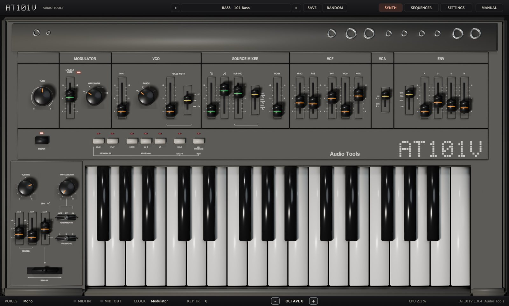

## Instalación

Bajá el zip para tu sistema desde el sitio de Audio Tools. Los dos paquetes traen un archivo `INSTALL.txt` con los mismos pasos que acá.

### macOS

El AT101V necesita macOS 11 o posterior. Un solo binario universal funciona en Mac con Apple silicon e Intel.

1. Descomprimí el archivo.
2. Copiá `AT101V.vst3` a `~/Library/Audio/Plug-Ins/VST3/`.
3. Copiá `AT101V.component` a `~/Library/Audio/Plug-Ins/Components/`.
4. Reescaneá los plugins en tu DAW. En Ableton Live: Settings, Plug-Ins, Rescan.
5. `AT101V.app` es la versión independiente. Copiala a Aplicaciones si la querés usar sin DAW.

Los binarios tienen firma ad hoc y no están notarizados, así que macOS puede negarse a abrirlos la primera vez. Si pasa, abrí la Terminal, corré este comando y volvé a reescanear:

`xattr -dr com.apple.quarantine ~/Library/Audio/Plug-Ins/VST3/AT101V*.vst3 ~/Library/Audio/Plug-Ins/Components/AT101V*.component`

### Windows

El AT101V necesita Windows 10 u 11 de 64 bits.

1. Descomprimí el archivo.
2. Copiá la carpeta `AT101V.vst3` a `C:\Program Files\Common Files\VST3\`. Windows pide permisos de administrador.
3. Reescaneá los plugins en tu DAW.
4. `AT101V.exe` es la versión independiente y funciona sin DAW.

Los binarios no están firmados, así que SmartScreen de Windows puede pedirte confirmación la primera vez que los abrís.

## Cargarlo en un DAW

El AT101V es un instrumento: ponelo en una pista MIDI o de instrumento, no en una de audio. Tiene salida estéreo (también funciona en un bus mono), recibe MIDI en cualquier canal y puede mandar MIDI.

### Ableton Live

1. Después de reescanear, abrí el navegador y elegí Plug-Ins.
2. Abrí Audio Units (macOS) o VST3, y después la carpeta Audio Tools.
3. Arrastrá el AT101V a una pista MIDI vacía, o al espacio libre de la sesión para crear una nueva.
4. Armá la pista y tocá tu teclado MIDI. Si la ventana del editor está cerrada, hacé clic en el ícono de la llave inglesa en la barra de título del dispositivo.

> En Windows, si el AT101V no aparece, abrí Settings, Plug-Ins, activá Use VST3 Plug-in System Folders y reescaneá.

Para grabar como clips MIDI las notas que tocan el arpegiador o el secuenciador, mirá Salida MIDI en la sección MIDI. Live toma la salida MIDI sólo del VST3, no del Audio Unit (REAPER tampoco).

Los presets de fábrica aparecen en el navegador de Live en Plug-Ins → Audio Tools AT101V (desplegá el plugin), instalados por el launcher o desde la carpeta Presets del zip. Live no muestra la lista de programas propia de un plugin; el menú de presets del editor los tiene todos.

Live llena solo el panel del dispositivo únicamente en plugins con hasta 64 parámetros automatizables, así que Oversampling y MIDI Out, dos ajustes de sesión, no se ofrecen para automatizar. Siguen en la página de ajustes, en los presets y en los proyectos. Con Configure se suma cualquier parámetro al panel del dispositivo.

### Otros DAW

En cualquier otro host, insertá el AT101V como instrumento y mandale MIDI. Cada control del panel y de la página de ajustes es un parámetro del host, así que lo podés automatizar (salvo Oversampling y MIDI Out). Los presets de fábrica y los tuyos aparecen también en la lista de programas de los hosts que la muestran (REAPER, Logic, Bitwig; no Ableton Live, mirá arriba).

### Aplicación independiente

Abrí `AT101V.app` o `AT101V.exe`. Con el botón Options de arriba de la ventana elegís la salida de audio y la entrada MIDI. Sin teclado MIDI podés tocar el teclado en pantalla con el mouse. En la aplicación independiente no hay tempo del host, así que todo lo que sigue al tempo va a 120 BPM.

## Primer sonido

1. Cargá el AT101V. Abre con el preset Init: una sierra por un filtro a medio abrir.
2. Tocá unas notas en tu teclado MIDI, o hacé clic en las teclas de la pantalla.
3. Bajá el fader **FREQ** del VCF y subí **RES**: el sonido se oscurece y empieza a silbar.
4. Hacé clic en el nombre del preset en la barra superior y elegí un sonido del menú Bass o Seq. Los presets Seq tocan una secuencia solos apenas se cargan.
5. Arrastrá la esquina inferior derecha del editor para agrandar o achicar la ventana. Mantiene las proporciones, de la mitad a una vez y media su tamaño completo.

## Recorrido por la interfaz

El editor tiene una barra superior, tres páginas y una barra inferior. **SYNTH** es el instrumento como era en 1982, **SEQUENCER** es el editor de pasos y **SETTINGS** junta todo lo que el original nunca tuvo.

### Barra superior

- **<** y **>** recorren los presets. La lista da la vuelta e incluye tus presets al final.
- El botón ancho del medio muestra la categoría y el nombre del preset actual. Hacé clic para abrir el menú de presets.
- **SAVE** guarda el sonido actual como preset de usuario.
- **RANDOM** tira un patch al azar dentro de rangos musicales. Respeta la secuencia, los ajustes, el arpegio y HOLD, y no toca TUNE, VOLUME, la palanca ni las llaves de transposición.
- Las tres pestañas de la derecha cambian de página.
- **MANUAL**, en el extremo derecho, abre este manual dentro del plugin, en inglés o en castellano. Esc o la cruz lo cierran.

### Barra inferior

De izquierda a derecha:

- **VOICES** muestra Mono, Poly 2, Poly 4, Poly 6 o Poly 8, y la cantidad de unísono cuando está activo.
- **MIDI IN** y **MIDI OUT** se encienden cuando entra o sale MIDI.
- **CLOCK** muestra la fuente de reloj: Modulator o Host tempo.
- **KEY TR** muestra la transposición en semitonos, o "press a key" mientras KEY TRANSPOSE espera una tecla.
- **OCTAVE**, con sus botones **-** y **+**, corre el teclado en pantalla hasta tres octavas para cada lado. Sólo afecta al teclado del mouse, no al MIDI.
- **STEP** muestra el paso actual mientras suena el secuenciador, y **LOADING** cuántos de los 100 pasos llevás cargados mientras grabás.
- **CPU** muestra la carga del procesador, seguida del número de versión.

### Cómo se usan los controles

- Arrastrá un fader o una perilla hacia arriba o hacia abajo. Con Shift apretado el ajuste es fino.
- Hacé clic en una posición de una llave, o arrastrá a lo largo de la llave.
- La rueda del mouse mueve cualquier fader, perilla o llave que esté bajo el puntero.
- Doble clic en un control lo devuelve a su valor por defecto.
- Mientras tocás un control, un globo muestra su nombre y su valor, en unidades reales cuando sirve (Hz, ms, s, semitonos, cents).
- Clic derecho en un control (o Ctrl-clic en macOS) para MIDI Learn, para borrar su CC o para volverlo al valor por defecto.
- En el teclado en pantalla, cuanto más adelante hacés clic en una tecla, más fuerte suena. Arrastrar sobre las teclas las toca una tras otra.

## Modulador y afinación

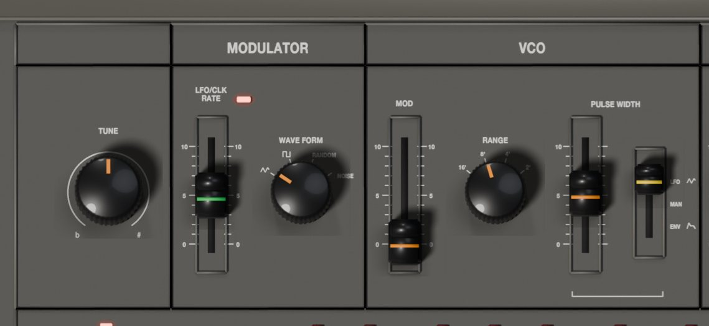

### TUNE

La perilla **TUNE** afina todo el instrumento hasta 50 cents para arriba o para abajo. En el centro está en el tono de concierto.

### MODULATOR

El modulador es el LFO del SH-101, y además es el reloj interno del arpegiador y del secuenciador. El LED rojo junto al fader de velocidad titila a su ritmo.

- **LFO/CLK RATE** fija la velocidad, de 0,1 Hz (0) a 30 Hz (10). Cuando el modulador es el reloj, es también el tempo: una nota de arpegio o un paso de secuencia por ciclo.
- **WAVE FORM** elige qué manda el modulador al VCO y al VCF: triángulo, cuadrada, RANDOM (un valor al azar nuevo en cada paso del reloj, el clásico sample and hold) o NOISE.

La modulación del ancho de pulso y el empuje de la palanca usan siempre el triángulo, diga lo que diga WAVE FORM.

## VCO

El único oscilador da una sierra ascendente y un pulso desde el mismo núcleo, más el sub-oscilador y el ruido que se mezclan en la sección siguiente.

- **MOD** fija cuánto mueve el modulador la afinación, hasta una octava para cada lado en 10. La curva es suave abajo: los valores chicos dan un vibrato sutil y la parte alta del fader da sirenas y trinos.
- **RANGE** elige la octava: 16', 8', 4' o 2'. 8' es la afinación normal.
- **PULSE WIDTH** fija la forma del pulso. Lo que hace depende de la llave que tiene al lado.
- La llave de fuente del ancho de pulso tiene tres posiciones. **LFO**: el triángulo del modulador barre el ancho y el fader fija la profundidad. **MAN**: el fader fija un ancho quieto, de onda cuadrada (50 %) en 0 a un pulso finito de 3 % en 10. **ENV**: la envolvente barre el ancho y el fader fija la profundidad.

> Con LFO o ENV como fuente y PULSE WIDTH cerca de 10, el pulso se afina tanto que desaparece por un momento. Así se comporta el original.

## Mezclador de fuentes

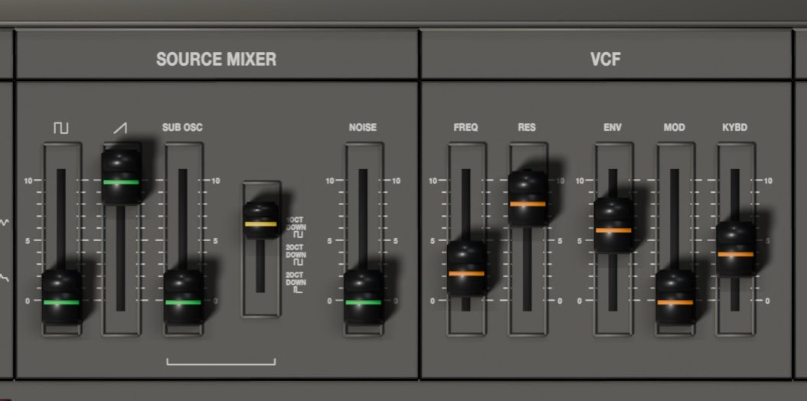

Cuatro faders fijan el nivel de cada fuente que entra al filtro. Se pueden mezclar libremente.

- **Pulso** (el símbolo cuadrado) es el pulso del VCO.
- **Sierra** (el símbolo de rampa) es la sierra.
- **SUB OSC** es el sub-oscilador, enganchado en fase con el VCO.
- La llave del sub-oscilador elige **1 OCT DOWN** (una cuadrada una octava abajo), **2 OCT DOWN** (una cuadrada dos octavas abajo) o la tercera posición, un pulso angosto de 25 % dos octavas abajo, de sonido hueco y nasal.
- **NOISE** es ruido blanco. Un poco agrega aire; solo, con el filtro, da viento, redoblantes y efectos.

Con los cuatro faders en 0 el filtro igual tiene un piso de ruido mínimo, como el original, así que puede autooscilar sin nada en la mezcla.

## VCF

El filtro es un pasa bajos de cuatro polos, 24 dB por octava, modelado sobre el chip IR3109 del original. Al subir la resonancia adelgaza los graves y cerca del tope se vuelve un seno puro.

- **FREQ** fija la frecuencia de corte, de 10 Hz (0) a 20 kHz (10).
- **RES** fija la resonancia. Alrededor de 9 el filtro empieza a autooscilar.
- **ENV** fija cuánto abre la envolvente el filtro, hasta 10 octavas por encima de FREQ.
- **MOD** fija cuánto mueve el modulador el corte, hasta 3 octavas para cada lado.
- **KYBD** fija cuánto sigue el corte al teclado. En 10 lo sigue nota a nota (una octava por octava, alrededor del do central), así un filtro que autooscila toca afinado. En 0 todas las notas tienen el mismo corte.

La llave TRANSPOSE también mueve el seguimiento de teclado; RANGE y KEY TRANSPOSE no.

## VCA y envolvente

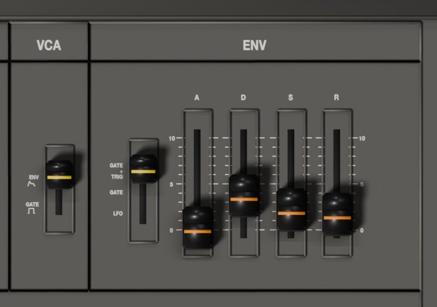

### VCA

La llave **VCA** elige qué le da forma al volumen. **ENV**: la envolvente. **GATE**: el sonido está entero mientras la tecla está apretada y se corta al soltarla, como un órgano. En GATE la envolvente sigue moviendo el filtro y el ancho de pulso.

### ENV

Hay una sola envolvente, compartida por el filtro, el amplificador y el ancho de pulso.

- La llave de disparo fija cuándo arranca la envolvente y, en mono, también la prioridad de nota. **GATE+TRIG**: cada tecla nueva reinicia la envolvente, aunque toques ligado; gana la última tecla apretada. **GATE**: las notas ligadas no reinician la envolvente; gana la tecla más grave. **LFO**: mientras haya una tecla apretada, la envolvente se reinicia en cada paso del reloj (cada ciclo del modulador, o cada paso del tempo del host cuando el reloj sigue al host); gana la tecla más grave.
- **A** (ataque) de 1 ms a 4 s, aproximadamente.
- **D** (decaimiento) de 2 ms a 10 s, aproximadamente.
- **S** (sostenido) fija el nivel que se mantiene con la tecla apretada, de 0 a 10.
- **R** (relajación) de 2 ms a 10 s aproximadamente, después de soltar la tecla.

## Controles de ejecución

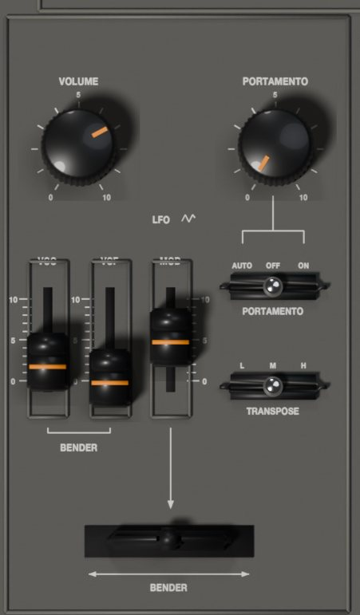

El bloque a la izquierda del teclado tiene los controles para tocar.

- **VOLUME** fija el nivel de salida del sinte.
- **PORTAMENTO** fija el tiempo de deslizamiento entre notas, de 0 a unos 5 s.
- La llave **PORTAMENTO** fija cuándo se desliza. **AUTO**: sólo cuando tocás ligado, es decir, cuando apretás una tecla nueva sin haber soltado la anterior. **OFF**: nunca. **ON**: siempre.
- La llave **TRANSPOSE** corre todo el instrumento una octava: **L** abajo, **M** normal, **H** arriba. También mueve el seguimiento de teclado del filtro.
- Los faders **BENDER** fijan cuánto dobla la palanca. **VCO** dobla la afinación hasta una octava para cada lado en 10 (en el valor por defecto, 2, unos 2,4 semitonos). **VCF** dobla el corte hasta dos octavas para cada lado.
- El fader **LFO** (con el símbolo de triángulo) fija la profundidad del vibrato y del growl al empujar la palanca hacia adelante: hasta unos tres cuartos de semitono en la afinación y una octava en el corte.
- La palanca **BENDER**: arrastrala a izquierda o derecha para doblar, y hacia arriba para empujarla. Al soltarla vuelve sola al centro. El pitch bend de tu controlador MIDI la mueve a los costados y la rueda de modulación la empuja.

> Con el arpegiador y el secuenciador el portamento sólo se desliza en ON; AUTO actúa como OFF. Los pasos con SLIDE se deslizan siempre.

### POWER y los botones de función

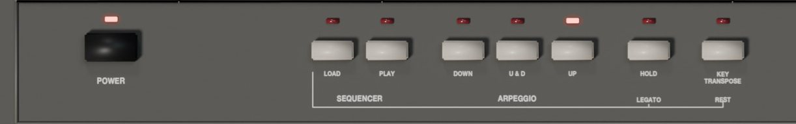

- **POWER** apaga y prende el sonido. Con su LED apagado el AT101V queda en silencio y se sueltan todas las notas. Siempre está prendido al abrir el plugin.
- **LOAD** y **PLAY** (SEQUENCER) graban y tocan la secuencia; **DOWN**, **U & D** y **UP** (ARPEGGIO) arrancan el arpegiador. Los dos tienen su sección más abajo.
- **HOLD** mantiene las notas sonando después de soltar las teclas. Mientras cargás una secuencia funciona como **LEGATO**.
- **KEY TRANSPOSE** corre todo lo que tocás el intervalo de la próxima tecla que apretes. Mientras cargás una secuencia funciona como **REST**.

Cada botón tiene un LED rojo arriba. Los jacks del borde superior del panel son parte del dibujo y no hacen nada.

### HOLD

En mono, HOLD mantiene la última nota después de soltar la tecla; una tecla nueva la reemplaza. Con varias voces funciona como un pedal de sustain para todas las notas. Con el arpegiador engancha el acorde, así el arpegio sigue andando sin las manos en el teclado. El pedal de sustain de tu teclado MIDI hace lo mismo que HOLD mientras está apretado.

> HOLD mantiene el nivel de sostenido. Si S está en 0 y el VCA en ENV, una nota sostenida queda muda después del decaimiento.

### KEY TRANSPOSE

KEY TRANSPOSE corre todo lo que toca el AT101V: las teclas, las notas sostenidas, el arpegio y la secuencia en marcha, como en el original.

1. Hacé clic en **KEY TRANSPOSE**. Su LED titila y la barra inferior dice "press a key".
2. Apretá una tecla. El intervalo entre el do central (C4) y esa tecla pasa a ser la transposición, desde una octava abajo hasta dos octavas arriba. Con OCTAVE en 0, el do central es el do más grave del teclado en pantalla, la octava tecla desde la izquierda.
3. El LED queda encendido mientras haya una transposición, y KEY TR en la barra inferior la muestra en semitonos.

Para volver a la afinación normal, transponé otra vez con el do central, o hacé clic derecho (o Alt-clic) en el botón. La transposición no mueve el seguimiento de teclado del filtro. Se guarda con el proyecto del DAW, no con los presets.

## Voces, unísono y prioridad de nota

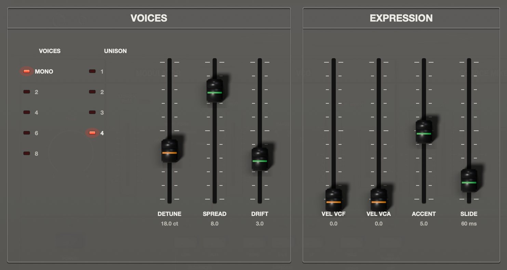

El AT101V es monofónico de fábrica, como el original. La sección VOICES de la página de ajustes lo vuelve polifónico o más gordo.

- **VOICES** elige Mono, 2, 4, 6 u 8 voces.
- **UNISON** apila 1, 2, 3 o 4 voces en cada nota.
- **DETUNE** separa en afinación las voces apiladas, de 0 a 50 cents entre las dos de los extremos.
- **SPREAD** abre las voces apiladas en el estéreo, de 0 a 10.
- **DRIFT** agrega una deriva lenta y al azar de afinación y corte, como un circuito analógico, de 0 a 10.

El unísono también funciona en mono: una nota, hasta cuatro voces desafinadas. El motor tiene 16 voces en total, así que con mucho unísono baja la cantidad de notas (por ejemplo, 8 voces con unísono 4 tocan 4 notas a la vez).

### Prioridad de nota

En mono, la llave de disparo del ENV decide qué tecla suena cuando apretás varias: la última en GATE+TRIG, la más grave en GATE y LFO. Al soltar la que suena, la nota vuelve a la que sigue apretada. El portamento en AUTO se desliza entre esas notas ligadas.

Con varias voces, cada nota nueva toma una voz libre; si están todas ocupadas, se roba la nota más vieja. El portamento en AUTO se desliza cuando hay otra tecla apretada, desde la última altura de esa voz.

### Expresión

- **VEL VCF** fija cuánto escala la velocidad el efecto de la envolvente sobre el filtro. En 0 la velocidad se ignora.
- **VEL VCA** fija cuánto escala la velocidad el volumen.
- **ACCENT** fija cuánto abren el filtro y empujan el volumen los pasos acentuados de la secuencia.
- **SLIDE** fija el tiempo de deslizamiento de los pasos con SLIDE, de 20 a 300 ms. Si PORTAMENTO está más largo, gana el tiempo más largo.

## Arpegiador

El arpegiador toca una tras otra las teclas que mantenés apretadas, ordenadas por altura, a la velocidad del reloj.

1. Apretá **UP**, **U & D** o **DOWN**. Se enciende su LED. Apretá de nuevo el botón encendido para apagar el arpegiador.
2. Mantené un acorde. El arpegio arranca con la primera tecla, en el acto.
3. Apretá **HOLD** si querés que siga andando cuando soltás las teclas. Un acorde nuevo, tocado después de soltar el anterior, lo reemplaza.

- **UP** va de la nota más grave a la más aguda y vuelve a empezar.
- **DOWN** va de la más aguda a la más grave.
- **U & D** sube y baja sin repetir las notas de los extremos: C E G E C E G.

Una sola tecla sin HOLD (y con ARP OCT en 1) suena normal, como en el original, así podés pasar de arpegio a toque normal según cómo tocás. Arrancar el arpegiador para el secuenciador, y apretar PLAY apaga el arpegiador.

### Velocidad, octavas y articulación

La velocidad la da el reloj: el RATE del modulador, o el tempo del host y DIVISION (mirá Sincronía). En la página de ajustes, **ARP OCT** repite el arpegio en 1, 2, 3 o 4 octavas hacia arriba.

En mono el gate queda abierto durante todo el arpegio, así que la llave de disparo del ENV le da forma: GATE+TRIG reinicia la envolvente en cada nota, GATE da una sola envolvente para todo el acorde (con S en 0 se apaga después del primer decaimiento) y LFO la reinicia en cada paso del reloj. Con varias voces cada nota del arpegio suena en su propia voz, así que las colas de relajación se superponen.

La velocidad del arpegio es la de la última tecla que apretaste. La transposición corre un arpegio sostenido, que es la forma clásica de tocarlo desde las teclas.

## Secuenciador: grabar desde el teclado

El secuenciador guarda hasta 100 pasos: notas, silencios y ligaduras. Como en el original, podés grabar la secuencia desde el teclado sin verla, o dibujarla en la página SEQUENCER.

1. Apretá **LOAD**. Se enciende su LED, se borra la secuencia anterior y la barra inferior muestra LOADING 0 / 100.
2. Tocá las notas en orden, una tecla por paso, en el teclado en pantalla o en tu teclado MIDI. El ritmo no importa.
3. Apretá **KEY TRANSPOSE** (REST) para cargar un paso de silencio.
4. Apretá **HOLD** (LEGATO) antes de una tecla para ligarle la nota anterior. Una ligadura a la misma altura da una nota más larga; a otra altura suena ligado.
5. Apretá **LOAD** otra vez para terminar. La grabación también se corta sola a los 100 pasos.

Cada nota se escucha mientras la cargás. LOAD siempre empieza una secuencia nueva desde el paso 1; para cambiar algunos pasos de una que ya existe, usá la página SEQUENCER.

## Secuenciador: reproducción y transposición

Apretá **PLAY**. Se enciende el LED y la secuencia da vueltas hasta que apretás PLAY de nuevo. No hace falta mantener ninguna tecla. Con el modulador como reloj arranca en el acto desde el paso 1; con el tempo del host sigue al DAW (mirá Sincronía). Arrancar el secuenciador apaga el arpegiador. Si la secuencia está vacía, PLAY no hace nada.

- Cada paso suena durante el largo de GATE de la página de ajustes (50 % del paso de fábrica) y después la nota se corta, salvo que el paso esté ligado o que el siguiente tenga SLIDE.
- Los silencios no tocan nada.
- Los pasos ligados mantienen el gate abierto. En GATE+TRIG la envolvente igual se reinicia en la nota ligada; poné la llave de disparo en GATE para ligaduras suaves. Con varias voces una ligadura siempre reinicia la nota.
- Los pasos con SLIDE llegan a su nota deslizándose desde la anterior, sin reiniciar la envolvente.
- Los pasos acentuados abren más el filtro y suenan más fuerte, según ACCENT.
- Los pasos con probabilidad menor a 100 % suenan sólo algunas veces.

### Transponer con las teclas

Mientras la secuencia suena, las teclas la transponen en lugar de tocar notas. El do central (C4, el do más grave de la pantalla con OCTAVE en 0) la toca como se grabó; cualquier otra tecla la corre el intervalo desde C4. La transposición vuelve a cero cada vez que apretás PLAY. Apagá **KEY TRANSP** en la página de ajustes si preferís tocar notas encima de la secuencia.

KEY TRANSPOSE del panel funciona encima de esto y queda puesto hasta que lo volvés a cero. La palanca, el portamento y todos los faders funcionan mientras suena la secuencia.

## La página del secuenciador

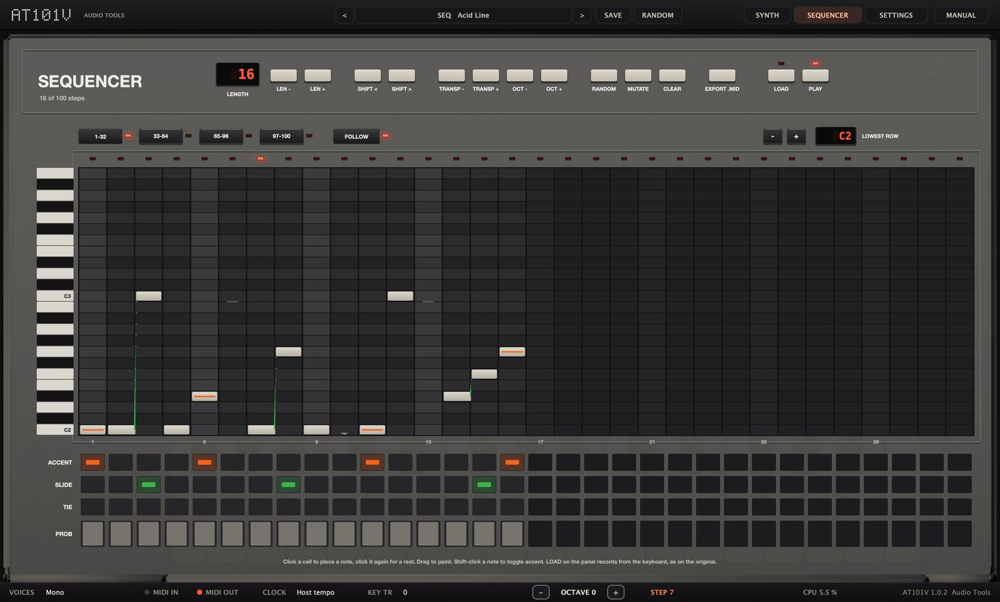

La página SEQUENCER muestra la secuencia como una grilla de notas, con carriles de acento, slide, ligadura y probabilidad abajo. Los cambios se escuchan en el acto, aunque esté sonando.

### Barra de herramientas

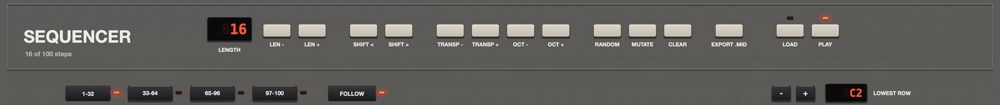

- **LENGTH** muestra la cantidad de pasos. Arrastrá el display hacia arriba o hacia abajo para cambiarla, de 1 a 100.
- **LEN -** y **LEN +** sacan o agregan un paso al final. Los pasos nuevos son silencios.
- **SHIFT <** y **SHIFT >** rotan toda la secuencia un paso a la izquierda o a la derecha.
- **TRANSP -** y **TRANSP +** mueven todas las notas un semitono; **OCT -** y **OCT +**, una octava.
- **RANDOM** escribe una línea de bajo nueva en escala menor pentatónica o dórica, con acentos, slides, silencios y alguna ligadura (16 pasos, o el largo actual si es de 8 o más).
- **MUTATE** cambia algunos pasos al azar: un salto de octava, o un acento, un slide o un silencio que se prende o se apaga.
- **CLEAR** deja 16 pasos vacíos (todos silencios).
- **EXPORT .MID** guarda la secuencia como archivo MIDI, de entrada `AT101V Sequence.mid` en tu carpeta Documentos. Los pasos son semicorcheas, las notas acentuadas tienen velocidad 127 y las demás 90, y las notas ligadas a la misma altura quedan como una sola nota larga.
- **LOAD** y **PLAY** funcionan como en el panel.

### Páginas y vista

- Los botones de página **1-32**, **33-64**, **65-96** y **97-100** muestran cada grupo de 32 pasos.
- **FOLLOW** hace que la vista salte a la página que está sonando. Elegir una página a mano apaga FOLLOW.
- La grilla muestra dos octavas. **-** y **+** junto a **LOWEST ROW** mueven la vista una octava, y la rueda del mouse sobre la grilla la mueve un semitono. El display muestra la nota más grave visible.
- Una nota fuera de la vista aparece como una flechita en el borde de arriba o de abajo de su columna.

### Dibujar notas

- Hacé clic en una celda para poner esa nota en ese paso. La escuchás, salvo que el secuenciador esté sonando.
- Hacé clic otra vez en la misma nota para volver el paso un silencio.
- Arrastrá sobre la grilla para pintar notas, o para borrarlas si empezaste sobre una nota.
- Hacé clic más allá del final de la secuencia para alargarla hasta ese paso; los pasos del medio quedan como silencios.
- Shift-clic en un paso prende o apaga su acento.

### Carriles

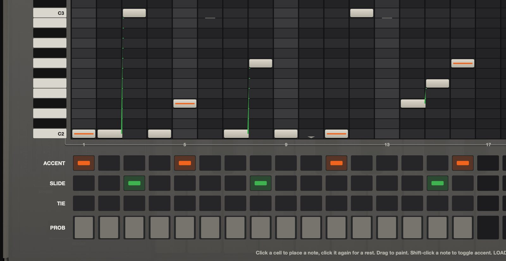

- **ACCENT** (naranja): el paso suena más fuerte y más brillante. Una nota acentuada muestra también una línea naranja en la grilla.
- **SLIDE** (verde): el paso llega a su nota deslizándose desde el anterior, sin reiniciar la envolvente. Una línea verde une las dos notas en la grilla.
- **TIE** (amarillo): el gate queda abierto hasta el paso siguiente.
- **PROB**: hacé clic a la altura que quieras para fijar la probabilidad de que el paso suene: 0, 25, 50, 75 o 100 %. Las notas por debajo de 100 % se dibujan más pálidas, con su porcentaje.

Hacé clic en una celda de un carril para cambiarla, o arrastrá a lo largo del carril para ajustar varios pasos de una vez.

La secuencia se guarda con los presets y con el proyecto del DAW.

## Sincronía: reloj del modulador o tempo del host

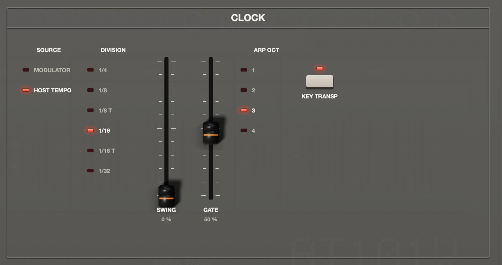

El arpegiador y el secuenciador avanzan con un reloj. La sección CLOCK de la página de ajustes elige cuál.

- **SOURCE Modulator**: el reloj es el modulador, como en el original. Un paso por ciclo, a la velocidad de LFO/CLK RATE (de 0,1 a 30 pasos por segundo). La primera tecla de un arpegio y el botón PLAY reinician el reloj, así la primera nota suena en el acto. Este reloj es libre: no sigue al DAW.
- **SOURCE Host Tempo**: el reloj sigue el tempo del DAW. **DIVISION** fija el largo de un paso: 1/4, 1/8, 1/8 T, 1/16 (de fábrica), 1/16 T o 1/32. Mientras el DAW toca, la secuencia queda enganchada a la posición de la canción (el mismo paso cae siempre en el mismo tiempo) y la primera nota de un arpegio espera el próximo paso de la grilla. Con el DAW parado, el arpegiador y el secuenciador siguen andando al tempo del host.
- **SWING** (sólo con Host Tempo) atrasa uno de cada dos pasos, de 0 a 75 %. En 75 % el paso a contratiempo llega un 37,5 % de paso tarde.
- **GATE** fija cuánto suena cada paso de la secuencia, de 5 a 100 % del paso, con cualquiera de los dos relojes. El arpegio no cambia: su gate queda abierto.
- **ARP OCT** y **KEY TRANSP** se explican con el arpegiador y el secuenciador.

> Con Host Tempo, los pasos del reloj también mueven el RANDOM del modulador y la posición LFO de la llave de disparo. El delay sincronizado sigue siempre el tempo del host, elijas el reloj que elijas. En la aplicación independiente, el tempo del host es 120 BPM.

## Página de ajustes: carácter, efectos y sistema

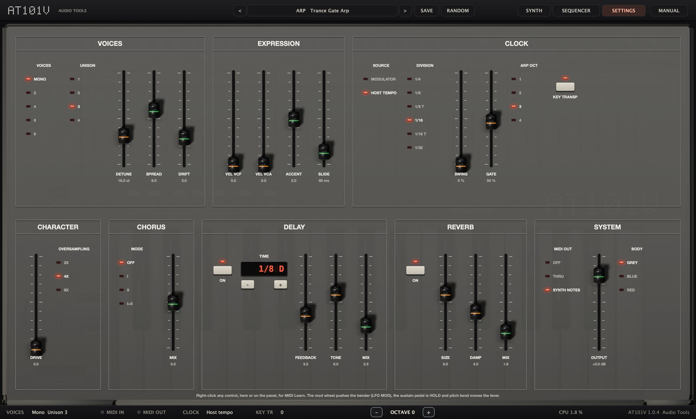

La fila de arriba de la página de ajustes tiene VOICES, EXPRESSION y CLOCK, que ya se explicaron. La fila de abajo tiene CHARACTER, CHORUS, DELAY, REVERB y SYSTEM.

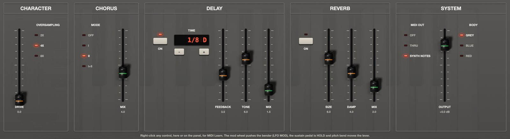

En esta página los faders se arrastran como en el panel (Shift para ajuste fino, doble clic para el valor por defecto), un clic en una línea de una lista la elige, un clic en un botón lo prende o lo apaga, y **-** y **+** debajo de un display recorren sus valores.

### CHARACTER

- **DRIVE** empuja más fuerte la mezcla dentro del filtro, de limpio (0) a gordo y saturado (10).
- **OVERSAMPLING** hace andar toda la voz a 2x, 4x (de fábrica) u 8x la frecuencia de muestreo. Los valores altos dejan más limpios los sonidos brillantes y resonantes, y gastan más CPU. Es un ajuste global: los presets no lo cambian.

### CHORUS

- **MODE** elige Off, I, II o I+II, al estilo del chorus BBD de los sintes clásicos. I es lento y suave, II más rápido y profundo, I+II tiene un movimiento más complejo.
- **MIX** fija la cantidad de chorus.

### DELAY

- **ON** prende o apaga el delay. Es un delay ping-pong: la primera repetición sale por la izquierda y cada repetición cruza al otro lado.
- **TIME** fija el tiempo en figuras, sincronizado con el tempo del host: 1/32, 1/16 T, 1/16, 1/16 D, 1/8 T, 1/8, 1/8 D (de fábrica), 1/4 T, 1/4, 1/4 D, 1/2 o 1 bar (un compás).
- **FEEDBACK** fija cuántas repeticiones se escuchan, de 0 a 9,5.
- **TONE** oscurece las repeticiones en valores bajos y las deja brillantes en valores altos.
- **MIX** fija el nivel de las repeticiones.

### REVERB

- **ON** prende o apaga la reverb de placa.
- **SIZE** fija el tamaño del espacio y el largo de la cola.
- **DAMP** suaviza los agudos de la cola.
- **MIX** fija el nivel de la reverb.

El orden de la cadena es chorus, delay, reverb. Después, un limitador suave ataja los picos.

### SYSTEM

- **MIDI OUT** elige qué manda el AT101V por su salida MIDI: Off, Thru o Synth Notes (de fábrica). Mirá la sección MIDI.
- **OUTPUT** fija el nivel final, de -24 a +6 dB.
- **BODY** elige el color del gabinete: Grey (gris), Blue (azul) o Red (rojo).

MIDI OUT, OUTPUT, BODY y OVERSAMPLING son preferencias tuyas: cargar un preset nunca los cambia.

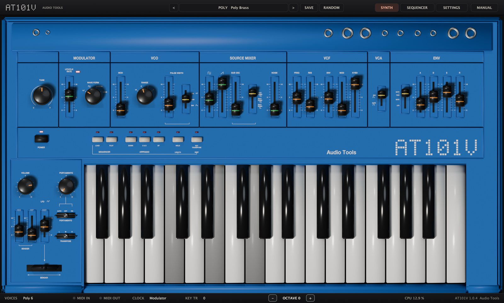

## Presets

El AT101V trae 44 presets de fábrica: Init y 43 sonidos en siete categorías. Un preset guarda todo el panel, la secuencia y los ajustes, salvo las cuatro preferencias de sistema.

### Elegir un preset

- Hacé clic en **<** o **>** en la barra superior para recorrer todos los presets.
- Hacé clic en el nombre del preset para abrir el menú. Cada categoría es un submenú; tus presets están en User.
- **Init**, en el menú, carga el patch básico, con la secuencia vacía y los ajustes de fábrica.
- **Show user presets folder** abre la carpeta donde se guardan tus presets.

### Guardar los tuyos

1. Hacé clic en **SAVE**.
2. Escribí un nombre y hacé clic en Save (o apretá Return).

El preset se guarda como archivo `.json` en la carpeta de usuario y aparece en User, en el menú. Si guardás con el nombre de un preset de usuario que ya existe, lo reemplaza sin preguntar.

- macOS: `~/Library/Application Support/Audio Tools/AT101V/Presets`
- Windows: `%APPDATA%\Audio Tools\AT101V\Presets`

Para borrar o renombrar un preset de usuario, hacelo en esa carpeta. Los archivos de preset que copies ahí desde otro lado aparecen la próxima vez que abras el AT101V.

El proyecto del DAW guarda el estado completo del AT101V, con la secuencia, la transposición y las asignaciones de MIDI learn, hayas guardado un preset o no.

### Presets de fábrica

| Categoría | Presets |
|---|---|
| Init | Init |
| Bass | 101 Bass, Pulse Bass, Sub Rumble, Rubber Bass, Square Sub, Gate Bass, Funk Pluck, Drive Bass |
| Lead | Classic Lead, Whistle, Bright Saw, PWM Solo, Singing Res, Unison Lead, Envelope PWM |
| Seq | Acid Line, Acid Drive, Berlin Night, Electro Funk, Minimal Pulse, Italo Octaves, Motorik, Techno Stab, Probability Bass, Hold Me |
| Arp | Arp Up, Arp U&D Host, Arp Down Bells, Trance Gate Arp |
| Ambient | Drift Sequence, Glass Bells, Dark Drone, Ocean Wind, Soft Pad, Self-Playing Bleeps |
| Poly | Poly Brass, Poly Keys, Poly Pluck |
| FX | Sample & Hold, Zap Tom, Noise Snare, Laser, Siren |

Los presets Seq y algunos Ambient arrancan su secuencia apenas se cargan; la mayoría sigue el tempo del host. Con los presets Arp, mantené un acorde y apretá HOLD para dejarlo andando.

### En REAPER

REAPER muestra cada preset de fábrica dos veces en el menú de presets: una de la lista propia del plugin y otra como archivo (los .vstpreset que instalan el launcher o la carpeta Presets del zip para Ableton Live, en ~/Library/Audio/Presets/Audio Tools/ en macOS, Documentos\VST3 Presets\Audio Tools\ en Windows y ~/.vst3/presets/Audio Tools/ en Linux). Los dos cargan lo mismo. Si no usás Live, podés borrar ahí la carpeta "Audio Tools AT101V" y cada preset aparece una sola vez.

## MIDI

### A qué responde el AT101V

| Mensaje | Efecto |
|---|---|
| Notas | Tocan, en cualquier canal, con velocidad |
| Pitch bend | Mueve la palanca a izquierda y derecha |
| CC 1, rueda de modulación | Empuja la palanca (LFO MOD) |
| CC 64, pedal de sustain | HOLD mientras el pedal está apretado |
| CC 120, CC 123 | Sueltan todas las notas |

La velocidad pesa sólo lo que permiten VEL VCF y VEL VCA; en su valor de fábrica, 0, todas las notas suenan igual. Mientras suena el secuenciador con KEY TRANSP prendido, las notas que entran lo transponen, y mientras LOAD está encendido graban pasos.

### MIDI learn

Podés manejar cualquier fader, perilla o llave del panel, y cualquier control de la página de ajustes, desde una perilla o un fader de tu controlador MIDI.

1. Hacé clic derecho en el control (o Ctrl-clic en macOS) y elegí **MIDI Learn**.
2. Mové la perilla o el fader de tu controlador. El control queda asignado a ese CC.

En la página de ajustes el CC asignado aparece en naranja debajo del control. Para sacarlo, hacé clic derecho en el control y elegí **Clear MIDI CC**. Cada control toma un CC, y cada CC maneja un control: si aprendés un CC que ya estaba en uso, pasa al control nuevo. Un CC aprendido reemplaza la función propia de CC 1 y CC 64. Las asignaciones se guardan con el proyecto del DAW, no con los presets. Los botones del panel (POWER, LOAD, PLAY, los del arpegio, HOLD y KEY TRANSPOSE) y la palanca no se pueden aprender.

### Salida MIDI

El AT101V tiene salida MIDI. La lista **MIDI OUT** de la página de ajustes elige qué manda.

- **Off**: nada.
- **Thru**: el MIDI que entra, sin cambios.
- **Synth Notes** (de fábrica): las notas que toca de verdad el AT101V, en el canal 1, con velocidad: tus teclas, el arpegio y la secuencia, con la transposición aplicada.

Synth Notes te deja grabar un arpegio o una secuencia como MIDI, o manejar otro instrumento con ellos. En Ableton Live: creá una segunda pista MIDI, poné su MIDI From en la pista que tiene el AT101V y, en el selector de abajo, en AT101V; después armá la segunda pista y grabá. Si escuchás notas dobles o se quedan colgadas, fijate que la salida del AT101V no vuelva a su propia entrada. Usá el VST3: Live y REAPER ignoran la salida MIDI de un Audio Unit.

La salida MIDI sale tan tarde como la latencia del plugin (27 muestras, los filtros del sobremuestreo), el mismo atraso que su audio: el host compensa el audio, así que otro instrumento tocado por MIDI From cae junto con el AT101V y no 0,6 ms antes.

## Recetas

### Bajo clásico del 101

1. Elegí Init en el menú de presets.
2. Poné **RANGE** en 16'.
3. En el mezclador, poné la sierra en 8 y **SUB OSC** en 7, con la llave del sub en 1 OCT DOWN.
4. En el VCF, poné **FREQ** en 3,4, **RES** en 3, **ENV** en 5 y **KYBD** en 6.
5. En el ENV, poné **A** en 0, **D** en 3,5, **S** en 2 y **R** en 1,5.
6. Tocá notas graves, cortas y separadas. Subí ENV para más golpe, o bajá FREQ para un sonido más redondo.

Es el preset 101 Bass. Para una variante elástica, poné la llave de disparo en GATE y PORTAMENTO en 2 con AUTO, y tocá ligado.

### Línea acid

1. Elegí Init y poné la sierra en 10, **FREQ** en 2,4, **RES** en 8,2, **ENV** en 6 y **KYBD** en 4.
2. Poné **D** en 3,4, **S** en 0 y **R** en 1,5, con la llave de disparo en GATE+TRIG.
3. En la página de ajustes, poné **SOURCE** en Host Tempo, **DIVISION** en 1/16 y **ACCENT** en 7.
4. Abrí la página SEQUENCER y hacé clic en **CLEAR**. Quedan 16 pasos vacíos.
5. Dibujá una línea alrededor de C2: casi todo C2, algunos C3 y D#2, G2 y A#1, y dejá dos o tres silencios.
6. En el carril ACCENT marcá unos cuatro pasos. En el carril SLIDE marcá los pasos que tienen que llegar deslizándose, como los saltos a C3.
7. Apretá **PLAY** y arrancá el DAW. Mientras suena, mové FREQ, ENV y RES en la página SYNTH.

Comparala con el preset Acid Line. Para más mordida, poné **DRIVE** en 6 y sumá el delay en 1/8 D.

### Arpegio sincronizado con el DAW

1. Elegí Init. Poné la sierra en 10, **FREQ** en 4,6, **RES** en 5, **ENV** en 4, **D** en 2,4, **S** en 0 y **R** en 2.
2. Apretá **U & D**.
3. En la página de ajustes, poné **SOURCE** en Host Tempo, **DIVISION** en 1/16 y **ARP OCT** en 2.
4. Prendé el delay con **ON**, con **TIME** en 1/8 D y **MIX** cerca de 2.
5. Arrancá el DAW, mantené un acorde y apretá **HOLD**. Soltá: el arpegio sigue andando.
6. Hacé clic en **KEY TRANSPOSE** y apretá otra tecla para correr el arpegio sostenido. Tocá un acorde nuevo para reemplazarlo.

Para la sensación del original, dejá SOURCE en Modulator y fijá la velocidad con **LFO/CLK RATE**.

### Secuencia grabada desde el teclado y transpuesta en vivo

1. Elegí el preset 101 Bass.
2. Apretá **LOAD**.
3. Tocá C4, C4, después apretá **KEY TRANSPOSE** para un silencio, y tocá D#4.
4. Apretá **HOLD** y tocá D#4 de nuevo: queda ligado al primer D#4 y forma una sola nota más larga.
5. Tocá G4, A#3, C4 y F4, y apretá **LOAD** para terminar.
6. Apretá **PLAY**. La secuencia da vueltas a la velocidad del modulador; fijá el tempo con **LFO/CLK RATE**.
7. Apretá C4 (el do más grave de la pantalla) y la secuencia suena como la grabaste. Apretá F4 y sube una cuarta; apretá G3 y baja una cuarta.
8. Poné la llave de disparo en GATE para escuchar la ligadura como una sola nota pareja.

Abrí la página SEQUENCER para ver lo que grabaste, y sumá acentos o slides con los carriles.

### Pad polifónico

1. Elegí Init. En la página de ajustes poné **VOICES** en 6 y **UNISON** en 1.
2. En el mezclador poné el pulso en 8 y la sierra en 6. Poné la llave de ancho de pulso en **LFO**, **PULSE WIDTH** en 6 y **LFO/CLK RATE** cerca de 2.
3. Poné **FREQ** en 4,8, **RES** en 1,5 y **ENV** en 2.
4. Poné **A** en 6,5, **D** en 7, **S** en 8 y **R** en 7,5.
5. En la página de ajustes poné el **MODE** del chorus en II con **MIX** en 6, y prendé la reverb con **ON**, **SIZE** en 8,5 y **MIX** en 3,5.
6. Tocá acordes lentos.

Es el preset Soft Pad. Para un sonido más ancho, subí **UNISON** a 2 y **DETUNE** a unos 15 cents; con 6 voces y unísono 2 seguís tocando 6 notas.

### Bleeps de sample and hold

1. Elegí Init. Poné la perilla **WAVE FORM** en RANDOM y **LFO/CLK RATE** cerca de 7,5.
2. Poné la llave de disparo en **LFO**.
3. Poné la sierra en 10, **FREQ** en 3,8, **RES** en 7,5, **ENV** en 2 y el **MOD** del VCF en 5.
4. Poné **D** en 2,5, **S** en 0 y **R** en 2.
5. Mantené una tecla. En cada ciclo del modulador el filtro salta a un valor al azar nuevo y la envolvente se reinicia.
6. Subí el **MOD** del VCO para que también salte la afinación, y sumá el delay en 1/16 T.

## Problemas y soluciones

### No suena

- Mirá el LED de **POWER**. Si está apagado, hacé clic en POWER.
- Revisá **VOLUME** en el panel y **OUTPUT** en la página de ajustes.
- Fijate que haya al menos un fader del mezclador arriba, o RES lo bastante alto para autooscilar.
- Con **FREQ** cerca de 0 y ENV en 0 el filtro está cerrado. Subí FREQ.
- Con **S** en 0 y el VCA en ENV, las notas sostenidas se apagan después del decaimiento. Es normal.
- En el DAW, fijate que la pista reciba MIDI y esté armada o en monitoreo.

### Las teclas transponen en lugar de tocar

El secuenciador está sonando y **KEY TRANSP** está prendido. Apretá PLAY para parar la secuencia, o apagá KEY TRANSP en la página de ajustes para tocar encima.

### Todo suena en otro tono u otra octava

- Si el LED de **KEY TRANSPOSE** está encendido, hacé clic derecho en el botón (o Alt-clic) para volverlo a cero. KEY TR en la barra inferior muestra el valor actual.
- Revisá la llave **TRANSPOSE** (M es normal) y **RANGE** (8' es normal).
- Revisá TUNE.

### PLAY no hace nada

La secuencia está vacía. Grabá una con LOAD, dibujala en la página SEQUENCER o cargá un preset Seq.

### El arpegio toca una sola nota sin moverse

Una sola tecla sin HOLD suena normal, a propósito. Mantené dos teclas o más, apretá HOLD o subí **ARP OCT**.

### El arpegio o la secuencia no van a tiempo con el DAW

Poné **SOURCE** en Host Tempo en la página de ajustes. Con el modulador como reloj, el tempo sale de LFO/CLK RATE y no sigue al DAW.

### Las ligaduras reinician la envolvente, o el portamento no se desliza

Poné la llave de disparo en GATE para ligaduras suaves. Con el arpegio y la secuencia, el portamento sólo se desliza en ON.

### Notas colgadas

Hacé clic dos veces en POWER, o mandá CC 123 (All Notes Off) desde tu controlador. Revisá también el ruteo MIDI (mirá Salida MIDI).

### El AT101V no aparece en el DAW

Fijate que los archivos estén en las carpetas de Instalación y reescaneá. En macOS corré el comando `xattr` de Instalación. En Windows, copiar a la carpeta VST3 pide permisos de administrador.

### Mucho consumo de CPU

Poné **OVERSAMPLING** en 2x, usá menos voces o menos unísono, y apagá los efectos que no uses.

## Especificaciones

| Ítem | Valor |
|---|---|
| Inspirado en | Roland SH-101 (1982) |
| Formatos | VST3, Audio Unit (macOS), aplicación independiente |
| Sistemas | macOS 11 o posterior (universal), Windows 10 u 11 de 64 bits |
| Tipo | Instrumento con entrada y salida MIDI |
| Salida | Estéreo (admite bus mono) |
| Voces | Mono, o 2, 4, 6 u 8; unísono de 1 a 4; 16 en total |
| Oscilador | Sierra y pulso, sub una o dos octavas abajo o pulso de 25 %, ruido |
| Filtro | Pasa bajos de cuatro polos, 24 dB por octava, de 10 Hz a 20 kHz |
| Respuesta del filtro | -12 dB en el corte, -28 dB al doble, -49 dB al cuádruple del corte |
| Autooscilación | Desde RES 9 aproximadamente; con RES 10 y KYBD 10: 218, 436 y 874 Hz para C3, C4 y C5 |
| Envolvente | Ataque de 1 ms a 4 s, decaimiento y relajación de 2 ms a 10 s, aproximadamente |
| Modulador | De 0,1 a 30 Hz; triángulo, cuadrada, random, ruido |
| Portamento | De 0 a unos 5 s; Auto, Off, On |
| Arpegiador | Up, Up and Down, Down; de 1 a 4 octavas |
| Secuenciador | 100 pasos: nota, silencio, ligadura, acento, slide, probabilidad |
| Reloj | Modulador, o tempo del host de 1/4 a 1/32 con tresillos; swing de 0 a 75 % |
| Efectos | Drive, chorus (I, II, I+II), delay sincronizado, reverb de placa |
| Sobremuestreo | 2x, 4x u 8x |
| Presets | 44 de fábrica, nivelados a unos -17 dBFS RMS |
| CPU | Cerca de 1 % de un núcleo en mono, 3 % con unísono de 4, 6 % para un pad de 6 voces (Apple serie M, 4x) |
| Validación | pluginval con exigencia 8, auval en macOS |
| Licencia | GNU AGPL v3 |

Roland y SH-101 son marcas registradas de Roland Corporation. Audio Tools es un proyecto independiente, sin relación ni aval de Roland. Los nombres de productos se usan sólo para identificar el instrumento histórico que inspiró esta recreación.
