# Manual del AT20V

## Qué es el AT20V

El AT20V es un sintetizador semimodular modelado circuito por circuito sobre el Korg MS-20 de 1978. Tiene los dos filtros que le dan al original su grito, la patchera completa de 35 jacks con sus conexiones internas por defecto, y el procesador de señal externa, que convierte una guitarra o una voz en tensiones de control. Una segunda página suma lo que el original nunca tuvo: vocoder, polifonía, un delay sincronizado al tempo, una reverb de placa y ajustes del sistema.

Viene en dos versiones con el mismo sonido y la misma interfaz:

- **AT20V** es un instrumento y se toca desde una pista MIDI. Su entrada de audio, que usan el vocoder y el procesador de señal externa, llega por sidechain.
- **AT20V FX** es un efecto de audio que además recibe MIDI. Arranca con **Filter FX**: la pista pasa por los filtros del MS-20 sin necesidad de MIDI (el procesador de señal externa alimenta los filtros y su disparador abre el VCA). Los presets de la categoría Effect (Filter FX, Auto-Wah FX, Screaming Filter FX, Envelope Gate FX) funcionan igual. Con los presets de Vocoder, la pista pasa a ser el modulador del vocoder y el sintetizador se toca desde una pista MIDI ruteada hacia él.

Las dos corren como VST3 en macOS y Windows, como Audio Unit en macOS y como aplicación independiente. El AT20V es software libre y de código abierto bajo la GNU AGPL v3.

## Instalación

Cada zip trae un `INSTALL.txt` con estos pasos.

### macOS

El AT20V necesita macOS 11 o posterior y corre nativo en Apple silicon e Intel.

1. Descomprimí el archivo.
2. Copiá `AT20V.vst3` y `AT20V FX.vst3` a `~/Library/Audio/Plug-Ins/VST3/`.
3. Copiá los dos `.component` a `~/Library/Audio/Plug-Ins/Components/`.
4. Reescaneá los plugins en tu DAW. En Ableton Live: Settings, Plug-Ins, Rescan.

`AT20V.app` es la versión independiente.

> Los binarios tienen firma ad hoc y no están notarizados. Si macOS se niega a abrirlos, corré esto en la Terminal: `xattr -dr com.apple.quarantine ~/Library/Audio/Plug-Ins/VST3/AT20V*.vst3 ~/Library/Audio/Plug-Ins/Components/AT20V*.component`

### Windows

El AT20V necesita Windows 10 u 11 de 64 bits.

1. Descomprimí el archivo.
2. Copiá las carpetas `AT20V.vst3` y `AT20V FX.vst3` a `C:\Program Files\Common Files\VST3\`. Windows pide permisos de administrador.
3. Reescaneá los plugins en tu DAW. En Ableton Live: Settings, Plug-Ins, Rescan.

`AT20V.exe` es la versión independiente y funciona sin DAW.

> Los binarios no están firmados. SmartScreen de Windows puede pedirte confirmación la primera vez.

## Cargar el AT20V en un DAW

Las dos versiones aparecen bajo el fabricante **Audio Tools**: AT20V entre los instrumentos y AT20V FX entre los efectos.

### Ableton Live

Los plugins están en Browser, Plug-Ins, Audio Tools. Si no aparecen, revisá en Settings, Plug-Ins que estén activadas las carpetas de sistema de VST3 (y, en Mac, Audio Units) y apretá Rescan.

- **AT20V**: arrastralo a una pista MIDI, armá la pista y tocá.
- **AT20V FX**: arrastralo a una pista de audio, por ejemplo una voz, un loop de batería o una guitarra. Filtra la pista de entrada (Filter FX); mové las perillas de los filtros. Para tocar el vocoder, cargá un preset de Vocoder, creá una pista MIDI, poné su selector MIDI To en esa pista de audio y el selector de abajo en AT20V FX. La pista MIDI toca el sintetizador y la voz es su entrada.
- **AT20V con sidechain**: cargá el AT20V en una pista MIDI, abrí la sección Sidechain en la barra de título del dispositivo y elegí la pista que querés usar como entrada. Alimenta el vocoder y el procesador de señal externa igual que el AT20V FX.

> El AT20V FX reemplaza el audio de su pista por el sonido del sintetizador. Si querés seguir escuchando la voz seca, duplicá la pista o mandala a una pista de retorno.

### Otros hosts y la aplicación independiente

En el AT20V la entrada de audio es un bus de sidechain llamado Audio In (Vocoder / ESP); ruteala en tu host para usar el vocoder o el procesador de señal externa.

La aplicación independiente abre el editor en su propia ventana; elegí los dispositivos de audio y MIDI en sus opciones. En macOS pide permiso para usar el micrófono, que alimenta el vocoder y el procesador de señal externa. En el AT20V independiente la entrada de audio queda apagada, así que para cantar en el vocoder sin DAW usá el AT20V FX independiente, donde la entrada está siempre activa.

### El primer sonido

El AT20V abre con el primer preset de fábrica, Synthe Bass. Para empezar de cero, hacé clic en el nombre del preset en la barra superior y elegí **Init (Normal Setting)**: los dos osciladores tocan diente de sierra en 8', los dos filtros quedan abiertos, el sonido se sostiene mientras mantenés una tecla y no hay cables. Es el "Normal Setting" del manual original, con VOLUME en 7. Todas las recetas de este manual arrancan de ahí.

## Recorrida por la interfaz

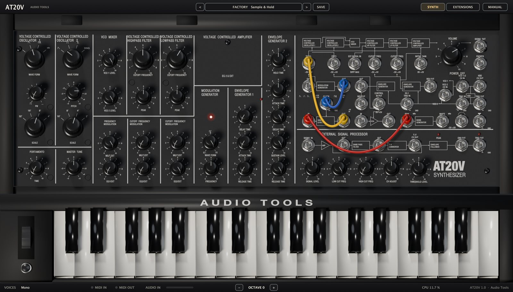

De arriba hacia abajo, el editor tiene la barra superior, la página (SYNTH o EXTENSIONS), el teclado y la barra inferior.

### Barra superior

- **<** y **>** recorren todos los presets, de fábrica y propios, y dan la vuelta en los extremos.
- El botón del preset muestra la categoría y el nombre del preset actual. Hacé clic para abrir el menú de presets.
- **SAVE** guarda el sonido actual como preset propio.
- **SYNTH** muestra el panel frontal y la patchera. **EXTENSIONS** muestra el vocoder, la polifonía, el delay, la reverb y los ajustes del sistema.
- **MANUAL** abre este manual dentro del plugin, en inglés o en castellano. Esc o la cruz lo cierran.

### La página SYNTH

El panel frontal sigue al original, en columnas separadas por líneas blancas finas: los dos osciladores (con PORTAMENTO y MASTER TUNE abajo), VCO MIXER (con FREQUENCY MODULATION abajo), los filtros pasa altos y pasa bajos (cada uno con su CUTOFF FREQUENCY MODULATION), el VOLTAGE CONTROLLED AMPLIFIER con el MODULATION GENERATOR y el ENVELOPE GENERATOR 1 debajo, y el ENVELOPE GENERATOR 2. A la derecha están la patchera, VOLUME y el EXTERNAL SIGNAL PROCESSOR.

Cuatro LEDs rojos muestran la actividad: el LED del MG titila al ritmo del MG, el LED entre los generadores de envolvente brilla con la EG1, y los LEDs PEAK y TRIG del procesador de señal externa muestran la saturación y la detección de disparos.

### Teclado

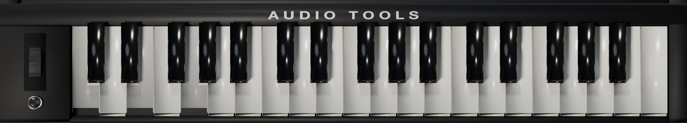

El teclado tiene 37 teclas, de do a do; en OCTAVE 0 la tecla más grave es la nota MIDI 36. Hacé clic en una tecla para tocarla y arrastrá sobre las teclas para hacer un glissando. A la izquierda:

- La **rueda de control**: arrastrala hacia arriba o hacia abajo. Al soltarla vuelve sola al centro, como una rueda de pitch bend; si la soltás con Alt apretado, queda donde está. Con doble clic se centra.
- El **pulsador momentáneo**: el botón redondo debajo de la rueda. Hacé clic y mantenelo para apretarlo.

Como en el original, ninguno de los dos hace nada por sí solo: actúan sólo a través de sus jacks en la patchera, CONTROL WHEEL y MOMENTARY SWITCH.

### Barra inferior

- **VOICES** muestra el modo de voces (Mono o Poly 2 a Poly 12) y el unísono.
- **MIDI IN** y **MIDI OUT** se prenden con la actividad MIDI.
- **AUDIO IN** mide la entrada de audio que alimenta el vocoder y el procesador de señal externa. Se pone roja cerca de saturar.
- **-** y **+** mueven el teclado en pantalla por octavas, de -2 a +2.
- **CPU** muestra la carga del motor de sonido.

### Cómo se usan los controles

- **Perillas**: arrastrá hacia arriba o hacia abajo; con Shift el ajuste es fino. La rueda del mouse también funciona. El doble clic devuelve la perilla a su valor por defecto (en la página SYNTH, el del Normal Setting).
- **Selectores** como WAVE FORM o SCALE avanzan una posición por cada arrastre corto o cada paso de la rueda del mouse.
- **Selectores de dos posiciones** de la página EXTENSIONS (OFF y ON, REV 1 y REV 2, FREE y TEMPO, 4x y 8x) cambian con un clic.
- Pasá el mouse sobre una perilla para ver su valor en la escala de 0 a 10 del panel y, cuando suma, en Hz, ms, semitonos o cents. Sobre un jack, ves su nombre y su conexión por defecto.
- Arrastrá la esquina inferior derecha de la ventana para cambiar el tamaño, de la mitad a 1,4 veces el tamaño completo.

## Cómo está conectado el sintetizador

Sin cables, el AT20V ya es un sintetizador completo. El audio va de izquierda a derecha: los dos osciladores entran al VCO MIXER, después pasan por el filtro pasa altos, el pasa bajos y el amplificador hasta VOLUME y la salida.

La modulación viene conectada. El teclado toca los dos osciladores y su disparo arranca las dos envolventes. El generador de modulación (MG) llega a las tres perillas MG/T.EXT. El generador de envolvente 1 (EG1) llega a la perilla EG1/EXT y al VCA de modulación. El generador de envolvente 2 (EG2) maneja siempre el amplificador y llega a las dos perillas EG2/EXT de los filtros.

Cada una de esas conexiones pasa por un jack. Si enchufás un cable en ese jack, reemplaza la conexión interna, y la perilla que sigue pasa a dosificar la señal patcheada. Esto se llama normalización y así funciona el original.

## Osciladores

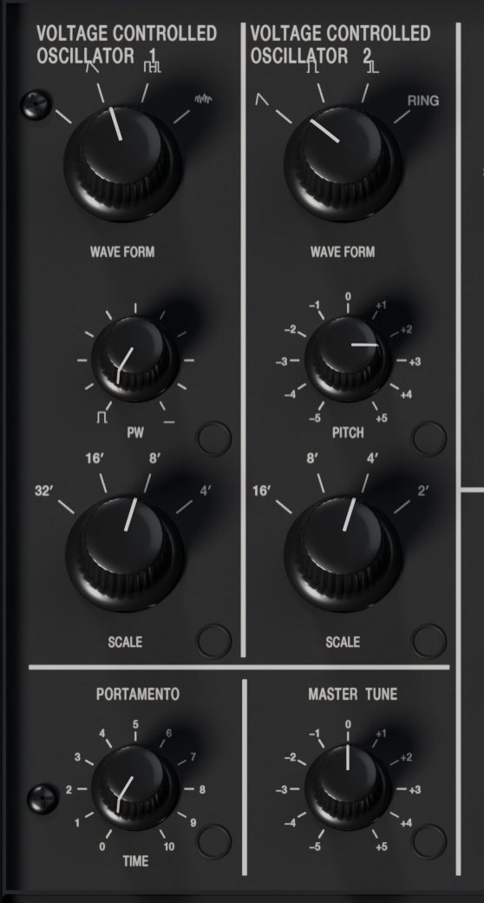

Los dos osciladores están limitados en banda y sobremuestreados, con la curvatura leve del circuito original y un poco de deriva analógica (ANALOG en la página EXTENSIONS). En 8' y con MASTER TUNE al centro, suenan en la afinación de concierto.

### VOLTAGE CONTROLLED OSCILLATOR 1

- **WAVE FORM**: triángulo (suave, tipo flauta), diente de sierra (brillante y lleno), pulso (hueco) o ruido blanco (viento, redoblantes, efectos).
- **PW**: el ancho del pulso. En 0 es cuadrada; hacia 10 se angosta hasta desaparecer, como en el original. PW también le da forma a la onda RING del VCO 2.
- **SCALE**: 32', 16', 8' o 4'. Cada paso es una octava.

### VOLTAGE CONTROLLED OSCILLATOR 2

- **WAVE FORM**: diente de sierra, cuadrada, pulso angosto (fijo, nasal) o RING. RING combina el pulso del VCO 1 y la cuadrada del VCO 2 en un tono metálico, de campana. Sigue a las dos perillas SCALE, a PITCH y a PW, pero no al WAVE FORM del VCO 1. Para escucharlo solo, bajá VCO 1 LEVEL.
- **PITCH**: de -5 a +5, desafina el VCO 2 desde una octava abajo hasta una octava arriba (el globo muestra semitonos). Un poco engorda el sonido como un chorus; cerca de +3,5 o +5, quintas y octavas.
- **SCALE**: 16', 8', 4' o 2'.

### PORTAMENTO y MASTER TUNE

- **PORTAMENTO TIME**: el deslizamiento entre notas, desde apagado en 0 hasta unos 2 s en 10. Actúa sobre la tensión Hz/V del teclado, como en el original, así que el glissando se curva.
- **MASTER TUNE**: afina los dos osciladores hasta un semitono arriba o abajo (se muestra en cents).

## Mezclador y modulación de frecuencia

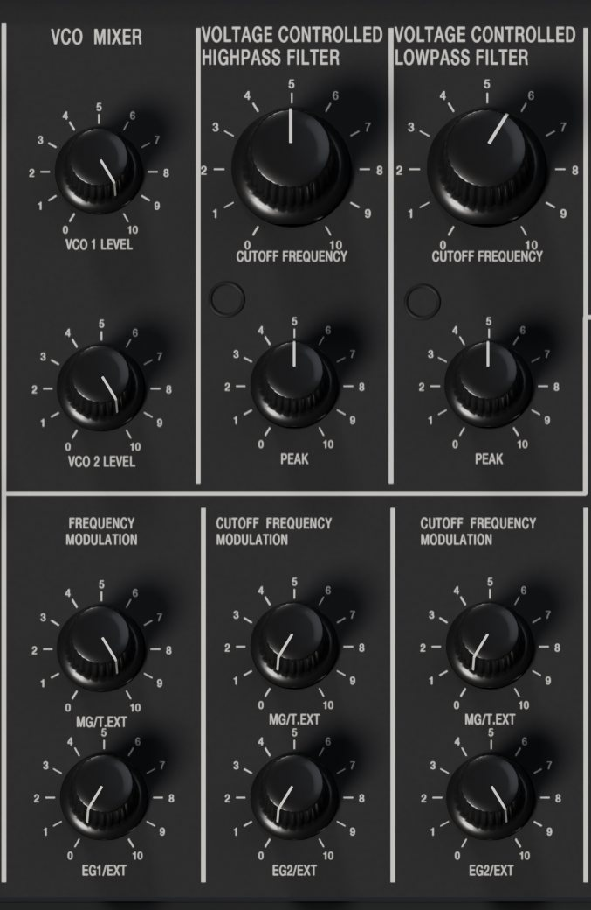

- **VCO 1 LEVEL** y **VCO 2 LEVEL**: cuánto de cada oscilador entra a los filtros, de 0 a 10. Con la revisión de filtro REV 1, más nivel también es más distorsión del filtro.

FREQUENCY MODULATION actúa sobre la altura de los dos osciladores:

- **MG/T.EXT**: la profundidad del MG, o de lo que esté patcheado en TOTAL. Con el MG da vibrato y sirenas; en 10 la altura se mueve unas 2,5 octavas para cada lado. La perilla tiene ley cuadrática, así que el vibrato vive entre 1 y 2.
- **EG1/EXT**: la profundidad de la EG1, o de lo que esté patcheado en FREQ. Da barridos de altura para láseres, percusión y ataques de bronces, hasta unas 5 octavas en 10.

## Filtros

Un filtro pasa altos seguido de un pasa bajos, los dos con resonancia (PEAK), modelados a partir del análisis de circuito de Tim Stinchcombe y del manual de servicio.

### VOLTAGE CONTROLLED HIGHPASS FILTER

- **CUTOFF FREQUENCY** (perilla grande): de 50 Hz a 15 kHz. En 0 está totalmente abierto; al subirla se van los graves. La pendiente es de 6 dB por octava, la real del original.
- **PEAK**: resonancia. Cerca del final del recorrido (alrededor de 9) el filtro autooscila.

### VOLTAGE CONTROLLED LOWPASS FILTER

- **CUTOFF FREQUENCY** (perilla grande): de 50 Hz a 15 kHz. En 10 está totalmente abierto; al bajarla el sonido se oscurece. La pendiente es de 12 dB por octava.
- **PEAK**: resonancia, con autooscilación cerca del final. Los diodos limitan la resonancia, así que con PEAK a fondo el filtro grita en lugar de silbar.

Con CUTOFF FREQUENCY en 5 y PEAK en 10, cada filtro autooscila a 500 Hz, la calibración de fábrica del original. Con el pasa altos cortando abajo y el pasa bajos arriba aparece el sonido pasa banda, "parlante", típico del MS-20.

### CUTOFF FREQUENCY MODULATION

Cada filtro tiene dos perillas de modulación:

- **MG/T.EXT**: la profundidad del MG, o de TOTAL, sobre ese corte. En 10 el MG barre unas 5 octavas para cada lado.
- **EG2/EXT**: la profundidad de la EG2, o del jack CUTOFF FREQ de ese filtro. Es la envolvente de filtro; entre 3 y 6 suele alcanzar.

Como en el original, los filtros no siguen al teclado. El preset Hammond Organ muestra una forma de agregarlo: KBD CV OUT patcheado en TOTAL.

### Revisiones del filtro

El original usó dos circuitos de filtro a lo largo de su vida. Elegí uno con **FILTER** en la página EXTENSIONS:

- **REV 1** (Korg35, por defecto): la distorsión crece con el nivel del mezclador, alrededor de 5 % con un oscilador a fondo y 15 % con los dos, y la resonancia es apenas asimétrica. La versión sucia.
- **REV 2** (OTA): la banda pasante queda limpia y sólo se limita la resonancia.

## Amplificador y envolventes

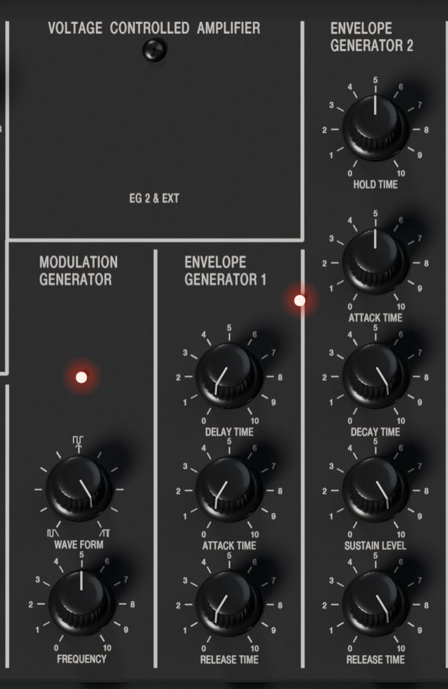

### VOLTAGE CONTROLLED AMPLIFIER

El amplificador no tiene perilla. Su ganancia es la EG2 más la tensión en INITIAL GAIN, y deja de subir cuando la suma llega al nivel máximo. Sin nada patcheado, la EG2 sola le da forma a cada nota.

> Para un drone que suene sin mantener una tecla, patcheá CONTROL WHEEL en VCA INITIAL GAIN, subí la rueda y soltala con Alt apretado para que quede arriba.

### ENVELOPE GENERATOR 1

Al dispararse, la EG1 espera el tiempo de retardo, sube durante el ataque, se queda al máximo mientras la tecla está apretada y cae durante el release.

- **DELAY TIME**: de 0 a 10 s antes del ataque. Para vibrato retardado o barridos tardíos.
- **ATTACK TIME**: de unos 0,8 ms a 10 s.
- **RELEASE TIME**: de unos 2 ms a 10 s.

La EG1 alimenta la perilla EG1/EXT y el MVCA. Sus salidas son EG1 OUT y EG1 REV OUT (invertida).

### ENVELOPE GENERATOR 2

La EG2 maneja siempre el amplificador y, a través de las perillas EG2/EXT, los filtros.

- **HOLD TIME**: de 0 a 20 s. La envolvente sigue hasta que pasa el tiempo de hold desde el disparo, aunque hayas tocado la tecla un instante. Es lo que mantiene sonando los patches UFO y Sample & Hold.
- **ATTACK TIME**: de unos 0,8 ms a 10 s.
- **DECAY TIME**: de unos 2 ms a 10 s, hasta el nivel de sostén.
- **SUSTAIN LEVEL**: de 0 a 10, el nivel que se mantiene con la tecla apretada.
- **RELEASE TIME**: de unos 2 ms a 10 s después de soltar la tecla.

Las perillas de tiempo siguen una curva de potenciómetro de audio: la mitad de abajo cubre los tiempos cortos y secos, y el último cuarto los muy largos. Como en el original, la única salida de la EG2 en la patchera es EG2 REV OUT, que está invertida.

## Generador de modulación

El MODULATION GENERATOR (MG) es el oscilador de baja frecuencia, con una salida triangular (normalizada también a las tres perillas MG/T.EXT) y una rectangular.

- **WAVE FORM**: variable en forma continua. Al centro, triángulo y cuadrada. Hacia la izquierda, rampa descendente y pulso angosto; hacia la derecha, rampa ascendente y pulso ancho.
- **FREQUENCY**: de 0,1 Hz a unos 25 Hz. Entre 4 y 5 da los 4 a 6 Hz de un vibrato natural. El LED rojo titila con la rectangular.

Cuando **MG CLOCK** de la página EXTENSIONS está en TEMPO, el MG sigue el tempo del DAW y FREQUENCY elige una división:

| FREQUENCY | División |
|---|---|
| 0 | 4 compases |
| 1 | 2 compases |
| 2 | 1 compás |
| 3 | 1/2 |
| 4 | 1/4 |
| 5 | 1/4 de tresillo |
| 6 | 1/8 |
| 7 | 1/8 de tresillo |
| 8 | 1/16 |
| 9 | 1/16 de tresillo |
| 10 | 1/32 |

> En modo TEMPO el globo de FREQUENCY sigue mostrando la velocidad libre en Hz. Leé la división en esta tabla.

Con el transporte en marcha, el MG se engancha a la posición de la canción. Con el transporte parado, sigue corriendo al tempo.

## Patchera

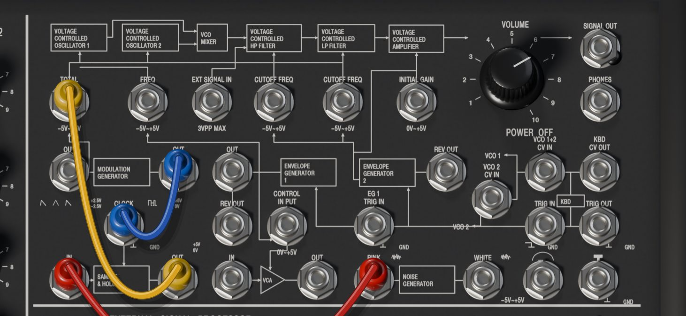

Los 35 jacks funcionan, incluidas las conexiones por defecto. Las líneas blancas impresas entre ellos son el diagrama de señal del original.

### Cómo se usan los cables

- **Conectar**: arrastrá desde un jack libre hasta uno compatible, siempre de salida a entrada. Mientras arrastrás, se resaltan los jacks a los que podés llegar.
- **Apilar**: una salida acepta varias fichas, así una fuente alimenta muchas entradas. Con Shift, arrastrar desde una salida que ya tiene cable agrega otro. Una entrada acepta una sola ficha; un cable nuevo reemplaza al anterior.
- **Mover**: hacé clic en un jack con cable para levantar el extremo del último cable enchufado ahí, y soltalo en otro jack.
- **Desenchufar**: levantá un extremo y soltalo lejos de cualquier jack. Alt-clic (Option-clic en Mac) sobre un jack saca todos sus cables.
- **Menú**: clic derecho sobre un jack para Cable color (rojo, azul, amarillo, verde, blanco o negro) y Unplug.

Los cables cuelgan y se balancean con física real. Se puede realimentar cualquier cosa: como los rieles de alimentación del original, la patchera satura un lazo en lugar de dejarlo crecer sin límite.

### Convenciones eléctricas

- Las tensiones de **altura** (KBD CV OUT, las entradas CV de los VCO, ESP F∝V CV OUT) son Hz/V, como en el original, así que tocan los osciladores afinados. Patcheadas en una entrada de 1 V/oct como TOTAL, dan una curva en lugar de una escala derecha.
- **TOTAL** y **FREQ** responden a 1 V/oct; las dos entradas **CUTOFF FREQ**, a 2 oct/V.
- Los **disparos** son S-trig: las salidas reposan en +5 V y caen a 0 V mientras están activas, y las entradas se disparan cuando su tensión cae cerca de 0 V. Una señal de 0 a +5 V como MG RECTANGLE dispara mientras está abajo.

### Referencia de jacks

Los nombres son los que muestra el globo.

| Jack | Tipo | Nivel | Sin nada enchufado |
|---|---|---|---|
| TOTAL | entrada | -5 a +5 V, 1 V/oct | triángulo del MG a las tres perillas MG/T.EXT |
| FREQ | entrada | -5 a +5 V, 1 V/oct | EG1 a la perilla EG1/EXT |
| EXT SIGNAL IN | entrada | audio | nada; se suma al mezclador a la entrada del HPF |
| HPF CUTOFF FREQ | entrada | -5 a +5 V, 2 oct/V | EG2 a la perilla EG2/EXT del HPF |
| LPF CUTOFF FREQ | entrada | -5 a +5 V, 2 oct/V | EG2 a la perilla EG2/EXT del LPF |
| VCA INITIAL GAIN | entrada | 0 a +5 V | nada; se suma a la EG2 en el VCA |
| SIGNAL OUT | salida | audio después de VOLUME | - |
| PHONES | salida | audio después de VOLUME | - |
| MG TRIANGLE | salida | -2,5 a +2,5 V | - |
| MG RECTANGLE | salida | 0 o +5 V | - |
| EG1 OUT | salida | 0 a +5 V | - |
| EG1 REV OUT | salida | +5 a 0 V | - |
| EG2 REV OUT | salida | 0 a -5 V | - |
| VCO 2 CV IN | entrada | Hz/V | lo que llegue a VCO 1+2 CV IN |
| VCO 1+2 CV IN | entrada | Hz/V | CV del teclado |
| KBD CV OUT | salida | Hz/V, después del portamento | - |
| S/H CLOCK | entrada | S-trig | nada |
| MVCA CONTROL | entrada | 0 a +5 V | EG1 |
| EG1 TRIG IN | entrada | S-trig | el bus de disparo (teclado o TRIG IN) |
| TRIG IN | entrada | S-trig | disparo del teclado |
| KBD TRIG OUT | salida | S-trig, abajo mientras hay una tecla apretada | - |
| S/H IN | entrada | señal a muestrear | nada |
| S/H OUT | salida | tensión retenida | - |
| MVCA IN | entrada | señal | nada |
| MVCA OUT | salida | señal | - |
| PINK NOISE | salida | 5 Vpp | - |
| WHITE NOISE | salida | 5 Vpp | - |
| CONTROL WHEEL | salida | -5 a +5 V | - |
| MOMENTARY SWITCH | salida | S-trig | - |
| ESP SIGNAL IN | entrada | audio | la entrada de audio del plugin |
| ESP AMP OUT | salida | audio después del preamplificador | - |
| ESP BPF OUT | salida | audio después del pasa banda | - |
| ESP F∝V CV OUT | salida | altura como Hz/V | - |
| ESP ENV OUT | salida | 0 a +5 V | - |
| ESP TRIG OUT | salida | S-trig | - |

Para tener en cuenta al patchear:

- **TOTAL** alimenta las tres perillas MG/T.EXT (altura, HPF y LPF); un cable ahí desconecta el MG de las tres.
- **TRIG IN** reemplaza el disparo del teclado para las dos envolventes, pero el teclado sigue mandando la altura: mantené una tecla para transponer un patch que se dispara solo. **EG1 TRIG IN** redispara sólo la EG1.
- **VCO 1+2 CV IN** desconecta el teclado de los dos osciladores; **VCO 2 CV IN**, sólo del VCO 2.
- **SIGNAL OUT** y **PHONES** llevan la salida del plugin. Patchearlas en otro lado, por ejemplo en ESP SIGNAL IN para realimentar, no la silencia.
- **EXT SIGNAL IN** no está conectada a la entrada de audio. Para filtrar tu pista, patcheá ESP AMP OUT ahí (mirá las recetas).

### Los módulos que sólo funcionan patcheados

- **SAMPLE & HOLD**: cada vez que S/H CLOCK cae a masa, S/H OUT toma la tensión de S/H IN y la retiene. Con ruido en la entrada salen escalones al azar. Necesita un reloj patcheado, como MG RECTANGLE.
- **MVCA**: multiplica MVCA IN por MVCA CONTROL, que es la EG1 salvo que patchees otra cosa. El uso clásico es el vibrato retardado.
- **NOISE GENERATOR**: PINK NOISE (más oscuro) y WHITE NOISE.
- **CONTROL WHEEL** y **MOMENTARY SWITCH**: la rueda y el botón al lado del teclado. El pitch bend y la rueda de modulación MIDI mueven la rueda; el pedal de sustain aprieta el pulsador.

## Procesador de señal externa

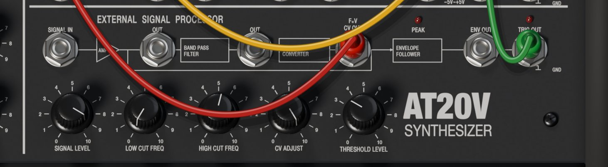

El procesador de señal externa (ESP) convierte la altura y el nivel de una señal de audio, como una guitarra o una voz, en tensiones de control. Su entrada, ESP SIGNAL IN, está conectada a la entrada de audio del plugin (el sidechain del AT20V, o la pista en el AT20V FX); también podés patchear ahí cualquier salida del sintetizador. La señal pasa por un preamplificador, un filtro pasa banda y un convertidor de frecuencia a tensión, mientras un seguidor de envolvente y un detector de disparo leen el preamplificador.

- **SIGNAL LEVEL**: ganancia del preamplificador, de unos -20 a +26 dB, con recorte suave. Ajustala para que el LED rojo **PEAK** sólo parpadee en las notas más fuertes.
- **LOW CUT FREQ**: el borde grave del pasa banda, de 50 Hz a 2,5 kHz.
- **HIGH CUT FREQ**: el borde agudo, de 100 Hz a 5 kHz. Cerrá la banda alrededor de las fundamentales de tu instrumento para que el detector de altura no salte a los armónicos.
- **CV ADJUST**: la escala de la tensión de altura. En 10 el ESP toca los osciladores a la altura que escucha; valores más bajos transponen hacia abajo, hasta dos octavas en 0.
- **THRESHOLD LEVEL**: qué tan fuerte tiene que ser la señal para disparar. El LED rojo **TRIG** se prende mientras el disparo está activo.

Las salidas son ESP AMP OUT (preamplificador), ESP BPF OUT (pasa banda), ESP F∝V CV OUT (altura, para VCO 1+2 CV IN), ESP ENV OUT (envolvente, con ataque de alrededor de 1 ms y caída de 50 ms) y ESP TRIG OUT (para TRIG IN). El detector de altura sigue fundamentales de unos 40 Hz a 1,2 kHz, y sólo corre mientras ESP F∝V CV OUT tiene un cable.

> Init (Normal Setting) deja LOW CUT FREQ en 10 y HIGH CUT FREQ en 0, lo que cierra el pasa banda. Antes de seguir la altura, bajá LOW CUT FREQ y subí HIGH CUT FREQ (los presets Guitar Synth usan 0 y 5,5).

## La página EXTENSIONS

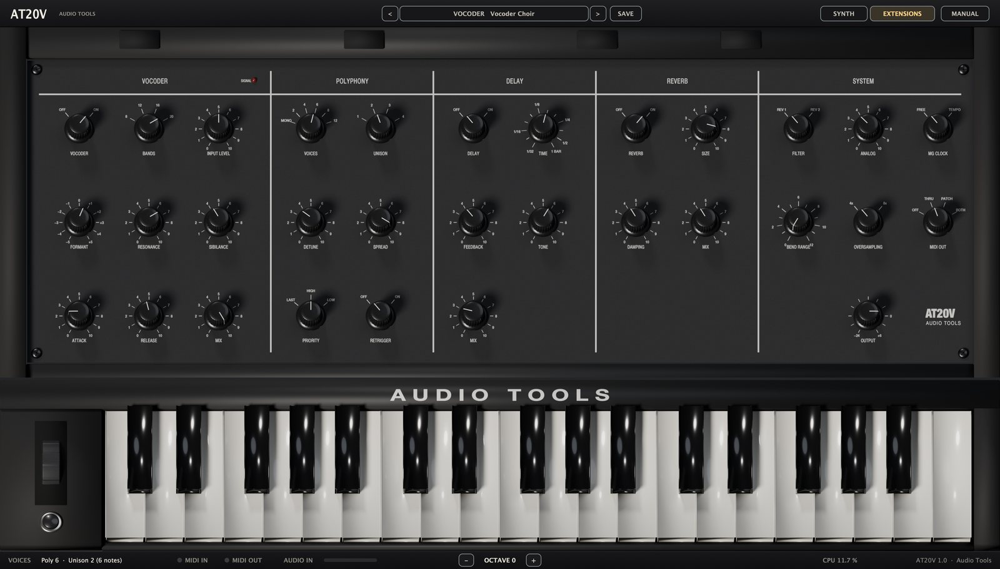

Cinco secciones dibujadas con el estilo del panel: VOCODER, POLYPHONY, DELAY, REVERB y SYSTEM.

### Vocoder

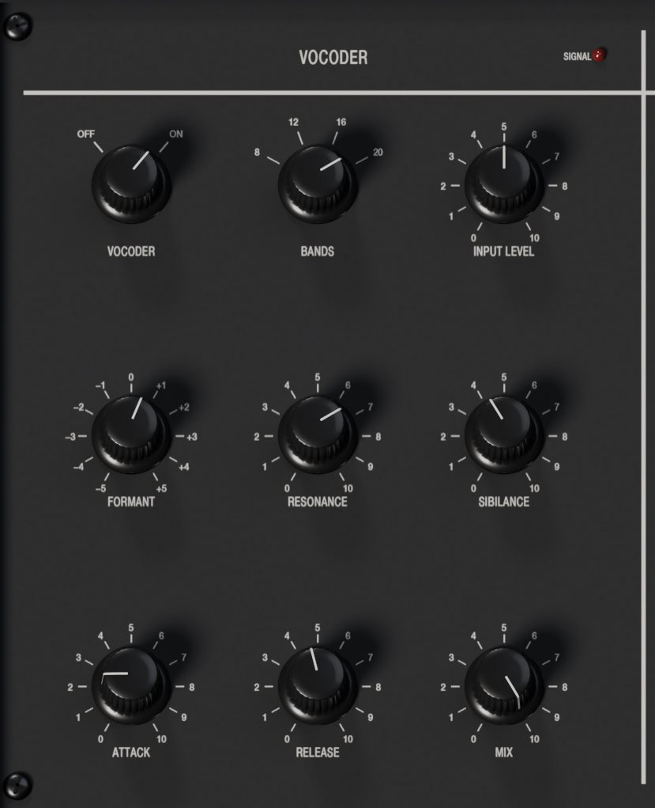

El vocoder le imprime el espectro de una voz al sintetizador. La voz (el modulador) es la entrada de audio; el sintetizador (el portador) es lo que esté tocando el AT20V. La voz se analiza en bandas de 120 Hz a 7,5 kHz, y cada banda abre la misma banda del sintetizador. Cantá o hablá por la entrada y tocá acordes.

- **VOCODER**: OFF u ON.
- **BANDS**: 8, 12, 16 (por defecto) o 20. Más bandas hacen las palabras más claras; menos suenan más robóticas.
- **INPUT LEVEL**: de -12 a +24 dB (por defecto +6 dB). El LED **SIGNAL** al lado del título brilla con la entrada.
- **FORMANT**: corre las bandas del sintetizador hasta una octava arriba o abajo. Arriba da una voz más chica y brillante; abajo, más grande y oscura.
- **RESONANCE**: bandas más angostas y resonantes a medida que la subís, para una voz robótica más filosa.
- **SIBILANCE**: suma ruido filtrado en las consonantes (energía de la voz arriba de 5 kHz), así las S y las T se siguen entendiendo.
- **ATTACK**: qué tan rápido se abren las bandas, de 1 a 100 ms.
- **RELEASE**: qué tan rápido se cierran, de 10 ms a 1 s.
- **MIX**: desde el sintetizador solo (0) hasta el vocoder solo (10, por defecto).

El portador es el sintetizador completo después del amplificador, así que mantené notas mientras cantás. Los portadores brillantes funcionan mejor: los dos osciladores, el pasa bajos abierto y un SUSTAIN LEVEL alto en la EG2. El vocoder va antes del delay y la reverb.

### Polifonía

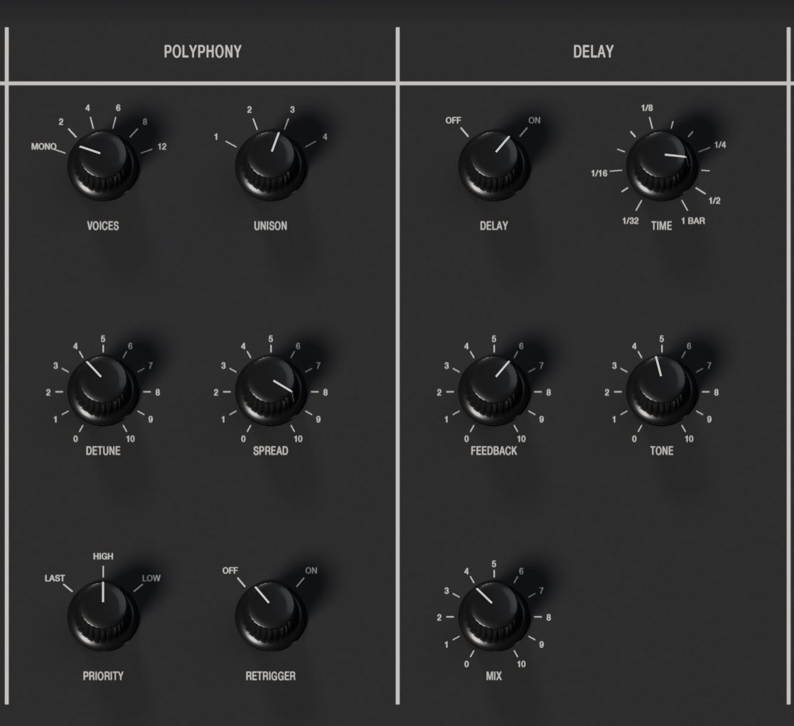

El AT20V arranca monofónico, como el original. En los modos polifónicos cada voz es un MS-20 completo, con sus envolventes, su MG y su patchera, y los cables valen para todas las voces.

- **VOICES**: MONO, 2, 4, 6, 8 o 12 notas a la vez.
- **UNISON**: de 1 a 4 voces apiladas en cada nota. Hay 12 voces en total, así que con VOICES en 12 y UNISON en 4 podés tocar 3 notas.
- **DETUNE**: de 0 a 50 cents (por defecto 12) entre las voces extremas del unísono.
- **SPREAD**: apertura estéreo. Las voces del unísono se abren de izquierda a derecha; sin unísono, las notas sucesivas alternan de lado.
- **PRIORITY**: en MONO, qué nota suena cuando mantenés varias: LAST, HIGH (por defecto, como en el original) o LOW.
- **RETRIGGER**: en MONO, OFF (por defecto) dispara las envolventes una sola vez mientras tocás ligado, como en el original, así las notas superpuestas se deslizan sin un ataque nuevo. ON las reinicia en cada nota.

Si cambiás VOICES o UNISON con notas apretadas, se vuelven a tocar con la nueva distribución.

### Delay

Un delay estéreo ping-pong sincronizado al tempo del DAW: la entrada va a la izquierda y cada repetición cruza de lado.

- **DELAY**: OFF u ON.
- **TIME**: de 1/32 a 1 compás, con valores de tresillo y con puntillo (por defecto 1/8 con puntillo). Hasta 4 s.
- **FEEDBACK**: de 0 a 9,5. Los valores altos saturan suave.
- **TONE**: los valores bajos oscurecen cada repetición.
- **MIX**: el nivel de las repeticiones, sumado al sonido seco.

### Reverb

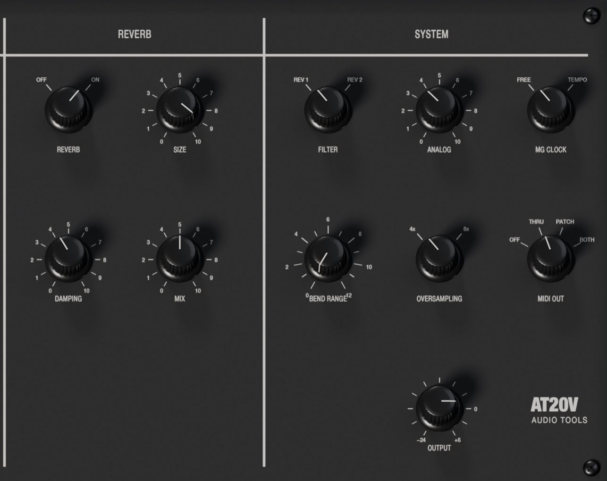

Una reverb de placa, la que usan casi todos los presets ambient.

- **REVERB**: OFF u ON.
- **SIZE**: el largo de la cola.
- **DAMPING**: qué tan rápido se apagan los agudos en la cola.
- **MIX**: el nivel de la reverb, sumado al sonido seco.

### Sistema

- **FILTER**: REV 1 (Korg35) o REV 2 (OTA). Mirá Revisiones del filtro.
- **ANALOG**: de 0 a 10 (por defecto 3,5): deriva lenta de afinación, pequeñas diferencias entre osciladores y entre voces, y un soplido tenue. En 0 todo queda perfectamente estable.
- **MG CLOCK**: FREE o TEMPO (el MG sigue al DAW y FREQUENCY elige la división).
- **BEND RANGE**: de 0 a 12 semitonos (por defecto 0). El pitch bend siempre mueve la rueda de control; por encima de 0 también dobla los osciladores directamente.
- **OVERSAMPLING**: 4x (por defecto) u 8x para toda la voz. 8x es un poco más suave en sonidos agudos y resonantes y cuesta alrededor del doble de CPU.
- **MIDI OUT**: OFF, THRU (por defecto), PATCH o BOTH. Mirá Salida MIDI.
- **OUTPUT**: de -24 a +6 dB para todo el instrumento.

BEND RANGE, OVERSAMPLING, MIDI OUT y OUTPUT son globales: los presets no los guardan ni los cambian. Se guardan con tu proyecto.

## Presets

### Navegar y guardar

Hacé clic en el nombre del preset para abrir el menú. Cada categoría es un submenú, con el preset actual tildado. Al final, **Init (Normal Setting)** carga el panel en blanco y **Show user presets folder** abre la carpeta de tus presets.

Para guardar, hacé clic en **SAVE**, escribí un nombre y apretá Save. El preset aparece en la categoría User; si guardás de nuevo con el mismo nombre, se reemplaza sin preguntar. Los presets propios son archivos JSON:

- macOS: `~/Library/Application Support/Audio Tools/AT20V/Presets`
- Windows: `%APPDATA%\Audio Tools\AT20V\Presets`

Para borrar un preset, sacá su archivo de esa carpeta. Los archivos que agregues aparecen la próxima vez que se carga el AT20V.

Un preset guarda cada perilla de la página SYNTH, cada cable con su color, y los ajustes de EXTENSIONS salvo los cuatro globales. Los ajustes que un preset no trae vuelven a su valor por defecto, así la reverb o el unísono de un preset nunca quedan pegados en el siguiente.

### Presets de fábrica

| Categoría | Presets |
|---|---|
| Factory | Synthe Bass, Hammond Organ, Parallel Fifths, Voice, Pitch Bend, Steam Locomotive, UFO, Horn, Violin, Sample & Hold, Guitar Synth I, Guitar Synth II, Trumpet, Clarinet |
| Bass | Acid Bass, Fat Saw Bass, Hoover Square |
| Lead | Scream Lead, Reso Pluck, Delayed Vibrato Lead |
| Keys | Ring Bells |
| Drums | MS Kick, MS Snare, MS Hi-Hat |
| FX | Howling Wind, Random Bloops, Laser Zap |
| Self-Playing | Random Bleeps, Robot Talk, Drip Cave, Morse Station, Chaos Arp, Pulse Train Bass, Wind Chimes, Clockwork Toy, Bubbling Swamp, Endless Drift, Space Telemetry |
| Ambient | Glass Cathedral, Analog Fog, Frozen Horizon, Deep Ocean Drone, Aurora, Distant Choir, Tape Memories, Breathing Strings, Lunar Bells |
| Vocoder | Classic Robot Voice, Vocoder Choir, Whisper Machine, Talk Box Lead |
| Effect | Filter FX, Auto-Wah FX, Screaming Filter FX, Envelope Gate FX |

- **Factory**: 14 patches transcriptos de las cartas de ajuste del manual original. Synthe Bass, Voice, Pitch Bend y Steam Locomotive usan la rueda de control; los Guitar Synth necesitan una guitarra en la entrada de audio.
- **Bass, Lead, Keys, Drums, FX**: 13 sonidos clásicos, desde bajos acid hasta una batería hecha con filtros.
- **Self-Playing**: 11 patrones en los que el MG en modo TEMPO dispara las envolventes y el sample and hold, a tiempo con tu DAW. Mantené una tecla para transponer.
- **Ambient**: 9 pads polifónicos lentos con delay y reverb.
- **Vocoder**: 4 presets que quedan en silencio hasta que llega una voz a la entrada de audio.
- **Effect**: 4 patches para el AT20V FX que procesan la entrada de audio sin MIDI: el procesador de señal externa alimenta los filtros (EXT SIGNAL IN) y su disparador abre el VCA (KBD TRIG IN). Auto-Wah FX además manda la envolvente de la entrada al corte del pasa bajos.

## MIDI y sincronía

### Notas y controladores

El AT20V toca notas de todos los canales MIDI. La velocidad no tiene efecto, como en el original. La rueda y el pulsador del original sólo actúan por sus jacks, y el MIDI se mapea sobre ellos:

- El **pitch bend** mueve la rueda de control. Si BEND RANGE está por encima de 0, también dobla los osciladores.
- La **rueda de modulación** (CC1) mueve la misma rueda, sólo hacia arriba, sumada al pitch bend.
- El **pedal de sustain** (CC64) aprieta el pulsador momentáneo. No sostiene notas.
- **CC121** centra la rueda y suelta el pulsador; **CC120** y **CC123** sueltan todas las voces.

### Salida MIDI

Se elige con MIDI OUT en la página EXTENSIONS:

- **THRU** (por defecto) reenvía el MIDI que entra más las notas del teclado en pantalla.
- **PATCH** convierte en nota cada disparo del bus de teclado, incluidos los que genera la patchera (por ejemplo MG RECTANGLE en TRIG IN), con la altura que está tocando el VCO 1, en el canal 1. Así un preset self-playing puede tocar otro instrumento.
- **BOTH** hace las dos cosas; **OFF** no manda nada.

En Ableton Live, creá una pista MIDI con otro instrumento, poné su MIDI From en la pista del AT20V (y el selector de abajo en AT20V) y Monitor en In. En bypass, el AT20V queda en silencio y sólo deja pasar MIDI en THRU o BOTH.

### Tempo del host

El MG en modo TEMPO y el delay siguen el tempo del DAW, o 120 BPM si el host no informa ninguno.

### Automatización y control MIDI

Todas las perillas y ajustes se pueden automatizar; los cables no. El AT20V no tiene MIDI learn propio: para manejar sus parámetros desde un controlador, usá el mapeo MIDI de tu DAW. En el host, los nombres combinan sección y perilla (HPF Cutoff, EG2 Hold), y algunos ajustes cambian de nombre: MG CLOCK es MG Tempo Sync, FILTER es Filter Revision, INPUT LEVEL es Vocoder Input y RESONANCE es Vocoder Q.

## Recetas

Todas las recetas arrancan de Init (Normal Setting).

### Bajo acid

1. Poné VCO 1 WAVE FORM en diente de sierra y SCALE en 16'. Bajá VCO 2 LEVEL a 0.
2. En el pasa bajos, poné CUTOFF FREQUENCY en 3, PEAK en 8 y EG2/EXT en 6.
3. En la EG2, poné DECAY TIME en 3, SUSTAIN LEVEL en 1,5 y RELEASE TIME en 1,5.
4. Poné PORTAMENTO TIME en 2,5 y tocá ligado: las notas superpuestas se deslizan sin un ataque nuevo.
5. Para más mordida, subí HPF CUTOFF FREQUENCY a 1,5 o llevá el PEAK del pasa bajos más arriba con FILTER en REV 1.

### Vibrato retardado

1. Bajá VCO 2 LEVEL a 0.
2. Patcheá MG TRIANGLE en MVCA IN y MVCA OUT en TOTAL.
3. Poné FREQUENCY MODULATION MG/T.EXT en 3 y MG FREQUENCY en 5,5.
4. Poné EG1 DELAY TIME en 4,5 y ATTACK TIME en 5. La EG1 controla el MVCA, así que el vibrato espera y después entra de a poco.
5. Dejá las perillas MG/T.EXT del HPF y del LPF en 0, o subilas para un vaivén de filtro retardado: TOTAL también las alimenta.

### La rueda como pitch bend

1. Patcheá CONTROL WHEEL en FREQ. La EG1 sale de la altura, y EG1/EXT pasa a fijar el rango de la rueda.
2. Poné FREQUENCY MODULATION EG1/EXT en 1,8 para un tono, o en 4,5 para una octava.
3. Mové la rueda en pantalla o el pitch bend de tu teclado.

Si en cambio la patcheás en TOTAL, la rueda puede doblar la altura y mover los dos filtros a la vez con las tres perillas MG/T.EXT. Para un pitch bend común, alcanza con BEND RANGE.

### Sample and hold

1. Patcheá PINK NOISE en S/H IN, MG RECTANGLE en S/H CLOCK y S/H OUT en TOTAL.
2. Poné FREQUENCY MODULATION MG/T.EXT en 6 para alturas al azar, o dejala en 0 y subí LPF MG/T.EXT con un PEAK alto para escalones de filtro.
3. MG FREQUENCY fija la velocidad. Poné MG CLOCK en TEMPO para engancharla a tu tema.

### Bombo con el filtro

1. Poné VCO 1 WAVE FORM en triángulo, SCALE en 32' y VCO 1 LEVEL en 6. Bajá VCO 2 LEVEL a 0.
2. En el pasa bajos, poné CUTOFF FREQUENCY en 1,5, PEAK en 9,4 y EG2/EXT en 6.
3. En la EG2, poné DECAY TIME y RELEASE TIME en 3,6 y SUSTAIN LEVEL en 0.
4. Tocá notas graves. El filtro resonando es el cuerpo y la EG2 la caída de altura; DECAY TIME fija el largo.

### Un patrón que toca otro instrumento

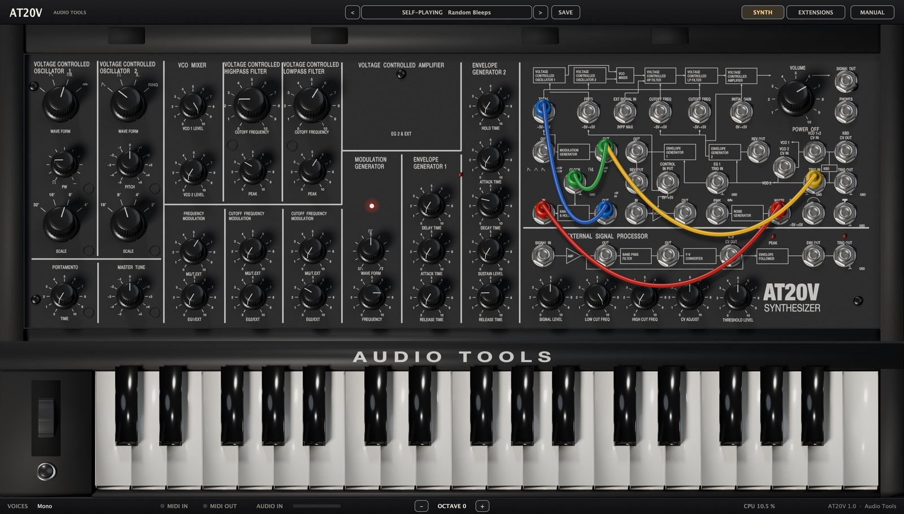

1. Poné VCO 1 WAVE FORM en pulso y bajá VCO 2 LEVEL a 0.
2. Patcheá MG RECTANGLE en TRIG IN y después arrastrá un segundo cable desde MG RECTANGLE hasta S/H CLOCK.
3. Patcheá WHITE NOISE en S/H IN y S/H OUT en TOTAL. Poné FREQUENCY MODULATION MG/T.EXT en 6.
4. En la EG2, poné DECAY TIME en 2,5, SUSTAIN LEVEL en 0 y RELEASE TIME en 2. En el pasa bajos, poné CUTOFF FREQUENCY en 6, PEAK en 6 y EG2/EXT en 3.
5. En la página EXTENSIONS, poné MG CLOCK en TEMPO. De vuelta en SYNTH, poné MG FREQUENCY en 8 (semicorcheas). El patch se toca solo y a tiempo; mantené una tecla para transponerlo.
6. Poné MIDI OUT en PATCH y ruteá el MIDI a otro instrumento como se explica en Salida MIDI. Ahora toca las mismas notas al azar.

El preset Random Bleeps es un pariente cercano, con delay agregado.

### Vocoder en Ableton Live

1. Poné el AT20V FX en la pista de audio con la voz: una voz grabada, o un micrófono con Monitor en In.
2. Creá una pista MIDI, poné su MIDI To en la pista de voz y el selector de abajo en AT20V FX, y armala.
3. Cargá Vocoder Choir, o Classic Robot Voice para un sonido más duro.
4. Reproducí la voz y mantené acordes.
5. Ajustá INPUT LEVEL para que el LED SIGNAL y el medidor AUDIO IN se muevan claro sin ponerse rojos.
6. Ajustá BANDS para la claridad, FORMANT para el tamaño de la voz, SIBILANCE para las consonantes y MIX para mezclar el sintetizador solo.

Con el AT20V en cambio, cargalo en la pista MIDI y elegí la pista de voz en su sección Sidechain. Para armar un sonido de vocoder desde Init, poné VOICES en 6, dejá los dos osciladores en diente de sierra y el pasa bajos abierto, y prendé VOCODER.

### Una guitarra tocando el sintetizador

1. Llevá la guitarra a la entrada de audio: el AT20V FX en la pista de guitarra, o el AT20V con la guitarra como sidechain.
2. Patcheá ESP F∝V CV OUT en VCO 1+2 CV IN y ESP TRIG OUT en TRIG IN.
3. Ajustá ESP SIGNAL LEVEL para que PEAK sólo parpadee en las notas más fuertes.
4. Poné LOW CUT FREQ en 0, HIGH CUT FREQ en 5,5, CV ADJUST en 10 y THRESHOLD LEVEL en 3. El LED TRIG tiene que prenderse con cada nota.
5. Usá SCALE, PITCH y MASTER TUNE para afinar el sintetizador con la guitarra o a un intervalo.

Guitar Synth I y II son versiones completas de este patch. Con una voz funciona igual.

### Tu pista por los filtros

1. Poné el AT20V FX en una pista de audio, como una batería o un loop de sintetizador. Bajá VCO 1 LEVEL y VCO 2 LEVEL a 0.
2. Patcheá ESP AMP OUT en EXT SIGNAL IN. La pista ahora pasa por los dos filtros y el amplificador.
3. Patcheá ESP ENV OUT en VCA INITIAL GAIN. El nivel de la pista abre el amplificador, así que no hacen falta notas.
4. Jugá con las perillas CUTOFF FREQUENCY y PEAK, y con ESP SIGNAL LEVEL para saturar. Para un barrido rítmico, poné MG CLOCK en TEMPO y subí LPF MG/T.EXT.

## Consejos y problemas comunes

### No suena

- Revisá VOLUME (7 es ganancia unitaria) y OUTPUT.
- Un cable en TRIG IN reemplaza el disparo del teclado: si su fuente nunca cae a masa, las envolventes no arrancan. Un cable en VCO 1+2 CV IN desconecta el teclado de los osciladores.
- Los presets de vocoder no suenan sin audio en la entrada. Mirá el medidor AUDIO IN: en el AT20V FX la pista tiene que estar sonando; en el AT20V, el sidechain tiene que estar ruteado. Bajá el MIX del vocoder para escuchar el sintetizador solo.

### Sonidos que se tocan solos

Los presets Self-Playing suenan apenas se cargan, aun con el transporte parado. Cargá otro preset o desenchufá TRIG IN para pararlos.

### La rueda, el pedal o la velocidad no hacen nada

El pitch bend y la rueda de modulación mueven la rueda en pantalla, pero el sonido sólo cambia si CONTROL WHEEL está patcheada o BEND RANGE está por encima de 0. El pedal de sustain aprieta el pulsador momentáneo y nunca sostiene notas. La velocidad se ignora.

### Distorsión y nivel

- Los dos filtros distorsionan con PEAK alto, y con REV 1 la distorsión también crece con el nivel del mezclador. Bajá los niveles de los VCO o pasá a REV 2.
- Un limitador suave mantiene la salida por debajo de 0 dB. Si un sonido queda aplastado, bajá VOLUME u OUTPUT.
- Si un patch con realimentación se descontrola, el AT20V se calla un instante y reinicia las voces en lugar de trabarse.

### CPU

- Dejá OVERSAMPLING en 4x; 8x cuesta alrededor del doble.
- Usá menos voces y menos unísono: cada voz es un sintetizador completo.
- Apagá el delay, la reverb o el vocoder cuando no los uses.
- Cerrá el editor, que suma alrededor de 5 a 15 % de un núcleo.

## Especificaciones

| | |
|---|---|
| Versión | 1.0.2 |
| Plugins | AT20V (instrumento), AT20V FX (efecto de audio con entrada MIDI) |
| Formatos | macOS: VST3, Audio Unit, independiente. Windows: VST3, independiente |
| Audio | salida estéreo (admite mono); entrada estéreo o mono, sumada a mono |
| Entrada MIDI | notas en todos los canales, pitch bend, CC1, CC64, CC120, CC121, CC123 |
| Salida MIDI | Thru, Patch o ambas |
| Voces | mono o de 2 a 12; unísono de 1 a 4; 12 voces en total |
| Sobremuestreo | 4x u 8x para toda la voz |
| Patchera | 35 jacks con las normalizaciones del original |
| Filtros | HPF 6 dB/oct, LPF 12 dB/oct, Rev 1 o Rev 2 |
| Vocoder | de 8 a 20 bandas, de 120 Hz a 7,5 kHz |
| Efectos | delay ping-pong sincronizado al tempo, reverb de placa |
| Presets | 51 de fábrica en 9 categorías, más los propios |

### Requisitos del sistema

| | Mínimo | Recomendado |
|---|---|---|
| macOS | macOS 11 Big Sur o posterior; Apple silicon (M1 o posterior) o Intel Core i5 de cuatro núcleos de 2017 | Cualquier Mac con Apple silicon |
| Windows | Windows 10 u 11 de 64 bits; Intel Core i5-6500 (2015) o AMD Ryzen 5 1600 | Intel Core i5-12400 o AMD Ryzen 5 5600 |
| Ambos | 4 GB de RAM, pantalla de 1280 x 800, un host VST3 o AU de 64 bits (o la aplicación independiente) | 8 GB de RAM, pantalla de 1920 x 1080 |

### Carga de CPU

Porcentaje de un núcleo a 48 kHz, sólo el motor de sonido; el editor suma alrededor de 5 a 15 % en un Apple M4. Los hosts corren cada instrumento en un núcleo, así que lo que cuenta es la velocidad de un solo núcleo.

| Ajuste | Apple M4 | AMD Ryzen 9 5900XT |
|---|---|---|
| Mono, 4x | 1,6 % | 3,6 % |
| 8 voces con delay y reverb, 4x | 11,2 % | 32,4 % |
| 12 voces, 8x (necesita el procesador recomendado) | 28,9 % | 78,1 % |
