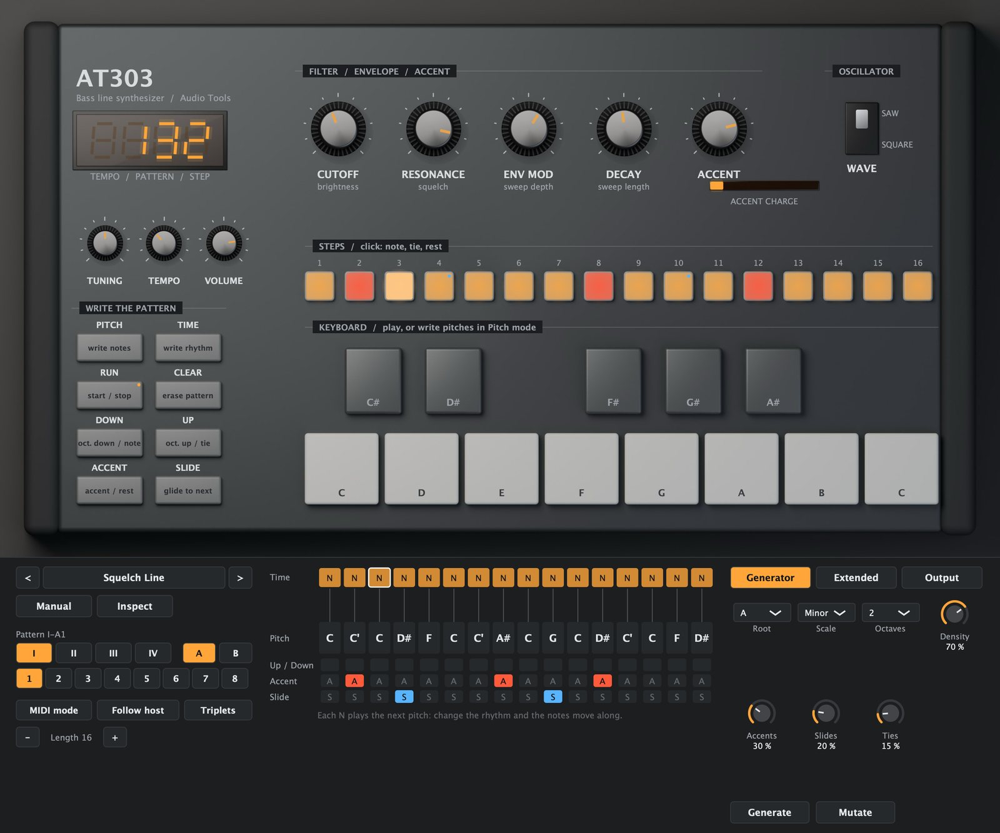
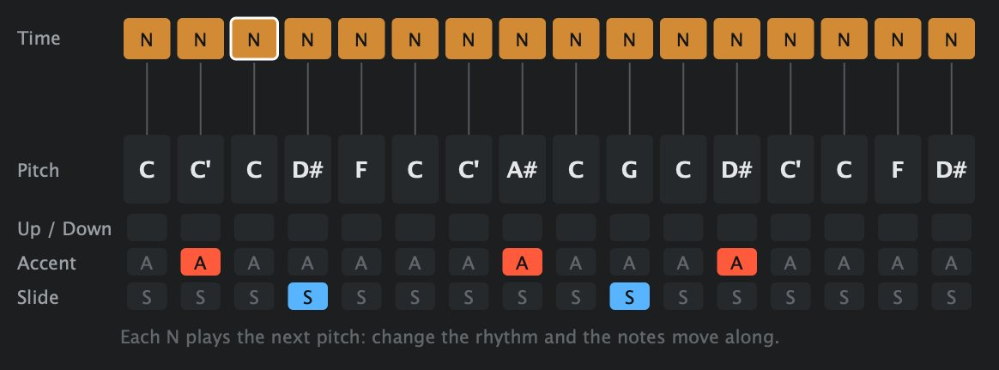
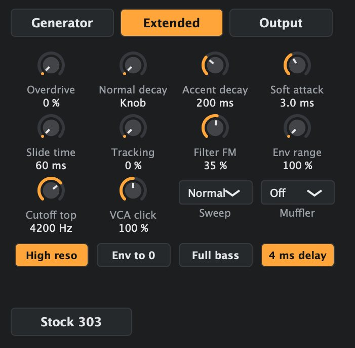
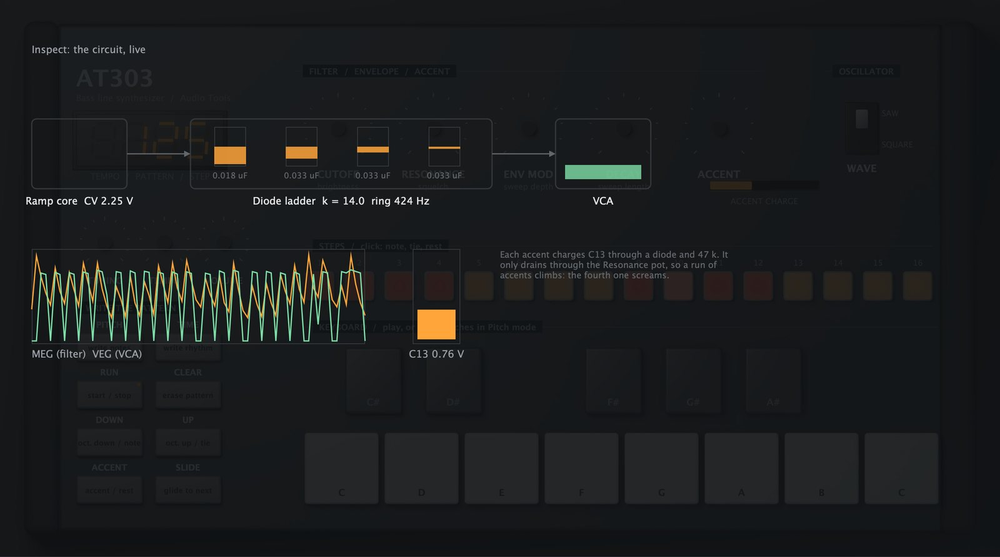

# Manual de AT303

## Qué es AT303

AT303 es un sintetizador de bajo con su propio secuenciador por pasos: un oscilador (diente de sierra o cuadrada), un filtro de escalera de diodos de cuatro polos, una envolvente para el filtro y otra para el volumen, acento y slide. Es el circuito detrás del acid: un filtro resonante que chilla, acentos que suenan más fuerte y más brillantes cuantos más tocás seguidos, y notas que se deslizan una en la otra.

La voz está modelada a partir del circuito, no sampleada. El filtro es una escalera de diodos con sus capacitores reales, así que pierde graves a medida que sube la resonancia y suena cerca de 500 Hz con el corte al medio. El acento es el circuito de barrido real: cada acento carga un capacitor que se descarga despacio, así que una seguidilla de acentos va subiendo. El slide es el deslizamiento RC del original.

El secuenciador funciona como el original, con dos listas separadas: las alturas, en orden, y el ritmo, paso por paso. Cada paso de nota toca la altura siguiente de la lista. Cambiás el ritmo y la melodía se corre con él; de ahí salen muchas líneas de acid. Además, AT303 suma lo que al original le falta: un editor de patrones que se ve, un generador de líneas ácidas, modo MIDI, sincronía con el host, las modificaciones clásicas del circuito en una página, distorsión y delay.



## Instalación

Bajá el paquete para tu sistema desde la web y descomprimilo.

En macOS:

1. Copiá `AT303.vst3` a `~/Library/Audio/Plug-Ins/VST3/` y `AT303.component` (Audio Unit) a `~/Library/Audio/Plug-Ins/Components/`.
2. Volvé a escanear los plugins en tu DAW.
3. `AT303.app` es la versión independiente y `at303render` el renderizador de línea de comandos.

Los archivos no están notarizados. Si macOS no los deja abrir, corré `xattr -dr com.apple.quarantine` seguido de la ruta de cada archivo.

En Windows:

1. Copiá `AT303.vst3` a `C:\Program Files\Common Files\VST3\`.
2. Volvé a escanear los plugins en tu DAW.
3. `AT303.exe` es la versión independiente y `at303render.exe` el renderizador de línea de comandos.

## Primeros sonidos en un minuto

1. Poné AT303 en una pista de instrumento y dale play en tu DAW. El secuenciador sigue al host: arranca y para con el transporte, al tempo del host.
2. Abrí el menú de presets y elegí **Squelch Line**.
3. Mové **Cutoff** despacio para arriba y para abajo mientras suena. Después **Resonance**. Después **Env Mod**. Esas tres son casi todo el sonido.
4. Elegí **Accent Climb** y mirá la barra **Accent charge**: cuatro acentos seguidos, y el cuarto grita.
5. Andá a la página **Generator** y apretá **Generate** varias veces. Cada vez es una línea nueva en la tonalidad y la escala elegidas.

En la versión independiente, o con **Follow host** apagado, apretá **Run** en el instrumento para arrancar el reloj interno; **Tempo** fija su velocidad.

Cada control se explica en un cartel cuando dejás el puntero encima.

## La interfaz de un vistazo

- **El instrumento.** El panel frontal. Las perillas y la llave de forma de onda funcionan como en el aparato; los 16 pads muestran el patrón y el paso que suena; las teclas tocan notas y escriben alturas; los botones escriben patrones a la manera del original.
- **Barra de presets.** Presets, **Manual** e **Inspect**.
- **Patrones.** Cuatro grupos (I a IV), dos bancos (A y B) y ocho patrones por banco: 64 patrones, que se guardan con tu proyecto. **MIDI mode**, **Follow host**, **Triplets** y el largo (**Length**) del patrón.
- **El editor de patrones.** Las dos listas del patrón, y qué altura toca cada paso.
- **Páginas.** **Generator**, **Extended** (las modificaciones del circuito) y **Output** (distorsión, delay, transposición y calidad).

## La voz

- **Cutoff.** Dónde está el filtro. Con la resonancia alta, al medio suena cerca de 500 Hz, como lo calibraba la fábrica.
- **Resonance.** El chillido. La escalera pierde graves a medida que sube, y hace más fuerte el barrido del acento: en el original el capacitor del acento se descarga a través de esta perilla.
- **Env Mod.** Cuánto barre la envolvente al filtro. Como en el original, subirla también baja el punto de partida del barrido, así que el sonido se vuelve a la vez más grave y más vocal. Nunca llega del todo a cero; la modificación **Env to 0** sí.
- **Decay.** Cuánto dura el barrido del filtro en las notas normales, de unos 200 ms a 2,5 s. Las notas con acento siempre usan el decay más corto; **Accent decay**, en la página Extended, lo cambia.
- **Accent.** Cuánto más fuerte y brillante suenan las notas con acento, y cuánto cargan el capacitor del barrido.
- **Waveform.** Diente de sierra o cuadrada. La cuadrada sale de la sierra a través de un transistor que le da forma, como en el original, así que tiene las esquinas suaves.
- **Tuning.** ±7 semitonos. **Tempo** es el reloj interno. **Volume** es el nivel de salida.

### Acento y slide

El **acento** hace la nota más fuerte, le da un barrido del filtro corto y filoso y carga el capacitor del barrido. El capacitor se descarga despacio, así que los acentos juntos van subiendo: el segundo más brillante que el primero, el cuarto todavía más. La barra **Accent charge** muestra su tensión en vivo.

El **slide** liga una nota con la siguiente: la compuerta queda abierta, las envolventes no vuelven a arrancar y la altura se desliza a la nota siguiente en unos 60 ms. Un slide hacia un silencio no hace nada.

## El secuenciador

Un patrón tiene dos listas, como en el original:

- **Time (tiempos)**: para cada paso, una **nota** (N), una **ligadura** (T, sostiene la nota anterior) o un **silencio** (-).
- **Pitch (alturas)**: hasta 16 alturas en orden, cada una con su nota (de C al C de arriba), octava **arriba** o **abajo**, **acento** y **slide**.

Cada paso N toma la altura siguiente de la lista. Las líneas del editor muestran qué altura toca cada paso. Convertí un silencio en nota y todas las notas que siguen se corren una altura: la misma melodía, un ritmo nuevo, otra línea.



### Editar en pantalla

- **Fila de tiempos**: un clic en un paso alterna nota, ligadura y silencio.
- **Altura**: arrastrá para arriba o para abajo para cambiar la nota.
- **Up / Down, Accent, Slide**: un clic para prender o apagar.
- **Length**: los botones - y +, de 1 a 16 pasos (15 en tresillos).
- **Triplets**: tres pasos por tiempo en vez de cuatro.

En el instrumento, un clic en un pad alterna su paso entre nota, ligadura y silencio.

### Escribir a la manera del original

- Modo **Pitch**: apretá **Pitch** y tocá las teclas. Cada tecla escribe la altura siguiente de la lista; apretá **Up** o **Down** antes de la tecla para la octava. **Accent** y **Slide** cambian las marcas de la última altura escrita. El display muestra el lugar en la lista.
- Modo **Time**: apretá **Time** y después **Down** para una nota, **Up** para una ligadura y **Accent** para un silencio, de a un paso. El display muestra el paso.
- Apretá el mismo botón otra vez para salir del modo. **Clear** vacía el patrón actual.

### Reloj y MIDI

- **Follow host** prendido: el secuenciador corre con el transporte y el tempo del host, enganchado a sus compases, así que siempre está a tiempo después de un salto o un loop.
- **Follow host** apagado: **Run** y **Tempo** en el instrumento.
- **MIDI mode**: el secuenciador se detiene y AT303 se toca por MIDI. Una velocidad igual o mayor que **Accent vel.** (100 de fábrica) es un acento; las notas que se superponen hacen slide, como en el teclado del original. Las teclas del instrumento siempre tocan notas cuando no se está escribiendo.

## El generador

El generador escribe una línea ácida en el patrón actual: **Root** (tónica), **Scale** (menor, frigia, dórica, pentatónica menor, menor armónica, mixolidia o cromática), **Octaves** y cuánta densidad (**Density**), acentos (**Accents**), slides (**Slides**) y ligaduras (**Ties**) tiene la línea.

- **Generate** escribe un patrón entero nuevo. Cada vez, uno distinto.
- **Mutate** conserva el ritmo y vuelve a dibujar las alturas, los acentos y los slides.

Si te gusta una línea, ya está en el patrón: pasá a otro patrón antes de volver a generar.

## Extended: las modificaciones del circuito

La página tiene las modificaciones clásicas que se le hacen al aparato. **Stock 303** las devuelve todas al circuito original.

- **Overdrive.** Más nivel a la entrada del filtro: la escalera distorsiona antes que nada.
- **Normal decay.** Un decay fijo en milisegundos en vez de la perilla Decay (Knob = usar la perilla).
- **Accent decay.** El decay de las notas con acento, 200 ms en el original.
- **Soft attack.** El ataque de las notas normales (3 ms en el original; los acentos siempre son filosos).
- **Slide time.** Cuánto tarda el deslizamiento.
- **Tracking.** El filtro sigue a las teclas, así que las notas agudas siguen brillantes. El original no tiene.
- **Filter FM.** La salida modula al filtro: gruñido y zumbido.
- **Env range.** Hasta el triple del barrido de la envolvente.
- **Cutoff top.** El tope de la perilla Cutoff, de 2,4 kHz hasta 5 kHz.
- **VCA click.** El golpe al principio de cada nota.
- **Sweep.** La velocidad del capacitor del barrido del acento: rápida, normal o lenta.
- **Muffler.** Un recorte suave después del VCA que redondea los ataques.
- **High reso.** El doble de resonancia: el filtro oscila solo.
- **Env to 0.** Env Mod llega a cero.
- **Full bass.** El capacitor de acople de salida, que corta los graves en 47 Hz, baja a 4,7 Hz.
- **4 ms delay.** El original espera 4 ms antes del ataque de las notas normales; apagalo para un tiempo más justo.



## Output

- **Drive** (apagado, recorte suave, recorte duro o fuzz), **Amount** y **Tone**: los pedales de siempre después de una caja ácida.
- **Delay**, **Time** (de 1/16 a 1/2, con puntillos), **Feedback** y **Delay tone**: un delay ping-pong sincronizado con el tempo.
- **Transpose**: ±12 semitonos para todo el patrón.
- **Accent vel.**: la velocidad MIDI desde la que una nota es un acento.
- **Quality**: el sobremuestreo de la voz, 2x (Eco), 4x (Normal) u 8x (High).

## Inspect

**Inspect** funde el instrumento en su circuito, en vivo: la tensión de control del oscilador, los cuatro capacitores de la escalera de diodos con su carga, el VCA, las dos envolventes mientras se mueven y C13, el capacitor del acento, llenándose con cada acento. Es el mismo modelo que escuchás, dibujado mientras suena.



## Presets

Treinta y cuatro presets en seis grupos, cada uno con su patrón:

- **Classic.** First Squelch, Rubber Root, Sliding Fifths, Square Pulse, Accent Climb, Low Decay Chug, Long Sweep, Minor Walk.
- **Acid.** Squelch Line, Night Bus, Wet Concrete, Glass Eel, Twelve O'Clock, Pressure Drop, Bubble Square, Off The Grid.
- **Bass.** Deep Root, Dub Pulse, Sub Ladder, Funk Thumb, Tied Drone, Pocket.
- **Driven.** Hot Box, Broken Speaker, Fuzz Worm, Overdriven Ladder.
- **Triplets.** Triplet Roll, Shuffle Gate, Six Against Four.
- **Extended.** Long Accent, Screamer, Soft Attack, Tracking Lead, Muffled Box.

Cargar un preset escribe su patrón en el patrón que está elegido. Todas las líneas son originales.

## El renderizador de línea de comandos

`at303render` toca el patrón de un preset con el instrumento completo y lo guarda en un archivo:

```
at303render out.wav --preset "Squelch Line"
at303render out.wav --preset "Wet Concrete" --seconds 30 --bpm 128 --at 8 cutoff=80 --at 16 cutoff=30
at303render out.wav --set waveform=1 --set resonance=90
```

- `--preset` carga un preset por nombre. Sin él, los valores de fábrica.
- `--seconds` es el largo (16 de fábrica) y `--sr` la frecuencia de muestreo (48000).
- `--bpm` es el tempo (el del preset si no se indica).
- `--set id=valor` fija un parámetro antes de empezar; `--at segundos id=valor` lo cambia en ese momento.

## Para sacarle el jugo

- **Tocá las perillas.** Las líneas ácidas son interpretaciones: grabá Cutoff, Resonance y Env Mod como automatización mientras el patrón da vueltas.
- **Los acentos seguidos** suben; separados, suenan todos igual. Movelos antes de cambiar cualquier otra cosa.
- **Cambiá el ritmo, no las notas.** Convertí una ligadura o un silencio en nota y escuchá cómo se corre la melodía.
- **Decay corto y Env Mod alto** para sonidos punteados; **Decay largo y Cutoff bajo** para barridos lentos y vocales.
- **Para un bajo profundo debajo de un tema**, prendé Full bass y dejá la resonancia moderada.

## Límites

- La escritura por golpes (tap write) y el encadenado de patrones del original no están; cambiá de patrón desde el host (el parámetro Pattern se puede automatizar).
- En modo MIDI el secuenciador interno se detiene; no transpone con las notas que entran.
- Los valores del original varían de un aparato a otro; AT303 sigue la calibración de las notas de servicio.

## Notas técnicas

- **Filtro.** Una escalera de diodos con la relación de sus capacitores, resuelta con realimentación sin retardo (cada etapa no lineal linealizada alrededor de su estado y todo el lazo resuelto en cada muestra), con el pasa altos de realimentación del original, sobremuestreada 4x de fábrica.
- **Envolventes y acento.** La envolvente del filtro, la del volumen y el circuito de barrido del acento están modeladas como sus redes RC, incluidos el diodo y las resistencias que cargan y descargan C13.
- **Slide.** El deslizamiento RC de la tensión de control, unos 60 ms en llegar.
- **Oscilador.** Una rampa de banda limitada; la cuadrada sale de la rampa a través de un modelo del transistor que le da forma.
- **Secuenciador.** 24 pulsos por negra, 6 por paso (8 en tresillos), enganchado a la posición del host.
- **CPU.** Cerca de 0,9 % de un núcleo en un Apple M4 con el sonido de fábrica en 4x; 1,7 % en 8x.
- **Probado** con una batería automática (frecuencia de resonancia del filtro, subida del acento, tiempo del slide, determinismo, sin NaN, salida acotada, CPU), pluginval y auval.
