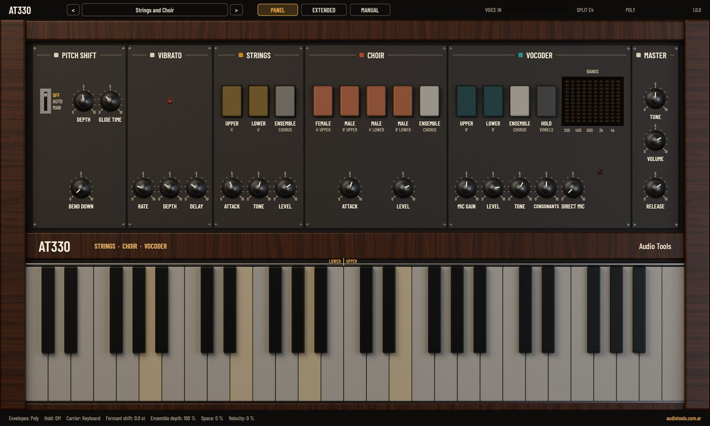
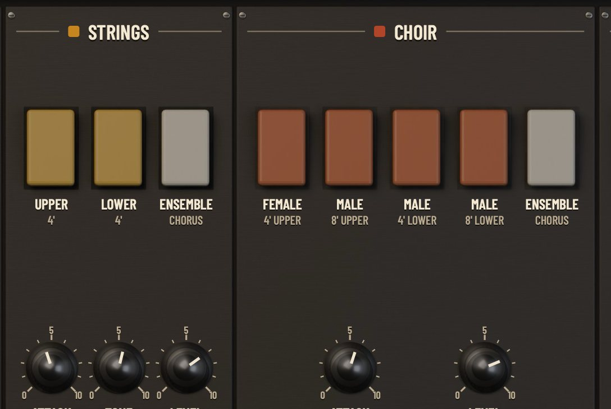
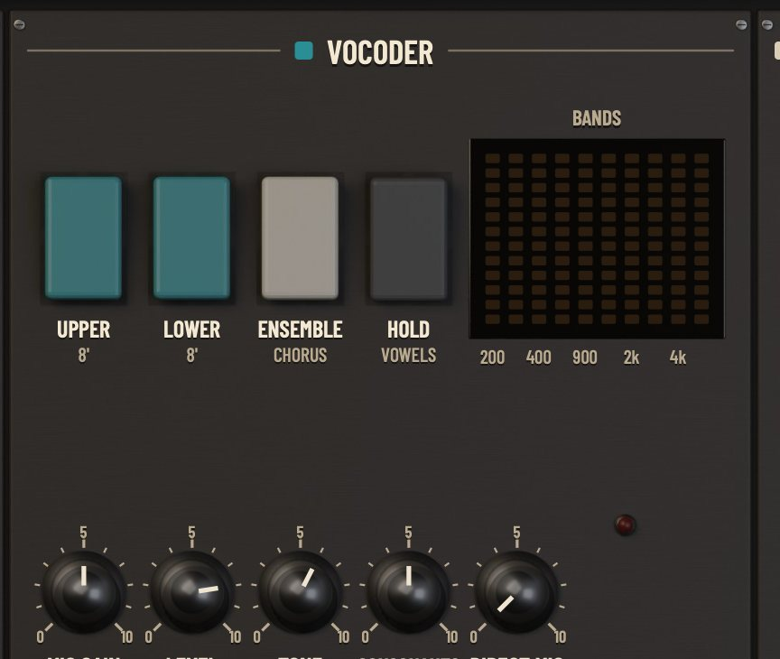
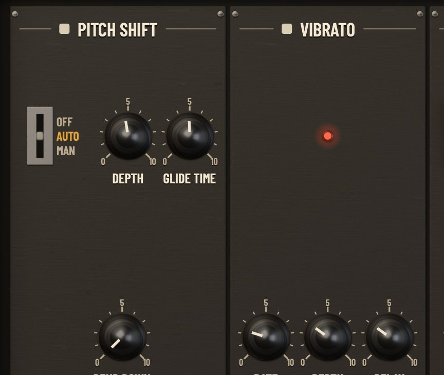
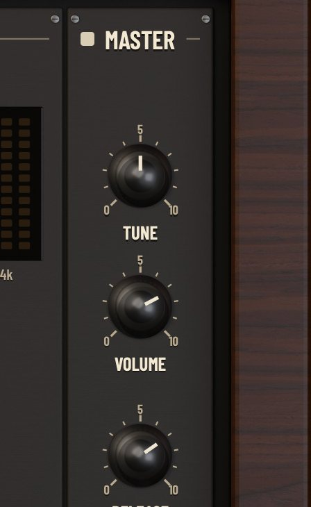
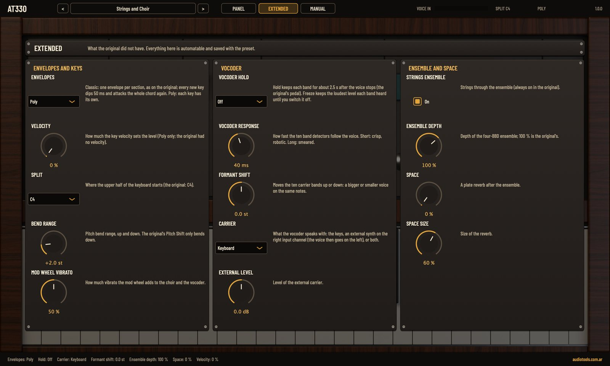
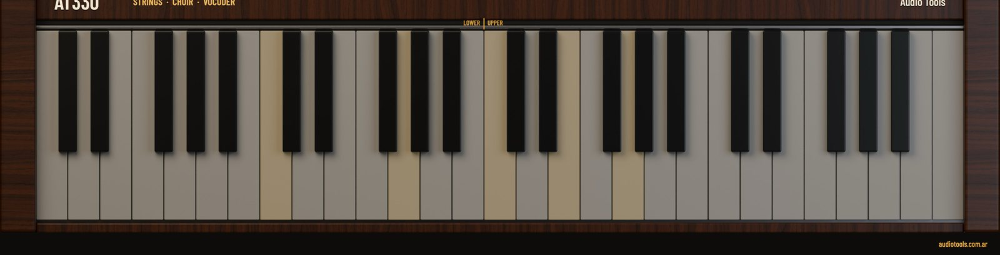

# AT330 user manual

## What AT330 is

AT330 is a strings, choir and vocoder instrument recreated from a 1979 keyboard. It has three sections that can be mixed at will: a **string section** (a sawtooth at 4'), a **choir** with male voices at 8' and 4' and a female voice at 4', and a **10-band vocoder** that makes the keyboard talk with the sound of your voice. Everything goes through a vibrato and an **ensemble** built from four bucket-brigade delay lines (BBD), which is what gives this kind of instrument its wide, slowly swirling sound. A **pitch shift** bends every note down and brings it back.

What comes from the original:

- One master oscillator with dividers: every note is a sawtooth derived from the same counter, so all octaves stay in phase.
- The strings, filtered by a fixed tone filter and a TONE control.
- The choir: a fixed bank of seven formant filters (200, 230, 600, 900, 1300, 2800 and 3300 Hz) that gives each voice its vowel.
- The vocoder: ten analysis and ten synthesis bands from 200 Hz to 6 kHz, the consonants path, the direct microphone and Hold.
- The two BBD vibratos (choir and vocoder) and the ensemble of four BBDs.
- The pitch shift, which only bends down.
- The keyboard split at middle C, the common release and the envelope that restarts the whole chord on every new key.

What is extra, and lives on the Extended page or in the host:

- **Poly** envelopes (the default), velocity, an adjustable split, pitch bend in both directions and mod wheel vibrato.
- **Freeze** for the vocoder, **Formant Shift**, **Vocoder Response** and an **external carrier** on the right input channel.
- The strings can leave the ensemble, and the ensemble depth goes from 0 to 150 %.
- **Space**, a plate reverb.

AT330 runs as VST3 on macOS, Windows and Linux, as Audio Unit and LV2 where the platform has them, and as a standalone app. It is an instrument: play it from a MIDI track. Its audio input is the voice for the vocoder and arrives through the sidechain. It is free, open-source software under the GNU AGPL v3.

## Installation

Each zip file includes an `INSTALL.txt` with these steps.

### macOS

1. Unzip the file.
2. Copy `AT330.vst3` to `~/Library/Audio/Plug-Ins/VST3/` and `AT330.component` to `~/Library/Audio/Plug-Ins/Components/`.
3. Rescan plugins in your DAW. In Ableton Live: Settings, Plug-Ins, Rescan.

`AT330.app` is the standalone version.

> The binaries are signed ad hoc and not notarized. If macOS refuses to open them, run this in Terminal: `xattr -dr com.apple.quarantine ~/Library/Audio/Plug-Ins/VST3/AT330.vst3 ~/Library/Audio/Plug-Ins/Components/AT330.component`

### Windows

1. Unzip the file.
2. Copy the `AT330.vst3` folder to `C:\Program Files\Common Files\VST3\`. Windows asks for administrator rights.
3. Rescan plugins in your DAW.

`AT330.exe` is the standalone version and runs without a DAW.

> The binaries are not code-signed. Windows SmartScreen may ask you to confirm the first time.

### Linux

Copy `AT330.vst3` to `~/.vst3/` and the LV2 bundle to `~/.lv2/`, then rescan in your host.

## Loading AT330 in a DAW

AT330 appears under the maker name **Audio Tools**, among the instruments, as Audio Tools AT330. Load it on a MIDI track and play: it opens with the first factory preset, Ensemble Strings.

The standalone app opens the editor in its own window; choose your audio and MIDI devices in its options. Notes can also be played with the mouse on the on-screen keyboard.

## First sound

1. Load AT330 on a MIDI track and play a chord: strings through the ensemble.
2. Click the **FEMALE 4' UPPER** and **MALE 8' LOWER** tablets to add voices, and play again.
3. Turn **RELEASE** up to hear the chord fade slowly.
4. Press the preset name in the top bar and pick **Strings and Choir** from the Layers category for the sound the instrument is known for.

## A tour of the interface

### Top bar

- **<** and **>** step through all the presets and wrap around at the ends.
- The preset button shows the name of the current preset. Click it to open the menu, with one submenu per category.
- **PANEL**, **EXTENDED** and **MANUAL** change the page. **MANUAL** opens this manual inside the plugin, in English or Spanish; press Esc or the cross to close it.
- **VOICE IN** is the level meter of the audio input. It turns red near clipping.
- At the right, **SPLIT** shows the split note, and **CLASSIC** or **POLY** the envelope mode.

### Panel

From left to right: **PITCH SHIFT**, **VIBRATO**, **STRINGS**, **CHOIR**, **VOCODER** and **MASTER**, then the keyboard. The coloured square next to each title matches the colour of its tablets.

### Working with the controls

- **Knobs**: drag up or down. The value appears while you drag. A double click returns the knob to its default.
- **Tablets**: click to turn on or off. A lit tablet is on.
- Hover over a knob for its full name.
- The line at the bottom shows the state of the Extended settings (Envelopes, Hold, Carrier, Formant shift, Ensemble depth, Space and Velocity).
- Drag the bottom right corner to resize the window, from half to one and a half times its size.

### Tablets and the keyboard

Each tablet has two lines: what it is (UPPER, MALE, FEMALE, ENSEMBLE, HOLD) and its footage and keyboard half (for example 8' LOWER). The keyboard is split in two: notes from the split note upwards are the **UPPER** half and the notes below it the **LOWER** half. A line with the words LOWER and UPPER marks the split on the keyboard; by default it is at C4 (middle C, MIDI note 60) and it can be moved on the Extended page.

The footage is the octave: 8' is the pitch of the key, 4' sounds one octave higher. A tablet that says UPPER only sounds for keys in the upper half; one that says LOWER only for keys in the lower half. That lets you play a choir with your right hand over strings with your left.

The on-screen keyboard has 49 keys, C2 to C6. Click a key to play it. MIDI notes outside that range play too.

## Strings

A sawtooth at 4' through a fixed tone filter, with its own envelope.

- **UPPER 4'** and **LOWER 4'**: strings on the upper and on the lower half of the keyboard. Both are on by default.
- **ENSEMBLE CHORUS**: sends the strings through the ensemble. In the original the strings always go through it; here you can turn it off (extra) and hear the bare sawtooth.
- **ATTACK**: 5 ms to 4 s. How long the strings take to reach full level.
- **TONE**: 0 to 100 %. Closes or opens the brightness of the strings.
- **LEVEL**: 0 to 100 %.

## Choir

The choir is the same sawtooth through a bank of seven fixed formant filters. Each voice uses a different set of them, which is why the male voices sound lower and rounder and the female voice thinner and more open. The voices do not change vowel: it is the fixed vowel of the machine, and the vocoder is what makes it speak.

- **FEMALE 4' UPPER**: the female voice, one octave above the key, on the upper half.
- **MALE 8' UPPER**: the male voice at the pitch of the key, on the upper half.
- **MALE 4' LOWER**: the male voice one octave higher, on the lower half.
- **MALE 8' LOWER**: the male voice at the pitch of the key, on the lower half.
- **ENSEMBLE CHORUS**: sends the choir through the ensemble.
- **ATTACK**: 5 ms to 1.5 s.
- **LEVEL**: 0 to 100 %.

The choir goes through the vibrato first. All four voice tablets are off by default.

## Vocoder

The vocoder measures how much energy your voice has in each of ten frequency bands (200, 280, 400, 600, 900, 1300, 2000, 2800, 4000 and 6000 Hz) and uses that to open ten matching bands on a carrier. The carrier is a sawtooth at 8' played from the keyboard, so you play the notes and the voice shapes them into words.

- **UPPER 8'** and **LOWER 8'**: the keyboard carrier on each half. No tablet on, no carrier: the vocoder is silent unless the carrier comes from outside.
- **ENSEMBLE CHORUS**: sends the vocoder through the ensemble.
- **HOLD VOWELS**: keeps each band at its level for about 2.5 seconds after the voice stops, so a vowel stays while you play. Click again to turn it off.
- **BANDS**: ten columns of lights, one per band, that show the voice. Without a voice they stay dark, and that is the first thing to check when the vocoder is silent.
- **MIC GAIN**: -24 to +24 dB. The gain of the voice. The red LED below the display lights when the voice is close to clipping.
- **LEVEL**: 0 to 100 %. The level of the vocoder.
- **TONE**: 0 to 100 %. A low-pass on the output of the vocoder.
- **CONSONANTS**: 0 to 100 %. Mixes the high frequencies of the voice (the s, t and f) directly, but only while a key is held. Without it a vocoder sounds muffled.
- **DIRECT MIC**: 0 to 100 %. Mixes in the dry voice.

### The voice goes in the audio input

The input of the plugin is named Voice In (Vocoder) and is stereo or mono. In a DAW it is a sidechain: you route the track with the voice to it (see the DAW sections below). The VOICE IN meter in the top bar shows what arrives. If the two channels are different, they are mixed into one voice.

### The carrier

On the Extended page, **Carrier** chooses what the vocoder speaks with:

- **Keyboard**: the sawtooth of the keys (the vocoder tablets). The default.
- **External (input R)**: another sound. The **voice goes on the left channel and the carrier on the right channel** of the input. The keyboard does not take part. A synth, a guitar or a pad all work as carrier.
- **Keyboard + External**: both at once.

**External Level** (-24 to +24 dB) sets the level of the external carrier. The external carrier needs a stereo input.

### Hold and Freeze

**Hold** (the tablet on the panel, or **Vocoder Hold** on the Extended page) keeps each band for about 2.5 s. **Freeze** (Extended page only) keeps, for every band, the highest level it has heard until you turn Freeze off: say a vowel, switch Freeze on and play chords on top of it as long as you like.

### Shaping the voice

- **Vocoder Response**: 3 to 300 ms. How fast the band detectors follow the voice. Short is crisp and robotic; long smears the words into a ghostly voice.
- **Formant Shift**: -12 to +12 semitones. Moves the ten carrier bands up or down: the voice sounds bigger or smaller on the same notes.

> The presets whose name ends in "(Audio In)" need a voice at the input. With no sound there they stay silent. Check the VOICE IN meter and the BANDS display.

## Vibrato

The vibrato is a slow modulation of a short BBD delay line, not a plain pitch wobble. It acts on the **choir and the vocoder**; the strings do not go through it. The small LED lights at the rate of the vibrato.

- **RATE**: 4.5 to 11 Hz.
- **DEPTH**: 0 to 100 %. The mod wheel adds up to 150 % in total.
- **DELAY**: 0 to 3 s. How long after the first note the vibrato takes to fade in, as a singer would. Playing legato keeps it running.

## Pitch shift

The pitch shift moves every section down, never up (use the pitch bend for that). The three-position switch **MODE** chooses how it works:

- **OFF**: nothing.
- **AUTO**: every new key starts the sound **DEPTH** semitones below and brings it back up to pitch in the time of **GLIDE TIME**. A scoop into each chord.
- **MAN**: **BEND DOWN** bends the pitch down by hand, up to **DEPTH** semitones. It can be automated.

The controls:

- **DEPTH**: 0 to 15 semitones, a little more than an octave.
- **GLIDE TIME**: 10 ms to 2 s. How long the return takes in AUTO.
- **BEND DOWN**: 0 to 100 %. How much of DEPTH is applied in MAN.

## Master

- **TUNE**: -50 to +50 cents. A4 is 440 Hz at 0.
- **VOLUME**: -36 to +6 dB.
- **RELEASE**: 0.02 to 8 s. How long every note takes to fade after you let go (the time to reach -40 dB). It is shared by the strings, the choir and the vocoder.

## Envelopes

On the Extended page, **Envelopes** chooses how the keys trigger the sounds:

- **Poly**: every key has its own envelope. Notes you add to a held chord do not disturb it, and each one has its own attack. This is the default.
- **Classic**: the original's behaviour. There is one envelope per section for all the keys, and each new key dips the whole sound for 50 ms and attacks again, so the held chord is cut and re-attacks. The first note also waits those 50 ms. It is the way the machine plays, and it is useful for staccato chords and for the vintage character; the Vintage Strings and Classic Retrigger presets use it.

**Velocity** (0 to 100 %) makes the level of each key depend on how hard you play it. It only works in Poly mode, and at 0 every note has the same level.

## Ensemble

The ensemble is four BBD lines whose delay changes with two slow modulators each (a triangle of several seconds and a fast sine), and whose outputs go to the left and the right in opposite directions. The result is the wide, moving chorus. The ENSEMBLE tablet of each section decides which sounds go through it; whatever does not goes straight to the output, dry. Its depth is **Ensemble Depth** on the Extended page.

## Extended page

What the original did not have. Everything here is automatable and saved with the preset.

### Envelopes and keys

- **Envelopes**: Classic or Poly, as above.
- **Velocity**: 0 to 100 %.
- **Split**: where the upper half starts, from C2 to C6. The default is C4.
- **Bend Range**: 0 to 12 semitones, up and down. The default is 2.
- **Mod Wheel Vibrato**: 0 to 100 %. How much vibrato the mod wheel adds to the choir and the vocoder.

### Vocoder

- **Vocoder Hold**: Off, Hold or Freeze.
- **Vocoder Response**: 3 to 300 ms.
- **Formant Shift**: -12 to +12 semitones.
- **Carrier**: Keyboard, External (input R) or Keyboard + External.
- **External Level**: -24 to +24 dB.

### Ensemble and space

- **Strings Ensemble**: turns the ensemble on the strings on or off.
- **Ensemble Depth**: 0 to 150 %. At 100 % it is the original's; at 0 % the lines stop moving; above 100 % it gets wider and more seasick.
- **Space**: 0 to 100 %. The amount of a plate reverb at the end.
- **Space Size**: 0 to 100 %. The size of the reverb.

## Keyboard and split

The keys you play, with the mouse or from MIDI, light up. Try this: in STRINGS turn off UPPER 4' and keep LOWER 4', in CHOIR turn on FEMALE 4' UPPER and MALE 8' UPPER, and play with both hands. The left hand is the strings and the right the choir, and the split can be moved to where your hands meet.

## Presets

AT330 has 45 factory presets in five categories. Click the preset name in the top bar to open the menu, or step through them with **<** and **>**.

| Category | Presets | What is in it |
|---|---|---|
| Strings | 9 | The string section alone, from Ensemble Strings to Upper Strings Only |
| Choir | 8 | Male and female voices, from Male Choir 8' to Dry Choir |
| Layers | 8 | Strings with the choir, from Strings and Choir to Velvet Poly |
| Vocoder | 12 | The ten bands, from Vocoder Ensemble to External Carrier |
| Pitch and Motion | 8 | Pitch shift, deep vibrato and the two envelope modes |

The presets that depend on the voice end in "(Audio In)" and are silent without a voice at the input. Presets set every control, so after loading one you can change anything and the host saves your changes in the project. The editor has no Save button: to keep your own sounds use your host's preset saving.

## MIDI

| Message | Effect |
|---|---|
| Notes | Play, on any channel. Velocity counts in Poly mode with Velocity above 0 |
| CC 64, sustain pedal | Holds the notes while the pedal is down |
| CC 1, mod wheel | Adds vibrato to the choir and the vocoder (Mod Wheel Vibrato) |
| Pitch bend | Bends all sounds up and down by Bend Range |
| CC 120, CC 123 | All sound off, all notes off |

AT330 has no MIDI output.

## In Ableton Live

AT330 is in Browser, Plug-Ins, Audio Tools. If it is missing, check in Settings, Plug-Ins that the VST3 system folders (and, on a Mac, Audio Units) are turned on, then press Rescan.

Drag it onto a MIDI track, arm the track and play.

To use the vocoder, the voice has to get to the input of the plugin:

1. Put the voice on an audio track (a recording, or an input with a microphone) and keep it.
2. On the AT330 track, open the **Sidechain** section in the title bar of the device and choose the audio track of the voice.
3. Load a preset ending in "(Audio In)", for example Vocoder Ensemble, and play chords while the voice sounds.

The sidechain feeds the VOICE IN meter and the BANDS display. To hear the dry voice too, leave the voice track audible or turn up **DIRECT MIC**.

> For an external carrier, the sidechain has to carry the voice on its left channel and the carrier on its right channel, for example a group track with the voice panned hard left and the carrier hard right. Then choose the External (input R) carrier.

Factory presets appear in Live's browser under Plug-Ins, Audio Tools AT330: expand the plugin. They are installed by the launcher or from the zip's Presets folder. Live does not show a plugin's own program list; the preset menu in the editor always has them all.

AT330 has 44 automatable parameters, fewer than the 64 that Live puts on the device panel by itself, so all of them are offered for automation.

## In REAPER

REAPER lists every factory preset twice in the preset menu: once from the plugin's own list (the programs) and once as a preset file (the `.vstpreset` files that the launcher or the Presets folder of the zip install, in `~/Library/Audio/Presets/Audio Tools/` on macOS, `Documents\VST3 Presets\Audio Tools\` on Windows and `~/.vst3/presets/Audio Tools/` on Linux). Both load the same settings. If you don't use Live, you can delete the "Audio Tools AT330" folder there and each preset appears once.

To feed the vocoder, route a track with the voice to the plugin input through channels 3 and 4:

1. Set the AT330 track to 4 channels.
2. On the voice track add a send to the AT330 track and set its destination channels to 3/4.
3. In the AT330 window open the routing button (In/Out pins) and connect the input channels 3 and 4 to the two inputs of the plugin.
4. Load a preset ending in "(Audio In)" and play.

For an external carrier, send the voice to channel 3 only and the carrier to channel 4 only, and connect them in that order: the left input is the voice, the right is the carrier.

## CPU and latency

AT330 adds no latency: the output follows the notes at the same moment. Measured on an Apple M4 at 48 kHz:

| Case | CPU, one core |
|---|---|
| Strings, a chord of eight notes | 1.3 % |
| Everything on, 16 notes, with the vocoder and Space | about 2 % |
| All 49 keys held with everything on | about 4.3 % |

## Tips and troubleshooting

- **The vocoder is silent.** Look at the VOICE IN meter in the top bar: if it does not move, the voice is not reaching the plugin (check the sidechain or the routing). Check that one of the vocoder tablets (UPPER 8' or LOWER 8') is on for the half of the keyboard you play, or that the carrier is External.
- **The voice is dull.** Turn CONSONANTS up, open TONE, and shorten Vocoder Response.
- **The voice is too thick.** Turn ENSEMBLE off on the vocoder or lower Ensemble Depth.
- **A held chord is cut when you add a note.** You are in Classic. Choose Poly on the Extended page.
- **Notes that don't fit the section.** Check that the tablet matches the keyboard half: an UPPER tablet is silent below the split.
- **Pitch Shift does not seem to do anything.** MODE is OFF, or in MAN BEND DOWN is at 0.
- **No sound at all.** Check that at least one tablet is on for the half of the keyboard you play, and that VOLUME and the level of the section are not at the minimum.
