# AT42 user manual

AT42 is a free, open-source ambient drone machine for macOS and Windows, as a VST3 and Audio Unit instrument and as a standalone app. It recreates the Elta Music SOLAR 42 family, taking the latest model (the 42N) as its starting point, and adds what the hardware lacks: MIDI, host sync, presets, a stereo width control and a Settings page. This manual covers every control, how the voices and the patch bay work, and how to get from the silent Init patch to a full drone.

## What it is

AT42 is a semi-modular instrument with eight fixed voices. Nothing is allocated or stolen: every voice is always there, and the mixer and the envelopes decide what you hear.

- Four classic drone voices (DRONE 1, 2, 4 and 5), each with five sawtooth oscillators, a light-sensitive orb and an attack/release envelope.
- Two noise voices (DRONE 3 and 6) after the Papa Srapa design: a square modulator, a tone oscillator with FM and AM, white noise and a sample and hold.
- Two VCOs (VCO A and B) with six waveforms, linear FM, hard sync and their own ADSR envelopes.
- A 10-channel stereo mixer that also takes an external audio input (EXT IN) and a preamp.
- Two Polivoks-style 12 dB filters, low-pass or band-pass, followed by a stereo distortion.
- A dual effector with 13 cartridges of 3 programs each.
- LFO A and B, a joystick, a 5-step sequencer with its own clock (the pulser) and an envelope follower.
- A 12-plate touch keyboard with keyboard, arpeggiator and 16-step sequencer modes.
- Six drone keys, also playable from MIDI notes C1 to F1.
- A 62-jack patch bay with the hardware's internal connections (normals), so the instrument plays before you plug in a single cable.

The signal path: the eight voices, EXT IN and PREAMP go to the mixer, where each channel has a volume and a pan. The stereo mix passes a gentle bus saturation and the WIDTH control, then FILTER L and FILTER R and the distortion, then the two effector engines (one per side), and finally MASTER.

The panel graphics are original. Elta Music and SOLAR 42 are named only to identify the instrument that inspired this recreation; the effector algorithms are AT42's own.

## First steps

### Installing on macOS

AT42 needs macOS 11 or later and runs natively on Apple silicon and Intel.

1. Unzip the downloaded file.
2. Copy `AT42.vst3` to `~/Library/Audio/Plug-Ins/VST3/`.
3. Copy `AT42.component` to `~/Library/Audio/Plug-Ins/Components/`.
4. Rescan plugins in your DAW (in Ableton Live: Settings, Plug-Ins, Rescan).

`AT42.app` is the standalone version.

> The builds are signed ad hoc and not notarized. If macOS blocks them, run `xattr -dr com.apple.quarantine ~/Library/Audio/Plug-Ins/VST3/AT42*.vst3 ~/Library/Audio/Plug-Ins/Components/AT42*.component` in Terminal. The INSTALL.txt in the package has the same steps.

### Installing on Windows

AT42 needs Windows 10 or 11, 64-bit, and comes as VST3 and standalone.

1. Unzip the downloaded file.
2. Copy the `AT42.vst3` folder to `C:\Program Files\Common Files\VST3\` (this needs administrator rights).
3. Rescan plugins in your DAW.

`AT42.exe` runs without a DAW. The binaries are not code-signed, so SmartScreen may ask you to confirm the first time.

### Loading it in a DAW

Insert AT42 on an instrument or MIDI track. It receives notes, pitch bend and controllers, and has an optional stereo audio input called Audio In (Ext / Preamp). If your DAW can route audio into an instrument (often as a side-chain), that audio feeds the EXT IN channel and the preamp; otherwise both stay silent. In the standalone app, choose your devices in its audio settings; on macOS it asks for microphone permission for the same reason.

Drag the window's corner to resize it, from half to 1.4 times its full size, with fixed proportions.

### Your first sound

AT42 opens with the Init preset, and **Init is silent by design**: drone voices 1 and 2 are up in the mixer, but their envelopes stay closed until something opens them, just like the hardware with no key pressed.

1. Click and hold drone key 1, at the bottom right under DRONE KEYS. Drone 1 sounds while you hold it and fades when you let go. MIDI note C1 does the same.
2. To keep it sounding, click the **hold** button of DRONE 1 (the light grey button at the left of the voice).
3. Turn the five TUNE knobs of DRONE 1 to build a chord, and click MUTE buttons to remove oscillators.

For an instant result, pick a preset from the Drone or Ambient categories: most have hold switched on and sound as soon as they load.

## A tour of the interface

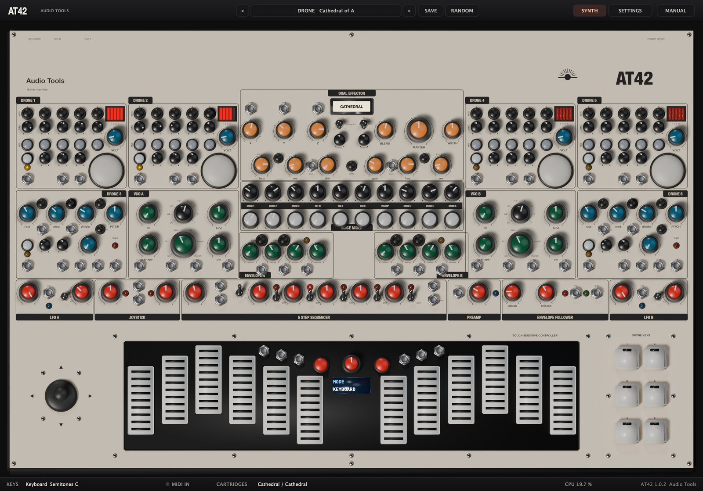

The top bar holds the preset controls: **<** and **>** step through the presets, the long button shows the current category and name and opens the preset menu, **SAVE** stores a user preset and **RANDOM** rolls a random patch. At the right, **SYNTH** shows the panel and **SETTINGS** the Settings page. **MANUAL**, at the right end, opens this manual inside the plugin, in English or Spanish; Esc or the cross closes it.

The panel follows the hardware. Across the top: DRONE 1 and 2 at the left, DRONE 4 and 5 at the right, and between them the DUAL EFFECTOR with the filters in its lower strip. Below: DRONE 3 at the far left, DRONE 6 at the far right, VCO A and VCO B with their envelopes, and the VOICE MIXER in the centre. Then the modulation row: LFO A, JOYSTICK, 5 STEP SEQUENCER, PREAMP, ENVELOPE FOLLOWER and LFO B. At the bottom: the joystick, the TOUCH SENSITIVE CONTROLLER and the DRONE KEYS.

The lower bar shows the keyboard's mode, scale and root, a MIDI IN light, the cartridges loaded on each side, the CPU load and the version.

### Working with the controls

- Knobs: drag up or down; hold Shift for fine moves; the mouse wheel works too. Double-click returns a knob to its default. A bubble shows the name and value while you turn it.
- Stepped knobs (VCO octave and waveform) move one position at a time.
- Buttons latch: click for on, click again for off.
- Two-position switches flip with each click. Three-position switches go to the part you click: upper, middle or lower.
- Right-click any panel control for MIDI Learn.
- Every control and setting is a host parameter you can automate.

## Drone voices 1, 2, 4 and 5

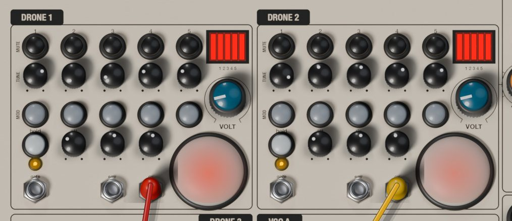

Each classic voice has five sawtooth oscillators with no 1 V per octave input. Each one models a single-transistor relaxation circuit: a capacitor charges through the TUNE control and discharges suddenly at breakdown. That slightly curved ramp with an instant drop gives the drones their buzzing, organ-like body.

The voice has three rows, MUTE, TUNE and MOD, and five columns, one per oscillator.

- **MUTE** (black buttons): silences that oscillator, to go from a five-note cluster to a chord, a fifth or a single tone.
- **TUNE** (small knobs): the pitch of each oscillator within its range. Like the original, the last part of the travel (fully clockwise) is much more sensitive. The bubble shows the frequency in Hz before VOLT and the orb move it.
- **MOD** (grey buttons): connects that oscillator to the orb. With MOD off it runs steadily; with MOD on its pitch follows the light.

| Oscillator | Range | Frequency |
|---|---|---|
| 1 | C0 to G2 | 16.4 to 98 Hz |
| 2 | B1 to G3 | 61.7 to 196 Hz |
| 3 | D3 to B4 | 146.8 to 493.9 Hz |
| 4 | E4 to C6 | 329.6 to 1046.5 Hz |
| 5 | G5 to D7 | 784 to 2349 Hz |

The black window at the top right shows a red segment for each oscillator that is not muted, brightening as the envelope opens.

- **VOLT** (teal knob): lowers the supply voltage of all five oscillators. Clockwise transposes the whole voice down and curves the ramp further. Past half travel the supply sags with every discharge and the oscillators pull on each other, turning the chord into a growling cross-modulated mass. Fully counter-clockwise, the oscillators sit exactly at their TUNE frequencies.
- **hold**: keeps the voice open without a gate. Its envelope opens too, so the env output stays high.
- **att**: attack, about 1 ms to 5 s.
- **rls**: release, a few milliseconds to about 8 s (about 30 s with the Drone Release setting).
- **cv**: how much of the cv input reaches the red LED inside the orb.

The amber LED follows the envelope. The jacks are **gate** (input), **env** (output, 0 to 10 V) and **cv** (input for the orb's LED). The gate input is normalled to the drone key of the same number.

> The drones drift slowly, as the original's simple oscillators do; the Drone Drift setting controls how much. For chords locked to semitones, set Drone Tuning to Chromatic.

### The orbs and ambient light

The orb at the lower right of each classic voice is a photo-sensitive dome. A light-dependent resistor sits in parallel with the TUNE control of every oscillator whose MOD is on: more light, higher pitch. Three things light it.

- The ambient light, set by Ambient Light on the Settings page, the same for all orbs. At its default, switching MOD on already raises the pitch by a couple of semitones, so tune with MOD on if you plan to use it.
- Your hand: hovering the mouse over an orb casts a shadow. The closer to the centre, the darker the orb and the lower the pitch.
- The red LED inside, driven by the cv jack and scaled by the cv knob. Like a real LED it only lights with positive voltage, a little above 1.5 V, so the unipolar LFOs (0 to 10 V) suit it well. The dome turns red as it lights.

The resistor reacts quickly to more light and slowly to less, so the pitch jumps up and glides back over a fraction of a second. An LFO into cv therefore gives a breathing, lopsided movement rather than a plain vibrato.

### Triggering the drones

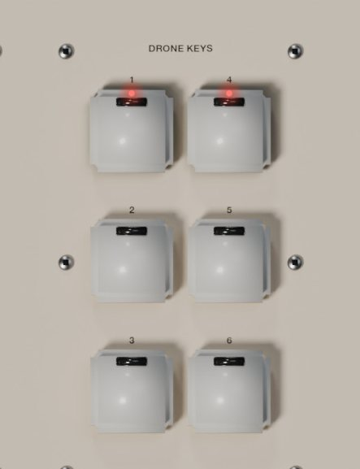

The six drone voices (classic and noise voices alike) open in four ways.

- The DRONE KEYS, arranged 1 and 4 at the top, 2 and 5 in the middle, 3 and 6 at the bottom. Clicking is momentary: the voice opens while you hold the mouse button and a red light shows the pressed key.
- MIDI notes C1 to F1, when MIDI Drone Keys is set to C1-F1 (the default). Those notes then do not play the touch keyboard.
- The gate jack of each voice: anything above 1 V opens it, such as the sequencer's gate, an LFO, the envelope follower's gate or another drone's env output.
- The hold button.

| MIDI note | Voice |
|---|---|
| C1 | DRONE 1 |
| C#1 | DRONE 2 |
| D1 | DRONE 3 |
| D#1 | DRONE 4 |
| E1 | DRONE 5 |
| F1 | DRONE 6 |

## Drone voices 3 and 6 (Papa Srapa)

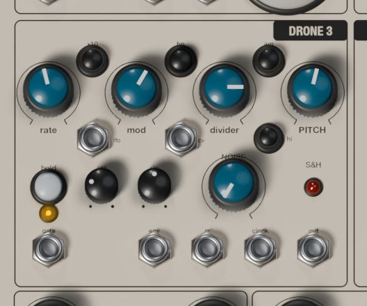

The noise voices follow the DIY noise synthesizers of the Russian artist Papa Srapa: a slow square modulator and an audio-rate tone oscillator, plus white noise and a sample and hold. Think sirens, birds, space monsters, volleys, surf and wind.

- **rate**: modulator frequency, a square wave from 0.1 to 30 Hz.
- **x10**: multiplies the rate by ten, up to 300 Hz, so the FM turns rough and metallic.
- **fm** (on by default): the modulator bends the tone's pitch.
- **am**: chops the tone at the modulator rate.
- **mod**: FM depth, up to about four octaves either way.
- **divider**: smooths the modulator before it reaches the FM. Low values jump between two pitches (a trill); high values glide (a siren).
- **PITCH**: tone pitch, about C0 to C6 (16 Hz to 1 kHz).
- **hi**: moves PITCH to about C3 to E7 (131 Hz to 2.6 kHz).
- **NOISE**: fades in white noise; the tone drops back but never fully disappears.
- **hold**, **att**, **rls**: as on the classic voices.

Both buttons off give a steady tone; fm alone gives sweeps and trills; am alone an interrupted tone; both together an interrupted sweep. For noise, set PITCH fully down, mod and divider fully up and NOISE to maximum.

The jacks:

- **lfo** (output): the modulator's square, 0 or 12 V.
- **cv** (input): pitch modulation of the tone, about one octave per 5 V, whether fm is on or off.
- **gate** (input, normalled to its drone key) and **env** (output, 0 to 10 V).
- **in** (input): what the sample and hold samples, normalled to the voice's own white noise.
- **clock** (input): each rising edge above 1.5 V takes a sample. Nothing happens until you patch a clock here (the pulser out, a square LFO, the voice's lfo output).
- **out** (output): the held voltage, -5 to +5 V. The red S&H LED flashes on each sample.

The sample and hold is only a control voltage; patch its out to a VCO's 1v/oct for random melodies, or to a filter's cv.

## VCO A and VCO B

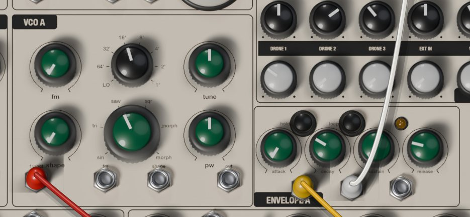

The VCOs model a triangle-core oscillator chip of the AS3340 type and are played by default from the touch keyboard or MIDI.

- **fm**: depth of linear FM from the fm input. Linear FM keeps the pitch centre and can drive the frequency through zero, for bells and metal.
- Octave selector (black): LO, 64', 32', 16', 8', 4', 2' and 1'. 64' is C0 (16 Hz) and each step doubles, up to C6 at 1'. LO sits around 2 Hz, for using a VCO as a slow modulator. At 8', MIDI note C3 (and the first plate, with root C) plays C3, 131 Hz.
- **tune**: fine tuning, half an octave either way.
- **shape**: how much the shape input moves the pulse width.
- Waveform selector (green): sin, tri, saw, sqr and two shapes labelled morph.
- **pw**: pulse width of sqr. On the first morph it sweeps from inverted saw (left) through triangle (centre) to saw (right); on the second it crossfades sine to triangle. Sine, triangle and saw ignore it.

VCO A's jacks are **1v/oct**, **fm**, **shape** and **out** (the raw oscillator, -5 to +5 V, before its envelope). VCO B has **sync** instead of out: each time the voltage there rises above 0 V, VCO B restarts its cycle. Patch VCO A out into it and sweep VCO B's tune for sync sounds.

Normals: both 1v/oct inputs follow the keyboard's v/oct, and VCO B's fm input receives VCO A's output. Raise VCO B's fm knob for two-oscillator FM without a cable.

### Envelope A and Envelope B

Each VCO reaches the mixer only through its own ADSR envelope and amplifier.

- **attack**: about 1 ms to 8 s.
- **decay** and **release**: about 2 ms to 10 s.
- **sustain**: the level held while the gate is high.
- **hold**: keeps the amplifier open, so the VCO drones; the envelope keeps working at its output.
- **loop**: the envelope cycles attack and decay by itself, ignoring sustain, with or without a gate. Short times make an extra LFO; long ones a slow swell.

The amber LED follows the envelope. The three unlabelled jacks are, from left to right, the gate input (normalled to the keyboard's gate), the envelope output (0 to 8 V) and the amplifier input (normalled to the envelope's own output). Patch an LFO into the amplifier input and it sets the VCO's level directly.

## Voice mixer and width

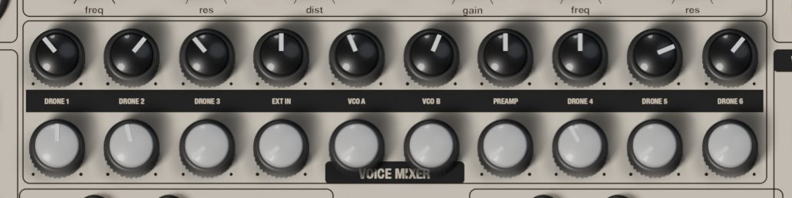

Ten channels, each with pan on top and volume below. The names are on the black band.

| Channel | Source |
|---|---|
| DRONE 1, 2, 4, 5 | classic drone voices |
| DRONE 3, 6 | noise voices |
| EXT IN | the plugin's audio input, summed to mono |
| VCO A, VCO B | the VCOs after their envelopes |
| PREAMP | the preamp's output |

Pans use an equal-power law. The bus adds a soft saturation that grows with the Mixer Drive setting: push several voices together and it glues and grits them.

**WIDTH** (in the effector box, right of MASTER) sets the stereo width before the filters and the effector: fully left is mono, the centre is normal, fully right doubles the difference between the sides. The original cannot do this.

## Filters

The lower strip of the DUAL EFFECTOR box holds FILTER L (left side of the mix) and FILTER R (right side). These are 12 dB per octave state-variable filters whose integrators run out of speed on loud signals, which gives the dirty character of the original. More resonance does not thin the bass.

- **freq**: cutoff, 20 Hz to 20 kHz.
- **res**: resonance.
- **bp** (small button above each side): band-pass instead of low-pass.
- **cv L**, **cv R** (inputs): cutoff modulation. cv R is normalled to cv L, so one cable moves both.
- **mod L**, **mod R** (small knobs under the program switches): depth of cv L and cv R, up to one octave per volt.
- **link**: FILTER R follows FILTER L's freq, res and bp. Each side keeps its own cv and mod.
- **dist**: balance between clean and distorted after the filters.
- **gain**: drive into the distortion; it gets louder, so watch MASTER.

The two sides differ slightly, like two analog circuits; L/R Mismatch sets how much.

## Dual effector

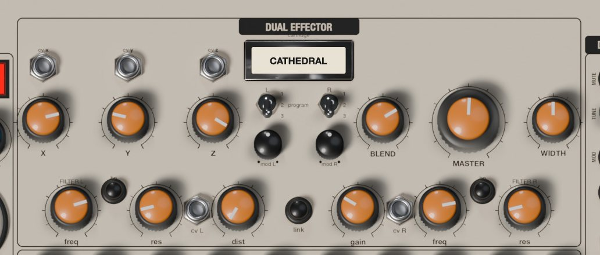

Two engines, one per side of the mix, each running one program from one cartridge. X, Y, Z and BLEND are shared.

- Cartridge slot: shows what is loaded. Click it to load a cartridge into Channel L, Channel R or Both channels.
- **program** (L and R three-position switches): program 1 (up), 2 or 3 for each side.
- **X**, **Y**, **Z**: the program's parameters (see the table).
- **cv x**, **cv y**, **cv z** (inputs): add a voltage to X, Y and Z; 10 V covers a knob's full range, negative voltages subtract.
- **BLEND**: amount of effect. Even at maximum the dry signal stays at half level.
- **MASTER**: the main output level.

Changing cartridge or program clears the engine's memory, like reloading a cartridge. Different programs on each side give an uneven, wide stereo. The engine keeps the limits of the original's digital processor: about 1.4 s of delay memory and a soft low-pass around 14 kHz. The Effector Noise setting adds its hiss, which rises with MASTER.

### Cartridges and programs

| Cartridge | Program | X | Y | Z |
|---|---|---|---|---|
| CATHEDRAL | 1 Shimmer | octave up | octave down | decay |
| CATHEDRAL | 2 Octave delay | feedback | delay time | reverb |
| CATHEDRAL | 3 Space reverb | feedback | delay time | decay |
| MAGIC | 1 Pitch delay | feedback | delay time | pitch |
| MAGIC | 2 Reverse pitch delay | feedback | segment length | pitch |
| MAGIC | 3 Bell pitch delay | feedback | delay time | pitch |
| TIME | 1 Delay reverb | feedback | delay time | reverb |
| TIME | 2 Delay chorus | feedback | delay time | mod depth |
| TIME | 3 Delay vibrato | feedback | vibrato rate | mod depth |
| VIBROTREM | 1 Tremolo | depth | rate | reverb |
| VIBROTREM | 2 Vibrato | depth | rate | reverb |
| VIBROTREM | 3 Chorus | depth | rate | reverb |
| FILTER | 1 Auto wah | frequency | envelope | reverb |
| FILTER | 2 HP and LP | high-pass cutoff | low-pass cutoff | resonance |
| FILTER | 3 Notch | notch 1 | notch 2 | resonance |
| VIBE | 1 Phaser | depth | rate | reverb |
| VIBE | 2 Flanger | depth | rate | reverb |
| VIBE | 3 Resonant flanger | resonance | rate | depth |
| PITCH SHIFTER | 1 SynthTaver | square sub | octave up | direct |
| PITCH SHIFTER | 2 Octaver | octave down | octave up | direct |
| PITCH SHIFTER | 3 Harmonizer | pitch 1 | pitch 2 | voice mix |
| INFINITY | 1 Resonance reverb | pre-delay | pre-delay mod | decay |
| INFINITY | 2 O.D.D. delay | feedback | delay time | pitch |
| INFINITY | 3 Resonance delay | feedback | length | pitch |
| STRING RINGER | 1 Synthetic ring | frequency | resonance | sub |
| STRING RINGER | 2 Ring mod | frequency | wobble rate | reverb |
| STRING RINGER | 3 S&H ring mod | frequency and glide | S&H rate | random range |
| SYNTEX-1 | 1 Vibe synth | wobble rate | resonance | sub |
| SYNTEX-1 | 2 Pulse synth | tremolo rate | resonance | sub |
| SYNTEX-1 | 3 Acid synth | tone | color | sub |
| DIGITAL | 1 Filter DAC | sample rate | cutoff | input gain |
| DIGITAL | 2 LFO DAC | sample rate | LFO speed | LFO amount |
| DIGITAL | 3 Envelope crusher | sample rate | envelope amount | input gain |
| GENERATOR | 1 FM tone | pitch 1 | pitch 2 | FM amount |
| GENERATOR | 2 Ramp | LFO rate | pitch | pitch mod |
| GENERATOR | 3 Voice | cutoff | pitch | LP or HP |
| OCHRE | 1 One-shot long | delay time | feedback | trigger threshold |
| OCHRE | 2 One-shot short | delay time | feedback | trigger threshold |
| OCHRE | 3 Free-run loop | delay time | feedback | delay mod |

- The pitch controls of MAGIC and INFINITY 2 go from an octave down (left) through no shift (centre) to an octave up. The Harmonizer's pitches move in semitones, up to an octave either way.
- On CATHEDRAL 2 the feedback passes through an octave-up shifter, so each repeat climbs.
- PITCH SHIFTER's direct sets how much of the original stays in the effect.
- SYNTEX-1 squares the input, adds a sub-octave (Z) and opens with the input level: a bass synth that works best on a single drone or VCO.
- DIGITAL: X clockwise lowers the sample rate, so the crushing grows.
- GENERATOR makes its own sound; the input level only opens it. On Ramp, Z at the centre means no pitch movement; on Voice, Z below half is low-pass, above half high-pass.
- OCHRE is a reverse delay. The one-shot programs play the recording backwards once each time the input passes the Z threshold; the free-run program loops.

## Modulation row

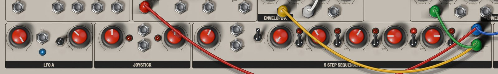

### LFO A and LFO B

Unipolar outputs, 0 to 10 V, because the orbs' LEDs only respond to positive voltage.

- **wave**: triangle (left) to square (right), with mixes in between.
- **rate**: LFO A is slow (about 0.02 to 5 Hz), LFO B fast (about 0.2 to 40 Hz).
- Speed switch (/6, x1, x10): divides the rate by six or multiplies it by ten. LFO A at /6 can take minutes per cycle; LFO B at x10 reaches audio rate.
- **out**: the output; the blue LED follows it.

Each LFO can follow the host tempo instead (see MIDI and host sync).

### Joystick

The stick is at the far left, beside the keyboard. Drag its cap; it stays where you leave it, like the position-locking original. Double-click it to centre it.

- **x**, **y** (outputs): 5 V of travel either side of the offset, -10 to +10 V in total.
- **offset x**, **offset y**: shift each window. Fully left gives -10 to 0 V, centre -5 to +5 V, fully right 0 to +10 V. Use positive windows for the orbs.
- The red LEDs show each axis's distance from the centre.

The mod wheel also moves Y, and both positions can be automated.

### 5 step sequencer

A sequential voltage source in the Buchla tradition.

- **pulser**: speed of the internal clock, about 0.3 to 30 Hz.
- **out** (output): the pulser's square, -10 to +10 V.
- **ext** (input): the clock that advances the sequencer, normalled to the pulser. Any rising edge above 2.5 V moves one step.
- Stages switch (3, 4, 5): sequence length.
- **step 1** to **step 5**: each step's voltage, 0 to 5 V. Into a VCO, a semitone is about 0.083 V; the bubble shows volts.
- Gate switches: down, the step sends a gate; up, it is silent at the gate output but its voltage still plays.
- **cv** (output): the current step, 0 to 5 V.
- **gate** (output): 10 V while the clock is high on a step whose gate is on.

The red LEDs show the current step. The pulser can follow the host tempo.

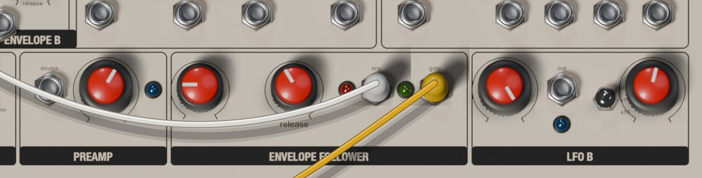

### Preamp

The hardware has a contact microphone under the keyboard. In AT42 the preamp listens to the plugin's audio input instead.

- **source** (input): normalled to the plugin's audio input, summed to mono. A cable here replaces it, so you can also amplify a voltage or a voice.
- **gain**: 0 to 40 dB. The blue LED lights when the preamp clips.

It has its own mixer channel, PREAMP, and feeds the envelope follower.

### Envelope follower

- **attack**, **release**: how fast the follower rises (about 0.5 ms to 0.5 s) and falls (about 5 ms to 3 s).
- **env** (output): the input level, 0 to 10 V, shown by the red LED.
- **gate** (output): 8 V while the level is above a threshold, shown by the green LED. Use it to trigger drones or envelopes from a drum loop or your voice.

## Touch keyboard

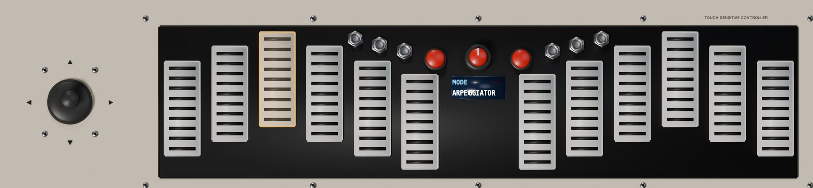

The TOUCH SENSITIVE CONTROLLER makes control voltages, not sound: pitch, gates and pressure, which by default drive both VCOs and their envelopes. In Init the VCO channels are at zero, so raise VCO A or B in the mixer to hear it.

- Plates: click to play, drag across to slide. Lower on the plate means more pressure. The six left plates are the left half, the six right plates the right half.
- The two red buttons: transpose one octave down or up, from -2 to +4.
- The screen: one setting at a time. Click it for the next page, right-click for the previous one.
- The encoder: drag it up or down, or use the mouse wheel over it, to change the value. Click it without turning for the next page.

The plates follow the scale: plate 1 is the root and each plate to the right is the next note of the scale, climbing octaves as needed. With Semitones the plates span one chromatic octave; with a pentatonic, more than two octaves.

| Screen page | What it sets |
|---|---|
| MODE | Keyboard, Arpeggiator or Sequencer |
| SCALE | one of 19 scales |
| ROOT | root note, C to B |
| OCTAVE | transposition, -2 to +4 |
| ARP DIR | arpeggiator direction |
| ARP HOLD | latches notes |
| CLOCK | division: 1/4, 1/8, 1/16, 1/32 |
| TEMPO | internal tempo, 10 to 300 BPM |
| PORTAMENTO | glide time |
| LEGATO | no retrigger between overlapping notes |
| VIBRATO, VIB SPEED | vibrato depth and speed |
| PRESSURE | pressure mode |
| RISE, FALL | pressure rise and fall times |
| SEQ LENGTH | 2 to 16 steps |
| SEQ RECORD | starts and stops recording |

The scales: Semitones, Ionian, Dorian, Phrygian, Lydian, Mixolydian, Aeolian, Locrian, Blues major, Blues minor, Pentatonic major, Pentatonic minor, Folk, Japanese, Gamelan, Gypsy, Arabian, Flamenco and Whole tone.

The jacks in the centre column:

- **clock** (input): external clock for the arpeggiator and sequencer. Rising edges above 1.5 V replace the internal clock; about two seconds after the last one, the internal clock returns.
- **v/oct** (output): 1 V per octave, normalled to both VCOs. 0 V is C3 at octave 0.
- **gate** (output): the main gate, 10 V, normalled to both envelopes.
- **gate R** (output): 10 V while a right-half plate, or a MIDI note from C4 up, is held.
- **press** (output): pressure, 0 to 8 V.
- **reset** (input): a rising edge sends the arpeggiator and the sequencer back to the start.

### Keyboard mode

A monophonic keyboard: the last plate pressed wins, and releasing it returns to a plate still held. The gate stays high while any plate is down. Each new note normally makes a tiny gap in the gate so envelopes restart; with LEGATO on they don't. PORTAMENTO glides up to about a second; VIBRATO adds up to about a semitone at 0.5 to 9.5 Hz (VIB SPEED).

### Arpeggiator mode

Hold several plates and they play one at a time on the clock, each note lasting half a step. ARP DIR: Forward or Backward (by pitch), Ping-pong, Random, or Order (the order you pressed them). With ARP HOLD on the notes keep playing after you let go, and the next press after releasing everything starts a new chord. The clock is TEMPO divided by CLOCK, the host tempo, or the clock jack.

### Sequencer mode

1. Go to SEQ RECORD (click the screen or the encoder until it appears).
2. Turn the encoder one notch (a short drag or one wheel step; every notch on this page toggles recording). The screen shows REC 0/16 and the old sequence is cleared.
3. Play up to 16 notes on the plates or from MIDI; each press is one step.
4. Turn the encoder again to stop.
5. Set MODE to Sequencer and hold a plate: the sequence plays, transposed so that its first note lands on the plate you hold.

SEQ LENGTH shortens the loop without erasing notes. The gate only opens while a plate is held, or after one has been pressed with ARP HOLD on. The sequence is saved with presets and with your session.

### Pressure modes

- Pressure: where you clicked the plate, or the MIDI velocity.
- ASR: rises while the gate is high, falls when it closes.
- AD: rises on each new gate and falls straight away, even while held.
- Loop: rises and falls repeatedly while the gate is high.
- Random: a new random level on each new gate.

RISE and FALL go from a couple of milliseconds to about 3 s. Patch press into a filter cv or a VCA input.

## Patch bay

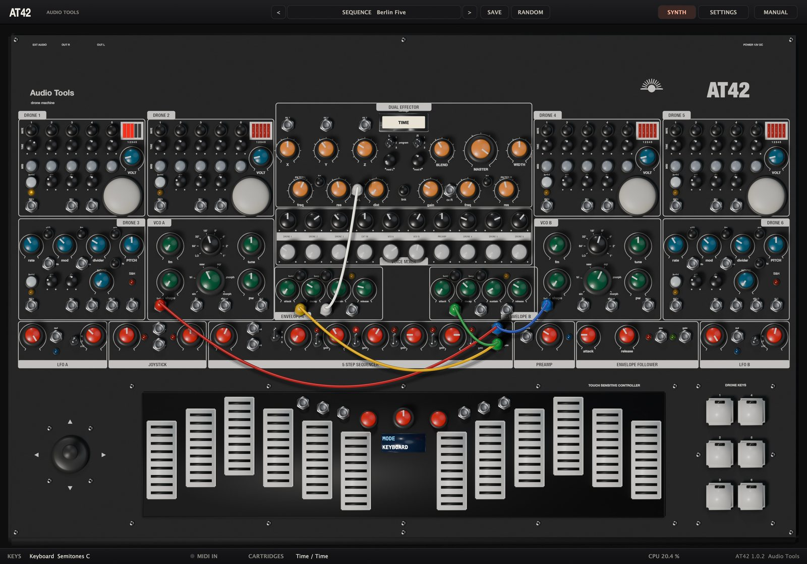

Outputs send a voltage, inputs receive one. An input without a cable uses its normal, if it has one; a cable breaks it.

- Patch: click a jack and drag to another. Outputs connect only to inputs; a yellow ring shows a valid target.
- An input takes one cable; patching a new one replaces the old.
- An output takes stacked cables: hold Shift and drag from an output that already has one.
- Move a cable by dragging one of its ends; drop it on empty panel to remove it.
- Alt-click (Option-click on a Mac) or right-click a jack to remove all its cables.
- Colours cycle red, yellow, blue, green, white and black.

Gates count as high above 1 V on the drone and envelope gates, 1.5 V on clock, reset and sample-and-hold inputs, and 2.5 V on the sequencer's ext. Voltages are limited to plus or minus 15 V, so feedback loops saturate instead of running away.

| Jack | Box | Type | Range or use | Normal |
|---|---|---|---|---|
| gate | DRONE 1, 2, 4, 5 | in | gate | its drone key |
| env | DRONE 1, 2, 4, 5 | out | 0 to 10 V | none |
| cv | DRONE 1, 2, 4, 5 | in | orb LED | none |
| lfo | DRONE 3, 6 | out | 0 or 12 V | none |
| cv | DRONE 3, 6 | in | tone FM | none |
| gate | DRONE 3, 6 | in | gate | its drone key |
| env | DRONE 3, 6 | out | 0 to 10 V | none |
| in | DRONE 3, 6 | in | S&H signal | voice noise |
| clock | DRONE 3, 6 | in | S&H clock | none |
| out | DRONE 3, 6 | out | -5 to +5 V | none |
| 1v/oct | VCO A, B | in | pitch | keyboard v/oct |
| fm | VCO A | in | linear FM | none |
| fm | VCO B | in | linear FM | VCO A out |
| shape | VCO A, B | in | pulse width | none |
| out | VCO A | out | -5 to +5 V | none |
| sync | VCO B | in | hard sync | none |
| gate | ENVELOPE A, B | in | gate | keyboard gate |
| env | ENVELOPE A, B | out | 0 to 8 V | none |
| vca | ENVELOPE A, B | in | VCA level | own envelope |
| cv x, y, z | DUAL EFFECTOR | in | -10 to +10 V | none |
| cv L | FILTER L | in | cutoff | none |
| cv R | FILTER R | in | cutoff | cv L |
| out | LFO A, B | out | 0 to 10 V | none |
| x, y | JOYSTICK | out | -10 to +10 V | none |
| out | 5 STEP SEQUENCER | out | pulser | none |
| ext | 5 STEP SEQUENCER | in | clock | pulser out |
| cv | 5 STEP SEQUENCER | out | 0 to 5 V | none |
| gate | 5 STEP SEQUENCER | out | 0 or 10 V | none |
| source | PREAMP | in | audio | audio input |
| env | ENVELOPE FOLLOWER | out | 0 to 10 V | none |
| gate | ENVELOPE FOLLOWER | out | 0 or 8 V | none |
| clock | keyboard | in | clock | none |
| v/oct | keyboard | out | 1 V per octave | none |
| gate | keyboard | out | 0 or 10 V | none |
| gate R | keyboard | out | 0 or 10 V | none |
| press | keyboard | out | 0 to 8 V | none |
| reset | keyboard | in | reset | none |

In all, 62 jacks: 26 outputs and 36 inputs. The envelope jacks have no printed names: gate, env and vca from left to right.

## Settings page

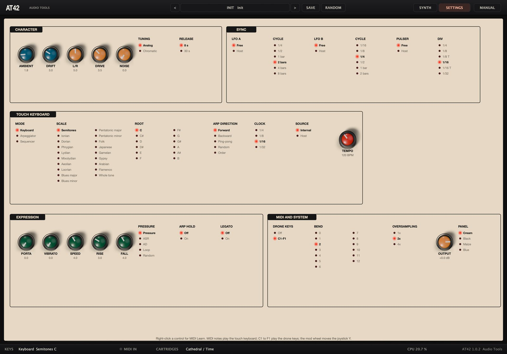

Click **SETTINGS** for everything the hardware lacks or hides in its firmware, in five boxes drawn like the panel. Knobs work as on the panel. In lists, a red LED marks the selected option; click another to choose it. Right-click any control for MIDI Learn, Clear MIDI CC or Reset to default.

### CHARACTER

| Control | Range | What it does |
|---|---|---|
| AMBIENT | 0 to 10 | light reaching the four orbs |
| DRIFT | 0 to 10 | slow random detuning of the drones |
| L/R | 0 to 10 | difference between left and right filter and effector |
| DRIVE | 0 to 10 | mix bus saturation |
| NOISE | 0 to 10 | effector hiss |
| TUNING | Analog, Chromatic | drone oscillators in semitones |
| RELEASE | 8 s, 30 s | longest drone release |

With Chromatic, each TUNE knob steps in semitones relative to A 440 Hz. VOLT still transposes the voice, so keep it fully counter-clockwise for concert pitch; the orb still bends MOD oscillators.

### SYNC

| Control | Options |
|---|---|
| LFO A | Free, Host |
| CYCLE (LFO A) | 1/4, 1/2, 1 bar, 2 bars, 4 bars, 8 bars |
| LFO B | Free, Host |
| CYCLE (LFO B) | 1/16, 1/8, 1/4, 1/2, 1 bar, 2 bars |
| PULSER | Free, Host |
| DIV | 1/4, 1/8, 1/8 T, 1/16, 1/16 T, 1/32 |

### TOUCH KEYBOARD

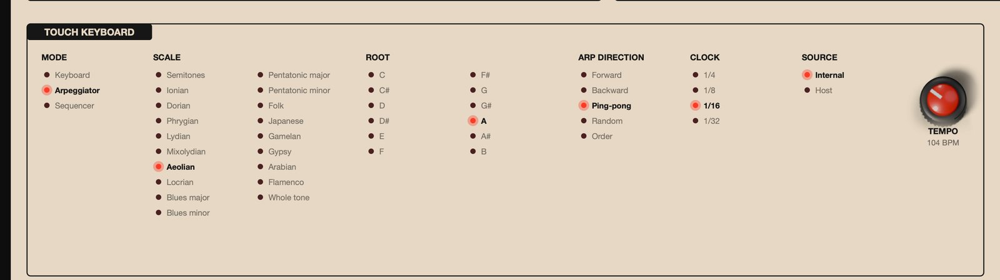

MODE, SCALE, ROOT, ARP DIRECTION and CLOCK mirror the keyboard's screen. **SOURCE** picks the arpeggiator and sequencer clock: Internal (the TEMPO knob, 10 to 300 BPM) or Host. A cable sending pulses to the keyboard's clock jack overrides both.

### EXPRESSION

Knobs PORTA, VIBRATO, SPEED, RISE and FALL, and the lists PRESSURE, ARP HOLD and LEGATO, mirror the screen pages of the same names.

### MIDI AND SYSTEM

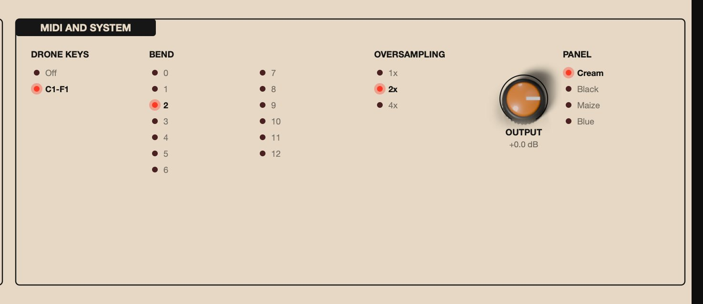

| Control | Options | What it does |
|---|---|---|
| DRONE KEYS | Off, C1-F1 | MIDI notes C1 to F1 play the drone keys |
| BEND | 0 to 12 | pitch bend range in semitones |
| OVERSAMPLING | 1x, 2x, 4x | quality of voices, filters and distortion |
| OUTPUT | -24 to +6 dB | final output trim |
| PANEL | Cream, Black, Maize, Blue | panel colour |

These five belong to the plugin, not the sound: presets never change them. Oversampling (2x by default) reduces aliasing on FM, sync and distortion; the effector always runs at the session rate. OUTPUT comes after MASTER and before a soft limiter that keeps peaks below full scale.

## Presets

The preset menu (click the name in the top bar) groups presets by category, with your own under User. It also offers Init, a fresh default patch, and Show user presets folder. **<** and **>** step through the whole list, which your DAW also sees as programs.

| Category | Factory presets |
|---|---|
| Init | Init |
| Drone | Cathedral of A, Low Choir, Swarm, Fifth Machine, Microtonal Fog, Volt Storm |
| Ambient | Shimmer Garden, Breathing Orbs, Tape Memory, Ocean of Noise, Reverse Hymn |
| Sci-Fi | Siren Tower, Birds at Dusk, Space Monster, Volleys, Random Robot |
| Sequence | Berlin Five, Pulser Ritual, Techno Monster |
| Keys | Flute Lead, Arp Constellation, Binaural VCOs, Pressure Pad, Sequenced Plates |
| Experimental | Piezo Percussion, Joystick Space, Ring Bells, Crushed Choir |

The drone chords are tuned to real notes on the oscillators' own tuning curve. Many presets use cables: look at the patch bay to see how they work. Keys presets need the plates or MIDI notes; Sequenced Plates plays while you hold a plate; Piezo Percussion needs audio at the input. Most presets sit at a similar loudness.

**SAVE** stores the panel, the cables, the recorded keyboard sequence and the sound settings (character, sync, keyboard, expression) under a name; an existing name is replaced. The MIDI AND SYSTEM settings are not stored. User presets are JSON files in `~/Library/Application Support/Audio Tools/AT42/Presets` on macOS, and in `Audio Tools\AT42\Presets` inside your user application data folder (AppData) on Windows.

**RANDOM** changes drone tunings, mutes and MOD buttons, VOLT, the noise voices, VCO waveforms, filters, cartridges and programs, X, Y, Z, BLEND and LFO rates. It keeps your cables and the mixer.

Your DAW session stores everything, including cables, the sequence and MIDI Learn assignments.

## MIDI and host sync

### MIDI

- Notes play the touch keyboard, in semitones and ignoring the scale. Note C3 is 0 V at v/oct, transposed by OCTAVE. Velocity is the pressure in Pressure mode.
- With MIDI Drone Keys at C1-F1, notes C1 to F1 play drone keys 1 to 6 instead of the keyboard. Set it to Off to free them.
- Pitch bend moves the keyboard's v/oct by up to the BEND range (2 semitones by default).
- The mod wheel (CC 1) moves the joystick's Y axis unless CC 1 is learned elsewhere. At minimum the stick goes to the top, at maximum to the bottom.
- All Notes Off (CC 123) and All Sound Off (CC 120) release every note and drone key.

MIDI Learn works on every panel control and setting.

1. Right-click a control and choose MIDI Learn.
2. Move a knob or fader on your controller. Its full range now covers the control's full range.
3. To undo it, right-click the control and choose Clear MIDI CC.

The sustain pedal (CC 64) and CC 120 and above cannot be learned. Each control takes one CC. The Settings page shows learned CCs in red. Assignments are saved with your session, not in presets.

### Host sync

Under SYNC, LFO A, LFO B and the pulser can follow your DAW. With Host, the rate knob and speed switch are ignored, the cycle is the CYCLE or DIV value (1/4 is one beat, 1 bar is four beats, 1/8 T is three pulses per beat) and the phase follows the song position. The keyboard clock follows the host with SOURCE at Host. When the transport stops, synced sources keep running at the host tempo, so you can play without pressing play.

## Recipes

### A drone chord from scratch

1. Choose Init from the preset menu and turn on hold for DRONE 1.
2. Mute oscillators 4 and 5, and tune 1, 2 and 3 to a root, a fifth and an octave, watching the Hz in the bubble.
3. Turn on hold for DRONE 2, mute its oscillators 1 and 2, and tune 3, 4 and 5 to a third, a fifth and an octave above.
4. Pan DRONE 1 a little left and DRONE 2 a little right.
5. Click the cartridge slot, load CATHEDRAL into Both channels with program 1 on both switches, and raise BLEND to half and Z for a long shimmer.
6. Turn VOLT of DRONE 1 slowly past the middle to hear the oscillators pull on each other.

### Breathing orbs

1. Start from a sounding drone, such as Cathedral of A.
2. Turn on MOD for two or three oscillators of DRONE 1.
3. Patch LFO A out into DRONE 1's cv jack. Set LFO A's wave fully left, its rate low and its speed switch to /6.
4. Raise DRONE 1's cv knob until the orb glows red at the top of each cycle. The MOD oscillators rise with the light and sink back slowly.
5. Hover the mouse over the orb to pull the pitch down by hand.

### Siren and birds

1. Choose Init, raise DRONE 3 in the mixer and turn on its hold.
2. With fm on, set rate to the middle, mod to two thirds and divider high: a slow siren.
3. Lower divider for a trill, then raise rate.
4. Turn on hi and am, raise PITCH and rate: chirping birds.
5. Load TIME program 1 on both sides and raise BLEND for echoes.

### A Berlin-school sequence

1. Choose Init. Raise VCO A in the mixer, set it to saw at 16'.
2. Set ENVELOPE A short: attack and sustain at minimum, decay and release short.
3. Patch the sequencer's cv into VCO A's 1v/oct and its gate into ENVELOPE A's gate.
4. Set stages to 5 and tune the steps into a melody.
5. Patch ENVELOPE A's envelope output into cv L; cv R follows, so both filters open on each note. Set mod L low, freq low and res high.
6. Set the speed with pulser, or set PULSER to Host on the Settings page.

### Random melodies

1. Choose Init and raise VCO A. Turn on ENVELOPE A's loop with short attack and decay and zero sustain, so it pings by itself.
2. Patch DRONE 3's S&H out into VCO A's 1v/oct.
3. Patch the sequencer's out into DRONE 3's clock. On every pulse the S&H samples noise and VCO A jumps to a new pitch.
4. Add STRING RINGER program 3 for a robotic edge.

### Record and transpose a sequence

1. Raise VCO A and set ENVELOPE A for short notes.
2. On the keyboard's screen, set SCALE to Pentatonic minor.
3. Go to SEQ RECORD, turn the encoder one notch, play eight plates, and turn it one notch again.
4. Set MODE to Sequencer and SEQ LENGTH to 8.
5. Hold a plate to play the sequence from there; hold another to transpose it. For an arpeggio in time with your DAW instead, set MODE to Arpeggiator and SOURCE to Host.

### Drones triggered by audio

1. Choose Init and route a drum loop into AT42's audio input.
2. Raise the PREAMP gain until the follower's green LED flashes with the hits.
3. Patch the follower's gate into DRONE 1's gate. Set att short and rls long.
4. Patch the follower's env into cv L and raise mod L for a pumping filter.

### Joystick performance

1. Load Cathedral of A.
2. Patch the joystick's x into the effector's cv x and its y into cv L.
3. Set mod L to a moderate value and lower freq a little.
4. Drag the stick while the drone plays. It stays where you leave it, and the mod wheel moves Y too.

## Tips and troubleshooting

- **Init is silent.** By design. Press drone key 1 or 2, play C1 or C#1, or turn on hold for DRONE 1 or 2.
- **The plates or MIDI notes are silent.** The keyboard only sends voltages. Raise VCO A or B in the mixer and check that no cable has taken over the envelope's gate.
- **MIDI notes C1 to F1 don't play the keyboard.** They play the drone keys; set MIDI Drone Keys to Off.
- **The drone pitch moves with the mouse.** The pointer shades the orbs, and MOD oscillators follow the light. Move away from the orb or turn MOD off.
- **The drones won't stay in tune.** Lower Drone Drift, turn MOD off, or use Chromatic with VOLT fully counter-clockwise.
- **The arpeggiator or sequencer doesn't move.** Check MODE, SOURCE and any cable in the keyboard's clock jack. The sequencer needs a recorded sequence and a held plate (or ARP HOLD).
- **EXT IN, PREAMP or Piezo Percussion are silent.** They need audio at the plugin's input: route it in your DAW, or pick an input device in the standalone app and allow microphone access on macOS.
- **Too loud or distorted.** Lower MASTER, dist and gain, Mixer Drive or OUTPUT. The soft limiter catches peaks but is not meant to work constantly.
- **A hiss.** Set Effector Noise to zero.
- **High CPU.** Oversampling at 1x roughly halves the load; keep 4x for final renders.
- **A synced LFO ignores its rate knob.** Expected while its sync is Host.
- **Silence when bypassed.** AT42 is an instrument, so bypass mutes it and releases held notes.

## Specifications

| Item | Value |
|---|---|
| Formats | VST3, AU and standalone on macOS; VST3 and standalone on Windows |
| Systems | macOS 11 or later, Apple silicon and Intel; Windows 10 or 11, 64-bit |
| Type | instrument, MIDI input, optional stereo audio input |
| Output | stereo, or mono summed |
| Voices | 4 drone voices of 5 oscillators, 2 noise voices, 2 VCOs with ADSR |
| Mixer | 10 channels, volume and pan |
| Filters | 2 Polivoks-style 12 dB, low-pass or band-pass, with distortion |
| Effector | 2 engines, 13 cartridges of 3 programs |
| Patch bay | 62 jacks: 26 outputs, 36 inputs |
| Parameters | 194 panel parameters and 35 settings, all automatable |
| Presets | 29 factory presets plus user presets |
| Oversampling | 1x, 2x or 4x |
| Drone voice level | about -5.2 dBFS peak, one voice with 5 oscillators at default tuning |
| Preset level | about -17 dBFS RMS |
| CPU | 10 to 20 percent of one core at 2x, Apple silicon, standalone; 1x halves it |
| Validation | pluginval at strictness 8, auval on macOS |
| License | GNU Affero General Public License v3 |
