# AT700 user manual

## What the AT700 is

The AT700 is a modular synthesizer modeled on the Roland System-700 of 1976. It recreates three cabinets as they stood in a studio: the Main Console with its 17 modules and power switch, the 701A keyboard controller below it and the 717A analog sequencer above it. It runs as a VST3 or Audio Unit instrument in your DAW, or on its own as a standalone app, on macOS and Windows.

Like the original, it comes partly wired: the oscillators already reach the filters, the filters the amplifiers and the amplifiers the output, so you can play it the moment it loads. Patch cords add everything else across 137 working jacks.

Everything inside runs in volts, as on the hardware, so patching is predictable: a sequencer output set to 1 V raises an oscillator by exactly one octave.

A Settings page adds what a studio expects today and the System-700 never had: up to eight voices of polyphony, MIDI, a choice of two filters for VCF-1, host tempo sync for the sequencer, oversampling and presets.

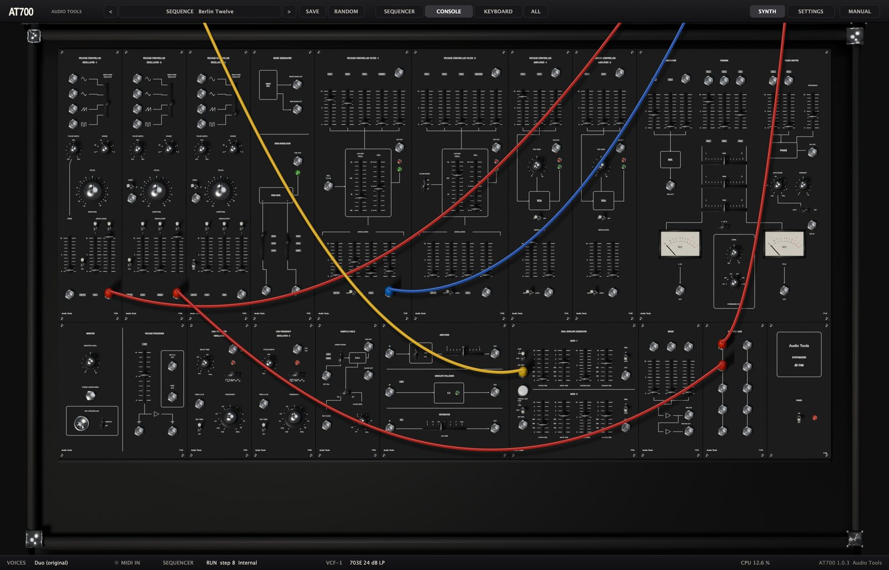

The panel graphics are our own. Roland and System-700 are trademarks of Roland Corporation; the names are used only to identify the instrument that inspired this recreation.

## First steps

### Installing on macOS

The AT700 needs macOS 11 or later and runs natively on Apple silicon and Intel.

1. Unzip the downloaded file.
2. Copy `AT700.vst3` to `~/Library/Audio/Plug-Ins/VST3/`.
3. Copy `AT700.component` to `~/Library/Audio/Plug-Ins/Components/`.
4. Rescan plugins in your DAW (in Ableton Live: Settings, Plug-Ins, Rescan).

`AT700.app` is the standalone version and can go anywhere, for example in Applications.

> The builds are ad-hoc signed and not notarized. If macOS refuses to open the plugin, run this in Terminal: `xattr -dr com.apple.quarantine ~/Library/Audio/Plug-Ins/VST3/AT700*.vst3 ~/Library/Audio/Plug-Ins/Components/AT700*.component`

### Installing on Windows

The AT700 needs Windows 10 or 11, 64-bit.

1. Unzip the downloaded file.
2. Copy the `AT700.vst3` folder to `C:\Program Files\Common Files\VST3\` (Windows asks for administrator rights).
3. Rescan plugins in your DAW.

`AT700.exe` is the standalone version and runs without a DAW. The binaries are not code-signed, so Windows SmartScreen may ask you to confirm the first time.

### Loading it in a DAW

The AT700 is an instrument with MIDI input and a stereo output (mono outputs are supported too). Create an instrument or MIDI track and choose AT700 from the Audio Tools plugins. Notes on any MIDI channel play the 701A keyboard. The plugin reports a tail of six seconds, so long releases and the spring reverb are not cut off when a clip ends.

In Ableton Live, the factory presets appear in Live's browser under Plug-Ins → Audio Tools AT700 (expand the plugin), installed by the launcher or from the zip's Presets folder. Live doesn't show a plugin's own program list; the preset menu in the editor has them all. AT700 has 230 parameters, more than the 64 for which Live fills the device panel by itself: click Configure in the device title bar and touch the controls you want there (Live automates up to 128 at once).

### Your first sound

The AT700 opens on the **Init** preset: VCO-1 with a sawtooth goes through VCF-1 and VCA-1, the envelope ADSR-1 opens the filter and the amplifier, and a little spring reverb is mixed in. Play a few notes from your MIDI keyboard, or click the keys of the 701A at the bottom of the window (choose **KEYBOARD** in the top bar to see them). Then move the **CUTOFF FREQ.** fader of VCF-1 and the **RES.** fader next to it, and you are already shaping the sound.

If you prefer to start with something finished, click the preset name in the top bar and pick one of the 32 factory presets.

## A tour of the interface

The editor has three parts: the top bar, the canvas with the three cabinets, and a status bar at the bottom. The window can be resized from its corner; it keeps its proportions and goes from a third of its full size to 1.3 times.

### The top bar

- The **<** and **>** buttons step through the presets.
- The preset button in the middle shows the category and the name of the current preset. Click it to open the preset menu.
- **SAVE** stores the current patch as a user preset.
- **RANDOM** makes a random patch: it moves the oscillators, filters, envelopes and LFOs, and keeps your cables and the output mix.
- **SEQUENCER**, **CONSOLE**, **KEYBOARD** and **ALL** move the view between the cabinets.
- **SYNTH** shows the canvas and **SETTINGS** shows the Settings page, at the right end of the bar.
- **MANUAL** opens this manual inside the plugin, in English or Spanish. Press Esc or the cross to close it.

### The canvas and the views

The three cabinets stand on one large canvas and the view buttons glide between them. **CONSOLE** frames the whole Main Console, **SEQUENCER** the 717A with the top of the console, **KEYBOARD** the lower row of the console with the keyboard in front, and **ALL** shows the three cabinets at once at half size. Cables keep hanging between the cabinets in every view.

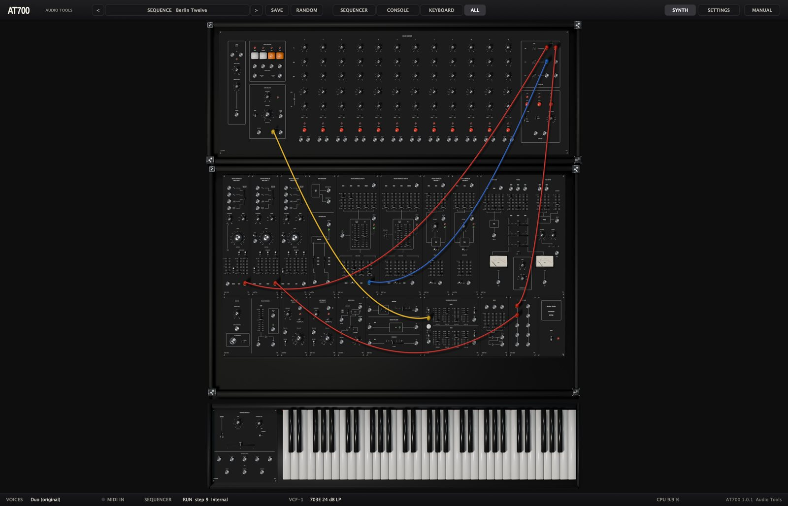

Turn the mouse wheel or drag over an empty part of the panel to scroll up or down.

### The status bar

The bar at the bottom shows the keyboard mode (**VOICES**), a **MIDI IN** light that flashes when MIDI arrives, the state of the **SEQUENCER** (RUN or STOP, the current step and whether it uses the internal or the host clock), the **VCF-1** model in use, the CPU load and the version.

### Working the controls

- Knobs: drag up or down. Hold Shift for fine adjustment. Knobs with positions (RANGE, DIVIDE, STEP SELECTOR) click from one position to the next.
- The PITCH knob of each oscillator is concentric: the large outer ring sets semitones and the small center sets FINE.
- Faders, vertical or horizontal: drag the cap, or click on the track to jump there.
- Slide switches and wave selector levers: click the position you want.
- Toggle switches: click to flip them; the three-position toggles of the envelopes follow where you click.
- Buttons (START, STOP, MANUAL and the others) act while you press them.
- The mouse wheel over a knob or fader moves it; double-click a knob or fader to return it to its default.
- While you move a control, a label shows its name and value in real units. The BENDER lever springs back to the center when you let go.
- Click a key of the 701A to play it, and drag across the keys to slide from note to note.

Right-click any knob, fader or switch to assign it to a MIDI controller (see MIDI).

### Patch cords

- Drag from one jack to another to plug in a cord, starting at either end. Cords take colors in turn.
- A valid target lights with a yellow ring. Output to output and input to input are not allowed, and a cord dropped anywhere else disappears.
- To move a cord, click a plugged jack and drag: the plug comes out of that jack and you can put it somewhere else, or drop it on an empty spot to remove the cord.
- To take several cords from one output, hold Shift and drag from the output: a new plug stacks on top of the ones already there.
- Alt-click or right-click a jack to remove every cord plugged into it.
- An input takes one cord. Plugging a new cord into an occupied input replaces the old one. Outputs take as many cords as you want.

## How the system works

### Levels and voltages

The AT700 keeps the conventions of the System-700, and the panels follow them.

| Signal | Level |
|---|---|
| Audio | 10 V peak to peak |
| Control voltage | 0 to plus or minus 10 V |
| Gates and triggers | +15 V |
| Pitch | 1 V per octave |
| Gate and clock inputs | switch at about +5 V |

On each module the upper faders mix audio inputs and the lower ones, under MODULATION, mix control voltages. A modulation fader at 10 adds the incoming voltage at full strength: on a filter or an oscillator (with the attenuator at 1) that is exactly 1 V per octave, so a sequence played into it stays in tune.

The filters and amplifiers have two lights next to their output. The green one shows signal. The red one lights when the sum at the input goes past about 13 V peak to peak, which happens when more than one input fader is near 10; the green light goes out at the same time. The module is then soft clipping, which may be the sound you want.

### The internal buses

The Main Console comes wired at the factory. These connections need no cords:

- Each oscillator's WAVE FORM SELECTOR feeds its chosen waveform to the input faders of both filters and to the ring modulator.
- White noise feeds the W.NOISE fader of VCF-1, and the ring modulator feeds the RING MOD fader of VCF-2.
- Both filters feed the input faders of both amplifiers.
- Both amplifiers feed the reverb inputs, the PAN 1 and PAN 2 channels and the phase shifter inputs. The reverb feeds PAN 3.
- The keyboard's KEY CV1 reaches the KEY CV switches of the oscillators and the KEY CV faders of the filters. Its gate and trigger reach both envelopes and the KEY TRIG switches of the LFOs.
- LFO-1 reaches the oscillators, the filters and the sample and hold. ADSR-1 reaches VCO-2, and the sample and hold reaches VCO-3. Both envelopes reach the filters and amplifiers through their ADSR1 and ADSR2 selectors.

Some inputs are normalled: a jack carries an internal signal until you plug a cord into it, and then the cord replaces it. PAN 1 and PAN 2 carry VCA-1 and VCA-2, PAN 3 carries the reverb, the phase shifter inputs carry VCA-1 and VCA-2, the envelope follower input carries the amplifier output, and the integrator input carries the envelope follower output.

## The Main Console: upper row

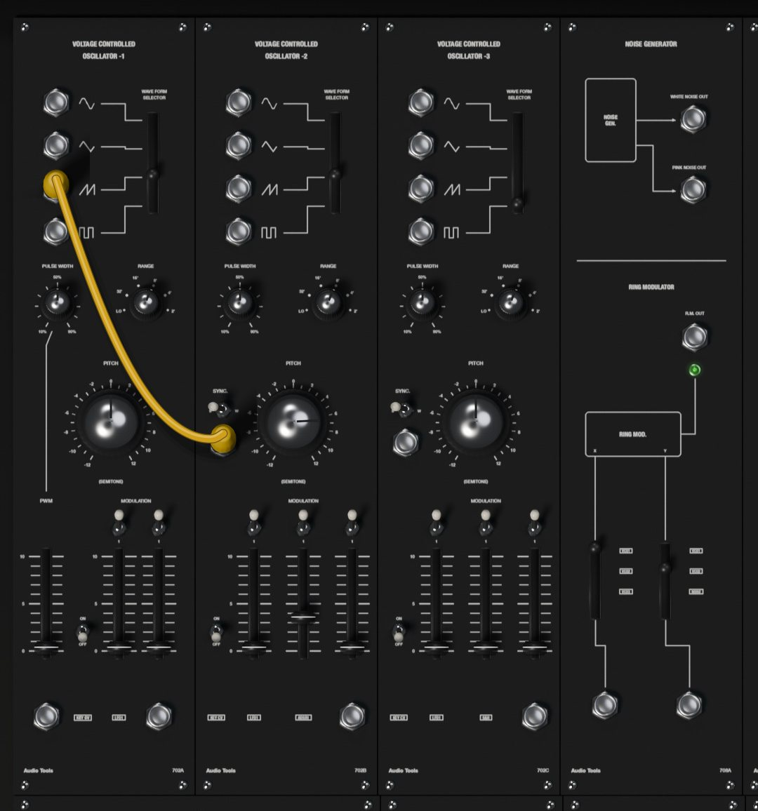

### 702 VCO-1, VCO-2 and VCO-3

Each oscillator has four simultaneous outputs, **sine**, **triangle**, **sawtooth** and **pulse**, and a **WAVE FORM SELECTOR** lever that chooses which of the four goes to the filters and the ring modulator through the internal bus.

| Control | Range | What it does |
|---|---|---|
| RANGE | LO, 32', 16', 8', 4', 2' | Octave. 8' is the normal pitch; LO is five octaves below it, for sub-audio sweeps and modulation |
| PITCH | -12 to +12 semitones | Tuning, outer ring (-24 to +24 in LO) |
| FINE | -100 to +100 cents | Fine tuning, the small center knob |
| PULSE WIDTH | 10 to 90 % | Width of the pulse wave |
| KEY CV | ON, OFF | Whether the oscillator follows the keyboard |

At 8' and with PITCH centered, the lowest key of the 701A plays C at 65.4 Hz. The sawtooth and pulse outputs run from 0 to +10 V, and the sine and triangle swing plus and minus 5 V. On the bus to the filters all four are centered.

Each oscillator has a **MODULATION** section of faders, each with a **1/10 and 1** attenuator switch above it. At 1 a fader at 10 passes the voltage at full strength, 1 V per octave; at 1/10 it passes a tenth, which is what you want for vibrato.

- VCO-1: **LFO1** (internal) and **EXT** (the jack under the fader).
- VCO-2: **LFO1**, **ADSR1** (internal) and **EXT**.
- VCO-3: **LFO1**, **S&H** (internal, the sample and hold) and **EXT**.

VCO-1 also has a **PWM** fader with its own jack. The fader sets how much the voltage at that jack moves the pulse width; at 10, every volt widens the pulse by 10 %. The PWM fader does nothing until a cord reaches the PWM jack.

VCO-2 and VCO-3 have a **SYNC.** jack with an **S and W** switch. S (strong) restarts the oscillator's cycle every time the signal at SYNC rises past +5 V: the classic hard sync, with its tearing sweep when you move the synced oscillator's pitch. W (weak) only nudges the cycle forward, for a softer lock that also catches some non-harmonic ratios. A sawtooth or pulse from another oscillator is the usual source.

### 708A noise generator and ring modulator

The upper half is the **NOISE GENERATOR** with two outputs, **WHITE NOISE OUT** and **PINK NOISE OUT** (pink falls 3 dB per octave and sounds darker). White noise also reaches VCF-1 internally; pink noise is only available at its jack.

The lower half is the **RING MODULATOR**. It multiplies two signals and gives their sum and difference frequencies, the clangorous sound of bells and metal. Two levers choose its inputs: **X** takes VCO1, VCO2, VCO3 or the X jack, and **Y** takes VCO1, VCO2, NOISE or the Y jack (the last position of each lever selects its jack). The result goes to the RING MOD fader of VCF-2 and to the **R.M. OUT** jack, and a green light shows activity. A trace of the X signal leaks through, as in the calibrated original.

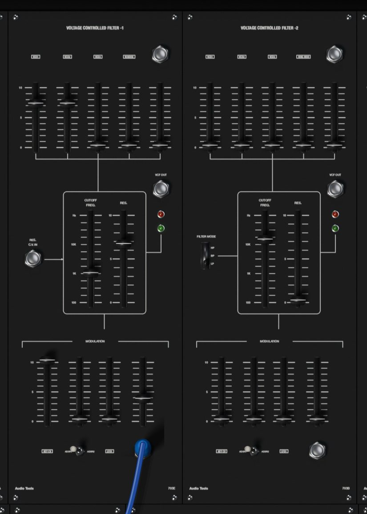

### 703E VCF-1

VCF-1 is a 24 dB per octave low-pass filter built from four transconductance stages, the type found in the surviving consoles. Its five input faders mix **VCO1**, **VCO2**, **VCO3**, **W.NOISE** and an external signal from the jack above the fifth fader.

| Control | Range | What it does |
|---|---|---|
| CUTOFF FREQ. | 20 Hz to 30 kHz | Cutoff frequency; the scale is marked 100, 1K and 10K |
| RES. | 0 to 10 | Resonance; the filter whistles on its own from about 7.5 |

Like the original, VCF-1 has no compensation for resonance: as RES goes up, the low end gets thinner (about 10 dB quieter at 4 and 13 dB at 7). Make up for it with the input faders or the amplifier, or use VCF-2.

The **RES. C.V. IN** jack lets a voltage control the resonance; each volt adds a little less than one unit on the RES scale.

The **MODULATION** faders move the cutoff: **KEY CV** (keyboard tracking; at 10 the filter follows the keyboard exactly, which is its default), **ADSR** (with an **ADSR1 and ADSR2** switch under it to pick the envelope), **LFO1**, and **EXT** with its jack. Each fader at 10 gives 1 V per octave. Self-oscillating with KEY CV at 10, the filter plays in tune from the keyboard.

On the Settings page you can replace VCF-1 with a 703A, the 12 dB multimode filter the 1976 manual shows in this position (see Settings). The RES. C.V. IN jack only acts on the 703E.

### 703B VCF-2

VCF-2 is a 12 dB per octave state-variable filter with a **FILTER MODE** switch: **HP** (high-pass), **BP** (band-pass) and **LP** (low-pass). Its inputs are **VCO1**, **VCO2**, **VCO3**, **RING MOD** and an external jack. CUTOFF FREQ., RES. and the MODULATION section work as on VCF-1, except that it has no resonance input and its KEY CV fader starts at 0. It self-oscillates from about RES 7.6, also in tune, and keeps its low end as the resonance rises.

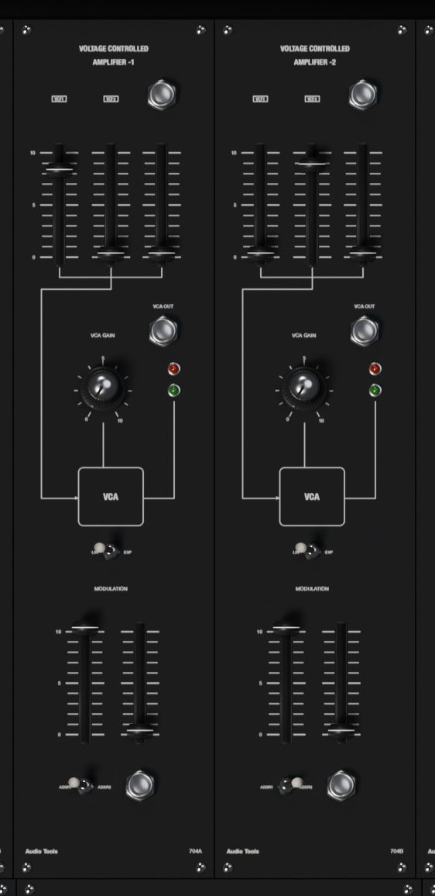

### 704 VCA-1 and VCA-2

The two amplifiers set the loudness of the sound. Each mixes **VCF1**, **VCF2** and an external jack on its input faders.

| Control | Range | What it does |
|---|---|---|
| VCA GAIN | 0 to 10 | Initial gain, before any envelope |
| LIN and EXP | switch | Response to the control voltage |
| MODULATION: ADSR | 0 to 10 | Envelope amount, with an ADSR1 and ADSR2 switch |
| MODULATION: EXT | 0 to 10 | Amount of the voltage at the jack under it |

At VCA GAIN 0 only the envelope opens the amplifier, as a played note should; at 10 it stays open, for drones.

In **LIN** each volt adds 10 % of gain, so the envelope shape comes through as drawn. In **EXP** each volt adds 10 dB, which gives snappier attacks and long, natural-sounding tails.

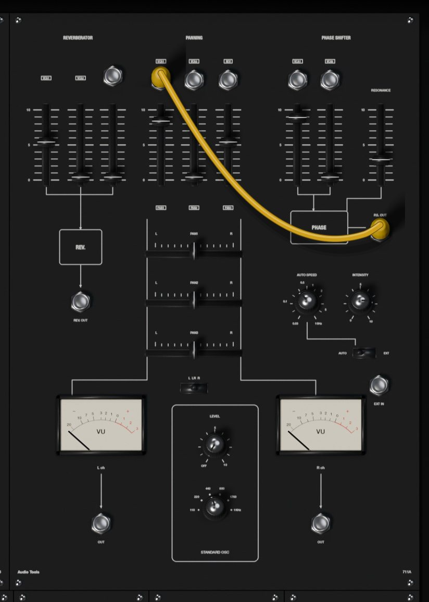

### 711A output module

The widest module holds four sections and the meters.

**REVERBERATOR.** A two-spring reverb with the dark, metallic tone and the drip of real springs (about two seconds at most). Three faders mix **VCA1**, **VCA2** and the **REV IN** jack into it. The result goes to PAN 3 and to the **REV. OUT** jack.

**PANNING.** Three channels with a level fader each and a horizontal **PAN1**, **PAN2** and **PAN3** fader that places them between **L** and **R** (centered by default). Each channel has an input jack that is normalled: PAN 1 carries VCA-1, PAN 2 carries VCA-2 and PAN 3 carries the reverb, until you plug a cord into it.

**STANDARD OSC.** A reference tone to tune by: **LEVEL** (OFF to 10) and a frequency switch with **110**, **220**, **440**, **880** and **1760** Hz (square waves) and **1KHz** (a sine). The **L, LR and R** switch sends it to the left output, both or the right output. It goes straight to the outputs, after the panning.

**PHASE SHIFTER.** Eight phase-shifting stages, swept between 100 Hz and 10 kHz. Two faders mix **VCA1** and **VCA2** (both inputs have normalled jacks), and **RESONANCE** feeds the output back for a sharper sweep. **AUTO SPEED** (0.03 to 10 Hz) and **INTENSITY** (0 to 10) set the internal sweep; switch **AUTO and EXT** to EXT and a voltage at the **EXT IN** jack sweeps it instead, with INTENSITY as its depth.

> The phase shifter's output, **P.S. OUT**, is not connected anywhere inside, as in the original. To hear it, patch P.S. OUT into one of the PAN inputs and raise that channel's level. The factory presets that use the phaser do exactly that.

At the bottom are the two VU meters, **L ch** and **R ch**, with an **OUT** jack under each one. These jacks carry the final left and right mix.

## The Main Console: lower row

### 712A monitor and voltage processor

**MONITOR LEVEL** is the master volume. At 7 the output is at its normal level, at 10 it is about 9 dB louder, and at 0 it is silent. The STEREO HEADPHONES socket and the EXT CONTROLLER socket and switch are drawn as on the original but have no function in the plugin.

The **VOLTAGE PROCESSOR** is a fixed voltage source: the **+10V** fader sets a voltage from 0 to +10 V at **+OUT** and the same voltage negative at **-OUT**. Use it to offset a pitch or open a filter by hand.

The **KEY C.V. OUT** and **GATE OUT** jacks give the keyboard's CV1 and gate (in poly mode they carry the first voice).

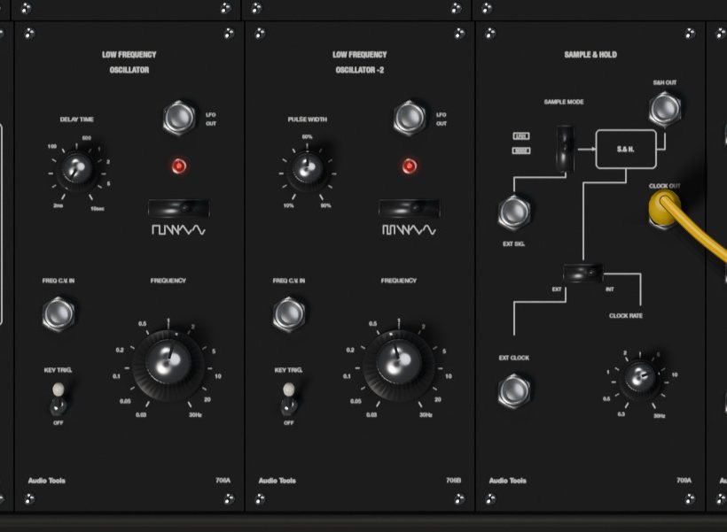

### 706 LFO-1 and LFO-2

Two low-frequency oscillators for vibrato, tremolo, sweeps and clocks.

| Control | Range | What it does |
|---|---|---|
| FREQUENCY | 0.03 to 30 Hz | Speed |
| Wave switch | 4 positions | Square (pulse on LFO-2), falling ramp, triangle, sine |
| DELAY TIME (LFO-1) | 2 ms to 10 s | Fade-in time of LFO-1 after the first key |
| PULSE WIDTH (LFO-2) | 10 to 90 % | Width of LFO-2's pulse wave |
| KEY TRIG. | ON, OFF | Restart the wave when a phrase begins |

The square and pulse waves run from 0 to +10 V, the ramp falls from +10 V to 0, and the triangle and sine swing plus and minus 5 V. The **FREQ C.V. IN** jack changes the speed at 1 V per octave. The light shows the wave.

LFO-1 is the console's modulation source: it reaches the MODULATION faders of the oscillators and filters and the sample and hold without any cord. Its DELAY TIME makes vibrato arrive gradually: each time you play a key after all keys were released, LFO-1 starts from silence and fades in over the time you set. With **KEY TRIG.** ON, the wave also restarts from the same point at that moment, so every phrase begins the same way.

> LFO-2 has no internal connections. It only works through its **LFO OUT** jack: patch it where you need it, for example into the PWM jack of VCO-1.

### 709A sample and hold

The sample and hold takes a reading of a signal at each clock pulse and holds that voltage until the next one: random steps from noise, staircases from an LFO.

- **SAMPLE MODE** chooses what is sampled: **LFO1**, **NOISE** or (bottom position) the **EXT SIG.** jack.
- The **EXT and INT** switch chooses the clock: INT uses the internal clock set by **CLOCK RATE** (0.3 to 30 Hz), EXT uses pulses at the **EXT CLOCK** jack (each rise past +5 V takes a sample).
- **S&H OUT** gives the held voltage (up to plus or minus 10 V), and it also reaches VCO-3's S&H modulation fader internally.
- **CLOCK OUT** gives the clock as a +15 V square wave, handy to gate an envelope in time with the steps.

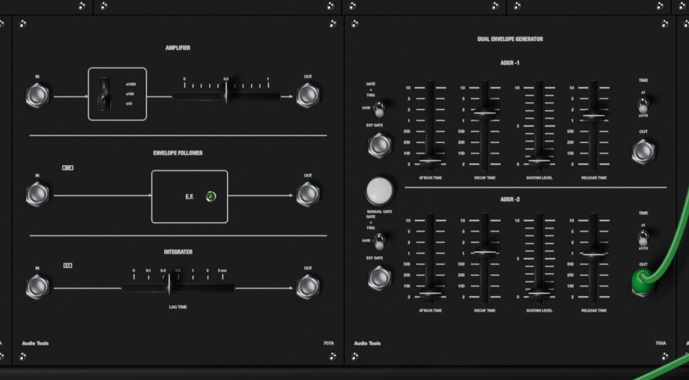

### 707A amplifier, envelope follower and integrator

**AMPLIFIER.** A preamp for quiet signals: a range switch (**x1000**, **x100** and **x10**) and a horizontal gain fader from 0 to 1 multiply the signal at **IN**; the result, limited to plus or minus 10 V, comes out at **OUT**.

**ENVELOPE FOLLOWER.** Turns the loudness of a signal into a voltage: 1 V for each volt peak to peak at the input, up to 10 V, with a fast rise and a slower fall. Its **IN** is normalled to the amplifier output. A green light shows the level.

**INTEGRATER** (the panel's spelling). A lag: its output follows the input slowly, with **LAG TIME** from 0 to 3 seconds, and falls a little slower than it rises. Its **IN** is normalled to the envelope follower output, so with nothing patched the three sections form one chain. Patched alone, it smooths steps into glides, for example on a sequencer output.

### 705A dual envelope generator

Two ADSR envelopes, **ADSR -1** and **ADSR -2**, each with four faders:

| Control | Range | What it does |
|---|---|---|
| ATTACK TIME | 2 ms to 10 s | Time to rise to 10 V |
| DECAY TIME | 2 ms to 10 s | Time to fall to the sustain level |
| SUSTAIN LEVEL | 0 to 10 | Level held while the gate lasts |
| RELEASE TIME | 2 ms to 10 s | Time to fall to 0 after the gate ends |
| TIME | x1, x1/10 | x1/10 divides the three times by ten (0.2 ms to 1 s) |

The envelopes run from 0 to +10 V and come out at their **OUT** jacks as well as reaching the filters and amplifiers internally (ADSR-1 also reaches VCO-2). The three-position mode toggle on the left sets what starts them:

- Top, **GATE + TRIG**: the keyboard's gate holds the envelope and each new trigger restarts the attack, so every note in a legato phrase is articulated.
- Middle, **GATE**: only the gate counts; a legato phrase gets one envelope from the first note to the last.
- Bottom, **EXT GATE**: the envelope listens to the **EXT GATE** jack instead of the keyboard. Anything over +5 V is a gate: the sequencer's CLOCK OUT or a step's GATE OUT, the S&H CLOCK OUT, an LFO square.

The white **MANUAL GATE** button opens both envelopes for as long as you hold it, whatever their mode.

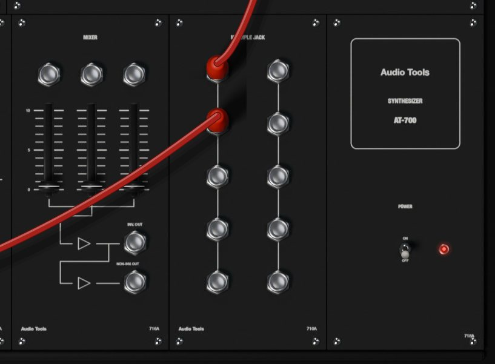

### 716A mixer

Three inputs with a fader each, summed and sent to two outputs: **NON-INV. OUT** gives the sum, and **INV. OUT** gives it upside down. It works for audio or control voltages, for example to add two modulations or invert an envelope.

### 710A multiple jacks

Two columns of five jacks. Every jack in a column carries the sum of whatever is plugged into that column, so a multiple lets one output feed several inputs, or adds a few signals together. A multiple jack works as an input or an output depending on what you plug into it: a cord from an output into a multiple feeds the column, and a cord from a multiple to an input takes the signal out.

The two columns can be linked with a cord, but a column cannot feed itself, and the two columns cannot feed each other in a loop: the editor refuses those cords.

### 718A power

The **POWER** switch, with its light. Switched OFF, the output fades to silence and the meters and lights go dark; switch it back ON to hear the console again.

## The patch bay

All 137 jacks are listed here by module, with their signals. Outputs can feed any number of inputs; each input takes one cord.

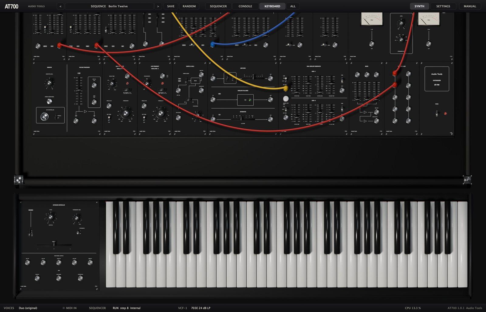

| Module | Inputs | Outputs |
|---|---|---|
| VCO-1 | PWM, EXT | sine, triangle, saw, pulse |
| VCO-2, VCO-3 | SYNC., EXT | sine, triangle, saw, pulse |
| 708A | ring mod X, Y | white noise, pink noise, R.M. OUT |
| VCF-1 | audio IN, RES. C.V. IN, EXT (cutoff) | VCF OUT |
| VCF-2 | audio IN, EXT (cutoff) | VCF OUT |
| VCA-1, VCA-2 | audio IN, EXT (gain) | VCA OUT |
| 711A | REV IN, PAN 1 to 3, phaser IN 1 and 2, EXT IN | REV. OUT, P.S. OUT, OUT L, OUT R |
| 712A | none | +OUT, -OUT, KEY C.V. OUT, GATE OUT |
| LFO-1, LFO-2 | FREQ C.V. IN | LFO OUT |
| 709A | EXT SIG., EXT CLOCK | S&H OUT, CLOCK OUT |
| 707A | AMP IN, E.F. IN, INT IN | AMP OUT, E.F. OUT, INT OUT |
| 705A | EXT GATE 1 and 2 | ADSR OUT 1 and 2 |
| 716A | IN 1 to 3 | NON-INV. OUT, INV. OUT |
| 710A | 10 jacks, in or out | |
| 717A | 4 control pulse, EXT CLOCK, C.V. IN, PULSE IN, 12 ANALOG IN | START and END PULSE, 2 CLOCK OUT, 2 pulse shaper, 12 GATE OUT, 6 parallel, 2 series |
| 701A | none | KEY CV1, KEY CV2, GATE, KEY TRIG., BEND CV, VELOCITY, MOD WHEEL, AFTERTOUCH |

And what each kind of output gives:

| Output | Signal |
|---|---|
| VCO saw and pulse | 0 to +10 V |
| VCO sine and triangle | plus or minus 5 V |
| Filters, amplifiers, noise, ring mod, reverb | audio, about 10 V peak to peak |
| LFO square and pulse, ramp | 0 to +10 V |
| LFO triangle and sine | plus or minus 5 V |
| ADSR, envelope follower | 0 to +10 V |
| Voltage processor | 0 to +10 V and 0 to -10 V |
| Keyboard CV | 0 V at the lowest key, +5 V at the top, 1 V per octave |
| Gates, triggers, clocks, pulses | +15 V |
| BEND CV | plus or minus 5 V |
| VELOCITY, MOD WHEEL, AFTERTOUCH | 0 to +10 V |
| Sequencer parallel and series | 0 to 10, 4 or 2 V |

The gate and clock inputs (EXT GATE, EXT CLOCK of the S&H and the sequencer, SYNC.) respond to a rise past about +5 V. The sequencer's CONTROL PULSE IN jacks respond past +7 V, and the pulse shaper has its own adjustable threshold.

Inputs that move a pitch or a frequency (VCO EXT, VCF EXT, LFO FREQ C.V. IN, the clock's C.V. IN) follow 1 V per octave at full setting. The VCA EXT inputs follow the LIN or EXP response.

> Feedback is allowed: you can patch an output back into its own module's input. Voltages stop at the plus and minus 15 V rails, as on the hardware, so a loop saturates instead of running away. Only the multiples are protected against loops.

In poly mode (see the keyboard), the jacks of the voice modules carry one signal per voice. A cord from a shared module (an LFO, the sample and hold, the sequencer) into a voice module reaches every voice; a cord from a voice module into a shared module carries the sum of the voices.

## The 701A keyboard controller

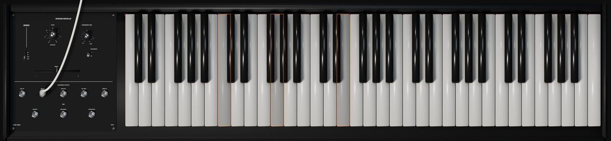

The keyboard has 61 keys over five octaves. Its key voltage is 0 V at the lowest key and +5 V at the highest, 1 V per octave. MIDI note 36 is the lowest key; notes outside the 61 keys still play, they just do not light a key.

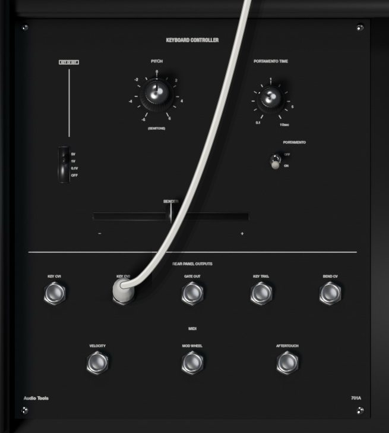

### Panel controls

| Control | Range | What it does |
|---|---|---|
| PITCH | -6 to +6 semitones | Transposes the whole keyboard |
| PORTAMENTO TIME | 0.1 to 10 s | Glide time between notes |
| PORTAMENTO | OFF, ON | Switches the glide on |
| Bend range switch | 5V, 1V, 0.1V, OFF | How far the BENDER moves the key voltage |
| BENDER | lever | Bends all notes, springs back to 0 |

The bend range is in volts, so at 1V the lever bends one octave each way, at 0.1V a little over a semitone, and at 5V five octaves, for wild effects. MIDI pitch bend moves the same lever (see Settings).

### Rear panel outputs and MIDI jacks

Under **REAR PANEL OUTPUTS** are the jacks that sat at the back of the original keyboard, brought to the front:

- **KEY CV1** and **KEY CV2**: the two key voltages (see the modes below). CV1 also reaches the console internally; CV2 is only available here.
- **GATE OUT**: +15 V while a key is held.
- **KEY TRIG.**: a 2 ms pulse at +15 V when a new note starts.
- **BEND CV**: the lever position as plus or minus 5 V, regardless of the range switch.

Under **MIDI** are three outputs that the original never had: **VELOCITY**, **MOD WHEEL** and **AFTERTOUCH**, each from 0 to +10 V. They do nothing until you patch them: velocity into a VCA's EXT input for touch-sensitive volume, the mod wheel into a VCO's EXT input for hand vibrato, aftertouch into a filter's EXT input.

### Keyboard modes

The mode is set on the Settings page and shown in the status bar.

**Duo (original).** The 701A is duophonic, as the original. KEY CV1 follows the lowest key held and KEY CV2 the highest; with one key down both are the same. The voltages stay where they are after you release the keys, so release tails keep their pitch. The trigger fires each time the lowest key changes. With CV1 on one oscillator and CV2 patched into another, you play two-voice lines through one filter and one amplifier.

**Mono.** One note at a time, with the last key pressed taking priority. Release it while still holding others and the voltage returns to the most recent key still down. Every new key fires a trigger.

**Poly 4, Poly 6 and Poly 8.** Each key gets its own voice: the voice modules of the console (the three VCOs, the ring modulator, both filters, both amplifiers, both envelopes, the 707A, the mixer, the multiples and the keyboard outputs) are duplicated for every voice, cords included. The LFOs, the sample and hold, the noise, the output module, the voltage processor and the sequencer stay shared, so one LFO sweep moves all voices together. A new note takes the voice that was released longest ago, or steals the oldest one when all are busy. In poly mode CV2 equals CV1 for each voice.

Changing the mode releases any held notes. KEY CV DROOP, also on the Settings page, makes the held voltage drift slowly down after release, as the original's sample and hold leaked.

## The 717A analog sequencer

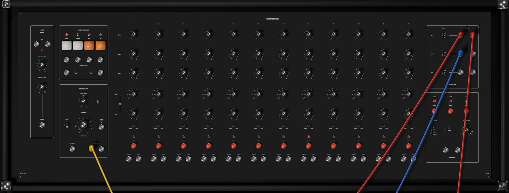

The 717A holds three rows of twelve voltages, CH-A, CH-B and CH-C, and steps through them in time. Each column is a step. The rows can play as three parallel sequences (three voltages per step, for pitch, filter and anything else at once) or one after another as a single series of up to 36 steps. Every step also has its own length, a hold switch for rests, a manual button, a gate output and an analog input.

The sequencer is shared by all voices and plays only what you patch its outputs into.

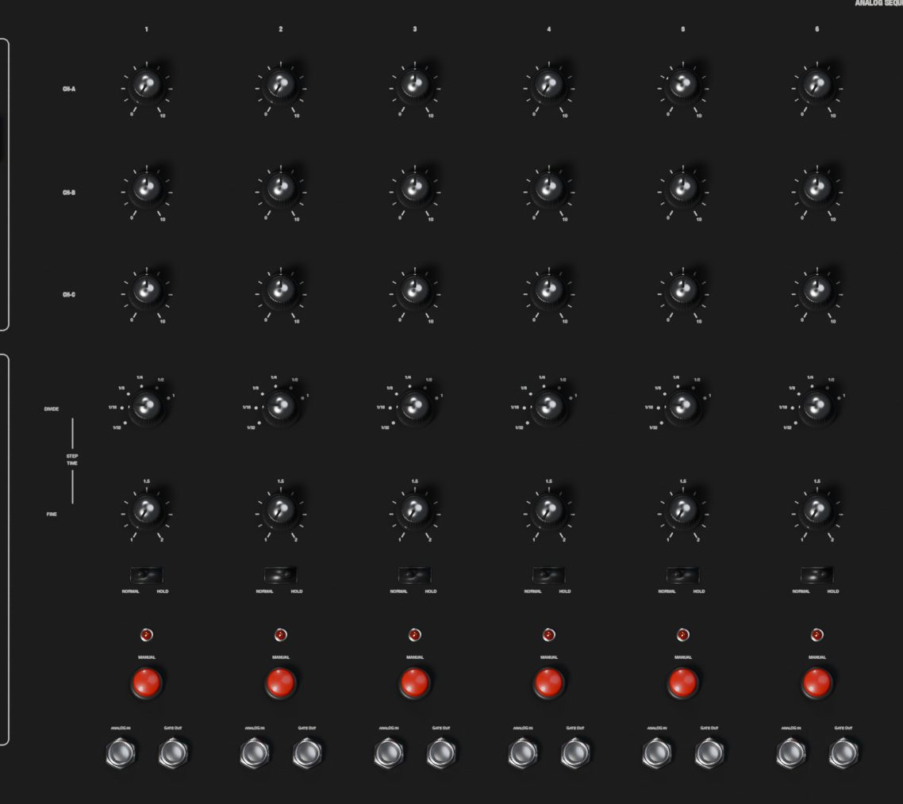

### The steps

Each of the twelve columns has, from top to bottom:

| Control | Range | What it does |
|---|---|---|
| CH-A, CH-B, CH-C | 0 to 10 | The three voltages of the step |
| DIVIDE | 1/32, 1/16, 1/8, 1/4, 1/2, 1 | Length of the step, as a fraction |
| FINE | 1 to 2 | Stretches the step, up to double |
| NORMAL and HOLD | switch | HOLD makes the step a rest |
| MANUAL | button | Jumps to the step |
| ANALOG IN | jack | Turns the step's knobs into level controls |
| GATE OUT | jack | +15 V while the step plays |

**DIVIDE and FINE** set the step length together: DIVIDE times FINE, as a fraction of the clock's basic unit (see the clock below). FINE at 1.5 on a 1/8 step makes a dotted eighth; at 2 it doubles the step.

**HOLD** keeps the voltages of the previous step and silences the CLOCK OUT for the length of the step. When the clock gates your envelope, a held step is a rest that keeps the previous pitch. The step's GATE OUT still fires.

The **GATE OUT** of each step gives +15 V during the high part of the clock pulse while that step plays. Patch a step's gate into an envelope for an accent on that step, or into the CONTROL PULSE inputs to make a step stop or restart the sequence. While the sequencer is stopped, the gate of the current step stays high.

**ANALOG IN**: with a signal patched into a step's ANALOG IN, that step's outputs give the signal multiplied by the step's knobs instead of a fixed voltage (10 is full level). The sequencer becomes a twelve-way switch, even for audio.

A light under each step shows the current step.

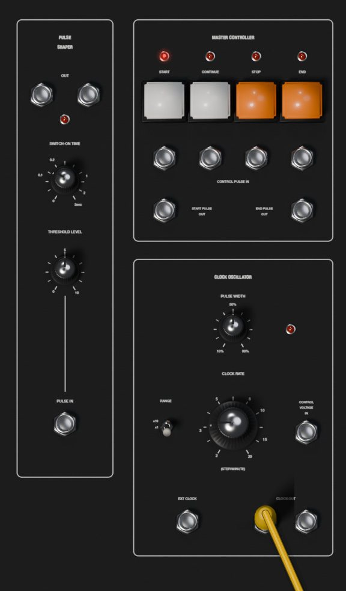

### The clock oscillator

| Control | Range | What it does |
|---|---|---|
| CLOCK RATE | 2 to 20 (STEP/MINUTE) | Speed of the internal clock |
| RANGE | x10, x1 | Multiplies the rate by 10 or 1 |
| PULSE WIDTH | 10 to 90 % | Length of each clock pulse within the step |

RANGE x10 covers 20 to 200. The value label shows the knob's own 2 to 20 scale, without the x10.

The CLOCK RATE counts in whole notes: it is the number of steps per minute when DIVIDE is at 1. Every step lasts 60 seconds divided by the rate, times its DIVIDE, times its FINE. So:

- To play sixteenth notes at a tempo, set the rate to the tempo divided by 4 and DIVIDE to 1/16. For 128 BPM: rate 32 (RANGE x10, knob at 3.2), DIVIDE 1/16 on every step.
- Eighth notes at 120 BPM: rate 30, DIVIDE 1/8.
- With every DIVIDE at its default of 1/4, a rate equal to the BPM gives sixteenths.

The **CONTROL VOLTAGE IN** jack changes the internal clock speed at 1 V per octave (plus or minus 5 V): one volt doubles it.

The **EXT CLOCK** jack replaces the internal clock with pulses: each rise past +5 V counts as 1/32 of a whole note, the divider of the original. A step at DIVIDE 1/16 takes two pulses, a step at 1/4 takes eight.

The two **CLOCK OUT** jacks give a +15 V pulse at the start of every step, as long as PULSE WIDTH sets. They are silent on held steps and while the sequencer is stopped. The clock light shows the pulses.

### The master controller

Four buttons control the run, each with a light and a **CONTROL PULSE IN** jack under it that does the same when a voltage rises past +7 V:

- **START**: starts from step 1 of channel A and sends a pulse at **START PULSE OUT**.
- **CONTINUE**: carries on from the current step.
- **STOP**: stops on the current step.
- **END**: stops and goes back to step 1 of channel A.

**END PULSE OUT** gives +15 V whenever the sequencer is not running, so it goes high when a series set to STOP reaches its last step.

The **MANUAL** button of each step jumps straight to that step, running or stopped; with the sequencer stopped, the step's voltages come out at once, so you can tune a sequence one step at a time.

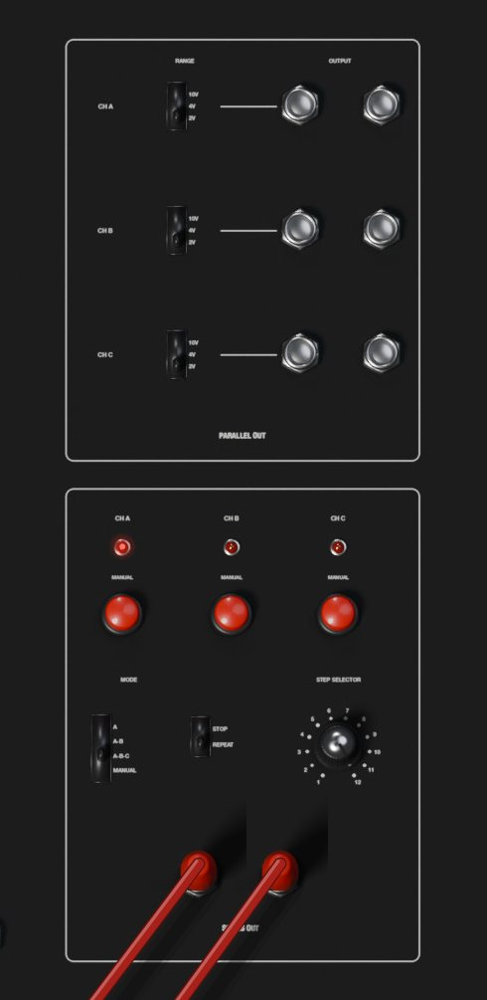

### Parallel and series outputs

**PARALLEL OUT** has two jacks per channel, CH A, CH B and CH C, which always give the current step's voltage for that channel. A **RANGE** switch per channel sets the scale of its knobs:

| RANGE | Knob at 10 gives | Good for |
|---|---|---|
| 10V | 10 V | Filter sweeps, VCA levels, wide modulation |
| 4V | 4 V | Melodies over four octaves |
| 2V | 2 V | Melodies over two octaves, easiest to tune |

In the 2V range, one octave is 5 on the knob and one semitone is a little over 0.4.

**SERIES OUT** has two jacks that give the channels one after another, set by the **MODE** switch:

- **A**: channel A only, steps 1 to 12.
- **A-B**: channel A, then channel B: 24 steps.
- **A-B-C**: A, B and C in turn: up to 36 steps.
- **MANUAL**: the channel chosen with the **CH A**, **CH B** and **CH C** MANUAL buttons above the switch.

The lights over the CH buttons show which channel is playing. In the other modes, pressing a CH button jumps to that channel at once.

The **STOP and REPEAT** switch decides what happens at the end of the series: REPEAT starts over, STOP halts on the last step (in MANUAL mode the sequence always loops).

The **STEP SELECTOR** sets how many steps each channel uses, from 1 to 12. Steps beyond the selector are skipped.

### The pulse shaper

On the left of the 717A, the **PULSE SHAPER** turns any signal into clean gates. Each time the signal at **PULSE IN** rises past **THRESHOLD LEVEL** (0 to 10 V), both **OUT** jacks give +15 V for the **SWITCH-ON TIME** (0 to 3 seconds; a few milliseconds at the minimum). A light shows the output. Use it to make gates from an LFO or the envelope follower, or to stretch short gates.

### Host sync and Follow Transport

Two settings on the Settings page connect the 717A to your DAW.

**CLOCK** chooses **Internal** (the clock oscillator) or **Host**. With Host, the sequencer follows the DAW's tempo and position: one whole note of the DAW is DIVIDE 1, so steps at 1/16 land on the sixteenths of your project, 1/4 on the beats. The CLOCK RATE knob, its RANGE and the C.V. IN have no effect, and the steps only advance while the DAW is playing. FINE still stretches steps, now in musical time.

**TRANSPORT** (Follow Transport, on by default) makes the DAW's Play and Stop act as START and STOP, with either clock. Play starts from step 1. With the Host clock, a jump in the DAW (a loop going back, or a click elsewhere on the timeline) starts the sequence again from step 1 at that point, so loop on bar lines and keep the sequence length a divisor of the loop to stay aligned.

> Presets in the Sequence category start the sequencer as soon as they load, so you hear them right away. With TRANSPORT on, stopping the DAW stops them; press START, or Play in the DAW, to hear them again.

With TRANSPORT off, only the panel buttons and the CONTROL PULSE inputs start and stop the sequence; with the Host clock it still waits for the DAW to play before moving.

## Settings

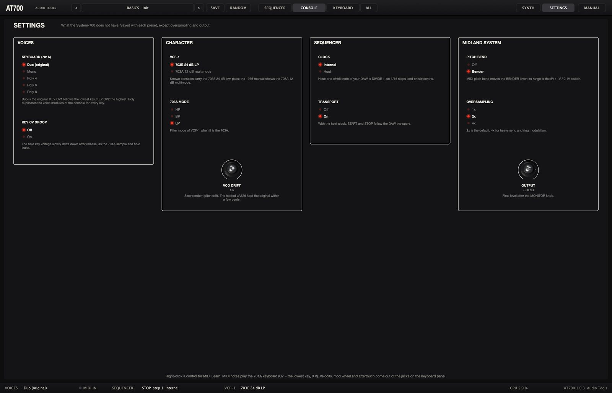

The Settings page holds what the System-700 does not have. Click **SETTINGS** at the right of the top bar to open it, and **SYNTH** (or any view button) to go back to the canvas. Everything here is saved with each preset, except OVERSAMPLING and OUTPUT, which stay as you set them.

| Section | Setting | Options | Default |
|---|---|---|---|
| VOICES | KEYBOARD (701A) | Duo (original), Mono, Poly 4, Poly 6, Poly 8 | Duo |
| VOICES | KEY CV DROOP | Off, On | Off |
| CHARACTER | VCF-1 | 703E 24 dB LP, 703A 12 dB multimode | 703E |
| CHARACTER | 703A MODE | HP, BP, LP | LP |
| CHARACTER | VCO DRIFT | 0 to 10 | 1.5 |
| SEQUENCER | CLOCK | Internal, Host | Internal |
| SEQUENCER | TRANSPORT | Off, On | On |
| MIDI AND SYSTEM | PITCH BEND | Off, Bender | Bender |
| MIDI AND SYSTEM | OVERSAMPLING | 1x, 2x, 4x | 2x |
| MIDI AND SYSTEM | OUTPUT | -24 to +6 dB | 0 dB |

- **VCF-1** swaps the 703E for the 703A, the 12 dB state-variable filter the 1976 manual shows as VCF-1. It keeps its bass at high resonance and offers the modes in **703A MODE**; the RES. C.V. IN jack has no effect on it.
- **VCO DRIFT** sets the slow random wandering of the oscillators' pitch. At 0 they are perfectly stable.
- **PITCH BEND** set to Bender lets MIDI pitch bend move the BENDER lever, with the range of the bend range switch.
- **OVERSAMPLING** runs the console at two or four times the sample rate. 4x cleans up hard sync and ring modulation; 1x saves CPU with many voices.
- **OUTPUT** is the final level, after MONITOR LEVEL.

Click an option to choose it; drag the knobs (double-click resets them). Right-click a setting for MIDI Learn or to reset it.

## Presets

The preset button in the top bar shows the category and name of the current preset. Click it for the menu: one submenu per category, then **Init** (the default panel, with no cords) and **Show user presets folder**. The < and > buttons step through the whole list, and your DAW's program list shows the same presets.

A preset stores the whole panel, every cord with its color, and the settings (except oversampling and output). The 32 factory presets:

| Category | Presets |
|---|---|
| Basics | Init |
| Lead | Fat Saw Lead, Sync Sweep, Tomita Whistle, Flute, PWM Lead, Duophonic Fifths, Glide Saw |
| Brass | Tomita Brass |
| Strings | Ensemble Strings |
| Pads | Phaser Pad |
| Bass | 700 Bass, Sheffield Bass, Sub Pulse |
| Bells | Ring Bells |
| Keys | Tine Keys, Clavi |
| Sequence | Berlin Twelve, Transposed Sequence, Thirty-Six Steps, Sequenced Filter, Gate Patterns |
| FX | Random Computer, S&H Filter, Surf and Wind, Laser Zaps, Thunder, Spring Drips |
| Drone | Space Drone |
| Drums | Kick, Snare, Hi-Hat |

To save your own, click **SAVE**, type a name and confirm. User presets appear in the menu under User. They are JSON files in:

- macOS: `~/Library/Application Support/Audio Tools/AT700/Presets`
- Windows: `%APPDATA%\Audio Tools\AT700\Presets`

Saving with the name of an existing user preset replaces it.

**RANDOM** picks new oscillator, filter, envelope and LFO settings and leaves the cords and the output mix alone, so a sequence patch remains a sequence patch.

Your DAW session stores the full state, including the MIDI controller assignments, which are not part of presets.

## MIDI

- **Notes** on any channel play the 701A according to the keyboard mode. MIDI note 36 is the lowest key (0 V).
- **Velocity** comes out of the VELOCITY jack on the keyboard panel, 0 to 10 V per voice. It changes nothing until you patch it.
- **Pitch bend** moves the BENDER lever when PITCH BEND is set to Bender; its range is the bend range switch.
- **Mod wheel** (CC 1) comes out of the MOD WHEEL jack, 0 to 10 V.
- **Aftertouch**, channel or polyphonic, comes out of the AFTERTOUCH jack, 0 to 10 V.
- **All notes off** and **all sound off** (CC 123 and 120) release every note, and **reset all controllers** (CC 121) centers the bend and zeroes the wheel and aftertouch.

**MIDI Learn.** Right-click any knob, fader, switch or lever on the canvas, or any setting, and choose **MIDI Learn**. Move a knob or fader on your controller: from then on that controller moves the control. Each control takes one controller; the menu shows the assigned CC and offers to clear it. Every CC from 0 to 119 can be learned except the sustain pedal (CC 64). A learned CC 1 moves its control instead of the MOD WHEEL jack. The assignments are saved with your DAW session.

Every panel control and setting is also a plugin parameter, named after its module and control (for example VCF1 Cutoff or Step 5 CH-A), so you can automate them from your DAW.

## Recipes

Each recipe starts from **Init** (preset menu, Init) unless it says otherwise. Values like "5" refer to the 0 to 10 scale printed on the panel.

### 1. A plucked bass

1. Load Init. On VCO-1, set **RANGE** to 16'.
2. On VCF-1, bring **CUTOFF FREQ.** down to around 150 Hz (watch the value label) and set **RES.** to 3.
3. On ADSR-1, set **ATTACK TIME** to the bottom, **DECAY TIME** to about 250 ms, **SUSTAIN LEVEL** to 0 and **RELEASE TIME** to about 150 ms.
4. Raise the ADSR fader in VCF-1's MODULATION section to about 5. Each note now opens the filter and closes it again: a pluck.
5. For a second oscillator, set VCO-2's wave lever to pulse, its RANGE to 16' and FINE a few cents off, and raise the **VCO2** input fader of VCF-1.

### 2. Vibrato that arrives late

1. Load Init. On VCO-1, set the attenuator above the **LFO1** MODULATION fader to 1/10, and raise the fader to about 1.5.
2. On LFO-1, set the wave switch to triangle or sine and **FREQUENCY** to about 5 Hz.
3. Set **DELAY TIME** to about 1 s. Hold a note: it starts straight, and the vibrato fades in.
4. Set **KEY TRIG.** to ON so the vibrato always starts at the same point of its wave. Remember that the delay restarts only when you play after releasing all keys.

### 3. Pulse width modulation

1. Load Init. Move VCO-1's **WAVE FORM SELECTOR** to pulse, and leave **PULSE WIDTH** at 50 %.
2. Patch **LFO OUT** of LFO-2 into the **PWM** jack of VCO-1.
3. Raise the **PWM** fader to about 6 and set LFO-2 to triangle at about 1 Hz. The sound thickens and moves like an ensemble.
4. For strings, add VCO-2 and VCO-3 on sawtooth slightly detuned, slow down the envelope and patch **P.S. OUT** into PAN 1 with the phaser input fader up. The Ensemble Strings preset is this patch.

### 4. A hard sync sweep

1. Load Init. Patch the **sawtooth** output of VCO-1 into the **SYNC.** jack of VCO-2, and set VCO-2's S and W switch to S.
2. On VCF-1, bring the VCO1 input fader down and the VCO2 fader up, so you hear only the synced oscillator.
3. Set VCO-2's PITCH to +7. It now sounds at VCO-1's pitch, with a different tone.
4. Raise VCO-2's **ADSR1** modulation fader (attenuator at 1) to about 3, and give ADSR-1 a decay of about 1.5 s with sustain at 2. Each note sweeps the tone from bright to dark: the classic sync sound. The Sync Sweep preset does it through VCF-2.

### 5. Two voices from one keyboard

1. Load Init and make sure the Settings page shows KEYBOARD set to Duo (original).
2. Patch **KEY CV2** (rear panel outputs of the 701A) into the **EXT** jack of VCO-2.
3. On VCO-2, set **KEY CV** to OFF, raise its **EXT** modulation fader to 10 with its attenuator at 1 (so it tracks at 1 V per octave), and pick a pulse wave.
4. Raise the VCO2 input fader of VCF-1. Play two keys: VCO-1 plays the lower one and VCO-2 the higher one, through the same filter and amplifier. With one key, both play in unison. This is the Duophonic Fifths preset.

### 6. Ring-modulated bells

1. Load Init. Set VCO-1 and VCO-2 to sine, and VCO-2's PITCH to +7 with FINE at about +35 cents, an inharmonic ratio.
2. On the 708A, set lever **X** to VCO1 and lever **Y** to VCO2.
3. On VCF-2, raise the **RING MOD** fader, set FILTER MODE to LP and CUTOFF FREQ. high (about 5 kHz).
4. On VCA-2, raise the **VCF2** input fader and set the ADSR selector to ADSR2 with its ADSR fader at 10. Give ADSR-2 an attack at the bottom, a decay of about 2.5 s, sustain 0 and release about 2 s.
5. Turn down the VCF1 input fader of VCA-1 so only the bells sound, and raise VCA2 on the reverb. Play high notes, and compare with Ring Bells.

### 7. Random filter steps

1. Load Init and set ADSR-1's SUSTAIN to 10 so held notes stay open.
2. On the 709A, set SAMPLE MODE to NOISE, the clock switch to INT and **CLOCK RATE** to about 7 Hz.
3. Patch **S&H OUT** into the **EXT** jack of VCF-1's MODULATION section and raise that EXT fader to about 3.5.
4. Set VCF-1's RES. to about 6.5. Hold a note: the filter jumps to a new random position several times a second.
5. Without any cord, the same steps can move pitch: raise VCO-3's **S&H** modulation fader and let VCO-3 into the filter, for the "random computer" sound.

### 8. A Berlin-school sequence

This builds the Berlin Twelve preset by hand.

1. Load Init. On the Settings page leave CLOCK on Internal. Choose **ALL** in the top bar to see the sequencer and the console while you patch.
2. On the 717A, set MODE to **A**, the end switch to **REPEAT** and the STEP SELECTOR to 12. Set the PARALLEL OUT **RANGE** of CH A to **2V**.
3. Set every step's **DIVIDE** to 1/16. Set the clock **RANGE** to x10 and **CLOCK RATE** to 3.2 (32 whole notes per minute: sixteenths at 128 BPM).
4. Patch one **CH A** parallel output into the **EXT** jack of VCO-1, and the other CH A output into the EXT jack of VCO-2.
5. On both oscillators set **KEY CV** to OFF, the EXT modulation fader to 10 and its attenuator to 1. Set both RANGE to 16', both waves to sawtooth, VCO-2's FINE to about +8 cents, and raise the VCO2 input fader of VCF-1.
6. Patch **CLOCK OUT** into the **EXT GATE** jack of ADSR-1 and set ADSR-1's mode toggle to the bottom (EXT GATE). Set ATTACK to the bottom, DECAY about 220 ms, SUSTAIN 0, RELEASE about 180 ms.
7. Set VCF-1: CUTOFF FREQ. about 110 Hz, RES. about 4, ADSR modulation 4, KEY CV modulation 0.
8. Press **START**. Tune the CH A knobs to a pattern; in the 2V range 0 is the root, 5 is the octave, about 2.9 a fifth and about 4.2 a minor seventh. Try 0, 5, 2.9, 4.2, 0, 5, 1.25, 4.2, 0, 5, 2.9, 6.25.
9. For accents, patch a **CH B** parallel output into VCF-1's EXT modulation jack, raise that EXT fader to about 1.2, leave CH B's RANGE at 10V, and set some CH B knobs higher than others.
10. For slow movement, raise VCF-1's LFO1 modulation fader a little and set LFO-1 to about 0.08 Hz.

### 9. Transposing a sequence from the keyboard

1. Load the Berlin Twelve preset, or build recipe 8.
2. On VCO-1 and VCO-2, set **KEY CV** back to ON. The keyboard voltage now adds to the sequence.
3. Play a key: the whole sequence moves to that key and stays there after you release it, because the 701A holds its voltage. The envelope keeps following the clock, so the keys only transpose. Play the lowest key to return to the original pitch. The Transposed Sequence preset works this way.

### 10. Locking a sequence to your DAW

1. Load any Sequence preset.
2. On the Settings page set **CLOCK** to Host and leave **TRANSPORT** on.
3. Check that the steps use the DIVIDE you want in musical terms: 1/16 for sixteenths, 1/8 for eighths.
4. Press Play in your DAW. The sequence starts from step 1 on the DAW's grid and follows its tempo changes. Stop the DAW and it stops; loop a bar range and it restarts with each loop.

## Tips and troubleshooting

**No sound at all.** Check MONITOR LEVEL on the 712A (7 is normal), the POWER switch on the 718A, the OUTPUT setting, and the level faders of the PAN channels. Then follow the signal: an oscillator input fader up on a filter, a cutoff that is not at the bottom, a filter input fader up on the amplifier, and an envelope or VCA GAIN opening the amplifier.

**A module seems silent.** Many inputs need a cord. LFO-2 has no internal connections; pink noise only comes out of its jack; the phase shifter's P.S. OUT must be patched into a PAN input with that channel raised; the PWM fader needs a cord in the PWM jack; every EXT fader needs a cord in its jack; the mixer, multiples, voltage processor, velocity, mod wheel, aftertouch and KEY CV2 do nothing until patched.

**The sound stopped when I patched a PAN or phaser input.** Those jacks are normalled. A cord into PAN 1 replaces VCA-1 on that channel, a cord into PAN 3 replaces the reverb. Patch the replaced signal elsewhere, or use another channel.

**An envelope does not start.** An envelope set to EXT GATE ignores the keyboard and waits for a gate at its EXT GATE jack. Use the MANUAL GATE button to test it.

**The sequence plays out of tune.** For 1 V per octave the oscillator's EXT fader must be at 10 with its attenuator at 1. If KEY CV is still ON, the keyboard voltage adds to the sequence (useful for transposing). Set VCO DRIFT to 0 if you need the oscillators dead steady.

**The sequence runs four times too fast or too slow.** The clock counts whole notes. Check RANGE (x10 or x1), the DIVIDE knobs, and remember that the value label shows the knob without the x10.

**The sequence does not move, or stops by itself.** With the Host clock it only advances while the DAW plays. With TRANSPORT on, stopping the DAW stops it. A series set to STOP halts after its last step: press START, or set REPEAT.

**The filter loses bass when I raise the resonance.** That is the 703E, as in the original. Turn up the input faders or the VCA, or use VCF-2 or the 703A model for a resonant sound with full bass.

**Pitch bend does nothing, or bends far too much.** Check that PITCH BEND is set to Bender and that the bend range switch is not at OFF. At 5V the bend covers five octaves; use 0.1V for about a semitone, or 1V for an octave.

**Stuck notes.** Send all notes off from your DAW, or bypass and re-enable the plugin: bypass releases every note.

## Specifications

| Item | Value |
|---|---|
| Inspired by | Roland System-700 (1976): Main Console, 701A, 717A |
| Version | 1.0.0 |
| Formats | VST3, Audio Unit (macOS), standalone |
| Systems | macOS 11 or later (Apple silicon and Intel), Windows 10 and 11 64-bit |
| Type | Instrument, MIDI in, stereo out (mono supported) |
| Modules | 17 on the Main Console plus power, 701A keyboard, 717A sequencer |
| Patch points | 137 jacks, ten of them in two multiples |
| Panel controls | 219 |
| Voices | Duo (original), mono, poly 4, 6 or 8 |
| Oscillators | 3, sine, triangle, sawtooth and pulse at once, LO to 2', strong and weak sync |
| Filters | 703E 24 dB low-pass or 703A 12 dB multimode, plus 703B 12 dB HP, BP, LP |
| Tuning | A at 440 Hz (measured 439.9 Hz) at 8'; ranges in exact octaves |
| Filter self-oscillation | 703E from RES 7.5, 703B and 703A from 7.6, tracking the keyboard |
| 703E passband loss | -9.7 dB at RES 4, -13 dB at RES 7 |
| Sequencer | 3 x 12 steps, up to 36 in series, 2 to 200 steps per minute, external or host clock |
| Oversampling | 1x, 2x or 4x |
| Presets | 32 factory presets with their cords, plus user presets |
| CPU | 1.8 % one voice, 8.8 % eight voices (Apple M4, 2x) |
| Tail | 6 s |
| License | GNU AGPL v3 |
