# ATFS1 user manual

## What the ATFS1 is

The ATFS1 is a formant and FM synthesizer modeled on the Yamaha FS1R, a one-unit rack tone generator from 1998. Each voice has eight voiced operators and eight unvoiced ones. A voiced operator puts a carrier inside a short window that restarts with every period of the note: depending on the window and the carrier, it gives a single partial, a group of harmonics, only the odd ones, a resonance or a vocal formant, and the operators can frequency-modulate each other like a DX7. Each unvoiced operator turns white noise into a band around a formant: breath, air and consonants.

On top of that comes the feature the FS1R is known for, the Formant Sequence (Fseq). A Formant Sequence stores how the formants of a voice move, 126 times a second, so the synthesizer can say a word or sing a phrase at the pitch you play. The ATFS1 plays sequences like the original, and it can also make new ones from a recording or from vowels you type, which the hardware could not do.

The plugin has a working 1U front panel at the top and a full-screen editor below it: the 88 algorithms drawn with live levels, a spectrum for every operator, envelopes you drag with the mouse, and a help line that says what each control does.

The ATFS1 is an independent recreation, built from the published manuals, an expired Yamaha patent and public measurements of real units. It is not affiliated with or endorsed by Yamaha. No Yamaha voices, sequences or other data are included: every factory preset and sequence was made for the ATFS1.

## Installing

The ATFS1 comes as a VST3 plugin, an Audio Unit (macOS only) and a standalone application.

### macOS

macOS 11 or later, Apple silicon and Intel.

1. Unzip the file.
2. Copy `ATFS1.vst3` to `~/Library/Audio/Plug-Ins/VST3/`.
3. Copy `ATFS1.component` to `~/Library/Audio/Plug-Ins/Components/`.
4. Rescan plugins in your DAW (in Ableton Live: Settings, Plug-Ins, Rescan).

`ATFS1.app` is the standalone version.

> The binaries are ad-hoc signed and not notarized. If macOS refuses to open them, run this in Terminal: `xattr -dr com.apple.quarantine ~/Library/Audio/Plug-Ins/VST3/ATFS1*.vst3 ~/Library/Audio/Plug-Ins/Components/ATFS1*.component`

### Windows

Windows 10 and 11, 64-bit.

1. Unzip the file.
2. Copy the `ATFS1.vst3` folder to `C:\Program Files\Common Files\VST3\` (this asks for administrator rights).
3. Rescan plugins in your DAW.

`ATFS1.exe` is the standalone version and runs without a DAW. The binaries are not code-signed, so SmartScreen may ask you to confirm the first time.

## First steps

### Loading it in a DAW

The ATFS1 is an instrument with a stereo output (a mono output works too). Insert it on an instrument or MIDI track and play: it answers notes on every MIDI channel. One instance is one part; the FS1R played up to four parts at once, so load four instances to layer or split four sounds.

Your DAW saves the whole state with the project: the voice, the Formant Sequence, the part and the effects. The presets also appear in the DAW's program list.

In Ableton Live, the factory presets appear in Live's browser under Plug-Ins → Audio Tools ATFS1 (expand the plugin), installed by the launcher or from the zip's Presets folder. Live doesn't show the plugin's own program list; the preset list in the editor has them all.

The standalone opens the same editor in its own window; choose the audio interface and MIDI input in its Options. Without a MIDI keyboard, play the keyboard strip at the bottom of the editor.

### Your first sound

1. Open the editor. It starts on the **Play** page with the first preset, Talking Formants.
2. Click and hold a key on the keyboard strip, around C2 or C3. The ATFS1 says "Audio Tools" at that pitch.
3. Click another preset in the list on the left, or use the **<** and **>** buttons under it.
4. Turn the big **FORMANT** knob on the front panel while you hold a note, then double-click it to bring it back to the centre.

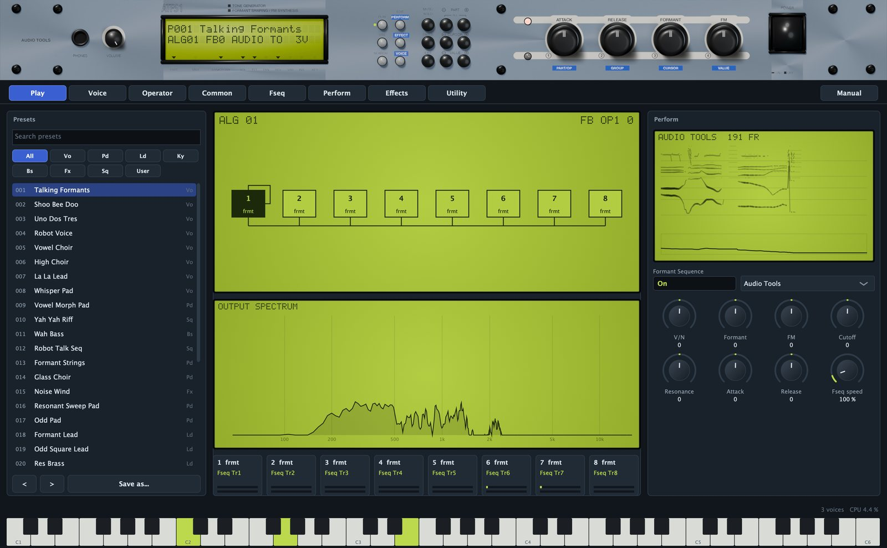

## A tour of the editor

From top to bottom:

- The **front panel**: the 1U rack with the LCD, the page and data buttons and five knobs.
- The **page tabs**: Play, Voice, Operator, Common, Fseq, Perform, Effects and Utility.
- The **Manual** button, at the right of the tabs, opens this manual inside the plugin, in English or Spanish. Press Esc or the cross to close it.
- The **page**.
- The **status line**: on the left, help for whatever is under the mouse, or a green message after an action (an import, a saved file); on the right, the voices sounding and the CPU used by the ATFS1.
- The **keyboard strip**: C1 to C6. Click lower on a key for a louder note. Notes that arrive by MIDI light up too.

Resize the window from its corner, from half size to 140 %; it keeps its proportions.

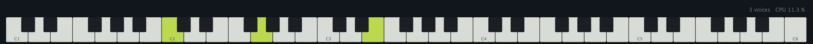

### Using the controls

- **Knobs**: drag up or down; hold Shift for fine steps; double-click, or right-click and choose Reset to default, to go back to the default. The mouse wheel moves one step.
- **Boxes** with a name above: an on/off box toggles with a click, a box with a small triangle opens a menu, a box with a number changes when you drag it.
- **Fields** of the voice (dark boxes with a green value): drag up or down, Shift for fine steps, wheel for single steps. Double-click to type a value and press Return; right-click for Reset. Fields with named values (a form, a mode, a wave) open a menu.

A field that shows `--` is not used by the current form or mode: Transpose, for example, only works on the frmt form. Every control writes its name and value on the front panel LCD while you move it, and the help line explains it when you rest the mouse on it.

### The voice and the part

The ATFS1 keeps the FS1R's split between voice and part.

The **voice** is the sound: the algorithm, the 16 operators, the envelopes, the LFOs, the filter and the Formant and FM knob assignments. It is edited on the Voice, Operator and Common pages. Voice settings are not DAW parameters, so they cannot be automated, but they are saved with the project and the presets, and they are what an FS1R voice sysex contains.

The **part** is how the voice is played: volume, pan, the offsets the front panel knobs move, mono or poly, portamento, controllers, the Formant Sequence playback and the effects. Part settings are DAW parameters you can automate.

## The front panel

The front panel works like the original: its knobs move their parameters, its buttons switch pages, and its data buttons walk through the editor.

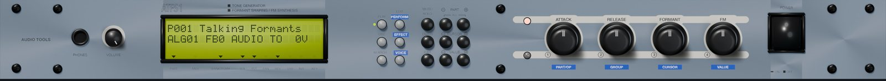

### Knobs

- **VOLUME** (next to PHONES): the part volume.
- **ATTACK** and **RELEASE**: offsets added to the attack and release times of every operator. Up is slower.
- **FORMANT** and **FM**: the two performance knobs of the voice. Each voice assigns them to the level, frequency or width of up to five operators (see Formant and FM knobs). On formant voices, Formant usually moves the formants; on FM voices, FM usually changes the brightness.

The four big knobs rest at the centre. Hold Shift for finer moves and double-click to reset.

### The LCD

- Line 1 shows the preset number and name, `P001 Talking Formants`. A `*` means you have edited the voice since loading it.
- Line 2 depends on the page. On Play and Voice: algorithm, feedback, the sequence name when one is on, and the voices sounding (`ALG01 FB0 AUDIO TO  2V`). On Operator: the operator, its form and ratio or frequency, or `NOISE` and its level. On Fseq: the sequence name and its number of frames.

When you move a control, line 2 shows its name and value for a moment. The arrows under the glass point to the printed labels: **MIDI** lights while MIDI arrives, **FLT** when the filter is on, **REV**, **VAR** and **INS** when each effect is active, **KEY** in mono, **VOL** and **PAN** when the volume is up and the pan off centre. **PART** and **BANK/PGM#** are always lit.

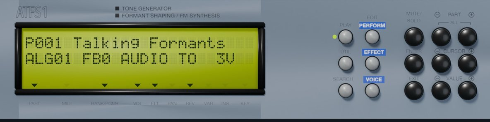

### Buttons

- **PLAY**, **UTIL** and **SEARCH**: the Play, Utility and Fseq pages.
- **EDIT PERFORM** and **EDIT EFFECT**: the Perform and Effects pages.
- **EDIT VOICE**: the Voice page; press again for Common, and again for Operator.
- **MUTE/SOLO**: cycles through all operators, voiced only and unvoiced only; line 2 ends in `V` or `N` while a solo is on. The quickest way to hear what the noise adds.
- **PART - and +**: previous or next preset; on the Operator page, previous or next operator.
- **CURSOR - and +**: move a green cursor over the fields of the Voice, Operator and Common pages.
- **VALUE - and +**: change the field under the cursor one step.
- **ENTER**: shows the field under the cursor on the LCD.
- **EXIT**: back to Play.

A green dot beside a page button shows the open page.

### Knob mode and power

The small button between the two LEDs left of the big knobs switches them to data entry: the lower LED lights and the LCD shows `KNOBS` and `DATA`. The knobs then follow the blue labels under them: **PART/OP** picks the operator and opens the Operator page, **GROUP** steps through the pages, **CURSOR** moves the cursor, **VALUE** changes the field. Click the button again to give them back their performance jobs.

The **POWER** switch mutes the output and resets every voice; the LCD goes dark. Click it again to turn the ATFS1 back on. It is also the fastest cure for a stuck note.

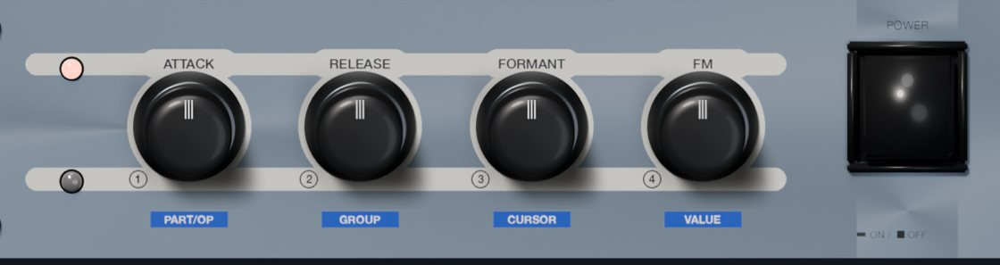

## Play page

The Play page is where you choose and play sounds.

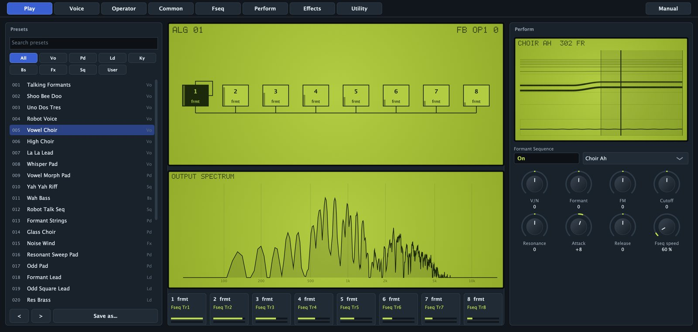

### Presets

- **Search presets**: filters the list by name or category.
- **Category buttons**: All, Vo (voices), Pd (pads), Ld (leads), Ky (keys), Bs (bass), Fx (effects), Sq (sequences) and User.
- The **list**: click a preset to load it. The number is its place in the DAW's program list; the code on the right is its category.
- **<** and **>**: previous or next preset in the filtered list.
- **Save as...**: saves a user preset (see Presets).

### The live view

The middle column shows the algorithm with a small level meter in every operator box, the spectrum of the output, and eight operator cards: number and form, ratio or frequency (or the Fseq track that drives it), and two meters, green for the voiced operator and grey for its unvoiced partner. Operators that are off are dimmed.

### Perform

- The **Formant Sequence** display, with the playhead while a note plays.
- **Formant Sequence**: switches the sequence on or off.
- The **sequence menu**: the factory sequences. A sequence you made or imported shows as its name plus `(own)`; `No Fseq` means there is none.
- Knobs: **V/N**, **Formant**, **FM**, **Cutoff**, **Resonance**, **Attack**, **Release** and **Fseq speed**, the same part parameters as on the Perform and Fseq pages.

## Voice page

The Voice page shows the whole voice: the algorithm on the left, the main parameters of all 16 operators on the right.

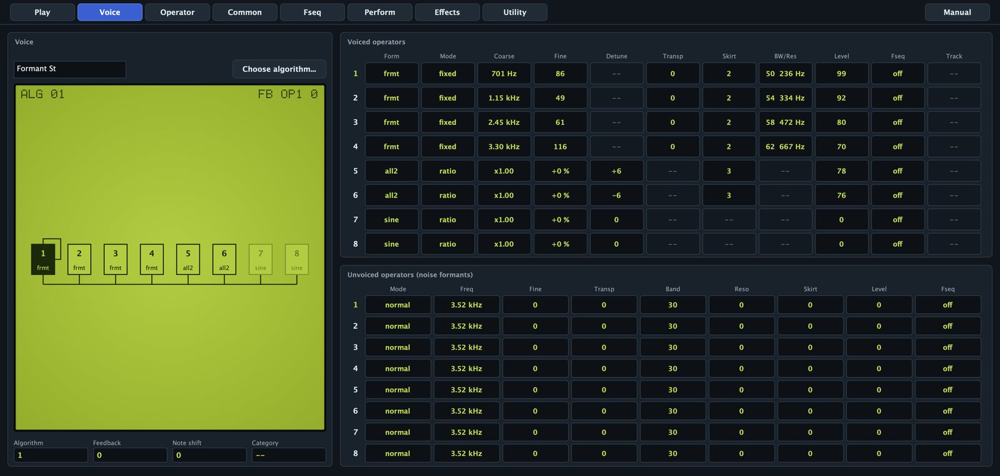

- The **name** field: up to 10 characters, stored in the voice and its sysex.
- **Choose algorithm...**: opens a grid of the 88 algorithms; click one to pick it.
- The **algorithm graph**: modulators above their carriers, the feedback loop and live levels. Click an operator to highlight it. The corners show the algorithm and the feedback path with its amount, for example `FB OP1 3`.
- **Algorithm**: 1 to 88.
- **Feedback**: 0 to 7.
- **Note shift**: -24 to +24 semitones.
- **Category**: the FS1R voice category (Pf, Or, Ld, Pd, Vo and others). A label only.

The upper table has one row per voiced operator: **Form**, **Mode**, **Coarse**, **Fine**, **Detune**, **Transp**, **Skirt**, **BW/Res**, **Level**, **Fseq** and **Track**. The lower one has one row per unvoiced operator: **Mode**, **Freq**, **Fine**, **Transp**, **Band**, **Reso**, **Skirt**, **Level** and **Fseq**. They are the Operator page parameters, side by side. Click an operator number at the start of a row to open it on the Operator page.

## Algorithms and feedback

An algorithm decides how the eight voiced operators connect. A **carrier** is heard; a **modulator** is not heard directly but changes the phase of the operator below it: frequency modulation. The higher the modulator's level, the more partials it adds. At level 99 it shifts the carrier's phase by about 3.4 cycles, enough for bright, metallic tones.

The 88 algorithms are those of the FS1R. Algorithm 1 has all eight operators as carriers, the usual choice for formant voices, where each operator is one formant. Algorithm 8 stacks operator 1 on operator 2; algorithm 6 has two stacks, 1 into 2 and 3 into 4; higher numbers have longer stacks and several modulators per carrier. Unvoiced operators never enter the algorithm: they go straight to the output.

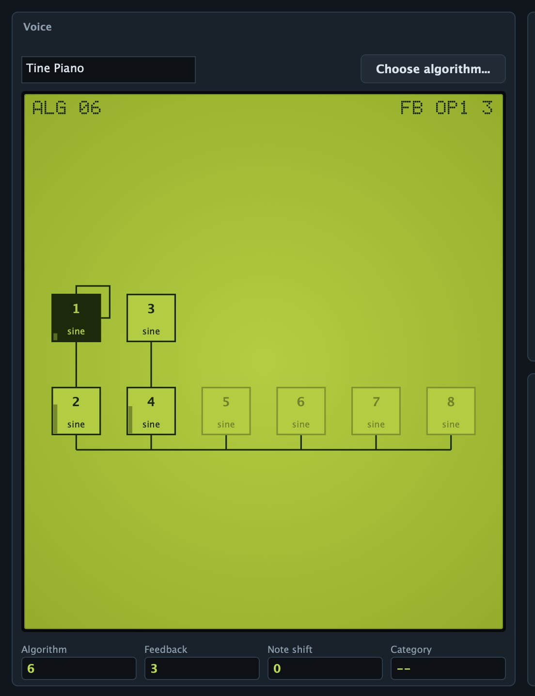

Most algorithms have a **feedback** loop: an operator modulates itself, or a later operator feeds an earlier one (`FB --` means none). Feedback 0 is off and every step doubles the amount; on a sine it brightens the tone towards a sawtooth and gets rough at the top.

The FS1R forms work inside FM too: a modulator can be all1 or odd1, a carrier can be a formant. That is where the ATFS1 sounds unlike a plain FM synthesizer.

## Operator page

The Operator page shows one operator. The buttons at the top choose it (**1** to **8**) and the **Voiced** or **Unvoiced** side. **Copy** takes both operators of the current number; **Paste** writes the side you are looking at.

On the right: the **spectrum** of the operator alone at A3 (220 Hz), redrawn as you edit (harmonics as bars, a noise band as a curve), the **amplitude envelope** and the **frequency envelope**.

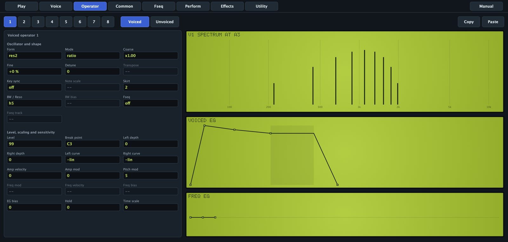

### Spectral forms

| Form | What you hear |
|---|---|
| sine | One partial. The form for classic FM. |
| all1 | A group of harmonics around the operator frequency; skirt 0 gives one partial, higher skirt opens the group. |
| all2 | Like all1, with a wider, brighter group. |
| odd1 | Odd harmonics only: hollow, towards a square wave. |
| odd2 | Odd harmonics, wider group. |
| res1 | Three lines on the harmonic set by the resonance: a whistle through the partials. |
| res2 | Like res1 with another window shape. |
| frmt | A formant: grains at the note pitch, carrier at the operator frequency. The colour of a vowel or an instrument body. |

### Voiced operator: oscillator and shape

- **Form**: one of the eight forms.
- **Mode**: ratio follows the key; fixed is an absolute frequency, a formant centre that stays put.
- **Coarse**: ratio 0.5, 1, 2 and up to 31. In fixed mode, octaves: 440 Hz × 2^(coarse + fine/128 - 16), so 12 is 27.5 Hz, 16 is 440 Hz and 21 about 14 kHz. The field shows the result (`x2.00`, `880 Hz`).
- **Fine**: ratio, +1 % per step up to 99; fixed, 1/128 octave per step.
- **Detune**: -15 to +15, a few cents, smaller up high. Ratio mode only.
- **Transpose**: -24 to +24 semitones, frmt only: shifts the grain pitch, the fundamental, without moving the formant.
- **Key sync**: on restarts the oscillator at every note. Not on frmt.
- **Note scale**: 0 to 99, fixed mode only: how much the frequency follows the keyboard around C3 (99 follows fully).
- **Skirt**: 0 to 7, the window steepness. Opens the harmonic group (all, odd, res) or the formant skirts (frmt), about -1.5 dB per step.
- **BW / Reso**: 0 to 99. On frmt, the bandwidth: the width in Hz doubles every 8 steps, whatever the note (the field shows it, `40  99 Hz`). On res1 and res2, the resonance: the group sits on harmonic value + 1 (`h5`).
- **BW bias**: -7 to +7, frmt only: how much the Voiced Bandwidth controller changes this formant.
- **Fseq**: on takes frequency and level from the Formant Sequence.
- **Fseq track**: Tr1 to Tr8, the track that drives this operator and its unvoiced partner.

### Voiced operator: level, scaling and sensitivity

- **Level**: 0 to 99, 0.75 dB per step; on a modulator, the FM depth. Level 0 (without Fseq) switches the operator off.
- **Break point**: A-1 to C8, the pivot of the level scaling.
- **Left depth** and **Right depth**: 0 to 99, level change below and above the break point.
- **Left curve** and **Right curve**: -lin, -exp, +exp or +lin. A modulator that fades towards the top keeps high notes from turning harsh.
- **Amp velocity**: -7 to +7, velocity to level.
- **Amp mod**: 0 to 7, LFO1 tremolo sensitivity.
- **Pitch mod**: 0 to 7, LFO1 vibrato sensitivity. At 0 the operator ignores vibrato, including the mod wheel's.
- **Freq mod**: 0 to 7, fixed only: LFO1 wobbles the frequency.
- **Freq velocity**: -7 to +7, fixed only: velocity moves the frequency.
- **Freq bias**: -7 to +7, fixed only: the Freq Bias controller moves the frequency.
- **EG bias**: -7 to +7: the Amp EG Bias controller changes the level.
- **Hold**: 0 to 99, a wait before the attack.
- **Time scale**: 0 to 7, higher notes run the envelope faster.

### Unvoiced operator

An unvoiced operator is white noise shaped into a band around a centre: breath, whisper, the hiss of an s, the air around a pipe.

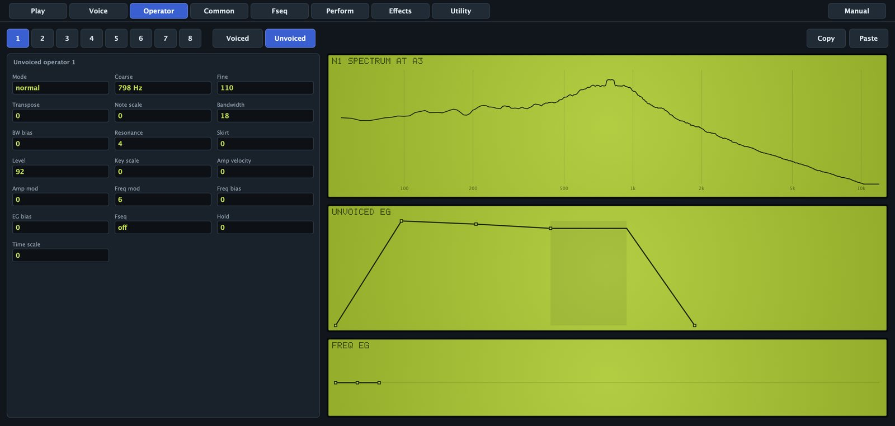

- **Mode**: normal has its own centre; linkFO puts it on the note pitch; linkFF follows the voiced operator of the same number when that one is frmt, so the noise rides on the formant.
- **Coarse**: 0 to 21, the centre in octaves, same law as a fixed voiced operator (19 is 3.5 kHz). Normal only.
- **Fine**: 0 to 127, 1/128 octave per step. Normal only.
- **Transpose**: -24 to +24 semitones, any mode.
- **Note scale**: 0 to 99, keyboard tracking of the centre around C3. Normal only.
- **Bandwidth**: 0 to 99, about 17 Hz per step up to 60. Narrow settings ring almost like a sine; wide ones hiss.
- **BW bias**: -7 to +7, response to the Voiced Bandwidth controller.
- **Resonance**: 0 to 7. Up to 3 nothing; 4 narrows the band; 5 to 7 add a pure tone at the centre.
- **Skirt**: 0 to 7, each step widens the band about 1.35 times.
- **Level**: 0 to 99, 0.75 dB per step.
- **Key scale**: -7 to +7, level tilt across the keyboard around C3.
- **Amp velocity**, **Amp mod** and **EG bias**: as on the voiced operator.
- **Freq mod** and **Freq bias**: LFO1 and the Freq Bias controller move the centre. Normal only.
- **Fseq**: on takes centre and level from the sequence, on the track of the voiced operator of the same number.
- **Hold** and **Time scale**: as on the voiced operator.

## Envelopes

### Amplitude envelope

Every voiced and unvoiced operator has a four-stage envelope on the Operator page. Drag a point: sideways for time, up and down for level. The shaded zone is the sustain, and the point under the mouse shows its values.

- It starts at L4, goes to L1 in time T1, to L2 in T2 and to L3 in T3, and holds L3 while the key is down. On release it goes to L4 in T4.
- Levels and times go from 0 to 99; higher times are slower. A full traverse takes 6.1 ms at 0 and about 350 s at 99.
- Decays fall in a straight line in decibels; attacks rise fast and settle.

The first point sets L4, where the envelope starts and ends. The front panel **ATTACK** and **RELEASE** knobs and the **Decay** knob on the Perform page shift these times for all operators at once.

### Frequency envelope

Each operator also has a frequency envelope: from the **Initial** level to the **Attack** level in the attack time, then back to normal in the decay time. Levels go from -50 to +50, up to two octaves either way. It reaches voiced operators in ratio mode and unvoiced operators in normal mode: the pitch blip at the start of a percussive sound.

## Common page

The Common page holds what the whole voice shares.

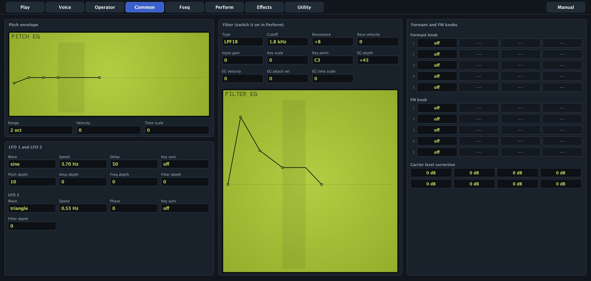

### Pitch envelope

It bends the pitch of the whole voice: L0, then L1, L2 and L3 in T1 to T3, L3 held, L4 in T4 after release. Levels -50 to +50; drag the points.

- **Range**: 8 oct, 2 oct, 1 oct or 1/2 oct, how far a level of 50 goes.
- **Velocity**: 0 to 7, softer notes get less pitch envelope.
- **Time scale**: 0 to 7, higher notes run faster.

### LFO 1 and LFO 2

LFO1 gives vibrato, tremolo, moving formants and filter sweeps; LFO2 only moves the filter.

- **Wave**: triangle, saw down, saw up, square, sine or S&H (random steps).
- **Speed**: LFO1 0 to 99, LFO2 0 to 127, both from about 0.06 Hz to 50 Hz. The field shows Hz.
- **Delay** (LFO1): 0 to 99, fade-in after the note starts; the singer's late vibrato.
- **Key sync**: on restarts the LFO at every note.
- **Phase** (LFO2): 0, 90, 180 or 270 degrees, the start point with key sync.
- **Pitch depth** (LFO1): 0 to 99, vibrato, scaled by each operator's Pitch mod.
- **Amp depth** (LFO1): 0 to 99, tremolo, scaled by each operator's Amp mod.
- **Freq depth** (LFO1): 0 to 99, moves fixed frequencies and noise centres, scaled by each Freq mod.
- **Filter depth**: 0 to 99, moves the cutoff.

### Filter

Every voice has its own filter after the operators. As on the original, the part switches it on (the **Filter** box on the Perform page, on by default) and the voice shapes it.

- **Type**: LPF24, LPF18, LPF12 (low-pass, 24, 18 or 12 dB per octave), HPF, BPF or BEF (band-reject).
- **Cutoff**: 0 to 127, 17.4 Hz × 2^(value/12); 127 leaves it open.
- **Resonance**: -16 to +100. Negative is damper than flat; the top nears self-oscillation.
- **Reso velocity**: -7 to +7.
- **Input gain**: -12 to +12 dB; positive values drive the filter into soft distortion.
- **Key scale**: -64 to +63, cutoff tracking; 63 follows the keyboard fully.
- **Key point**: the note the tracking pivots on.
- **EG depth**: -64 to +63, filter envelope amount; negative inverts it.
- **EG velocity**: -7 to +7, velocity scales the depth.
- **EG attack vel**: 0 to 7, harder notes start faster.
- **EG time scale**: 0 to 7, higher notes run faster.

The **filter envelope** under the fields starts at 0, goes to L1, L2 and L3, holds L3, and goes to L4 after release. Levels -50 to +50.

> With Authentic polyphony on (Utility page), the filter limits the part to 16 voices, as on the FS1R. With it off, all 32 voices are filtered.

### Formant and FM knobs

The front panel **FORMANT** and **FM** knobs have no fixed job: each voice decides. Each knob has five slots, and each slot moves one thing on one operator.

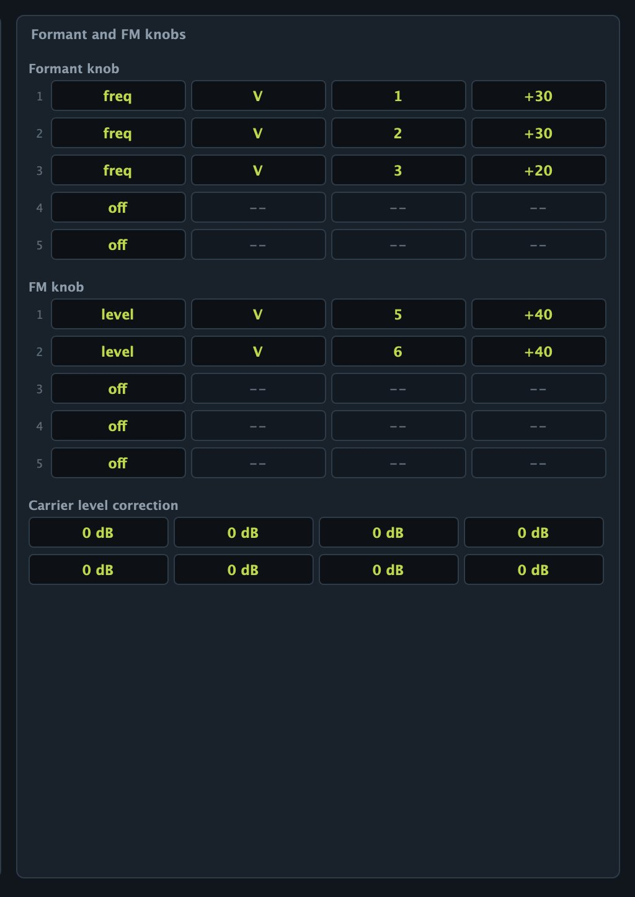

- **Dest**: off, level (output level; on a modulator, FM depth), freq, or width (bandwidth of a frmt formant or a noise band).
- **V/N**: V voiced, N unvoiced.
- **Op**: 1 to 8.
- **Depth**: -64 to +63. At +63 the slot reaches full effect at half the knob's travel; at +31, at the end.

Full effect is 24 dB of level, one octave of frequency or 24 bandwidth steps. Slots add up, so one knob can open a formant, move another and fade a noise band at once. The Formant and FM part parameters, MIDI CC 80 and 81, the mod wheel and aftertouch all turn these knobs.

### Carrier level correction

The eight **Op** fields lower an operator by 1.5 dB per step (0 to 15) when the algorithm makes it a carrier, to balance a voice across algorithms without touching the levels that set FM depth.

## Formant Sequences

A Formant Sequence records how a voice moves, not how it sounds. Each frame holds the pitch and the frequency and level of eight voiced and eight unvoiced formants; there are 126 frames per second at normal speed, up to 512 frames, a little over 4 seconds.

While a note plays, every operator with its **Fseq** switch on takes frequency and level from the current frame. Track 1 drives the operators on Tr1, and so on; an unvoiced operator follows the track of its voiced partner. Everything else still works: forms, skirts, bandwidths, envelopes, LFOs, filter and effects. That is why one sequence can sound like a person, a choir, a robot or a whispering pad.

The ATFS1 has 21 sequences:

| Kind | Sequences |
|---|---|
| Vowels | Vowels AEIOU, Vowels High, Ooh Aah, Ee Oh |
| Choirs and hums | Choir Ah, Choir Oo, Hum Mm, Breathy Ah |
| Rhythmic | Yah Yah, Wah Wah, Robot Talk |
| Whisper | Whisper Hey |
| Spoken words | Audio Tools, One Two, Formant, Shoo Bee Doo, Uno Dos Tres, Yeah, Synthesizer, La La La, I Am A Robot |

The vowels come from published average formant measurements; the words were spoken by free speech synthesis and analysed by the ATFS1. None comes from the FS1R.

### What a voice needs to play a sequence

- A sequence chosen in the menu on the Play or Fseq page.
- The part's **Formant Sequence** switch on (picking from the menu turns it on).
- Operators with **Fseq** on: ideally eight frmt operators on tracks 1 to 8, plus unvoiced operators for the noise.

All the factory voice presets (Talking Formants, Vowel Choir, Robot Voice and others) are built that way, so the quickest way to try a sequence is to load one and change the sequence.

### Fseq page

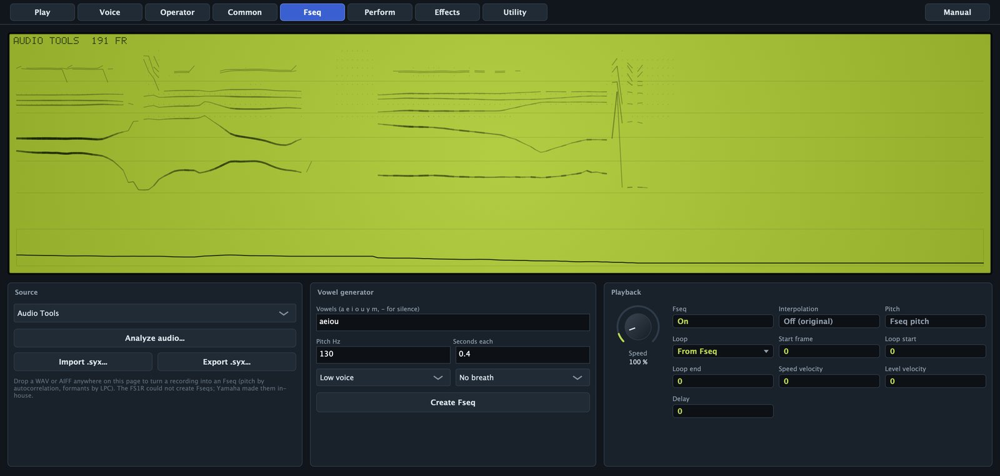

The display shows the voiced formants as lines (thicker when louder), the unvoiced ones as dots and the pitch in the strip below, with the name and frame count at the top. A vertical line follows the playback. Rest the mouse on it to read the frame number, pitch (F0) and first two formants (F1, F2).

The shaded area is the loop. Drag near an edge to move it, or drag elsewhere to draw a new loop. If Loop was From Fseq, touching the display switches it to Round.

### Playback

- **Speed**: 10 to 1000 %. At 100 % the sequence runs at 126 frames per second, as on the FS1R; the range is wider than the original's. Slow speeds stretch a word into a pad; fast ones turn a phrase into a texture.
- **Fseq**: the same switch as Formant Sequence on the Play page.
- **Interpolation**: Off (original) steps from frame to frame like the FS1R, slightly grainy; On glides between frames, which helps at slow speeds.
- **Pitch**: with Fseq pitch, the melody of the sequence moves the note and the key transposes it. With Key pitch, only the key sets the pitch and the sequence only moves the formants. Chords and choirs usually want Key pitch.
- **Loop**: From Fseq uses the loop stored in the sequence (a generated one loops its last vowel; an analysed recording has none and plays once). One-way plays to the loop end and jumps to the loop start. Round goes back and forth. The loop repeats while the key is held; on release the sequence runs to the end.
- **Start frame**: 0 to 511, where each note starts. Skip a breath, or start a loop in the middle.
- **Loop start** and **Loop end**: 0 to 511, the loop for One-way and Round.
- **Speed velocity**: 0 to 7. Softer notes play slower; at 7 a very soft note plays at about a tenth of the speed.
- **Level velocity**: -64 to +63. Positive makes the formants quieter on soft notes (down to -24 dB); negative does the opposite.
- **Delay**: 0 to 99, up to about 2 seconds before the sequence starts moving; until then the voice holds the start frame.

Without a loop, the sequence stays on its last frame while the note sounds.

### Sources

The **sequence menu** lists the factory sequences; picking one turns playback on. **Import .syx...** reads FS1R sysex (see FS1R sysex). **Export .syx...** saves the current sequence as an FS1R sequence bulk.

### Making a sequence from a recording

The FS1R could only play sequences made by Yamaha. The ATFS1 builds them from any recording.

- Drop a WAV, AIFF or FLAC file anywhere on the editor, or click **Analyze audio...** and choose one.
- The first 4 seconds or so (up to 512 frames) are analysed in the background. The status line shows `Analyzing...`, then a message such as `Fseq from hello.wav: 212 frames`, and the Fseq page opens.
- Pitch is followed by autocorrelation (60 to 500 Hz), formants are found by linear prediction, and the noise is measured in eight bands.
- The sequence takes the first 8 characters of the file name. Playback is switched on and Loop set to From Fseq: it plays once until you draw a loop.

A good source is one dry voice close to the microphone, without music or reverb: speech, singing, a whistle, a wah guitar. Stereo is mixed to mono; files of a fraction of a second are too short.

### Making a sequence from vowels

- **Vowels**: up to 24 characters among `a e i o u y m`, and `-` for silence. `y` is the rounded "ü"; `m` is a closed hum. For example `aeiou`, `oa` or `ya-ya-ya-`.
- **Pitch Hz**: 50 to 600 Hz. It matters with Fseq pitch; with Key pitch the key decides.
- **Seconds each**: 0.05 to 2 s per vowel; each glides into the next over the last third of its time.
- **Low voice** or **High voice**: High raises the formants 17 % and the pitch 1.8 times.
- **No breath**, **Breathy** or **Whisper**: how much noise the unvoiced formants carry.
- **Create Fseq**: builds and loads it, named after the first 8 characters you typed.

The result has a light vibrato and loops its last vowel back and forth, so a held note keeps singing. Anything past 512 frames is cut.

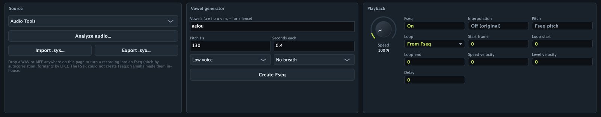

### Keeping your sequences

A sequence you make or import replaces the part's current one. It is kept in your DAW project, in any user preset you save with it (each preset carries its own), and as a `.syx` file with **Export .syx...**. The factory list does not change.

## Perform page

The Perform page holds the part. Every control is a DAW parameter and is saved in presets.

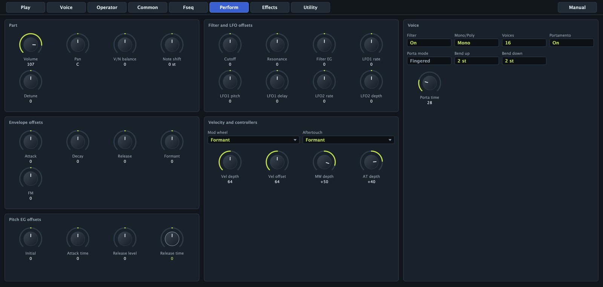

### Part, envelope and filter offsets

- **Volume** and **Pan** (L63 to R63).
- **V/N balance**: -64 to +63. Positive lowers the voiced operators (only noise at +63), negative the unvoiced ones.
- **Note shift**: -24 to +24 semitones, added to the voice's.
- **Detune**: -64 to +63, about 50 cents either way.
- **Attack**, **Decay** and **Release**: -64 to +63, added to T1, T2 and T3, and T4 of every operator. Positive is slower. Attack and Decay apply when a note starts; Release applies when you let go of it, so turning it down also shortens notes already held.
- **Formant** and **FM**: -64 to +63, turn the voice's knobs (the front panel knobs).
- **Cutoff**, **Resonance** and **Filter EG**: added to the filter cutoff, resonance and envelope depth.
- **LFO1 rate**, **LFO1 pitch**, **LFO1 delay**, **LFO2 rate** and **LFO2 depth**: added to the LFO speeds, LFO1 pitch depth and delay, and LFO2 filter depth.
- **Initial**, **Attack time**, **Release level** and **Release time**: added to L0, T1, L4 and T4 of the pitch envelope.

### Voice

- **Filter**: switches the voice filter on for this part.
- **Mono/Poly**: in Mono, a note played while another is held is legato: the envelopes keep going and the first velocity stays. Releasing the top note returns to the one still held.
- **Voices**: 1 to 32. Past the limit, the oldest released note is taken first, then the oldest held one.
- **Portamento**: pitch glide between notes.
- **Porta mode**: Fingered glides only when you play legato; Fulltime on every note.
- **Porta time**: 0 to 127, about 1.5 ms to 2.4 s per octave.
- **Bend up** and **Bend down**: 0 to 24 semitones.

### Velocity and controllers

- **Vel depth**: 0 to 127, how much velocity counts: 64 as played, 127 exaggerated, 0 ignored.
- **Vel offset**: 0 to 127, added to every velocity (64 changes nothing). With Vel depth at 0, every note gets the same velocity, set by Vel offset.
- **Mod wheel** and **MW depth** (-63 to +63): by default the wheel adds LFO1 vibrato, depth 40.
- **Aftertouch** and **AT depth**: by default Formant with depth 0, so nothing happens until you raise the depth.

| Destination | What it does |
|---|---|
| Off | Nothing. |
| LFO1 Pitch Mod | Adds vibrato. |
| LFO1 Amp Mod | Adds tremolo. |
| LFO1 Freq Mod | Adds LFO movement to fixed frequencies and noise centres. |
| LFO1 Filter Mod | Adds LFO movement to the cutoff. |
| Cutoff | Moves the cutoff. |
| Formant | Turns the Formant knob. |
| FM | Turns the FM knob. |
| V/N Balance | Moves the voiced and unvoiced balance. |
| Fseq Speed | Speeds the sequence up (or down with negative depth). |
| Formant Scratch | The controller position becomes the position in the sequence. |
| Freq Bias | Moves fixed frequencies, by each operator's Freq bias. |
| Amp EG Bias | Changes levels, by each operator's EG bias. |
| Voiced Bandwidth | Widens or narrows formants, by each operator's BW bias. |

## Effects page

The effects follow the FS1R topology: insertion on the part, sends to variation and reverb, variation into reverb, and an EQ. The algorithms are the ATFS1's own; the names follow the original list. The diagram at the top shows the flow and dims the effects that are off.

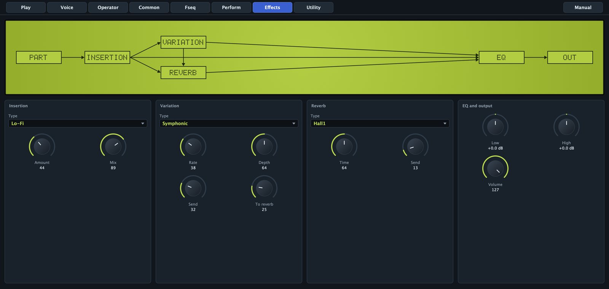

- Insertion **Type**: Thru, Distortion, Overdrive, Amp Sim, Auto Wah, Phaser, Rotary Sp, Lo-Fi or Compressor. **Amount** is the drive (Distortion, Overdrive, Amp Sim), sensitivity (Auto Wah), rate (Phaser), slow or fast below or above the middle (Rotary Sp), crushing (Lo-Fi) or threshold and ratio (Compressor). **Mix** goes from dry to fully processed.
- Variation **Type**: No Effect, Chorus, Celeste, Flanger, Symphonic, Ens Detune, Tremolo, Auto Pan, Delay L,R, Echo or Cross Delay. **Rate** is the modulation speed or, for the three delays, the delay time (higher is shorter, about 1 s down to 80 ms). **Depth** is the modulation depth or the delay feedback. **Send** feeds the variation; **To reverb** passes the variation to the reverb.
- Reverb **Type**: No Effect, Hall1, Hall2, Room1, Room2, Stage, Plate or Canyon, with **Time** and **Send**.
- **Low** and **High**: shelving EQ, -12 to +12 dB. **Volume** is the part volume again.

A soft limiter after the EQ keeps loud chords from clipping harshly.

## Utility page

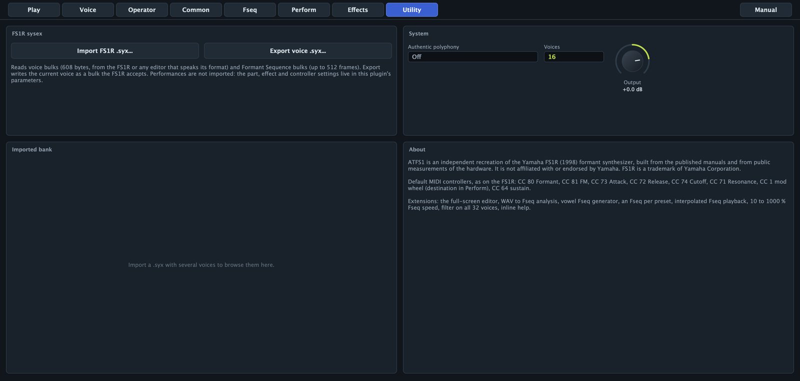

- **Import FS1R .syx...** and **Export voice .syx...**: see FS1R sysex.
- **Imported bank**: when a file has several voices, they are listed with algorithm and category; click one to load it.
- **Authentic polyphony**: on limits the part to 16 voices while the filter is on, as on the FS1R.
- **Voices**: the same as on the Perform page.
- **Output**: -24 to +6 dB, the plugin's final level.
- **About**: what the ATFS1 is, the default controllers and what it adds to the original.

Authentic polyphony and Output are global: presets neither store nor change them.

## FS1R sysex

The ATFS1 reads and writes the FS1R's sysex format, so voices and sequences travel between the plugin, a hardware FS1R and the editors that speak its format.

### Importing

Use **Import FS1R .syx...** on the Utility page, **Import .syx...** on the Fseq page, or drop a `.syx` or `.mid` file on the editor. All three do the same:

- Voice bulks (608 bytes) become voices. The first is loaded at once; a set appears in the Imported bank.
- Formant Sequence bulks (up to 512 frames) become the part's sequence, and playback is switched on. A sequence without a name takes the file name.
- Standard MIDI files are searched for sysex, so dumps saved as `.mid` work too.

The status line reports the result, for example `Imported 32 voices and 1 Fseq`.

Performances are not imported: in the ATFS1, the part, effect and controller settings are plugin parameters. After importing a voice, check the Perform page, especially **Filter**, the Formant and FM offsets and **Mono/Poly**.

> Many FS1R voices were made for one of the hardware's built-in sequences, which are not included. If an imported voice has operators on Fseq, choose a sequence from the library or import its sequence bulk.

### Exporting

**Export voice .syx...** (Utility) writes the current voice as a bulk the FS1R accepts; **Export .syx...** (Fseq) writes the current sequence. Files are named after the voice or sequence; send them with any sysex utility. Voice data keeps the FS1R ranges, so every field travels both ways.

## Presets

### Factory presets

| Category | Presets |
|---|---|
| Vo | Talking Formants, Shoo Bee Doo, Uno Dos Tres, Robot Voice, Vowel Choir, High Choir, La La Lead, Whisper Pad |
| Pd | Vowel Morph Pad, Formant Strings, Glass Choir, Resonant Sweep Pad, Odd Pad |
| Sq | Yah Yah Riff, Robot Talk Seq |
| Ld | Formant Lead, Odd Square Lead, Res Brass, Breath Flute |
| Ky | Tine Piano, Formant Bells, Glass Marimba, Formant Clav, Formant Organ, Init Formant |
| Bs | Wah Bass, FM Bass, Formant Bass, Odd Sub Bass |
| Fx | Noise Wind, Space Talk, Formant Scratch |

Init Formant is one fixed frmt operator, a clean starting point. Loading a preset stops the notes sounding and replaces the voice, the sequence and the part and effect settings.

### Saving your own

1. Shape the sound.
2. On the Play page click **Save as...**.
3. Type a name and click **Save**.

The preset appears under User. It stores the voice, the part and effects, and the sequence (a factory one by name, your own in full). Saving with an existing name replaces it. User presets are JSON files in:

- macOS: `~/Library/Application Support/Audio Tools/ATFS1/Presets/`
- Windows: `%APPDATA%\Audio Tools\ATFS1\Presets\`

Rename, delete or share them there; they are listed after the factory presets.

### In REAPER

REAPER lists every factory preset twice in the preset menu: once from the plugin's own list and once as a preset file (the .vstpreset files that the launcher or the Presets folder of the zip install for Ableton Live, in ~/Library/Audio/Presets/Audio Tools/ on macOS, Documents\VST3 Presets\Audio Tools\ on Windows and ~/.vst3/presets/Audio Tools/ on Linux). Both load the same settings. If you don't use Live, you can delete the "Audio Tools ATFS1" folder there and each preset appears once.

## MIDI and controllers

The ATFS1 answers on every MIDI channel.

| Message | Effect |
|---|---|
| Pitch bend | Bend up and Bend down ranges |
| CC 1 (mod wheel) | Mod wheel destination |
| Channel or key aftertouch | Aftertouch destination |
| CC 5 | Portamento time |
| CC 7 | Volume |
| CC 64 | Sustain |
| CC 65 | Portamento on or off |
| CC 71 | Resonance offset |
| CC 72 | Release offset |
| CC 73 | Attack offset |
| CC 74 | Cutoff offset |
| CC 80 | Formant knob |
| CC 81 | FM knob |
| CC 91 | Reverb send |
| CC 93 | Variation send |
| CC 120, 123 | All notes off |
| CC 121 | Reset controllers |

CC 80, 81 and 71 to 74 are the FS1R defaults. Controllers that change parameters move the knobs on screen. The voice parameters are not DAW parameters; the part, Fseq and effect ones are. There is no tempo sync: set Fseq speed, LFO rates and delays by ear.

## Recipes

### A vowel choir

1. Load **Talking Formants**.
2. On the **Fseq** page type `ooaa` in Vowels, set **Seconds each** to `1.2`, choose **Low voice** and **Breathy**, and click **Create Fseq**.
3. Set **Pitch** to Key pitch and **Speed** to 50 %.
4. On **Perform**, set **Voices** to 24 and **Attack** to about +10.
5. On **Effects**, choose **Symphonic** (Send about 35) and **Hall2** (Send about 35, Time about 70).
6. Play slow chords. The voice already has a late vibrato (LFO1 Pitch depth 14, Delay 40).

### A talking pad

1. Load **Vowel Morph Pad** and choose **One Two** or **Synthesizer** in the sequence menu.
2. On the Fseq page set **Pitch** to Key pitch, **Interpolation** On and **Speed** to 20 or 25 %.
3. Drag a loop over the part of the phrase you like; set **Loop** to Round.
4. On Perform set **V/N balance** to about +20 and raise **Release**.

Held chords slowly mouth the words; each new chord starts again from the start frame.

### An FM bell

1. Load **Init Formant**. On the **Voice** page click **Choose algorithm...** and pick **8** (operator 1 modulates 2).
2. Open operator **2**: **Form** sine, **Mode** ratio, **Coarse** 1, **Level** 99. Give it an instant attack, L2 around 80, long T2 and T3 down to L3 = 0, T4 around 55, and **Time scale** 3.
3. Open operator **1**: sine, ratio, **Coarse** 3, **Fine** 50 (`x3.50`), **Level** about 65, an instant attack and a faster decay than the carrier, **Amp velocity** +4.
4. Set **Feedback** to 2 and add a **Plate** reverb.

Ratios like 1.41 or 2.76 on operator 1 give gongs and bars; **Form** all1 on the modulator makes the bell glassy.

### Converting a recording into a Formant Sequence

1. Find or record a short phrase: one dry voice, under 4 seconds, as WAV or AIFF.
2. Load **Talking Formants**.
3. Drag the file onto the editor; the Fseq page opens with the new tracks.
4. Play a note near the pitch of the recording: the phrase comes back with its own melody.
5. For a melody of your own, set **Pitch** to Key pitch.
6. If it starts with silence, raise **Start frame**.
7. For a held note that keeps talking, drag a loop over a vowel and set **Loop** to Round.
8. Save it with **Save as...**, or for an FS1R with **Export .syx...**.

### A whisper

1. Load **Whisper Pad**, which plays **Whisper Hey**, or make a sequence of your own with **Whisper** selected.
2. On Perform turn **V/N balance** to +63: only the noise remains.
3. Press **MUTE/SOLO** to compare all, voiced and unvoiced.

### Scratching a phrase with the mod wheel

1. Load **Formant Scratch**, or any Fseq voice and set **Mod wheel** to Formant Scratch, **MW depth** +63.
2. Hold a note and move the wheel: down is the first frame, up the last.

### A formant sweep

1. Load **Init Formant**.
2. On **Common**, Formant knob slot 1: **Dest** freq, **V/N** V, **Op** 1, **Depth** +40.
3. Slot 2: **Dest** width, **Op** 1, **Depth** -30, so the formant narrows as it rises.
4. Hold a note and turn **FORMANT** on the front panel.
5. On Perform set **Aftertouch** to Formant, **AT depth** +40, to sweep with key pressure.

### A legato lead

1. Load **Formant Lead**: Mono, **Portamento** On, **Porta mode** Fingered.
2. Overlapping notes glide and keep their envelopes; detached notes start fresh without a glide.
3. Switch **Porta mode** to Fulltime to glide on every note.

### A rhythmic vowel loop

1. Load **Yah Yah Riff**; **Loop** is One-way.
2. Drag the loop over one or two syllables.
3. Turn **Speed** until the syllables lock to your tempo, holding Shift for fine steps.
4. Set **Speed velocity** to 3 or 4 so soft notes chant slower.

### A breath flute

1. Load **Init Formant**. Make operator 1 **sine**, ratio, Coarse 1, Level 96, T1 around 10, **Pitch mod** 5.
2. Click **Unvoiced**. Operator 1: **Mode** linkFO, **Transpose** +24, **Bandwidth** 40, **Level** about 62, a quick envelope down to a low sustain.
3. On Common give LFO1 sine, **Pitch depth** 12, **Delay** 50.
4. On Perform switch on Mono and Portamento with a short time.

The noise sits two octaves above the note, a breath at the start of each phrase. The factory Breath Flute is a fuller version.

## Tips and troubleshooting

### No sound

- **POWER** off: the LCD is dark.
- **VOLUME** on the front panel or **Output** on Utility down.
- A solo on: press **MUTE/SOLO** until line 2 shows neither `V` nor `N`.
- No carrier with **Level** above 0, or **V/N balance** at +63 on a voice without noise.

### The sequence does not play

- **Formant Sequence** off, or the menu says `No Fseq`.
- The operators' **Fseq** switches are off (Voice page, Fseq column).
- A long **Delay**, a **Start frame** near the end, or **Speed velocity** 7 with soft notes.

### The sequence sings at an odd pitch

With **Pitch** on Fseq pitch the sequence carries its own melody. Play near the original pitch, or switch to Key pitch.

### The mod wheel gives no vibrato

Each operator takes vibrato only up to its **Pitch mod**. Raise it on the carriers.

### The analysis sounds poor

Use a dry, single voice without music or reverb. Only the first 4 seconds or so are used.

### An imported voice sounds different

Performances are not imported, the effects are the ATFS1's own, and voices made for a built-in sequence need one.

### Clicks, dropouts or high CPU

Lower **Voices**, or switch on **Authentic polyphony** with the filter on. Operators at level 0 cost nothing. Raise your audio buffer size. The status line shows the ATFS1's CPU.

### A stuck note

Click **POWER** twice, or send all notes off (CC 120 or 123). Switching Mono and Poly also releases held voices.

## Specifications

| Item | Value |
|---|---|
| Version | 1.0.0 |
| Formats | VST3, Audio Unit (macOS), standalone |
| Systems | macOS 11 or later (Apple silicon and Intel); Windows 10 and 11, 64-bit |
| Output | stereo (mono supported) |
| Polyphony | 1 to 32 voices; 16 with Authentic polyphony and the filter on |
| Parts | one per instance |
| Operators | 8 voiced (8 spectral forms) and 8 unvoiced per voice |
| Algorithms | 88, feedback 0 to 7 |
| Envelopes | amplitude EG with hold and frequency EG per operator; pitch EG; filter EG |
| LFOs | LFO1 (pitch, amplitude, frequency, filter), LFO2 (filter); 6 waves |
| Filter | LPF 24, 18, 12 dB, HPF, BPF, BEF; resonance -16 to +100; input gain -12 to +12 dB |
| Formant Sequences | 8 voiced and 8 unvoiced formants plus pitch; 126 frames per second; up to 512 frames; speed 10 to 1000 % |
| Effects | 8 insertion types, 10 variation types, 7 reverbs, 2-band EQ, soft limiter |
| Factory content | 32 presets, 21 Formant Sequences |
| Sysex | FS1R voice (608 bytes) and Fseq bulks, read and write; .syx and .mid |

### Measurements

Measured with the ATFS1's own test tools.

| Check | Result |
|---|---|
| all1 at skirt 0 | one partial, the next below -100 dB |
| odd forms at skirt 0 | partials 1 and 3 only |
| res1, resonance 4 | lines on harmonics 4, 5, 6; sides at -6.0 dB; harmonic 2 below -130 dB |
| group width at skirt 7, one side | all1 1.23, all2 3.35 partials |
| envelope traverse | 6.1 ms (time 0) to 350 s (time 99); decay linear in dB |
| WAV to Fseq | synthetic /a/ at 120 Hz: pitch 120 Hz; F1, F2, F3 at 731, 1102, 2454 Hz (targets 730, 1090, 2440) |
| speech resynthesis | F1 and F2 tracks correlate 0.82 and 0.74 with the analysed phrase |
| sysex | voice of 619 bytes with checksum, every field round-trips; Fseq frequencies within 1.7 cents |
| CPU, Apple M4 | speech 0.4 %, 16-voice choir 6.8 %, 32 voices 8.7 % of a core |
| CPU, Ryzen 9 5900XT | speech 0.7 %, 16-voice choir 13.9 %, 32 voices 21.9 % of a core |

Yamaha and FS1R are trademarks of Yamaha Corporation. The ATFS1 is not affiliated with or endorsed by Yamaha; the names only identify the instrument that inspired it.
