# Manual del ATMD

## Qué es

El ATMD es un sintetizador monofónico libre y de código abierto basado en el Moog Minimoog Model D, que se fabricó de 1970 a 1981. Recrea una unidad de mediados de los 70 con la placa de osciladores Rev 2, la versión más común del instrumento y la que la propia Moog tomó como referencia para sus reediciones.

Tiene el mismo panel y el mismo recorrido de la señal: tres osciladores, un mezclador que puede llevar al filtro a la saturación, el filtro escalera de transistores de cuatro polos, dos generadores de contorno, las llaves GLIDE y DECAY y las dos ruedas al lado del teclado, la entrada externa con su lámpara OVERLOAD y el tono de afinación A-440. Y se toca como el original: prioridad a la nota más grave, disparo único y un teclado que retiene la última altura, así que GLIDE siempre se desliza desde la nota anterior.

Una página SETTINGS le suma lo que el Model D nunca tuvo: hasta 8 voces de polifonía, unísono de hasta 4 voces, deriva analógica ajustable, velocidad y aftertouch, prioridad de nota y modo de disparo a elección, una rueda de pitch más ancha o más angosta, un delay sincronizado al tempo, una reverb de placa y 32 presets de fábrica.

El ATMD funciona como plugin VST3, como Audio Unit en macOS y como aplicación independiente en macOS y Windows.

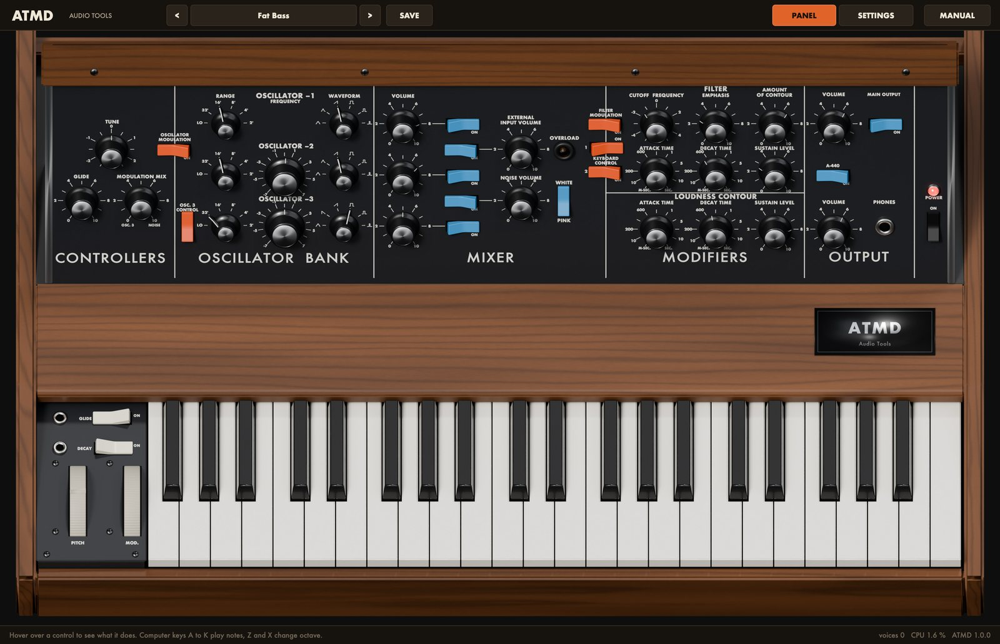

## Instalación

Bajá el zip para tu sistema desde el sitio de Audio Tools. Los dos paquetes traen un archivo `INSTALL.txt` con los mismos pasos que acá.

### macOS

El ATMD necesita macOS 11 o posterior. Un único binario universal funciona en Mac con Apple silicon y con Intel.

1. Descomprimí el archivo.
2. Copiá `ATMD.vst3` a `~/Library/Audio/Plug-Ins/VST3/`.
3. Copiá `ATMD.component` a `~/Library/Audio/Plug-Ins/Components/`.
4. Reescaneá los plugins en tu DAW. En Ableton Live: Settings, Plug-Ins, Rescan.
5. `ATMD.app` es la versión independiente. Copiala a Aplicaciones si la querés usar sin DAW.

Los binarios tienen firma ad hoc y no están notarizados, así que macOS puede negarse a abrirlos la primera vez. Si pasa, abrí la Terminal, corré este comando y reescaneá de nuevo:

`xattr -dr com.apple.quarantine ~/Library/Audio/Plug-Ins/VST3/ATMD*.vst3 ~/Library/Audio/Plug-Ins/Components/ATMD*.component`

### Windows

El ATMD necesita Windows 10 u 11 de 64 bits.

1. Descomprimí el archivo.
2. Copiá la carpeta `ATMD.vst3` a `C:\Program Files\Common Files\VST3\`. Windows pide permisos de administrador.
3. Reescaneá los plugins en tu DAW.
4. `ATMD.exe` es la versión independiente y funciona sin DAW.

Los binarios no están firmados, así que SmartScreen de Windows puede pedirte confirmación la primera vez que los abrís.

## Cargarlo en un DAW

El ATMD es un instrumento: ponelo en una pista MIDI o de instrumento, no en una de audio. Tiene salida estéreo (también funciona en un bus mono), recibe MIDI en cualquier canal y tiene una entrada de audio estéreo opcional, llamada External Input, que alimenta la EXTERNAL INPUT del mezclador (mirá Mandar audio a la entrada externa). El plugin informa una cola de 12 segundos, así que los decaimientos largos, el delay y la reverb no se cortan cuando termina un clip.

### Ableton Live

1. Después de reescanear, abrí el navegador y elegí Plug-Ins.
2. Abrí Audio Units (macOS) o VST3, y después la carpeta Audio Tools.
3. Arrastrá el ATMD a una pista MIDI vacía, o al espacio libre de la sesión para crear una nueva.
4. Armá la pista y tocá tu teclado MIDI. Si la ventana del editor está cerrada, hacé clic en el ícono de la llave inglesa en la barra de título del dispositivo.

> En Windows, si el ATMD no aparece, abrí Settings, Plug-Ins, activá Use VST3 Plug-in System Folders y reescaneá.

### Otros DAW

En cualquier otro host, insertá el ATMD como instrumento y mandale MIDI. Cada perilla y cada llave del panel y de la página SETTINGS es un parámetro del host, así que la podés automatizar. Las dos ruedas no son parámetros: como en el original, son controles de ejecución. Automatizalas con pitch bend y CC 1 en tus clips MIDI. Los presets de fábrica y los tuyos aparecen también en la lista de programas del host.

### Aplicación independiente

Abrí `ATMD.app` o `ATMD.exe`. Con el botón Options de arriba de la ventana elegís la salida de audio y la entrada MIDI. Sin teclado MIDI podés tocar el teclado en pantalla con el mouse, o el teclado de la computadora (mirá Tocar sin teclado MIDI). En la aplicación independiente no hay tempo del host, así que el delay sigue 120 BPM. La entrada externa es la entrada de audio que elegís en Options (mirá Rutear audio a la entrada externa).

## Primer sonido

1. Cargá el ATMD. Abre con el preset Init: el oscilador 1 tocando una sierra por un filtro a medio abrir, con un contorno corto de filtro en cada nota.
2. Tocá unas notas en tu teclado MIDI, o hacé clic en las teclas de la pantalla.
3. Bajá **CUTOFF FREQUENCY** en la sección MODIFIERS y subí **EMPHASIS**: el sonido se oscurece y empieza a silbar.
4. Prendé el segundo oscilador: en el MIXER, hacé clic en el tercer rocker azul ON desde arriba y subí la segunda perilla VOLUME. Corré un poco de 0 la perilla FREQUENCY del oscilador 2 y escuchá cómo los dos osciladores baten entre sí.
5. Hacé clic en el nombre del preset en la barra superior y elegí un sonido del menú Bass o Lead.
6. Arrastrá la esquina inferior derecha del editor para agrandar o achicar la ventana. Mantiene las proporciones, de la mitad a una vez y media su tamaño completo.

## Recorrido por la interfaz

El editor tiene una barra superior, el instrumento y una barra de ayuda abajo. **PANEL** muestra el instrumento como era; **SETTINGS** pone una placa negra con las extensiones encima del panel frontal, mientras las ruedas y el teclado quedan a la vista y siguen funcionando.

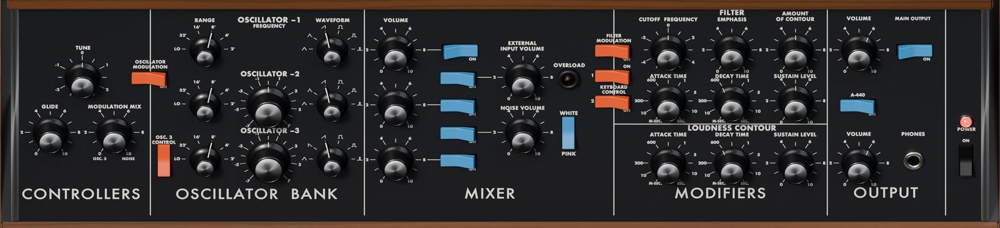

El panel se lee de izquierda a derecha en el orden de la señal: los CONTROLLERS fijan la afinación general, el glide y la modulación; el OSCILLATOR BANK genera el sonido; el MIXER elige qué entra al filtro y con cuánto nivel; los MODIFIERS le dan forma con el filtro y los dos contornos; OUTPUT fija el nivel. El controlador de la mano izquierda, al lado del teclado, tiene las llaves GLIDE y DECAY y las ruedas PITCH y MOD.

### Barra superior

- **<** y **>** recorren los presets. La lista da la vuelta e incluye tus presets al final.
- El botón ancho del medio muestra el nombre del preset actual. Hacé clic para abrir el menú de presets.
- **SAVE** guarda el sonido actual como preset de usuario.
- **PANEL** y **SETTINGS** cambian entre las dos páginas.
- **MANUAL**, en el extremo derecho, abre este manual dentro del plugin, en inglés o en castellano. Esc o la cruz lo cierran.

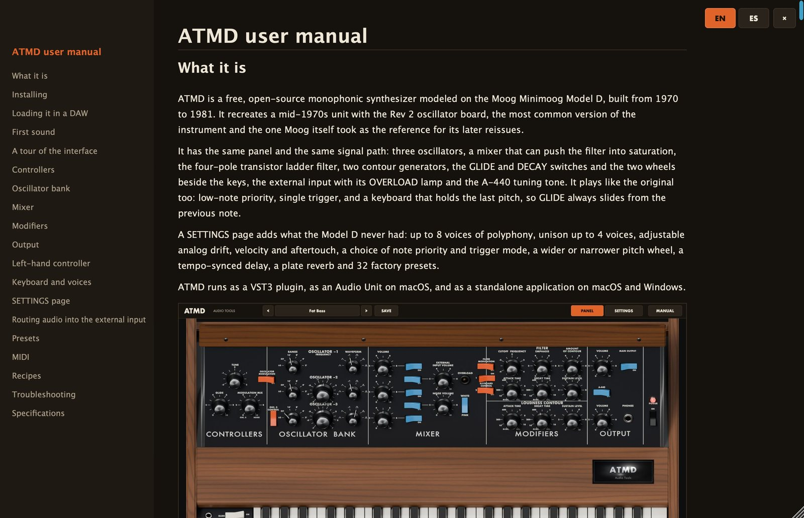

### Barra de ayuda

Pasá el mouse sobre cualquier perilla, rocker o rueda y la barra de ayuda muestra su nombre, su valor y una nota corta sobre lo que hace. Sin nada bajo el mouse, te recuerda las teclas de la computadora. A la derecha muestra cuántas voces suenan, la carga de CPU y el número de versión.

### Cómo se usan los controles

- **Perillas**: arrastrá hacia arriba o hacia abajo. Con Shift apretado el ajuste es fino. La rueda del mouse gira la perilla que está bajo el puntero (con Shift, de a pasos más chicos). Doble clic en una perilla la devuelve a su valor por defecto.
- **Selectores RANGE y WAVEFORM**: un clic los mueve una posición en el sentido de las agujas del reloj; después de la última vuelven a la primera. Shift-clic o clic derecho los mueve una posición para atrás. También podés arrastrar hacia arriba o hacia abajo por las posiciones.
- **Rockers**: un clic los cambia. Un rocker está encendido cuando tiene hundido el lado de ON.
- **Rueda PITCH**: arrastrala hacia arriba o hacia abajo. Al soltarla vuelve sola al centro.
- **Rueda MOD**: arrastrala hacia arriba o hacia abajo. Se queda donde la dejás; abajo del todo es sin modulación.
- **Teclas**: hacé clic en una tecla para tocarla. Cuanto más abajo hacés clic en la tecla, más cerca tuyo, más fuerte suena. Arrastrá sobre las teclas para un glissando.

Los jacks del controlador de la mano izquierda y el jack PHONES son parte del dibujo y no hacen nada. **POWER** está siempre encendido en el plugin.

### Tocar sin teclado MIDI

El teclado de la computadora toca el ATMD mientras su ventana tiene el foco del teclado (hacé clic antes en el editor; algunos DAW se quedan con las teclas de la computadora).

- A, S, D, F, G, H, J y K tocan las teclas blancas de una octava desde do, y W, E, T, Y y U las negras. O, L y P siguen con do sostenido, re y re sostenido de arriba.
- Z baja la octava y X la sube. Al empezar, A toca C3, una octava debajo del do central, y la octava va de C0 a C6.

## Controllers

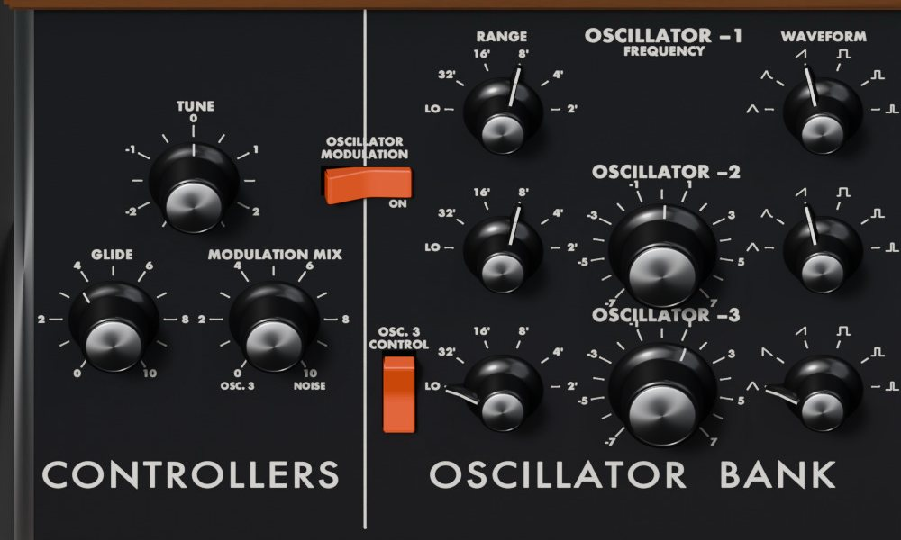

### TUNE

**TUNE** afina los tres osciladores juntos hasta 2,5 semitonos para arriba o para abajo. En 0 el instrumento está en el tono de concierto, con el la en 440 Hz. Usalo con el tono A-440 para afinar de oído, o para acompañar una grabación que no está en 440 Hz.

### GLIDE

La perilla **GLIDE** fija cuánto tarda la altura en deslizarse de una nota a la siguiente, de 1 ms aproximadamente (0) a 1 segundo por octava aproximadamente (10); en el medio de la perilla da cerca de una décima de segundo por octava. La perilla sólo actúa mientras el rocker **GLIDE** del controlador de la mano izquierda está encendido.

En los saltos grandes la altura se mueve a una velocidad casi constante, así que un deslizamiento de dos octavas tarda el doble que uno de una octava, y sólo el último semitono se asienta suave. El glide mueve junto con la altura el seguimiento de teclado del filtro, así que el timbre también se desliza.

### MODULATION MIX y las llaves de modulación

El Model D no tiene un LFO aparte. Su modulación sale de dos fuentes, el oscilador 3 y el generador de ruido, y la rueda MOD decide cuánto llega al sonido.

- **MODULATION MIX** mezcla las dos fuentes: en 0 sólo el oscilador 3, en 10 sólo ruido, y en el medio las dos a un 70 % cada una, más o menos.
- **OSCILLATOR MODULATION** (el rocker naranja en el borde con el OSCILLATOR BANK) manda la modulación a la altura de los osciladores 1 y 2, y también del 3 mientras OSC. 3 CONTROL está encendido (con el oscilador 3 como fuente, se modula a sí mismo, como en el original). Con la rueda a fondo, una cuadrada del oscilador 3 los mueve unos 9 semitonos para arriba y para abajo.
- **FILTER MODULATION** (el rocker naranja en el borde entre el MIXER y los MODIFIERS) manda la misma modulación al corte del filtro, hasta 1,25 octavas para cada lado, aproximadamente.

Las dos llaves pueden estar encendidas a la vez. Con las dos apagadas, la rueda MOD no hace nada.

El ruido que va a la modulación es más oscuro que el que escuchás: rosa cuando la llave WHITE/PINK está en WHITE, y rojo (todavía más oscuro, un retumbo lento) cuando está en PINK. Funciona aunque el ruido no esté subido en el mezclador.

## Oscillator bank

Tres osciladores generan el sonido. Cada uno tiene un selector **RANGE** y un selector **WAVEFORM**; los osciladores 2 y 3 tienen además una perilla **FREQUENCY**. El oscilador 1 no tiene FREQUENCY: sigue a TUNE, y los otros dos se afinan contra él.

### RANGE

**RANGE** fija la octava en pies de órgano: **LO**, **32'**, **16'**, **8'**, **4'** y **2'**. 8' es el tono de concierto (el la arriba del do central suena en 440 Hz); cada paso es una octava. LO está tres octavas debajo de 32', cinco debajo de 8': demasiado grave para oírse como altura, da clics lentos y está pensado para el oscilador 3 como modulador.

### FREQUENCY

**FREQUENCY** en el oscilador 2 lo afina contra el oscilador 1, hasta 7,5 semitonos para arriba o para abajo. Correlo apenas de 0 para el clásico batido lento de dos osciladores desafinados, o afinalo a un intervalo: en +7 suena una quinta arriba, en +5 una cuarta, en -5 una cuarta abajo. En el oscilador 3 hace lo mismo, salvo que OSC. 3 CONTROL esté apagado (mirá más abajo).

### WAVEFORM

**WAVEFORM** elige una de seis formas de onda, de izquierda a derecha:

- **Triángulo**: suave y aflautado, pocos armónicos.
- **Triángulo-sierra**: un triángulo con algo de sierra, el "diente de tiburón" del original. Más redondo que la sierra, más brillante que el triángulo. En el oscilador 3 esta posición es una **sierra invertida**, que baja en vez de subir y hace rampas descendentes cuando modula.
- **Sierra**: brillante y llena, todos los armónicos. La de por defecto y la más usada.
- **Cuadrada**: hueca, sólo armónicos impares.
- **Pulso ancho**: un ciclo de trabajo de un 29 %, una cuadrada más fina, de lengüeta.
- **Pulso angosto**: un ciclo de trabajo de un 15 %, fino y nasal.

Como en el original, la cuadrada y los pulsos salen un poco más fuertes que el triángulo con el mismo ajuste del mezclador.

### OSC. 3 CONTROL

**OSC. 3 CONTROL** es el rocker naranja vertical abajo a la izquierda del OSCILLATOR BANK. Encendido (por defecto), el oscilador 3 es una tercera fuente de sonido que sigue al teclado, al glide y a la rueda PITCH como los otros dos.

Apagado, el oscilador 3 ignora el teclado, el glide y la rueda PITCH y se queda en una altura fija, como drone o como modulador. Su perilla FREQUENCY pasa a cubrir 3 octavas para arriba y para abajo en vez de 7,5 semitonos, y RANGE sigue fijando la octava. En LO, con OSC. 3 CONTROL apagado, va de unos 0,3 Hz (FREQUENCY en -7,5), pasando por unos 2,7 Hz (0), a unos 22 Hz (+7,5): el rango completo de un LFO. Así hace el Model D el vibrato, los trinos y los barridos lentos.

> La perilla VOLUME y el rocker ON del oscilador 3 en el mezclador sólo afectan lo que escuchás. Apagá el oscilador 3 en el mezclador cuando lo usás como modulador, y su modulación sigue funcionando.

## Mixer

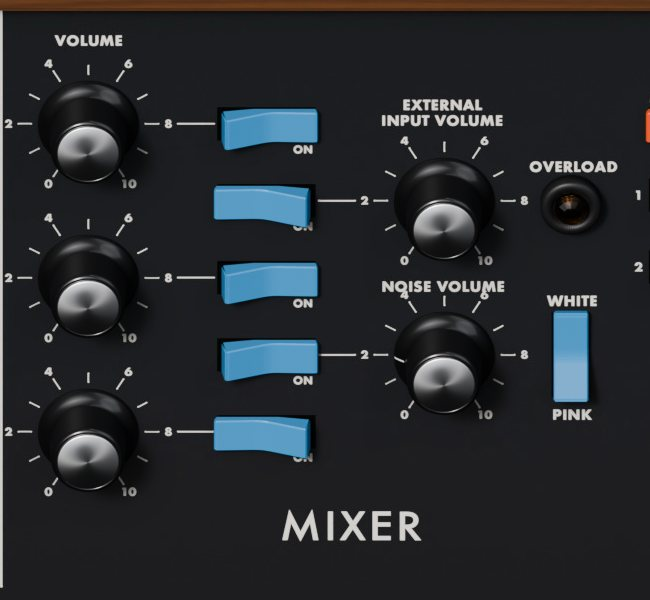

El mezclador tiene cinco entradas, cada una con una perilla VOLUME de 0 a 10 y su propio rocker azul ON. Los rockers están en una columna entre los volúmenes de los osciladores y las dos perillas de la derecha, en este orden de arriba hacia abajo: oscilador 1, entrada externa, oscilador 2, ruido, oscilador 3.

- Las tres perillas **VOLUME** de la izquierda fijan el nivel de los osciladores 1, 2 y 3.
- **EXTERNAL INPUT VOLUME** fija el nivel de la entrada externa, el audio que llega a la External Input del plugin (mirá Mandar audio a la entrada externa).
- **NOISE VOLUME** fija el nivel del generador de ruido.
- El rocker **WHITE/PINK** elige el color del ruido que escuchás: blanco (siseo brillante) cuando está arriba, rosa (más suave, con más graves) cuando está abajo. También elige el ruido de la modulación (mirá Controllers).
- La lámpara **OVERLOAD** se prende cuando la entrada externa satura su preamplificador.

### Empujar al filtro

El mezclador alimenta directamente al filtro, y la etapa de entrada del filtro satura a medida que sube el nivel. Un oscilador en 10 apenas se comprime. Dos o tres osciladores altos, o el ruido (su camino es más caliente que el de los osciladores), llevan al filtro a una saturación gorda y comprimida que es buena parte del carácter del Model D. Dejá los volúmenes cerca de 5 para un sonido limpio; subilos para que gruña. Usá el VOLUME principal, no el mezclador, para fijar qué tan fuerte suena el ATMD.

Con todas las fuentes apagadas, el filtro igual tiene un piso de ruido mínimo con el que trabajar, como en el original, así que puede cantar solo con EMPHASIS alto.

## Modifiers

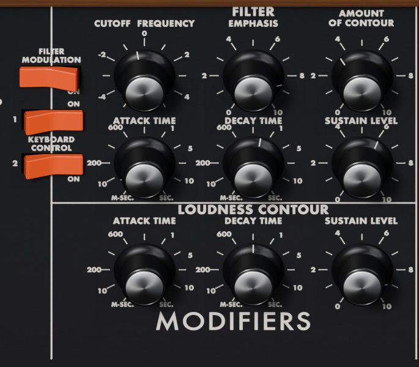

Los MODIFIERS tienen el filtro con su generador de contorno (mitad de arriba) y el contorno de volumen que maneja el amplificador (mitad de abajo). Los tres rockers naranjas del borde izquierdo son FILTER MODULATION (mirá Controllers) y las dos llaves KEYBOARD CONTROL.

### FILTER

El filtro es un pasa bajos de cuatro polos, 24 dB por octava, basado en la escalera de transistores de Moog. Como en el original, subir la resonancia le quita graves al sonido, y arriba de todo el filtro canta una senoidal casi pura.

- **CUTOFF FREQUENCY** fija dónde empieza a cortar el filtro, una octava por división del dial (de -5 a +5). En -1,1 el corte está en 440 Hz, en 0 en unos 940 Hz, en -5 en unos 30 Hz, y en +5 el filtro está abierto del todo. El seguimiento de teclado y el contorno se suman encima.
- **EMPHASIS** es la resonancia: un pico en el corte que hace silbar y barrer al filtro. Desde 8, más o menos, el filtro oscila solo. Debajo de unos 300 Hz la resonancia se debilita, y debajo de unos 150 Hz el filtro deja de oscilar, como en el original.
- **AMOUNT OF CONTOUR** fija cuánto abre el contorno al filtro por encima de CUTOFF FREQUENCY, hasta unas 6 octavas en 10. En 0 el contorno no le hace nada al filtro.
- **KEYBOARD CONTROL** 1 y 2 hacen que el corte siga a las teclas. La llave 1 sola da un tercio, la 2 sola dos tercios, y las dos juntas una octava por octava, así que un filtro que autooscila toca afinado. El seguimiento arranca en el fa más grave del teclado, donde no suma nada.

### Contorno del filtro

El generador de contorno le da a cada nota una forma en tres etapas: sube a su pico, baja a un nivel que se mantiene y se queda ahí mientras mantenés la tecla. No hay una perilla de relajación aparte: lo que pasa cuando soltás depende del rocker DECAY.

- **ATTACK TIME** fija qué tan rápido sube el contorno, de 1 ms aproximadamente (0) a 10 s (10). La perilla es logarítmica, como en el original: unos 0,15 s en 2, 0,5 s en 4, 1,5 s en 6 y 4 s en 8.
- **DECAY TIME** fija qué tan rápido baja del pico al nivel de sustain, en el mismo rango. Con el rocker DECAY encendido, fija también la relajación cuando soltás.
- **SUSTAIN LEVEL** fija el nivel que se mantiene mientras la tecla está apretada, de 0 a 10 (el pico).

El ataque sube casi en línea recta y se corta en el pico; el decay y la relajación son curvos, rápidos al principio y más lentos al final. Un ataque nuevo arranca desde donde esté el contorno, no desde cero.

### Contorno de volumen

El contorno de volumen tiene las mismas tres perillas, **ATTACK TIME**, **DECAY TIME** y **SUSTAIN LEVEL**, y funciona igual, pero le da forma al volumen de la nota. Con SUSTAIN LEVEL en 0 cada nota se apaga aunque mantengas la tecla, como una cuerda pulsada o un piano; en 10 suena a pleno mientras la mantengas, como un órgano.

## Output

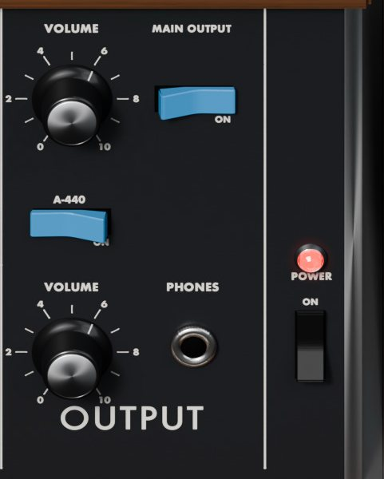

- **VOLUME** (arriba) fija el nivel de la salida principal. La perilla es logarítmica. En 6, el valor por defecto, los presets de fábrica están nivelados para sonar más o menos igual de fuerte.
- El rocker **MAIN OUTPUT** silencia la salida principal cuando está apagado.
- **A-440** suma a la salida un tono senoidal fijo de 440 Hz, la referencia que usaba el original para afinar. Suena toques o no, y aun con MAIN OUTPUT apagado.
- **VOLUME** (abajo, arriba de PHONES) era el nivel de auriculares del original. En el ATMD fija el nivel del tono A-440.
- **POWER** y su lámpara están siempre encendidos en el plugin.

Para afinar con A-440, tocá un la, prendé A-440 y girá TUNE (o la FREQUENCY de un oscilador) hasta que el batido entre los dos tonos se haga lento y desaparezca. El tono A-440 también pasa por el delay y la reverb, así que apagalos mientras afinás.

## Controlador de la mano izquierda

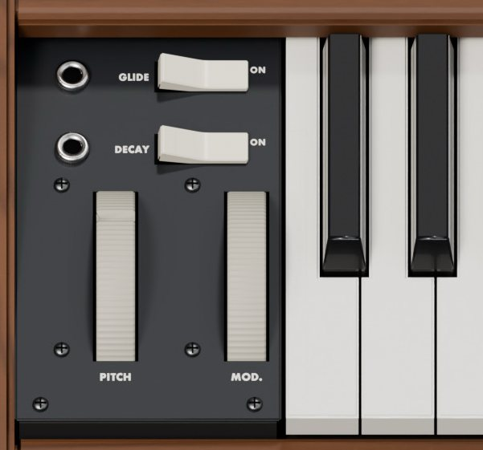

### GLIDE y DECAY

- **GLIDE** prende y apaga el glide; la perilla GLIDE de los CONTROLLERS fija su tiempo. Con GLIDE encendido, cada nota nueva se desliza desde la anterior, aunque toques separado, porque el teclado retiene la última altura, como en el original.
- **DECAY** decide qué pasa cuando soltás la tecla. Encendido (por defecto): los dos contornos bajan con su DECAY TIME, así que la nota se apaga natural. Apagado: bajan en unos 15 ms (o más rápido, si DECAY TIME es más corto), así que la nota se corta casi enseguida, mientras DECAY TIME le sigue dando forma mientras mantenés la tecla.

### Ruedas PITCH y MOD

- La rueda **PITCH** dobla los osciladores 1 y 2, y también el 3 cuando OSC. 3 CONTROL está encendido. Por defecto dobla hasta 7 semitonos para arriba o para abajo (una quinta); el rango se cambia en la página SETTINGS. Empujala hacia arriba para subir. Al soltarla vuelve sola al centro. El pitch bend de tu controlador MIDI la mueve.
- La rueda **MOD** fija cuánta modulación del oscilador 3 y del ruido llega a los osciladores y al filtro, a través de las llaves OSCILLATOR MODULATION y FILTER MODULATION. Abajo del todo es sin modulación. La profundidad crece despacio al principio y rápido cerca del final, como en el original: a mitad de recorrido da sólo un octavo de la profundidad total, más o menos, lo que deja lugar para un vibrato delicado. La rueda de modulación de tu controlador MIDI (CC 1) la mueve.

Las ruedas no se guardan en los presets ni como parámetros del host. Arrancan en el centro y en 0.

## Teclado y voces

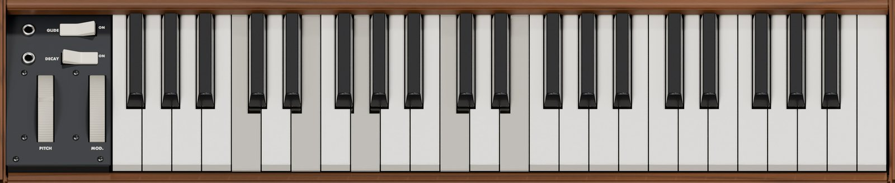

El teclado en pantalla tiene 44 teclas, de F2 a C6, como el original. Las notas MIDI fuera de ese rango también suenan.

### Como en el original

Con VOICES en 1 el ATMD es monofónico, y se comporta como el Model D:

- **Prioridad a la nota más grave**: si mantenés varias teclas, suena la más grave. Cuando la soltás, la nota vuelve a la tecla más grave que siga apretada.
- **Disparo único**: los contornos arrancan sólo cuando apretás una tecla sin ninguna otra apretada. Las notas tocadas legato (una tecla nueva antes de soltar la anterior) cambian la altura sin reiniciar los contornos, así que una frase legato fluye como un solo gesto, y las notas separadas tienen cada una su ataque.

Los ajustes NOTE PRIORITY y TRIGGER cambian las dos cosas (mirá la página SETTINGS).

### Polifonía

Con VOICES en más de 1, cada nota toma su propia voz, y cada voz tiene sus propios osciladores, filtro y contornos. Cada nota nueva arranca sus contornos, diga lo que diga TRIGGER. Cuando todas las voces están ocupadas, se toma la nota más vieja. Con GLIDE encendido, una voz que todavía suena se desliza desde su última altura hasta la nota nueva.

La modulación (el oscilador 3 como modulador, el ruido y las ruedas) actúa igual sobre todas las voces.

## Página SETTINGS

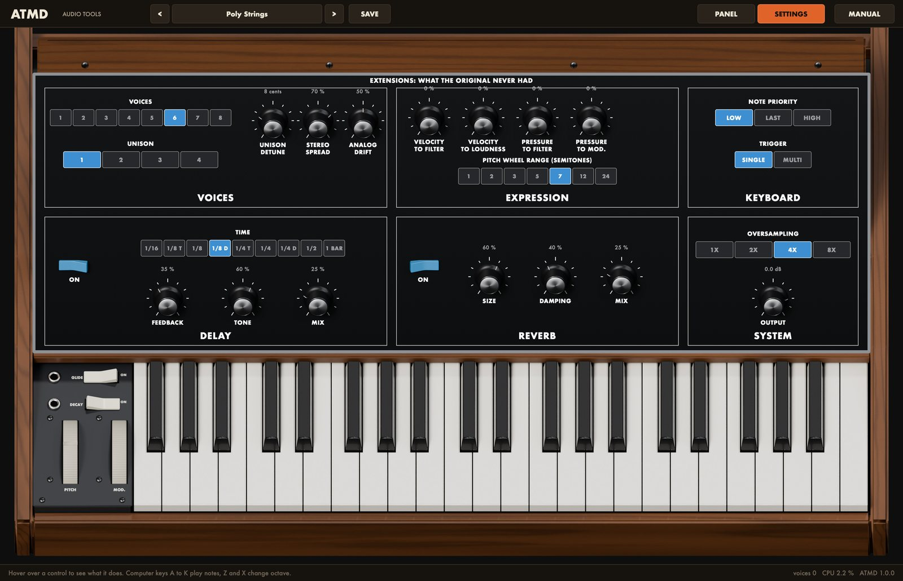

La página SETTINGS reúne las extensiones en seis grupos. En esta página arrastrá las perillas como en el panel (Shift para ajuste fino, doble clic para el valor por defecto), hacé clic en una casilla para elegir un valor y hacé clic en un rocker para cambiarlo. El valor actual de cada perilla está escrito arriba de ella.

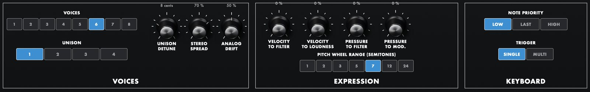

### VOICES

- **VOICES** elige cuántas notas pueden sonar a la vez, de 1 (el original monofónico) a 8.
- **UNISON** apila de 1 a 4 voces en cada nota, para un sonido más gordo. Funciona también con VOICES en 1: una nota, hasta cuatro voces.
- **UNISON DETUNE** separa en altura las voces apiladas, de 0 a 30 cents entre las dos de los extremos (8 por defecto).
- **STEREO SPREAD** reparte las voces apiladas en el campo estéreo. Con varias voces y sin unísono, ubica las notas un poco a la izquierda, al centro y a la derecha, por turno.
- **ANALOG DRIFT** hace que la altura de cada oscilador divague despacio unos pocos cents, hasta unos 6 cents en 100 %, como en un circuito analógico tibio. Cada voz deriva por su cuenta, así que las voces de un acorde o de un unísono difieren un poco. En 0 los osciladores quedan perfectamente quietos.

El motor tiene 16 voces en total. VOICES por UNISON nunca pasa de ahí: cuando pasaría, el unísono se reduce (con 8 voces, 2 voces por nota como mucho).

### EXPRESSION

El original no tenía velocidad ni aftertouch, así que todos arrancan en 0 %.

- **VELOCITY TO FILTER**: tocar más fuerte abre el filtro y tocar más suave lo cierra, hasta unas dos octavas entre la nota más suave y la más fuerte en 100 %. Una velocidad media, cerca de 90, deja el filtro como está.
- **VELOCITY TO LOUDNESS**: tocar más suave suena más bajo. En 100 % el volumen sigue por completo a la velocidad.
- **PRESSURE TO FILTER**: apretar más las teclas después de que arrancó la nota (aftertouch) abre el filtro, hasta 2 octavas.
- **PRESSURE TO MOD.**: el aftertouch se suma a la rueda MOD, así que podés traer el vibrato apretando la tecla. La llave OSCILLATOR MODULATION o FILTER MODULATION tiene que estar encendida, como para la rueda.
- **PITCH WHEEL RANGE (SEMITONES)** fija cuánto dobla la rueda PITCH: 1, 2, 3, 5, 7 (por defecto, como el original), 12 o 24 semitonos para arriba y para abajo.

Con VOICES en 1 y disparo único, las notas legato conservan la velocidad de la primera nota, porque los contornos no se reinician.

### KEYBOARD

Estos dos ajustes valen con VOICES en 1.

- **NOTE PRIORITY** elige qué tecla apretada suena: **LOW** (el original, la más grave), **LAST** (la última que apretaste) o **HIGH** (la más aguda).
- **TRIGGER** elige cuándo se reinician los contornos. **SINGLE** (el original): sólo cuando apretás una tecla sin ninguna otra apretada. **MULTI**: también con cada tecla que apretás y cambia la nota que suena, así que las notas legato tienen su propio ataque. Volver a una tecla apretada cuando soltás otra nunca reinicia los contornos.

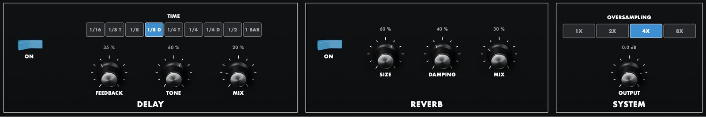

### DELAY

- **ON** prende o apaga el delay. Es un delay ping-pong: la primera repetición sale por la izquierda y cada repetición cruza al otro lado.
- **TIME** fija el tiempo del delay en figuras del tempo del host: 1/16, 1/8 T, 1/8, 1/8 D (por defecto), 1/4 T, 1/4, 1/4 D, 1/2 o 1 compás. En la aplicación independiente sigue 120 BPM.
- **FEEDBACK** fija cuántas repeticiones escuchás.
- **TONE** oscurece las repeticiones con valores bajos y las deja brillantes con valores altos.
- **MIX** fija el nivel de las repeticiones.

### REVERB

- **ON** prende o apaga la reverb de placa.
- **SIZE** fija el largo de la cola.
- **DAMPING** oscurece la cola.
- **MIX** fija el nivel de la reverb.

Primero va el delay y después la reverb.

### SYSTEM

- **OVERSAMPLING** hace correr las voces a 1x, 2x, 4x (por defecto) u 8x la frecuencia de muestreo. Los valores altos mantienen más limpios los sonidos brillantes y resonantes y la modulación rápida del oscilador 3, y gastan más CPU. Cambiarlo reinicia el motor, así que las notas que suenan se cortan.
- **OUTPUT** fija el nivel final después de los efectos, de -24 a +6 dB.

OVERSAMPLING y OUTPUT son preferencias tuyas: cargar un preset nunca los cambia.

## Mandar audio a la entrada externa

El Model D podía pasar cualquier sonido por su mezclador y su filtro: una guitarra, un loop de batería, una voz. El ATMD tiene la misma EXTERNAL INPUT, alimentada por la entrada estéreo opcional del plugin, llamada External Input (los dos canales se mezclan a mono). En la mayoría de los DAW aparece como una entrada de side-chain del instrumento.

1. Elegí la fuente en tu DAW. En Ableton Live, abrí la sección Sidechain en la barra de título del dispositivo ATMD y elegí la pista que querés procesar. En otros hosts, buscá el side-chain o el ruteo de entrada del instrumento.
2. En el MIXER, prendé el rocker ON de la entrada externa (el segundo desde arriba).
3. Subí **EXTERNAL INPUT VOLUME** hasta que la lámpara **OVERLOAD** se prenda en los momentos más fuertes. La entrada pasa por un preamplificador de mucha ganancia, así que con poco alcanza; más arriba el preamplificador recorta y distorsiona.
4. Mantené una tecla. La señal externa pasa por el filtro y el contorno de volumen, así que sólo la escuchás mientras suena una nota. Para un filtro fijo, poné el SUSTAIN LEVEL del contorno de volumen en 10 y apagá los osciladores en el mezclador, o dejalos prendidos para mezclar el sinte con la entrada.

La lámpara OVERLOAD mira el preamplificador, antes del rocker ON del mezclador, así que podés ajustar el nivel con la entrada apagada; queda prendida un tercio de segundo después de cada recorte. En la aplicación independiente la entrada externa es la entrada de audio elegida en Options.

### El lazo de realimentación

Los dueños del original solían conectar la salida principal de vuelta a la entrada externa. La señal da entonces una segunda vuelta por el mezclador y el filtro, lo que engorda y ensucia el sonido y cambia cómo se comporta la resonancia. Podés hacer lo mismo en un DAW si te deja rutear una pista de vuelta a su propio instrumento:

1. Agregá un envío desde la pista del ATMD a una pista de retorno (o a un bus auxiliar).
2. Elegí esa pista de retorno como fuente de la External Input del ATMD.
3. Subí el envío, prendé la entrada externa en el MIXER y subí **EXTERNAL INPUT VOLUME** despacio desde 0, con el VOLUME principal en 6 o menos.

Como la señal da una vuelta completa por el host, vuelve por lo menos un buffer de audio tarde, unos milisegundos. Por eso el lazo además colorea el sonido como un eco muy corto, y con ajustes altos puede aullar solo; con buffers más chicos se parece más al original. Algunos hosts no aceptan este ruteo, porque devuelve una pista a sí misma.

> Empezá con el envío y EXTERNAL INPUT VOLUME bajos y los monitores bajos. Un lazo de realimentación puede subir de volumen muy rápido.

## Presets

El ATMD trae 32 presets de fábrica: Init y 31 sonidos en cinco categorías. Un preset guarda cada perilla y cada rocker del panel y cada ajuste de la página SETTINGS, salvo OVERSAMPLING y OUTPUT. No guarda las ruedas.

### Elegir un preset

- Hacé clic en **<** o **>** en la barra superior para recorrer todos los presets.
- Hacé clic en el nombre del preset para abrir el menú. Cada categoría es un submenú; los tuyos están en User.
- **Show user presets folder** abre la carpeta donde se guardan tus presets.

### Guardar los tuyos

1. Hacé clic en **SAVE**.
2. Escribí un nombre (el diálogo te propone el actual) y hacé clic en Save, o apretá Return.

El preset se guarda como archivo `.json` en la carpeta de usuario y aparece en User en el menú. Si guardás con el nombre de un preset de usuario que ya existe, lo reemplaza sin preguntar.

- macOS: `~/Library/Application Support/Audio Tools/ATMD/Presets`
- Windows: `%APPDATA%\Audio Tools\ATMD\Presets`

Para borrar o renombrar un preset de usuario, hacelo en esa carpeta. Los archivos de presets que copies a la carpeta desde otro lado aparecen la próxima vez que abras el ATMD. El proyecto de tu DAW guarda el estado completo del ATMD, hayas guardado un preset o no.

### Presets de fábrica

| Categoría | Presets |
|---|---|
| Init | Init |
| Bass | Fat Bass, Taurus Low, Plucked Bass, Squelch Bass, Rubber Bass, Moog Thump, Funk Clav Bass, Sub Drop |
| Lead | Lucky Lead, Prog Solo, Square Whistle, Singing Filter, Fifth Lead, Thin Pulse Lead, Screamer, Detuned Saws |
| Brass and keys | Brass Section, Soft Horn, Organ Keys, Electric Piano, Harpsichord |
| Effects and percussion | Kick, Snare, Hi-Hat, Wind, Laser Zap, Bird Call |
| Drones and pads | Poly Strings, Unison Stack, Slow Sweep Pad, Drone Machine |

- **Bass**: el sonido por el que más se conoce al Model D. Fat Bass apila los tres osciladores, con el oscilador 3 una octava abajo; Taurus Low baja a 32' con un glide lento; Squelch Bass lleva EMPHASIS al límite; Plucked Bass y Funk Clav Bass tienen DECAY apagado para notas cortas y secas.
- **Lead**: Lucky Lead y Prog Solo son los solos clásicos con glide de los 70; Singing Filter deja cantar la resonancia sobre el oscilador; Fifth Lead afina el oscilador 2 una quinta arriba; Screamer empuja fuerte al mezclador.
- **Brass and keys**: los ataques de filtro más lentos de Brass Section y Soft Horn, y el Electric Piano, más corto y sensible a la velocidad.
- **Effects and percussion**: Kick es el filtro autooscilando barrido hacia abajo por su contorno, sin ningún oscilador; Snare y Hi-Hat son casi todo ruido.
- **Drones and pads**: usan las extensiones. Poly Strings y Slow Sweep Pad tocan con 6 voces y reverb, Unison Stack apila 4 voces en cada nota y Drone Machine barre el filtro despacio con el oscilador 3.

> En Lucky Lead y Square Whistle el oscilador 3 está preparado para un vibrato que sumás con la rueda MOD, como en el original. Sub Drop, Laser Zap, Bird Call, Wind y Drone Machine cargan con la rueda ya levantada, porque la modulación es su sonido. Mové la rueda despacio: el efecto crece rápido cerca del final.

## MIDI

| Mensaje | Efecto |
|---|---|
| Notas | Tocan, en cualquier canal, con velocidad |
| Pitch bend | Mueve la rueda PITCH |
| CC 1, rueda de modulación | Mueve la rueda MOD |
| CC 64, pedal de sustain | Sostiene las notas mientras el pedal está apretado |
| Presión de canal y presión polifónica | Aftertouch, para PRESSURE TO FILTER y PRESSURE TO MOD. |
| CC 120, All Sound Off | Corta todas las notas en el acto |
| CC 121, Reset All Controllers | Devuelve las ruedas y el aftertouch al reposo y suelta el pedal |
| CC 123, All Notes Off | Suelta todas las notas |

- La velocidad cuenta sólo lo que permiten VELOCITY TO FILTER y VELOCITY TO LOUDNESS; en su valor por defecto de 0 % todas las notas suenan igual, como en el original.
- La presión polifónica no se aplica nota por nota: el último valor recibido actúa sobre todas las voces.
- Con VOICES en 1, las teclas que sostiene el pedal cuentan como apretadas para la prioridad de nota.
- Poner el plugin en bypass suelta todas las notas, así que no queda nada colgado cuando lo volvés a activar.

## Recetas

### Bajo gordo

1. Elegí Init.
2. Poné **RANGE** de los osciladores 1 y 2 en 16' y el del oscilador 3 en 32'. Poné la **WAVEFORM** del oscilador 3 en cuadrada.
3. Subí apenas la **FREQUENCY** del oscilador 2, a +0,1 más o menos, para un batido lento.
4. En el MIXER, prendé los osciladores 2 y 3 y poné los volúmenes en 8, 7 y 5.
5. Poné **CUTOFF FREQUENCY** en -1,5, **EMPHASIS** en 2,5 y **AMOUNT OF CONTOUR** en 6,5. Prendé **KEYBOARD CONTROL** 1.
6. Poné el contorno del filtro en ATTACK 0, DECAY 3,6, SUSTAIN 2,5, y el contorno de volumen en ATTACK 0, DECAY 4,5, SUSTAIN 8.
7. Tocá notas graves. Subí AMOUNT OF CONTOUR para más ataque, o bajá los volúmenes de los osciladores para un sonido más limpio.

Es el preset Fat Bass. Para el clásico deslizamiento gomoso, prendé el rocker **GLIDE**, poné la perilla GLIDE en 2 más o menos y tocá legato: las notas se deslizan sin un ataque nuevo.

### Solo con vibrato en la rueda

1. Elegí Init. Prendé el oscilador 2 en el MIXER en 7, con **FREQUENCY** en +0,1 más o menos.
2. Poné el **RANGE** del oscilador 3 en LO y su **WAVEFORM** en triángulo, y apagá **OSC. 3 CONTROL**. Poné su **FREQUENCY** en +1 más o menos, para un vibrato de unas 3,5 veces por segundo. Dejá el oscilador 3 apagado en el mezclador.
3. Prendé **OSCILLATOR MODULATION** y dejá **MODULATION MIX** en 0.
4. Poné **CUTOFF FREQUENCY** en 0, **EMPHASIS** en 3 y **AMOUNT OF CONTOUR** en 4,5, con las dos llaves **KEYBOARD CONTROL** encendidas.
5. Prendé el rocker **GLIDE** y poné la perilla GLIDE en 3,5 más o menos.
6. Tocá una melodía, casi toda legato. En las notas largas, subí la rueda MOD despacio pasando la mitad para traer el vibrato.

Comparalo con Lucky Lead. Para un wah de filtro en vez de vibrato, prendé FILTER MODULATION y apagá OSCILLATOR MODULATION. Para un trino, poné la WAVEFORM del oscilador 3 en cuadrada.

### El filtro como instrumento

1. Elegí Init y apagá el oscilador 1 en el MIXER, así no entra nada al filtro.
2. Poné **EMPHASIS** en 10 y **AMOUNT OF CONTOUR** en 0. El filtro ahora canta solo una senoidal.
3. Prendé las dos llaves **KEYBOARD CONTROL**, así sigue a las teclas una octava por octava.
4. Poné **CUTOFF FREQUENCY** en -3,4 más o menos y tocá el la arriba del do central.
5. Prendé **A-440** y girá CUTOFF FREQUENCY despacio hasta que desaparezca el batido entre los dos tonos. Apagá A-440.
6. Tocá melodías desde A3 más o menos hacia arriba. Debajo de unos 150 Hz el filtro deja de cantar, como en el original.

Prendé **GLIDE** para un deslizamiento tipo theremin. Si volvés a mezclar un poco del oscilador 1, el filtro resuena con él.

### El oscilador 3 como fuente de FM

1. Elegí Init. Poné el **RANGE** del oscilador 3 en 8' y dejá **OSC. 3 CONTROL** encendido, así el oscilador 3 sigue a las teclas a frecuencia de audio.
2. Prendé **OSCILLATOR MODULATION** con **MODULATION MIX** en 0.
3. Poné la **WAVEFORM** del oscilador 1 en triángulo y **CUTOFF FREQUENCY** en +2.
4. Mantené una tecla y subí la rueda MOD. El oscilador 1 se vuelve metálico, como una campana, porque el oscilador 3 lo modula más rápido de lo que se oye como vibrato.
5. Girá la **FREQUENCY** del oscilador 3 para cambiar el color: en 0, +7 y +5 queda armónico, en el medio se vuelve metálico y disonante.

Prendé también FILTER MODULATION para un filtro que gruñe y zumba. Subí **OVERSAMPLING** a 8x si las notas agudas suenan ásperas.

### Viento

1. Elegí Init. En el MIXER apagá el oscilador 1 y prendé el ruido, con **NOISE VOLUME** en 8, y poné el rocker del ruido en **PINK**.
2. Poné **CUTOFF FREQUENCY** en -1, **EMPHASIS** en 7 y **AMOUNT OF CONTOUR** en 0.
3. Poné el contorno de volumen en ATTACK 4,5, DECAY 5 y SUSTAIN 10.
4. Poné el oscilador 3 en LO, triángulo, con **OSC. 3 CONTROL** apagado y **FREQUENCY** en -6, para una onda lenta. Prendé **FILTER MODULATION** con **MODULATION MIX** en 0.
5. Mantené una tecla y subí la rueda MOD. El pico resonante del filtro sube y baja con el oscilador 3, como ráfagas de viento.

Es el preset Wind. Llevá MODULATION MIX hacia 10 y el barrido se vuelve azaroso, manejado por el ruido rojo.

### Cuerdas polifónicas

1. Elegí Init. Prendé el oscilador 2 en el MIXER en 7, con **FREQUENCY** en +0,1 más o menos.
2. Poné **CUTOFF FREQUENCY** en -0,6, **EMPHASIS** en 1 y **AMOUNT OF CONTOUR** en 2,5. Poné el contorno del filtro en ATTACK 4, DECAY 5,5, SUSTAIN 6.
3. Poné el contorno de volumen en ATTACK 4,5, DECAY 6, SUSTAIN 9.
4. En la página SETTINGS, poné **VOICES** en 6, **ANALOG DRIFT** en 50 % más o menos y **STEREO SPREAD** en 70 %.
5. Prendé la reverb con **ON** y **MIX** en 25 %.
6. Tocá acordes lentos.

Comparalo con Poly Strings. Para un sonido más ancho, poné **UNISON** en 2 y UNISON DETUNE en 12 cents más o menos.

## Solución de problemas

### No suena

- Revisá el **VOLUME** principal, el rocker **MAIN OUTPUT** y **OUTPUT** en la página SETTINGS.
- Fijate que haya por lo menos una fuente prendida en el MIXER, su rocker ON y su perilla VOLUME, o que EMPHASIS esté lo bastante alto para que el filtro cante.
- Con **CUTOFF FREQUENCY** cerca de -5 y AMOUNT OF CONTOUR en 0 el filtro está cerrado. Subilo.
- Con el **SUSTAIN LEVEL** del volumen en 0, las notas mantenidas se apagan después del decay. Es normal.
- En tu DAW, fijate que la pista reciba MIDI y esté armada o en monitoreo.

### La modulación no hace nada

Subí la rueda MOD: en 0 no hay modulación, y la profundidad crece sobre todo en la mitad de arriba de su recorrido. Fijate que OSCILLATOR MODULATION o FILTER MODULATION esté encendido y que MODULATION MIX apunte a la fuente que querés. Si la fuente es el oscilador 3, revisá su RANGE: en LO con OSC. 3 CONTROL apagado da vibrato; en 8' da una modulación rápida que zumba.

### El oscilador 3 no sigue a las teclas

**OSC. 3 CONTROL** está apagado. Prendelo, o usá la perilla FREQUENCY para fijar su altura a mano.

### Las notas no se reinician, o la altura vuelve de golpe a otra nota

Es la prioridad a la nota grave y el disparo único del original. Levantá los dedos entre nota y nota para un ataque nuevo, o poné **TRIGGER** en MULTI y **NOTE PRIORITY** en LAST en la página SETTINGS.

### Las notas se deslizan cuando no quiero

El rocker **GLIDE** del controlador de la mano izquierda está encendido. Apagalo, o bajá la perilla GLIDE.

### Las notas se cortan de golpe al soltar la tecla

El rocker **DECAY** está apagado. Prendelo para que las notas se apaguen con el DECAY TIME.

### Un tono fijo no se apaga

A-440 está encendido. Apagalo en la sección OUTPUT.

### El sonido está distorsionado

Varias fuentes del mezclador están altas y saturan al filtro, que es parte del carácter. Bajá los volúmenes del mezclador y fijá el nivel con el VOLUME principal. Si se prende la lámpara OVERLOAD, bajá EXTERNAL INPUT VOLUME.

### La entrada externa no suena

Fijate que la fuente esté ruteada a la External Input del ATMD en tu DAW, que el rocker ON de la entrada externa en el MIXER esté encendido y su VOLUME arriba de 0, y que estés manteniendo una tecla. En la aplicación independiente, elegí la entrada de audio en Options.

### Notas colgadas

Mandá CC 123 (All Notes Off) desde tu controlador, o poné el ATMD en bypass y volvé a activarlo.

### El ATMD no aparece en el DAW

Fijate que los archivos estén en las carpetas de Instalación y reescaneá. En macOS corré el comando `xattr` de Instalación. En Windows, copiar a la carpeta VST3 pide permisos de administrador.

### Mucho consumo de CPU

Poné **OVERSAMPLING** en 2x, usá menos voces o menos unísono, y apagá el delay y la reverb si no los usás.

## Especificaciones

| Ítem | Valor |
|---|---|
| Inspirado en | Moog Minimoog Model D (1970-1981), una unidad de mediados de los 70 con la placa de osciladores Rev 2 |
| Formatos | VST3, Audio Unit (macOS), aplicación independiente |
| Sistemas | macOS 11 o posterior (universal), Windows 10 u 11 de 64 bits |
| Tipo | Instrumento con entrada MIDI y entrada externa estéreo opcional |
| Salida | Estéreo (admite bus mono) |
| Voces | De 1 (el original) a 8; unísono de 1 a 4; 16 en total |
| Teclado | 44 teclas en pantalla, de F2 a C6; prioridad grave, última o aguda; disparo único o múltiple |
| Osciladores | 3; triángulo, triángulo-sierra (sierra invertida en el oscilador 3), sierra, cuadrada, pulsos de 29 % y 15 % |
| Rangos | LO, 32', 16', 8', 4', 2'; 8' es el tono de concierto; LO está 3 octavas debajo de 32' |
| Afinación | TUNE +/-2,5 semitonos; osciladores 2 y 3 +/-7,5 semitonos; oscilador 3 +/-3 octavas sin control de teclado |
| Mezclador | 3 osciladores, entrada externa con lámpara OVERLOAD, ruido blanco o rosa; satura al filtro cuando se lo empuja |
| Filtro | Escalera de transistores de cuatro polos, 24 dB por octava; una octava por división, -1,1 = 440 Hz |
| Autooscilación | Desde EMPHASIS 8 aproximadamente; afinada con las dos llaves KEYBOARD CONTROL, hasta unos 150 Hz hacia abajo |
| Contorno del filtro | Hasta unas 6 octavas |
| Contornos | Ataque, decay y sustain; constantes de tiempo de 1 ms a 10 s, aproximadamente; relajación con DECAY, o unos 15 ms sin él |
| Glide | De 1 ms a 1 s por octava, aproximadamente |
| Modulación | Oscilador 3 y ruido rosa o rojo, por la rueda MOD a los osciladores (el 3 sólo con OSC. 3 CONTROL encendido) y al filtro |
| Rueda de pitch | 7 semitonos para arriba y para abajo por defecto; de 1 a 24 |
| Efectos | Delay ping-pong sincronizado al tempo, reverb de placa |
| Sobremuestreo | 1x, 2x, 4x u 8x |
| Presets | 32 de fábrica, más los presets de usuario |
| CPU | Cerca de 0,9 % de un núcleo en mono, 2,8 % con unísono de 4, 3,4 % para acordes de cinco notas con 6 voces (Apple M4, 4x) |
| Cola | 12 s |
| Licencia | GNU AGPL v3 |

Moog y Minimoog son marcas registradas de Moog Music Inc. Audio Tools es un proyecto independiente, sin relación ni aval de Moog Music. Los nombres de productos se usan sólo para identificar el instrumento histórico que inspiró esta recreación. Los gráficos del panel son nuestros.
