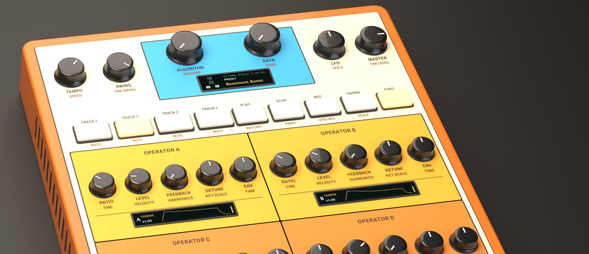
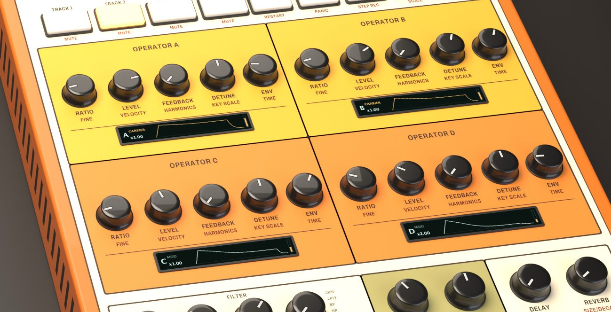
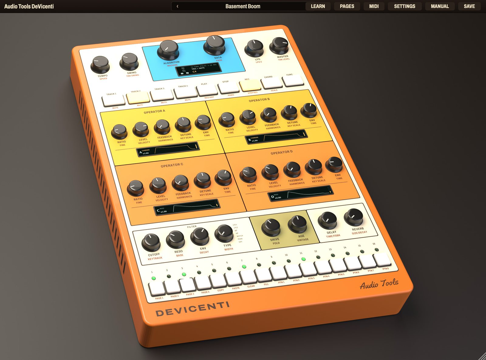
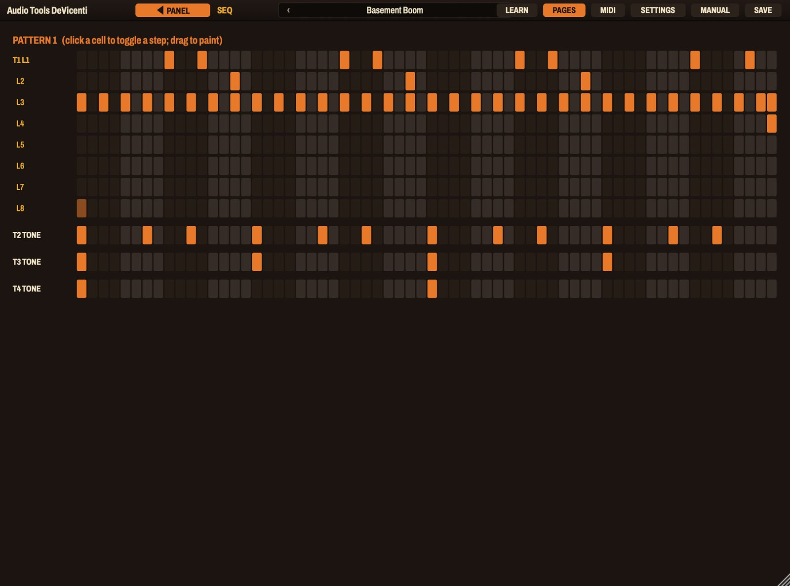
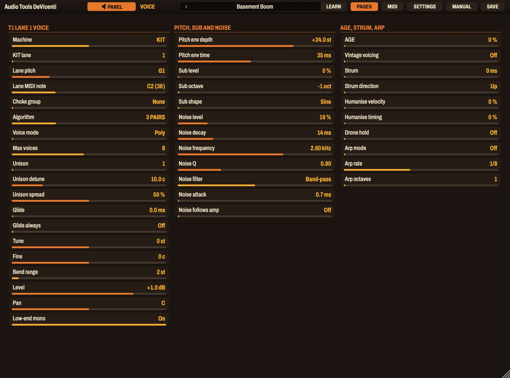
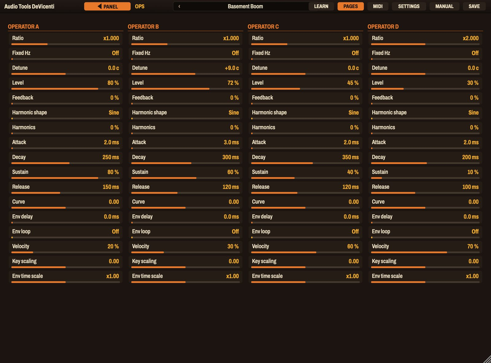
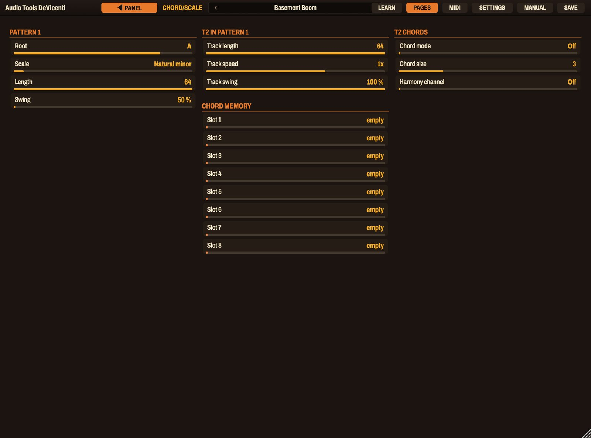
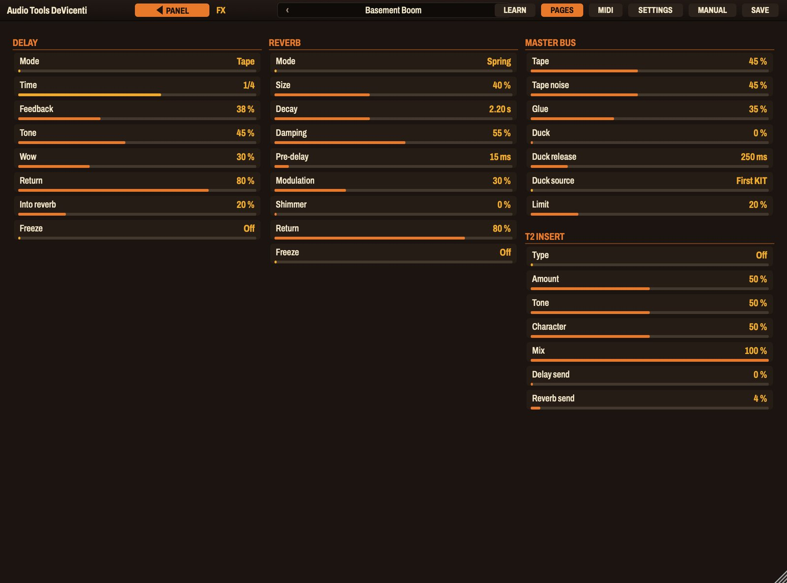
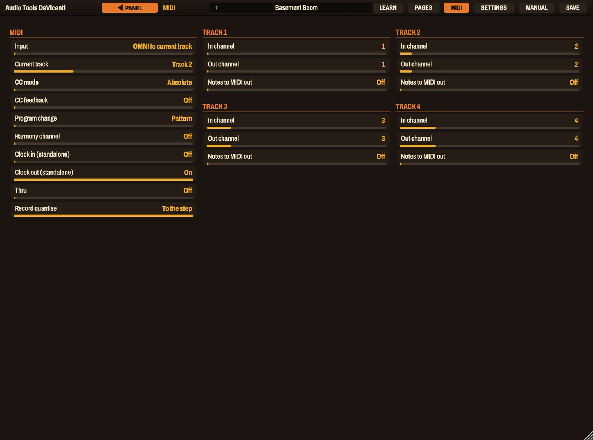

# DeVicenti user manual

## What DeVicenti is

DeVicenti is an FM groovebox: four tracks, a 64-step sequencer and a sound path built for slow, heavy, dark music. The whole instrument is one orange unit that you play and program from its panel. It is an original design, not a model of any existing machine.

Each of the four tracks is one of three machines:

- **TONE**: a four-operator FM voice with eight algorithms, a saturating filter, a sub layer, unison and a noise layer. It is polyphonic.
- **KIT**: a drum machine of eight FM lanes (kick, snare, clap, closed hat, open hat, low tom, high tom, percussion), each lane a small FM drum with its own steps, locks and conditions.
- **MIDI**: the track sends its notes, chords and locks to a MIDI channel, so DeVicenti can play an external synth.

What the sound goes through:

- A saturating filter with six shapes, **DRIVE** and **FOLD**, and **AGE**, a tape stage that adds wow, flutter, drift and hiss.
- One insert per track: overdrive and fold, bitcrush and lo-fi, chorus and ensemble, phaser, ring modulator, or a comb resonator tuned to the pattern root.
- A delay (TAPE, DUB or PING-PONG) and a reverb (SPRING, PLATE, HALL or VOID, with FREEZE and SHIMMER).
- A master bus with **TAPE**, **GLUE**, **DUCK** and **LIMIT**.

What the sequencer has:

- 16 patterns of up to 64 steps, with step locks on almost every parameter, step conditions and probability, micro timing, retriggers, slides and ties.
- Chord mode with scale-aware chords, voicings and inversions, chord memory slots, a strum and an arpeggiator.
- A per-pattern scale, per-track length, speed and swing, a song chain, and a direct jump between patterns.
- MIDI in and MIDI out: play it from a controller, record into it, and let it drive other instruments from a DAW.

It comes with 82 presets, each a whole project (sounds, patterns and effects) in banks named for the music it is made for: Trip Hop, Downtempo, Acid Jazz, Ambient, Dark Ambient and Heavy.

DeVicenti runs as VST3 on macOS, Windows and Linux, as Audio Unit on macOS, as LV2 on Linux, and as a standalone app. It is an instrument: play it from a MIDI track. It is free, open-source software under the GNU AGPL v3.

## Installation

Each zip file includes an `INSTALL.txt` with these steps.

### macOS

1. Unzip the file.
2. Copy `DeVicenti.vst3` to `~/Library/Audio/Plug-Ins/VST3/` and `DeVicenti.component` to `~/Library/Audio/Plug-Ins/Components/`.
3. Rescan plugins in your DAW. In Ableton Live: Settings, Plug-Ins, Rescan.

`DeVicenti.app` is the standalone version.

> The binaries are signed ad hoc and not notarized. If macOS refuses to open them, run this in Terminal: `xattr -dr com.apple.quarantine ~/Library/Audio/Plug-Ins/VST3/DeVicenti.vst3 ~/Library/Audio/Plug-Ins/Components/DeVicenti.component`

### Windows

1. Unzip the file.
2. Copy the `DeVicenti.vst3` folder to `C:\Program Files\Common Files\VST3\`. Windows asks for administrator rights.
3. Rescan plugins in your DAW.

`DeVicenti.exe` is the standalone version and runs without a DAW.

> The binaries are not code-signed. Windows SmartScreen may ask you to confirm the first time.

### Linux

Copy `DeVicenti.vst3` to `~/.vst3/` and the LV2 bundle to `~/.lv2/`, then rescan in your host.

## Loading DeVicenti in a DAW

DeVicenti appears under the maker name **Audio Tools**, among the instruments, as Audio Tools DeVicenti. Load it on a MIDI track. It opens with the first preset, Init: a kit on track 1 and three tone tracks, at 88 BPM.

- **The sequencer follows the host.** In a DAW the transport and the tempo are the host's: press play in the DAW and the patterns run. The unit's own PLAY and TEMPO only work in the standalone app.
- **Sound out.** The main stereo output carries everything. Each track can also go to its own stereo output (MIX page, Output): enable the extra outputs of the plugin in your DAW and send that track there to mix it separately.
- **Sound in.** Notes on the track's MIDI input play DeVicenti like any instrument (see MIDI in).
- **MIDI out.** DeVicenti also produces MIDI, to drive other instruments (see MIDI out).

The standalone app opens the editor in its own window. Choose your audio and MIDI devices in its options. There the unit has its own clock: PLAY starts and stops it, and TEMPO sets the speed.

## First sound

1. Press a preset arrow in the top bar, or click the name and choose one from the menu. Try **Basement Boom** in Trip Hop.
2. Start your DAW's transport (or PLAY in the standalone app). The pattern runs and the red LED over the STEP keys follows the playhead.
3. Click **TRACK 2**, **TRACK 3** and **TRACK 4** one after another: the operators, the filter and the STEP keys now show that track. Turn **CUTOFF** and **DRIVE** while it plays.
4. Hold the **Shift** key on your keyboard (or click **FUNC**) and click **TRACK 1**: the kit mutes. Do it again to bring it back.
5. Turn **DELAY** and **REVERB**: they send the current track to the effects.

## A tour of the interface

### Top bar

- **Preset browser** in the middle: the arrows step through the presets and a click on the name opens the menu, grouped by bank. The menu also saves and rescans your own presets.
- **LEARN**: arms MIDI learn. Click it, click a knob, then move a control on your keyboard or controller.
- **PAGES**: opens the back pages, the small display enlarged into full editors (see Back pages).
- **MIDI**: the MIDI page.
- **SETTINGS**: the window size and a reminder of how to use the panel with a mouse.
- **SAVE**: saves the current state as a user preset.
- **MANUAL**: opens this manual inside the plugin, in English or Spanish. Escape or the cross closes it.

On a back page, **PANEL** at the left of the bar returns to the unit.

### The unit

The unit is drawn in perspective. From the top: the speed and swing knobs, the blue block with the **ALGORITHM** and **DATA** knobs and the small display, the LFO and MASTER knobs; the row of keys; four operator blocks (A, B, C and D) in a grid, each with five knobs and its own small screen; the bottom row with the filter, DRIVE and AGE, and the DELAY and REVERB sends; and the sixteen STEP keys along the front edge, each with an LED above.

The window keeps its proportions and scales from 60 to 160 percent. The SETTINGS page has buttons for 75, 90, 100, 125 and 150 percent.

### Working with the controls

- **Knobs**: drag up or down, hold Shift to move slowly, scroll over them, or double-click to return to the default. Stepped knobs (ratio, type, algorithm) move one position per short drag.
- **Keys**: click them. A key that stays lit is on.
- **Value readout**: while you turn a knob, its name and value appear next to it and on the small display.
- **Right-click** a knob for the menu: MIDI learn, clear learned controllers, default value, and its CC number. Right-click a key for mute and solo (track keys) or hold and clear locks (step keys). Right-click the display to open a page.

### FUNC: the second layer

Every knob and key has a second function printed small in rust under its label. **FUNC** is the shift key that gets to it. Click FUNC to latch it (it stays lit until you click it again), or hold the **Shift** key on your computer keyboard for as long as you need it. Escape lets go of FUNC.

The second layer is listed with each control in the sections below.

## Tracks and machines

The four **TRACK** keys choose which track the panel edits. The operators, the filter row, DRIVE, AGE, the sends, the LFO and the STEP keys always belong to the selected track. The selected track is also the one that plays from your MIDI keyboard when MIDI input is in OMNI mode (see MIDI in).

- **FUNC + TRACK 1-4**: mute or unmute that track.
- **Holding one TRACK key and pressing another**, or **FUNC + Alt-click** on a track key: solo.
- **FUNC + ALGORITHM** (printed MACHINE): chooses TONE, KIT or MIDI for the selected track. The Machine field on the VOICE and MIX pages does the same.

On a TONE track every knob edits the voice. On a KIT track the knobs that shape a sound (RATIO, FEEDBACK, DETUNE, ENV of the operators, TYPE and the FUNC layer of the filter row) edit the **selected lane** (see KIT lanes), while the knobs that are host parameters (CUTOFF, RESO, the filter ENV, DRIVE, AGE, DELAY, REVERB and the four operator LEVEL knobs) act on the whole kit.

## Top row

| Control | Turn | FUNC + turn |
|---|---|---|
| **TEMPO** | Tempo, 40 to 240 BPM. In a DAW it shows the host's tempo and the host decides. | **SPEED**: the speed of the selected track in this pattern, from 1/8x to 2x |
| **SWING** | Swing for the whole pattern, 50 to 80 percent | **TRK SWING**: how much of that swing the selected track takes, 0 to 100 percent |
| **ALGORITHM** | The FM algorithm of the selected track, 1 to 8. With a step held, it chooses the trig field to edit. | **MACHINE**: TONE, KIT or MIDI |
| **DATA** | Edits the field shown on the small display. | **PAGE**: chooses the page on the display (VOICE, OPS, FILTER/AMP, LFO, MOD, TRIG, CHORD/SCALE, MIX, FX, MIDI, SONG) |
| **LFO** | Depth of LFO 1 of the selected track, positive or negative | **LFO 2**: depth of LFO 2 |
| **MASTER** | Output level of the whole unit | **TRK LEVEL**: level of the selected track |

The default swing is 56 percent, a lazy shuffle. Different tracks can run at different speeds (the polymeter in the Ambient presets uses 1/2x and 3/4x tracks) and have different lengths, so the loops drift against each other.

The **small display** shows the algorithm diagram with the role of each operator, the field being edited, and the position. Click its left half to go back one field and its right half to go forward; DATA edits the field. Every field of every page is also on the back pages, all at once.

## Key row

| Key | Press | FUNC + press |
|---|---|---|
| **TRACK 1-4** | Select the track | Mute or unmute it |
| **PLAY** | Play or pause (standalone) | **RESTART**: from step 1 |
| **STOP** | Stop (standalone); a second press releases all notes | **PANIC**: all voices and MIDI notes off |
| **REC** | Grid record on or off | **STEP REC**: step record on or off |
| **CHORD** | Chord mode on or off for the selected track | **SCALE**: opens the CHORD/SCALE page |
| **FUNC** | The shift key | |

In a DAW the host's transport starts and stops DeVicenti: PLAY and STOP only show a reminder. **REC + PLAY** starts live recording (see Recording).

## The operators

A TONE voice has four operators, **A**, **B**, **C** and **D**, laid out as a 2 by 2 grid. All four have the same five knobs. Operator A is always a carrier, the one you hear. The others are carriers or modulators depending on the algorithm.

| Knob | Turn | FUNC + turn |
|---|---|---|
| **RATIO** | Frequency ratio from a stepped table of 24 values: 0.25, 0.5, 0.75, 1, 1.41, 1.5, 2, 2.5, 3, 3.5, 4, 5, 6, 7, 7.07, 8, 9 to 16 | **FINE**: the continuous ratio, 0.25 to 16 |
| **LEVEL** | Carrier: the output level. Modulator: how much it modulates (the FM index). | **VELOCITY**: how much velocity changes the level |
| **FEEDBACK** | Self-feedback of the operator, 0 to 100 percent: it turns a sine towards a saw | **HARMONICS**: blends the sine into a harmonic shape |
| **DETUNE** | Detune, plus or minus 50 cents | **KEY SCALE**: makes the level fall or rise with the pitch |
| **ENV** | One knob that walks an envelope path: click, pluck, piano, organ, swell, pad | **TIME**: stretches or squeezes the operator's envelope, 0.1x to 10x |

The small screen under each block shows the operator's envelope, whether it is a carrier or a modulator, and its ratio.

Notes on the knobs:

- **RATIO.** Whole numbers give harmonic sounds. 1.41, 3.5 and 7.07 give bells and metal. To tune a modulator into a growl, try 1 against 2, then FINE for a slight offset.
- **LEVEL as index.** A modulator at zero does nothing; raising it adds sidebands. The sound gets brighter and harder. Because each operator has its own envelope, a modulator with a short decay gives a bright attack that settles.
- **FEEDBACK** works on any operator, not only one per algorithm. At full it is close to a sawtooth series.
- **HARMONICS** swaps the sine for one of six shapes: Sine, Saw, Square, Organ, Reed and Bell. The shape is chosen on the OPS page.
- **ENV** moves the attack, decay, sustain and release together. Its extremes are a click and a four-second pad. For a precise envelope use the OPS page: attack, decay, sustain, release, curve, delay and an envelope loop that makes the operator breathe.

### Algorithms

The ALGORITHM knob chooses how the operators connect. The routing column says which operator feeds which: a modulator changes the frequency of the operator it feeds.

| # | Name | Routing | Carriers | Good for |
|---|---|---|---|---|
| 1 | STACK | D, then C, then B, then A | A | Brass, leads, complex bass |
| 2 | FORK | D and C together, then B, then A | A | Stabs, brighter brass |
| 3 | PAIRS | D to C, and B to A | A, C | Electric piano, bells, layered tones |
| 4 | FAN | D to A, B and C | A, B, C | Pads, organs, detuned choirs |
| 5 | CROWN | B, C and D together to A | A | Fat bass, growls |
| 6 | STACK+SINE | D to C to B, with A on its own | A, B | A bass with a clean sine under the growl |
| 7 | DIAMOND | D to B and C, then to A | A | Moving and vocal tones |
| 8 | CHOIR | No modulation: the four add up | A, B, C, D | Organs, drawbars, feedback saws |

## Filter, drive and age

The bottom row belongs to the selected track.

| Knob | Turn | FUNC + turn |
|---|---|---|
| **CUTOFF** | Filter cutoff, 20 Hz to 20 kHz | **KEYTRACK**: how much the cutoff follows the pitch |
| **RESO** | Resonance | **BASE**: a high-pass in front of the filter, 10 Hz to 2 kHz |
| **ENV** | How much the filter envelope opens or closes the cutoff (it can be negative) | **DECAY**: the decay of the filter envelope |
| **TYPE** | LP24, LP12, BP, HP, NOTCH, PEAK or OFF | **WIDTH**: a low-pass after the filter, 500 Hz to 22 kHz |
| **DRIVE** | Drive in front of the filter | **FOLD**: a wavefolder |
| **AGE** | How worn the sound is | **VINTAGE**: a switch for the early-digital voicing |
| **DELAY** | Delay send of the track | **TIME/FDBK**: the delay feedback |
| **REVERB** | Reverb send of the track | **SIZE/DECAY**: the reverb decay |

- **The filter.** LP24 is a four-pole low-pass that stays heavy at high resonance. LP12, BP, HP, NOTCH and PEAK come from a second filter. OFF bypasses it. BASE and WIDTH together make a band-limiting pair that takes out sub rumble and fizz before the filter. The full filter envelope (attack, decay, sustain, release) and the bass compensation are on the FILTER/AMP page.
- **DRIVE, FOLD and CRUSH.** DRIVE saturates asymmetrically and goes far. FOLD folds the waveform over itself, which is the hard, metallic sound for the Heavy bank. CRUSH is on the FILTER/AMP page.
- **AGE.** On the track, AGE adds a tape stage: slow wow and flutter that make the pitch drift, a loss of top end, soft saturation and a trace of hiss. At low settings it just softens and detunes; at high ones the sound wobbles like a worn cassette. The tape stage works on the whole track including its effect sends, but the sub layer stays clean.
- **VINTAGE** (FUNC + AGE) switches the voice to an early-digital character: a coarse sine table and 12-bit operator output, which adds grain and bite to the attack without adding aliasing. The field is also on the VOICE page.
- **The sends.** DELAY and REVERB are send levels for the selected track. FUNC turns the same knobs into the delay feedback and the reverb decay, which are global. Their time and size are on the FX page.

## Weight: the sub, unison and the low end

On the VOICE page of a TONE track:

- **Sub level, Sub octave and Sub shape**: a sine or triangle one or two octaves below, mixed in clean. The sub does not go through the insert or the tape stage, so a distorted bass keeps its weight.
- **Unison**: one to four voices per note, with detune up to 50 cents and stereo spread.
- **Low-end mono**: keeps everything below about 120 Hz in the centre. On by default.
- **Voice mode**: Poly, Mono, or Legato, with **Glide** up to two seconds (and Glide always, to glide on every note, not only on overlapping ones). **Max voices** from 1 to 16.
- **Pitch env depth and time**: a pitch envelope up to plus or minus 48 semitones, for kicks and plucks.
- **Noise level, decay, frequency, Q, filter, attack and Follows amp**: a filtered noise layer, for breath, snares and hats.
- **Tune** (plus or minus 24 semitones), **Fine** (plus or minus 100 cents) and **Bend range** (1 to 24 semitones).

## LFOs and modulation

Each track has two LFOs. The **LFO** knob is the depth of LFO 1 and FUNC + LFO is the depth of LFO 2; the rest is on the LFO page: shape (sine, triangle, saw, square, S&H or smooth random), rate (free from 0.01 to 40 Hz, or synced from 1/64 to 16 bars), mode (free, trig, hold or one-shot), fade in or out, start phase and **destination**. The destination can be pitch, amplitude, FM index, pan spread or almost any parameter of the sound.

The **MOD** page is a matrix of eight slots. Each slot takes a source (velocity, keytrack, mod wheel, aftertouch, poly pressure, pitch bend, LFO 1, LFO 2, random, breath or expression), a destination and an amount from minus to plus 100 percent.

## STEP keys

Along the front edge are sixteen STEP keys, each with an LED. What they do depends on REC:

| Mode | STEP key | FUNC + STEP |
|---|---|---|
| **REC on** (grid record) | Toggle the step. Hold it to edit it (step locks). | 1 to 4: show steps 1-16, 17-32, 33-48, 49-64. 5: copy the page. 6: paste. 7: clear the page. 8: fill, while held. 9 to 16: pattern 1 to 8 |
| **REC off**, TONE track | A keyboard: sixteen notes of the pattern's scale, starting at the root. With CHORD on, each key plays a chord. | The same |
| **REC off**, KIT track | Keys 1 to 8 play the eight lanes; keys 9 to 16 choose the lane the panel edits | The same |

The LED above each key shows the selected track (the selected lane on a KIT): lit for a step that is on, dim for a step with a condition or a probability, blinking for a step with locks, and red for the playhead.

- **Pages.** A pattern has up to four pages of sixteen steps. FUNC + STEP 1 to 4 chooses the page the keys show. The pattern length (1 to 64) and each track's own length are on the CHORD/SCALE page.
- **Copy, paste, clear.** FUNC + STEP 5, 6 and 7 work on the page you see, for the selected track (or lane).
- **Fill.** FUNC + STEP 8 sets the fill flag while you hold it. Steps with the FILL condition play only then.
- **Patterns.** FUNC + STEP 9 to 16 chooses pattern 1 to 8 of the current bank, and pressing the one that is playing switches to the other bank (patterns 9 to 16). The change waits for the end of the pattern.
- **Direct jump.** Hold **STOP** (or Alt-click) while pressing FUNC + STEP 9 to 16 to jump at once instead of waiting.

## Programming: the step locks workflow

A step lock is a value of a parameter that applies only to that step. It is how a sequence stops sounding like a loop.

1. Click **REC** to turn grid record on. Click the STEP keys to switch steps on. A new step plays C4 on a TONE track and the lane's pitch on a KIT.
2. To edit one step, **hold** it: press the key for half a second, or Alt-click it (or right-click it). Its LED blinks and the display shows the TRIG page of that step.
3. While you hold the step, **turn any knob**. It does not change the sound; it becomes a lock on that step. The display says `LOCK CUTOFF` with the value. Cutoff, resonance, filter envelope, drive, AGE, sends, level, operator ratios and levels, the pitch and tune of the voice, and the delay feedback and reverb decay can all be locked. A locked step blinks.
4. Still holding the step, turn **ALGORITHM** to choose a **trig field** and **DATA** to set it (see below).
5. Click the step again (or press Escape) to let go. The whole step is saved in the pattern.

- **A lock on an empty step** makes a step that plays no note but applies its locks. Its locks reach the notes still sounding, so a "filter throw" on step 9 opens the filter on a note held from step 1.
- **To remove a lock**, right-click the knob while the step is held and choose Remove this lock, or right-click the step and choose Clear its locks. Switching the step off also removes its locks.
- **Locks are per pattern.** The same step in another pattern has its own.

### Trig fields

The TRIG page (and ALGORITHM and DATA with a step held) has these fields:

| Field | What it does |
|---|---|
| **Note** | The pitch of the step (a TONE track) |
| **Velocity** | 1 to 127 |
| **Length** | From a twelfth of a step up to eight steps, or **Tie**, which holds the note until the next trig |
| **Condition** | When the step plays (see below) |
| **Cond A, Cond B** | The numbers for the A:B condition |
| **Probability** | The chance that the step plays, 0 to 100 percent |
| **Micro timing** | Moves the step by up to half a step earlier or later, in 48ths of a step |
| **Retrig, Retrig count, Retrig ramp** | A roll within the step: rate 1/2, 1/3, 1/4, 1/6 or 1/8 of a step, two to sixteen hits, and a velocity ramp up or down |
| **Chord, Chord type, Chord size, Voicing, Inversion** | Turn the step into a chord (see Chords) |
| **Slide** | Glides into the next note of a mono or legato track |
| **Patch** | Swaps the whole sound for one of the sounds stored with the project (a dash is no swap) |

### Conditions

A condition decides each time the track comes around whether the step plays. They combine with the probability.

| Condition | The step plays |
|---|---|
| **FILL / !FILL** | only while fill is on / only while it is off |
| **PRE / !PRE** | if the previous conditional step on this lane played / did not play |
| **NEI / !NEI** | if the conditional step on the neighbour lane (or the track above) played / did not play |
| **1ST / !1ST** | on the first loop of the pattern only / on every loop except the first |
| **LAST / !LAST** | only on the last loop before a queued pattern change / on every loop except that one |
| **A:B** | on the A-th of every B loops: 1:2 plays on every other loop, 2:4 on the second of every four |
| **BAR** | on bar A of every B bars, whatever the track length |

Combined with probability and different track lengths (try 12, 14 and 16 steps on three tracks), conditions make a pattern that evolves for minutes without being edited.

## KIT lanes

A KIT track holds eight drums on one track. Each lane has its own steps (64), locks, conditions and, optionally, its own length.

| Lane | Drum | Note it answers to |
|---|---|---|
| 1 | Kick | 36 |
| 2 | Snare | 38 |
| 3 | Clap or rim | 39 |
| 4 | Closed hat | 42 |
| 5 | Open hat | 46 |
| 6 | Low tom | 45 |
| 7 | High tom | 50 |
| 8 | Percussion: shaker, impact or metal | 70 |

The notes are those of the factory kits. Each lane has its own **Lane MIDI note** and **Lane pitch** on the VOICE page, and lanes also answer to the notes 36 to 43 and to a few other usual drum notes.

- **To play the lanes**: with REC off, STEP keys 1 to 8 play lanes 1 to 8.
- **To choose the lane the panel edits**: with REC off, press a key from 9 to 16 (lane 1 to 8). The sound knobs now edit that lane, and in grid record the STEP keys show that lane's steps. The SEQ page shows every lane at once.
- **Every lane is a full voice.** It has the four operators (use fixed frequencies for metal and noise bodies: Ops page, Fixed), a pitch envelope for the kick's drop, a noise layer for snares and hats, DRIVE, FOLD and CRUSH.
- **Choke groups.** Lanes with the same choke group (1 to 3) cut each other: put the closed and open hats in group 1.
- **On the kit bus.** On a KIT track, CUTOFF and RESO are a low-pass on the summed kit, the filter ENV scales the decay of every lane, and DRIVE is a drive on the whole kit, so one knob closes or dirties the whole drum set. The four operator LEVEL knobs are the level of lane groups: A kick and low tom, B snare and clap, C hats, D high tom and percussion.
- **DUCK.** The master DUCK uses the first KIT track's kick lane as a sidechain for the tone tracks (see Master).

## Chords and the scale

Every pattern has a **root** and a **scale**, set on the CHORD/SCALE page (FUNC + CHORD opens it). There are 19 scales: Major (Ionian), Natural minor, Dorian, Phrygian, Lydian, Mixolydian, Locrian, Harmonic minor, Phrygian dominant, Double harmonic, Major pentatonic, Minor pentatonic, Hirajoshi, In-sen, Whole tone, Lydian augmented, Melodic minor, Diminished and Chromatic. The root and the scale are what the STEP-key keyboard, chord mode and chord memory follow.

### Chord steps

With a step held, the **Chord** field turns it into a chord:

- **Degree**: the step holds a scale degree and plays the chord built on it in the pattern's scale. Chord type (Diatonic, Sus2, Sus4, Add9, Quartal, Cluster, Open fifths, Shell or Power), size (2 to 6 notes), voicing (Close, Drop-2, Drop-3, Spread or No root) and inversion (0 to 3) shape it. Change the pattern's scale and the chords follow.
- **Memory**: the step plays a stored shape (see Chord memory).

A track can also play chords live: **CHORD** turns on chord mode, and from then on every note you play (on the STEP keys, or from MIDI) becomes a chord on the nearest scale degree. The size is Chord size on the CHORD/SCALE page.

The voice page adds **Strum** (up to 60 ms between the notes, upwards, downwards or alternating), **Humanise velocity and timing**, and **Drone hold**: when a chord step is followed by the same chord, the notes keep sounding instead of restarting.

### Chord memory

The project has eight chord memory slots, each a shape of up to eight intervals counted from the lowest note.

- **To store a shape**, hold **CHORD**, play the notes (from MIDI, or on the STEP keys with REC off) and let go of CHORD. The shape goes into the first empty slot, or into the slot after the last stored one when all eight are full. A short click on CHORD with no notes still toggles chord mode.
- **With a mouse** you cannot hold CHORD and click a STEP key at the same time: Alt-click CHORD instead. The key blinks, play the notes, then click CHORD again to store.
- **To use a shape**, hold a step and set Chord to Memory. The step plays the slot that its **Chord type** value points to (0 to 7 are slots 1 to 8; the display still shows the chord type names for those numbers), built from the step's own note, with every note quantised to the pattern's scale. Because the shapes are quantised, a shape stored from one chord follows the key when you change the scale or the root.
- The slots, with their intervals, are listed on the CHORD/SCALE page (read only there). They are saved with the project, and so with user presets.

### Harmony channel

If you set a **Harmony channel** (MIDI page or CHORD/SCALE page), the notes you hold on that channel set the pattern's root and scale while you hold them: a major or minor third, with or without a seventh, gives major, Mixolydian, natural minor or Dorian. The sequencer's chords follow what your other hand plays.

## The arpeggiator

Each TONE track has an arpeggiator for notes you play (from MIDI or from the STEP keys). Turn it on with **Arp mode** on the VOICE page: Up, Down, Up-down, Random or Order. **Arp rate** is a note division from 1/64 to 4 bars and **Arp octaves** extends it from 1 to 4 octaves. The notes you hold are played one at a time, each at 80 percent of the rate. Order plays the held notes from the lowest up, like Up.

The arpeggiator follows the tempo, and records into the pattern like any played note when you are recording.

## Patterns, song and recording

### Patterns

There are 16 patterns. The host parameter **Pattern** chooses the current one, so you can automate it. Each pattern has its own root, scale, length, swing and, per track, length, speed and swing amount. A KIT lane can also have its own length.

### Song mode

The **SONG** page (FUNC + DATA) is a chain: up to 16 rows of pattern and repeats (1 to 16). Turn **Song mode** on and DeVicenti plays the chain from the first row, repeating each pattern, then loops. With Song mode off, the current pattern loops.

### Recording

- **Grid record** (REC): click steps on, as described above.
- **Step record** (FUNC + REC): with REC off, the notes you play on the STEP keys are written into the held step (or the next one) and the cursor moves on.
- **Live record** (REC + PLAY): the notes you play from your MIDI keyboard or the STEP keys are written into the pattern while it runs. **Record quantise** on the MIDI page chooses To the step or Keep timing (micro timing). Knobs you move while recording on the selected track become locks on the current step.

## Back pages

The small display can show 11 pages, and the PAGES menu opens 13 as full editors with every field at once, grouped in columns. Drag a row left and right, scroll over it, click to step through a choice, or double-click a row to type its position from 0 to 100.

| Page | What is on it |
|---|---|
| **VOICE** | Machine, KIT lane, lane pitch and MIDI note, choke group, algorithm, voice mode, voices, unison, glide, tune, fine, bend range, level, pan, low-end mono. Pitch envelope, sub and noise. AGE, vintage, strum, humanise, drone hold and the arpeggiator |
| **OPS** | The four operators in full: ratio, fixed frequency, detune, level, feedback, harmonic shape and amount, attack, decay, sustain, release, curve, envelope delay and loop, velocity, key scaling and time scale |
| **FILTER/AMP** | Filter type, cutoff, resonance, envelope amount, the filter envelope, keytrack, base, width and bass compensation; drive, fold, crush, the amp envelope and velocity to amp |
| **LFO** | The two LFOs: shape, rate, sync, mode, fade, phase, destination, depth |
| **MOD** | The eight modulation slots |
| **TRIG** | The fields of the held step (the first step if none is held) |
| **CHORD/SCALE** | Root, scale, pattern length and swing; track length, speed and swing; chord mode and size; harmony channel; the chord memory slots |
| **MIX** | For each track: level, pan, mute, solo, output (main or own) and machine. Master, tape, glue and limit |
| **FX** | Delay, reverb, master bus and the track's insert (see Effects) |
| **MIDI** | MIDI input, CC, clock and per-track channels (see MIDI in) |
| **SONG** | Song mode and the chain |
| **SEQ** | The step grid of the pattern: all tracks, all KIT lanes, 64 steps. Click a cell to toggle a step, drag to paint |
| **SETTINGS** | Window size and help |

## Effects

### Insert

One per track, after the filter, chosen on the FX page: **Overdrive/Fold**, **Bitcrush/Lo-fi**, **Chorus/Ensemble**, **Phaser**, **Ring Mod** or **Comb/Resonator**. It has an **Amount** (CC 93), **Tone**, **Character** and **Mix**. What Tone and Character do depends on the type:

| Insert | Amount | Tone | Character |
|---|---|---|---|
| Overdrive/Fold | Drive, up to 30 dB | Low-pass after the drive | Amount of folding |
| Bitcrush/Lo-fi | Bit depth, 16 down to 4 | Sample rate, 44.1 kHz down to 2.7 kHz | Anti-alias filters on or off: off is the grainy sampler colour |
| Chorus/Ensemble | Depth | Speed, 0.05 to 8 Hz | Chorus or a three-voice ensemble |
| Phaser | Sweep depth | Speed, 0.02 to 5 Hz | Feedback |
| Ring Mod | Amount | Frequency, 5 Hz to 2 kHz | From sine to a hard square |
| Comb/Resonator | Feedback | Tuning, plus or minus two octaves around the pattern root | Damping |

The sub layer of a TONE track bypasses the insert.

### Delay

Three modes: **Tape** (a tape loop with wow and flutter, a filtered and saturated feedback; changing the time slides the pitch), **Dub** (band-passed saturating feedback that can self-oscillate above about 95 percent) and **Ping-pong**. Time is a note division, Feedback goes above 100 percent for dub throws, Tone, Wow, Return, **Into reverb** (how much of the delay feeds the reverb) and **Freeze**, which holds the loop.

### Reverb

Four modes: **Spring** (drip and boing, built with dispersive loops), **Plate**, **Hall** and **Void** (very long, up to 30 seconds, dark and modulated, for dark ambient). Size, Decay, Damping, Pre-delay, Modulation, **Shimmer** (an octave-up feedback, in Hall and Void), Return and **Freeze**, which holds the tail.

### Master bus

- **TAPE**: wow and flutter, soft saturation, hiss and vinyl crackle. **Tape noise** sets how much of the hiss and crackle.
- **GLUE**: a bus compressor. One knob moves threshold and makeup together; ratio from 2:1 to 4:1, with an automatic release.
- **DUCK**: lowers the TONE tracks on every kick of the first KIT track (or the track you choose with **Duck source**), for pumping pads. **Duck release** is the recovery time.
- **LIMIT**: a soft limiter with a ceiling of minus 1 dBFS. A safety ceiling is always on.

## MIDI in: playing it from a controller

Open the MIDI page for the settings.

- **Input.** *OMNI to current track*, the default, plays the selected track from any channel: click a TRACK key to choose which track your keyboard plays. *Channel per track* gives each track its own **In channel** (1 to 4 by default): notes on channel 1 play track 1 and so on.
- **Notes.** Velocity, pitch bend (the bend range is on the VOICE page), mod wheel (CC 1), aftertouch, poly pressure, breath (CC 2), expression (CC 11) and sustain (CC 64). All of them are sources in the MOD page. CC 120 and 123 stop all sound and notes on the track.
- **KIT tracks.** Notes play the lanes through their lane notes (36 to 43 by default).
- **MIDI machine tracks.** Notes go straight out to the track's out channel.
- **Recording.** REC + PLAY records what you play into the pattern.

### The CC map

Every knob has a fixed CC number on every track channel, so you can map it once in your controller. The FUNC layer has its own number. In OMNI mode the CCs go to the selected track.

| Control | CC | FUNC layer | CC |
|---|---|---|---|
| SWING | 9 | | |
| ALGORITHM | 15 | | |
| LFO | 12 | LFO 2 | 13 |
| MASTER | 16 | TRK LEVEL | 7 |
| Operator A: RATIO, LEVEL, FEEDBACK, DETUNE, ENV | 40 to 44 | FINE, VELOCITY, HARMONICS, KEY SCALE, TIME | 102 to 106 |
| Operator B | 45 to 49 | | 107 to 111 |
| Operator C | 50 to 54 | | 112 to 116 |
| Operator D | 55 to 59 | | 117 to 121 |
| CUTOFF | 74 | KEYTRACK | 80 |
| RESO | 71 | BASE | 81 |
| filter ENV | 75 | DECAY | 82 |
| TYPE | 76 | WIDTH | 83 |
| DRIVE | 77 | FOLD | 84 |
| AGE | 78 | VINTAGE | 85 |
| DELAY | 92 | feedback | 86 |
| REVERB | 91 | decay | 87 |

More CCs that are not knobs on the panel: **93** insert amount, **10** pan, **88** TAPE, **89** GLUE, **90** DUCK, **3** LIMIT, **94** delay feedback and **95** reverb size. TEMPO and the keys have no CC.

### MIDI learn

To assign any control to a CC of your own: click **LEARN** in the top bar (or right-click the knob and choose MIDI learn), click the knob, and move the control on your controller. The pair is saved with the project. Right-click a knob and choose Clear learned CCs to remove them. Learn works with every knob that sets a value; the keys and the display are not learnable.

### Relative CCs and feedback

On the MIDI page, **CC mode** chooses Absolute, Relative (two's complement) or Relative (offset 64). Use a relative mode for endless encoders: the value starts from where the knob already is, so nothing jumps. With **CC feedback** on, every mapped knob you move on the panel, or that changes with a preset or the automation, is sent out as a CC (on channel 1 in OMNI, otherwise on the track's channel) so motorised faders and LED rings follow the plugin.

### Program change, clock and harmony

- **Program change**: selects a pattern (program 0 to 15 are patterns 1 to 16), or a preset if you set Program change to Preset.
- **Clock in and Clock out** (standalone only): follow an external MIDI clock with start and stop, or send one. In a DAW the host's tempo and transport are used.
- **Harmony channel**: see Chords.

## MIDI out: driving an external synth from a DAW

DeVicenti can send notes, chords and locks as MIDI, so one pattern can play a hardware synth or another plugin.

**Make a track send MIDI**

- Set the track's machine to **MIDI** (FUNC + ALGORITHM). It does not make a sound; its steps, chords, velocities, lengths and conditions go out on the track's **Out channel** (MIDI page). Locks of cutoff, resonance, filter envelope, drive, AGE, sends, pan, level and the LFO depths go out as CC 74, 71, 75, 77, 78, 92, 91, 10, 7, 12 and 13.
- Or leave a TONE or KIT track as it is and turn on **Notes to MIDI out** for it: it plays its own sound and also sends the notes. With **Thru** on, what you play from a controller on that track is passed through as well.

**In a DAW**

1. Put DeVicenti on a MIDI track, sound or not.
2. Create another MIDI track with the synth you want to drive, or one that goes to your hardware.
3. Set that track's MIDI input to the DeVicenti track (in Ableton Live: **MIDI From**, then the track, then its plug-in, and the channel you set as Out channel; in REAPER: add a MIDI send from the DeVicenti track, or an input from it) and arm it.
4. Play the DAW's transport. The notes arrive in the synth in time with the host.

The preset **MIDI Out** in the Init bank is made for trying this: track 4 is a MIDI machine on channel 1, and track 2 sounds and also sends its notes on channel 2.

MIDI out is delayed by the plugin's latency, so it stays in time with the sound DeVicenti makes. In the standalone app the MIDI out goes to the output device you choose and the clock can go with it.

## Presets

The 82 presets are whole projects: sounds, patterns, effects and tempo. Click the preset name to see them by bank. **SAVE** keeps your own as a user preset, which then appears in the menu under User; Rescan user presets reads new ones from the folder.

| Bank | Presets | Character |
|---|---|---|
| **Init** (2) | Init, MIDI Out | A starting project at 88 BPM, and a project for trying MIDI out |
| **Trip Hop** (15) | Basement Boom, Damp Hum, Slow Sag, Tine Haze, Velvet Tine, Dust Strings, Thin Voice, Bristol Kit, Sleepwalk Kit, Cracked Vinyl Kit, Murk Pad, Rainy Pluck, Low Swell, Half-Light, Dub Throws | Heavy detuned FM bass over a sub, dusty kits, tine electric pianos through spring reverb, lo-fi |
| **Downtempo** (12) | Rolling Under, Warm Floor, Round Walk, Soft Vapor, Long Porch, Glass Pluck, Bamboo, Slow Choir, Soft Keys, Sunday Kit, Round Kit, Dub Whistle | Rolling bass, warm pads with AGE, plucks into the dub delay |
| **Acid Jazz** (13) | Funk Tine, Wah Keys, Late Set EP, Sunday Organ, Church Drive, Pocket Slap, Round Fretless, Horn Section, Short Horn, Vibe Mallet, Club Kit, Brush Kit, Tape Chords | Electric pianos with ninths and elevenths, an FM organ, slap and fretless basses, brass, ride and brushes |
| **Ambient** (13) | Slow Tide, Cold Dawn, Wide Room, Held Breath, Glass Rain, Soft Chime, Paper Piano, Warm Hum, Aurora, Distant Tape, Tick Garden, Frozen Lake, Frozen Tail | Evolving pads, bells on loops of different lengths, shimmer and a frozen reverb |
| **Dark Ambient** (14) | Black Cavern, Iron Breath, Cold Furnace, Under Water, Rusted Choir, Rite Bell, Hollow Gong, Distant Clang, Dead Signal, Crypt EP, Heartbeat Kit, Pressure, Last Light, Slow Weight | Comb drones, sub rumble, cluster pads, metal, the void reverb |
| **Heavy** (13) | Iron Growl, Basalt, Low Press, Concrete Sub, Hammer Stab, Slag Stab, Fold Lead, Heavy Pad, Wobble Drive, Anvil Kit, Grit Kit, Dub Slab, Drive and Fold | Growl basses, folded and crushed, half-time kits, hard stabs |

A preset loads the whole unit: all four tracks, the patterns, the chain and the effects.

## Host parameters and automation

DeVicenti shows 64 parameters to the host. For each of the four tracks (T1 to T4): Cutoff, Resonance, Filter env, Drive, AGE, Delay send, Reverb send, Level, Op A level, Op B level, Op C level, Op D level and Insert amount. Global: Swing, Master, Delay time, Delay feedback, Reverb size, Reverb decay, Tape, Glue, Duck, Limit, Tempo and Pattern. Everything else (the rest of the sound, the patterns, the effect modes and the MIDI settings) is part of the project state, edited on the panel and the pages and saved with the project, and can be changed per step with locks.

On a KIT track, the per-track values act on the kit bus: cutoff and resonance are a bus low-pass, ENV scales the decay of every lane, drive is a bus drive, and the four operator levels are the lane groups (A kick and low tom, B snare and clap, C hats, D high tom and percussion).

## Recipes

### A slow, heavy bass in two minutes

1. Choose track 2 and set ALGORITHM to 5 (CROWN) or 6 (STACK+SINE).
2. Turn LEVEL of B, C and D to about half, with RATIO 1, 2 and 2 and a little DETUNE on C.
3. Open the VOICE page, set **Sub level** to 70 percent and **Unison** to 2.
4. Close the filter: CUTOFF at about 400 Hz, RESO up a little, filter ENV positive so each note opens it, and push DRIVE.
5. In REC, switch on steps 1, 4 and 11, and hold step 11 to lock CUTOFF higher.

### A kit that breathes

1. Track 1 as KIT. With REC off, press STEP key 9 to select lane 1 and tune its pitch envelope on the VOICE page.
2. With REC on, switch lane 1 on at steps 1 and 11, lane 2 at 9, and lane 4 on every step.
3. Hold the hat steps and give them a 60 percent probability and a velocity pattern with locks. Set Choke group 1 on lanes 4 and 5.
4. Raise SWING above 56 and push the track's TRK SWING.

### Chords that follow a key

1. Choose a TONE track. On the CHORD/SCALE page set the root to F and the scale to Dorian.
2. In REC, hold step 1 and set Chord to Degree, Chord size to 4 and Voicing to Drop-2. Do the same on step 9 with another note.
3. Change the root or the scale and listen to the chords change with it.

### A pattern that never repeats

1. On track 3 give the pattern a length of 13 steps. On track 4 a length of 11.
2. Switch on a few steps and give them Probability 60 percent, or the condition 1:2 or 3:4.
3. Add a lock-only step with a CUTOFF lock at the end of one of the loops.

### Playing DeVicenti from a keyboard while it sequences

1. On the MIDI page leave Input on OMNI. Click TRACK 3.
2. Play a lead over the running pattern. Turn the knobs: with REC + PLAY on, the moves become locks.
3. For arpeggios, set Arp mode on the VOICE page of that track and hold chords.

## Tips and troubleshooting

- **No sound in a DAW.** Make sure the host's transport is running (the sequencer follows it), the track is not muted, and its level is up. A track set to MIDI machine makes no sound itself.
- **PLAY does nothing in my DAW.** In a plugin the host's transport rules. PLAY and RESTART only work in the standalone app.
- **A knob moved on the panel does not change the sound.** A step is held: it is writing a lock. Click the step again or press Escape.
- **FUNC stays on.** It is latched. Click it again, or press Escape.
- **The whole project resets with a preset.** A preset loads the whole unit. Save your own with SAVE.
- **Heavy CPU.** The filter, the unison and the reverb cost the most. Lower **Unison**, reduce **Max voices**, or use Plate instead of Void.
- **The same step plays differently each time.** It has a probability or a condition. A dim LED marks those steps.

## Specifications

- 4 tracks, each TONE (four operators, eight algorithms, sub, unison, noise), KIT (eight FM lanes) or MIDI.
- 16 patterns of up to 64 steps; per-track length, speed (1/8x to 2x) and swing; step locks, conditions, probability, retrigs, micro timing, slides, ties, patch swap, chords, strum, arpeggiator, and a song chain.
- Filter with seven positions (LP24, LP12, BP, HP, NOTCH, PEAK, OFF) and a base and width pair; DRIVE, FOLD, CRUSH, AGE.
- Six inserts, a delay with three modes, a reverb with four modes plus freeze and shimmer, and a master with tape, glue, duck and limit.
- 19 scales, eight chord memory slots, eight modulation slots, two LFOs per track.
- 82 presets; 64 automatable parameters; a main stereo output and four optional track outputs.
- MIDI in with a fixed CC map, MIDI learn, relative CCs and CC feedback; MIDI out with MIDI machine tracks and note doubling; MIDI clock in the standalone.
- VST3 on macOS, Windows and Linux, Audio Unit on macOS, LV2 on Linux, and a standalone app.
