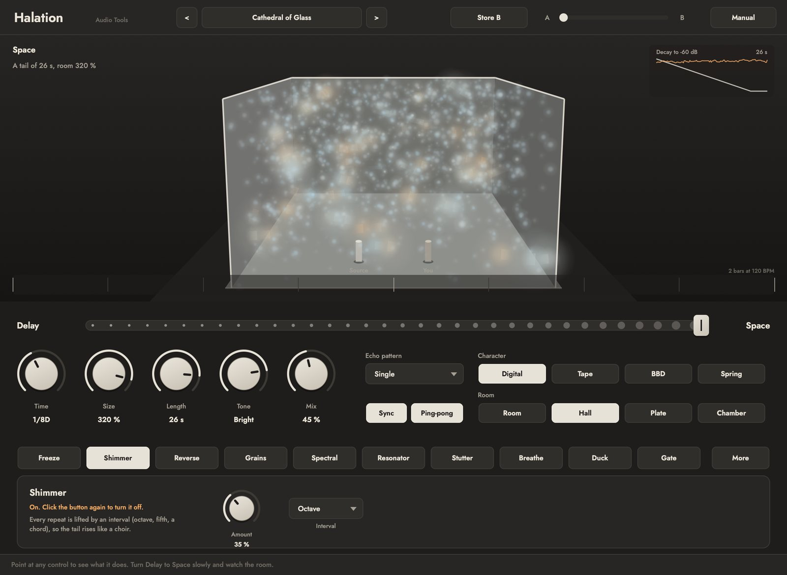
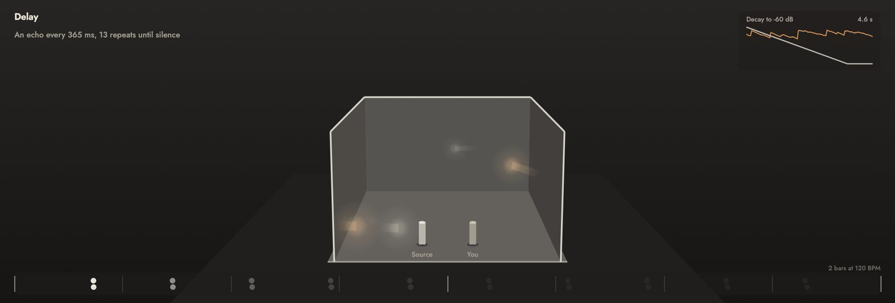
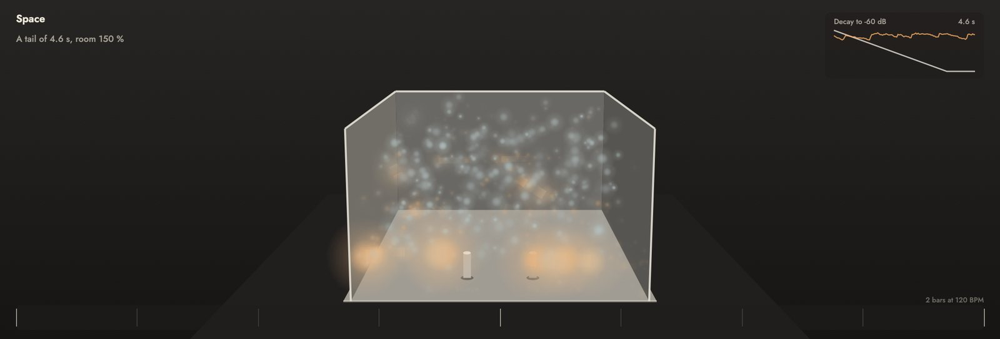
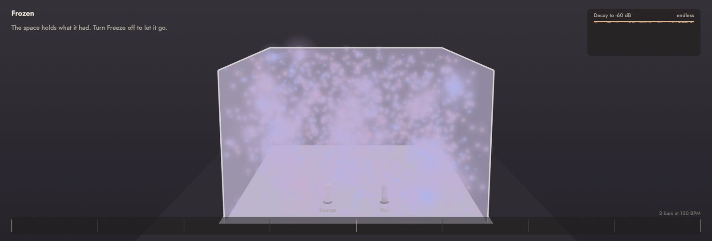
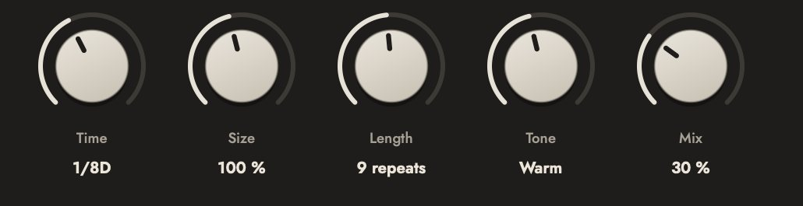
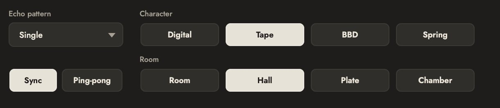
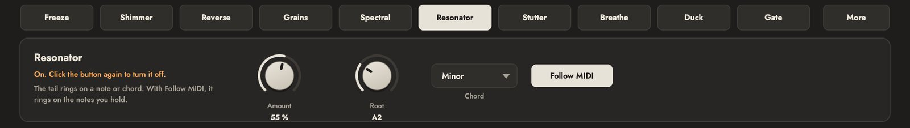
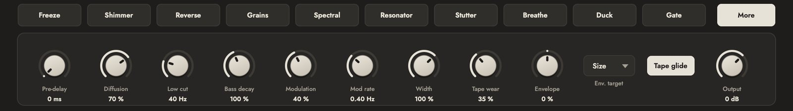

# Halation user manual

## What Halation is

Halation is a delay and a reverb in one space. The same set of delay lines plays separate echoes on the beat or a whole room, and one control, **Delay to Space**, moves between the two: from clean repeats, through echoes that melt into each other, to a hall whose tail you can stretch until it never ends.

Around that space there are ten modules that take it somewhere else: freeze it, lift it by an octave, play it backwards, scatter it into grains, smear it into a still cloud, tune it to a chord, cut it on the beat, make its walls breathe, duck it under your playing or gate it like the drums of the 1980s.

The window shows what you hear. The plaster room at the top is drawn from the effect itself: each echo is a pulse of light that leaves the source, travels, bounces off the walls and comes back. Its size is its level and its colour is its brightness (warm for dark sounds, cold for bright ones). In a room the pulses split at every wall and turn into mist; when you freeze, the light stops where it was.

The name comes from film photography: halation is the soft glow that forms around bright lights when they reflect inside the film. That is what a tail is: the sound, glowing after it has gone.



## Installing

Download the package for your system from the website and unzip it.

On macOS:

1. Copy `Halation.vst3` to `~/Library/Audio/Plug-Ins/VST3/` and `Halation.component` (Audio Unit) to `~/Library/Audio/Plug-Ins/Components/`.
2. Rescan plugins in your DAW.
3. `Halation.app` is the standalone version and `halationrender` the command-line renderer.

The files are not notarized. If macOS refuses to open them, run `xattr -dr com.apple.quarantine` followed by the path of each file.

On Windows:

1. Copy `Halation.vst3` to `C:\Program Files\Common Files\VST3\`.
2. Rescan plugins in your DAW.
3. `Halation.exe` is the standalone version and `halationrender.exe` the command-line renderer.

The Audio Unit is a "music effect": in Logic Pro it appears under **Audio Units > Audio Tools** in an audio track's effect slots, and also as a MIDI-controlled effect, which is how the Resonator follows the notes you play.

## First sounds in one minute

1. Put Halation on a track or on a send (on a send, turn **Mix** to 100 %).
2. Open the preset menu (the name in the top bar) and pick **Tape Echo 1974**. Play something short: you hear echoes on the beat.
3. Drag **Delay to Space** slowly to the right. The echoes start to blur, then become a room. Watch the pulses split and the mist rise.
4. Turn **Length** up. The tail grows; at the very top it never ends.
5. Click **Shimmer** in the module row. The tail now rises by an octave.
6. Click **Freeze**. Whatever is in the room stays there. Play over it, then click Freeze again to let it go.

Every control explains itself in the help line at the bottom of the window when you point at it.

## The interface at a glance

From top to bottom:

- **Top bar.** Preset name with previous and next, **Store B** and the **Morph** slider (two scenes, see below) and **Manual**.
- **The room.** What the effect is doing, drawn. Top left, a sentence that says it in words; top right, the decay graph; at the bottom, the echo times on a two-bar grid; and a warning when the feedback gets near self-oscillation.
- **Delay to Space.** The long slider.
- **Five knobs.** Time, Size, Length, Tone and Mix.
- **Echoes.** Echo pattern, Sync and Ping-pong.
- **Character and Room.** How the echoes sound, and the kind of room they melt into.
- **Modules.** Ten buttons and **More**. The panel below shows the settings of the selected one.

## Reading the room



- **Pulses.** Every time the input has an attack, pulses leave the source. In delay they come back to the listener as separate dots, one per echo, and the grid at the bottom marks where each repeat falls in the bar.
- **Size and colour.** A big pulse is a loud echo. Warm (amber) pulses carry mostly low frequencies, cold (blue) ones mostly highs. With a dark Tone the colours turn warm as the tail goes on, because the highs die first.
- **Mist.** In a room the pulses split at each wall into smaller fragments, which leave mist behind. The denser the mist, the denser the reverb.
- **The walls.** Size moves them. Breathe makes them move on their own, and Collapse closes them in while you play.
- **The decay graph.** The straight line is the tail falling to -60 dB at the current Length; the orange line is the level you are actually hearing. When Length is at the top, it reads "endless".





## Delay to Space


On the left, Halation is a delay: one clean line per side, the echoes exactly where Time and the pattern put them. As you move right, the lines start to feed each other, the echo times spread towards the room's own lengths and the diffusers smear every repeat. On the right it is a reverb.

Two things hold while you move it: the tail keeps its length (Length is a time, not a feedback amount), and the level stays close to where it was. So you can automate Delay to Space during a song without jumps in volume.

Between 30 and 70 % lives the most interesting area: echoes you can still count, each one already a small room.

## Time, Size, Length, Tone and Mix



- **Time.** The time between echoes. With **Sync** on it is a note value of the host tempo (from 1/32 to 4 bars, with dotted and triplet values); with Sync off it is in milliseconds, from 1 ms to 4 s. Changing it while sound is playing glides like tape (see Tape glide in More).
- **Size.** How big the room is, from 25 to 400 %. In delay it barely matters; in a room it sets how far apart the reflections are. Small sizes with a long Length make metallic, resonant spaces.
- **Length.** How long the sound lasts: the time the tail takes to fall by 60 dB, from 0.2 s to 60 s. At the very top the tail never ends. In delay it reads as a number of repeats.
- **Tone.** Dark to bright: how much faster the highs fade than the rest. Turning it left is like a room with curtains and carpets; to the right, glass and tiles.
- **Mix.** How much effect you hear against the dry sound. On a send, use 100 %.

## Echo pattern, Sync and Ping-pong



The pattern spreads the echoes over the beat: **Single**, **Dotted**, **Triplet**, **Dotted + 1/4**, **Rain** (four taps that fall at uneven times), **Gallop**, **Cascade** and **Swing**. **Ping-pong** sends the echoes from one side to the other. The patterns matter most in delay; as you move towards Space they dissolve into the room.

## Character

- **Digital.** Clean, every echo identical to the sound.
- **Tape.** A tape echo: slow wow and fast flutter, warm saturation, a little boost in the low mids and repeats that darken. **Tape wear** (in More) adds wear: more wobble and moments where the sound dulls, like a worn spot on the tape.
- **BBD.** The dark, slightly grainy sound of the bucket-brigade chips of the 1970s and 1980s. The longer the time, the darker it gets, as in the real thing.
- **Spring.** A spring tank: the drip and boing of surf guitar, made from a chain of stretched all-pass filters.

## Room

The kind of room the echoes melt into: **Room** (small and close), **Hall** (large, smooth), **Plate** (bright and dense from the first instant) and **Chamber** (a stone room with a darker colour). Size scales whichever you pick.

## Modules



A click on a module button selects it and shows its settings. A click on the selected module turns it on or off. A lit button is on.

- **Freeze.** The space holds what it has, for as long as Freeze is on. **Bands** chooses what freezes: **All** (the whole room stops), or **Lows**, **Mids**, **Highs** and **Lows + mids**, where only those bands are held and the rest keeps moving with what you play. Freezing only the lows makes a drone under a melody that stays alive.
- **Shimmer.** Every repeat is lifted by an interval: **Octave**, **Fifth**, **Octave + fifth**, **Fourth**, **Major chord**, **Minor chord** or **Octave down**. Because it happens inside the loop, each repeat climbs further: the tail rises like a choir. **Amount** sets how much of the shifted sound goes back into the space.
- **Reverse.** The tail plays backwards in slices of **Length** (a note value), so it swells up into the next beat. With Shimmer on as well, the reversed slices rise too.
- **Grains.** Fragments of the tail are scattered back into the space, some forward, some backward, with **Grain size** from 20 to 500 ms. Small grains make glitter; large ones, a smeared memory.
- **Spectral.** The tail is smeared in time and its phases scattered, into a still, glassy cloud with no attacks. **Smear** sets how far.
- **Resonator.** The tail rings on a note or a chord. **Root** is the note, **Chord** picks **Single**, **Fifth**, **Major**, **Minor**, **Sus** or **Octaves**. With **Follow MIDI** on, it rings on the notes you send to Halation instead (in Ableton Live, set a MIDI track's output to Halation; in Logic, use the MIDI-controlled effect).
- **Stutter.** On the beat, a slice of the output is caught and repeated. **Chance** is how often it happens, **Length** the size of the slice.
- **Breathe.** An impossible room. In **Breathe** mode the walls move slowly in and out (**Depth** and **Rate**); in **Collapse** mode they close in while you play and open again in the silences.
- **Duck.** The effect steps back while you play and blooms in the gaps. The detector is the same one Lacquer uses for its compression, with a smooth release.
- **Gate.** The tail stops dead shortly after the sound stops, with **Hold** setting how long it waits. Think big 1980s drums, or a vocal with a huge room that cuts off cleanly.

## More



- **Pre-delay.** A gap before the effect starts, up to 250 ms. Separates the dry sound from its room.
- **Diffusion.** How quickly echoes smear into a wash. Low values keep the reflections audible, like flutter in an empty room.
- **Low cut.** Removes lows before they enter the space, from 20 to 800 Hz.
- **Bass decay.** How long the lows last compared with the mids, from 30 to 200 %.
- **Modulation** and **Mod rate.** A slow movement of the delay lines that keeps long tails from ringing metallic. At high depths it becomes a chorus.
- **Width.** The stereo width of the effect, from mono to wider than the speakers.
- **Tape wear.** See Character: wear on the tape.
- **Envelope** and **Env. target.** Your playing moves one control: **Space**, **Size**, **Shimmer**, **Tone** or **Mix**. Positive values push it up when you play loud, negative values push it down.
- **Tape glide.** On, changing Time bends the pitch like a tape machine changing speed. Off, the new time fades in without a bend.
- **Output.** Output level of the effect, from -24 to +12 dB.

## Scenes and Morph

Halation keeps two scenes. **A** is what the knobs say. **Store B** remembers the current settings as **B**; after that, the **Morph** slider in the top bar glides every control from A to B.

A slow automation of Morph is the easiest way to have a space that changes over a song: a tight delay in the verse, a large room in the chorus, or a room that drifts over ten minutes in an ambient piece.

## Presets

Thirty presets in four groups:

- **Classic.** Tape Echo 1974, Analog Bucket, Clean Digital Quarter, Ping-Pong Machine, Plate Vocal, Small Room, Concert Hall, Spring Surf.
- **Ambient.** Cathedral of Glass, Endless Pad, Breathing Room, Rising Choir, Warm Blanket, Slow Tide, Tuned Abyss, Spectral Ice.
- **Rhythmic.** Dotted Rain, Stutter Grid, Gallop, Ducked Dub, Gated 1984, Swing Taps.
- **Experimental.** Ghost Before You, Broken Satellite, Collapsing Hall, Self-Oscillation, Reverse Shimmer, Frozen Lows, Delay to Cathedral, Grain Storm.

**Delay to Cathedral** comes with its own scene B: move Morph and a dotted delay turns into a bright, endless hall with shimmer. In the other presets there is no B until you store one, and Morph does nothing.

## Long sessions, meditation and sound baths

Halation was designed with long, slow music in mind: endless tails, freezes that hold a chord for minutes, rooms that breathe at a tenth of a hertz, shimmer that keeps rising. A few things help there:

- **Endless does not mean louder.** With Length at the top, Freeze or self-oscillation, a limiter inside the loop and a ceiling at the output (-1 dBFS) keep the level in check. They stop peaks, not loudness: set the volume at the start of a session and check it after the tail has built up.
- **Use Duck for a voice over a space.** A guide speaking over a frozen pad stays clear, and the room fills the silences.
- **Slow automation over sudden changes.** Morph between two scenes over minutes; Delay to Space can move without jumps.
- **Freeze, then play.** Freeze a chord in Lows + mids and play a melody over it: the drone holds, the melody gets its own room.

Halation is a tool for making sound. It does not treat anything; in therapy settings the professional decides how to use it.

## The command-line renderer

`halationrender` runs a file through the whole effect, the same engine as the plugin:

```
halationrender in.wav out.wav --preset "Cathedral of Glass" --tail 12 --bpm 92
halationrender in.wav out.wav --preset "Slow Tide" --tail 16 --at 9 on_freeze=1
halationrender in.wav out.wav --set space=60 --set length=80 --set on_shimmer=1
```

- `--preset` loads a preset by name. Without it, the defaults.
- `--tail` adds seconds of silence at the end so the tail can sound (6 by default).
- `--bpm` is the tempo for synced times (120 by default).
- `--set id=value` sets a parameter before starting; `--at seconds id=value` changes it at that moment.

It prints the time it took as a percentage of one CPU core.

## Getting the best from it

- **On a send** you can share one space across several tracks and treat it like a real room. **On an insert** is better for character echoes (tape, BBD, spring) and for the experimental modules.
- **Low cut** at 150 to 300 Hz keeps big rooms from muddying the mix.
- **Tone** to the left and **Bass decay** a little under 100 % give the most natural tails.
- **Duck** is often better than lowering Mix: the effect stays big where there is room for it.
- **Spectral, Grains and Shimmer** all add to each other; try one at a time first.

## Limits

- Freeze by bands is not perfectly clean: near the edges between bands a little of the live sound leaks into the frozen part.
- Spectral and Freeze by bands use a spectral analysis with a window of about 43 ms: very sharp attacks lose some definition when they pass through them. That is part of their sound.
- Follow MIDI needs a host that sends MIDI to an effect.
- Time changes with Tape glide on bend the pitch on purpose; for automation without bends, turn it off.

## Technical notes

- **The space.** Eight delay lines with an orthogonal mixing matrix whose angle goes from identity (separate echoes) to a Hadamard-like full mix (a dense room). The line lengths are interpolated in logarithmic steps between the echo pattern times and the room's own lengths. The decay of each line is computed from its length and the Length time, so the tail keeps the same T60 at any Delay to Space position.
- **Damping.** Three bands per line (crossovers at 250 Hz and 2.5 kHz) with their own decay times, from Tone and Bass decay.
- **Modulation.** Each line has its own slow random modulation with Hermite interpolation; the tape character adds wow (about 0.5 Hz), flutter (about 7 Hz) and a drift.
- **Safety.** A soft limiter on each line, an energy limiter on the loop and a -1 dBFS ceiling at the output. Neither NaN nor runaway levels can get through, checked in the automated tests with every module on and Length at infinite.
- **Latency.** Zero samples. The tail length is reported to the host (infinite when Length is at the top or Freeze is on).
- **Determinism.** The same input with the same settings gives the same output bit for bit, whatever the block size.
- **CPU.** With all modules on, 2.6 % of one core on an Apple M4. Presets range from 0.4 to 1.6 %.
- **Tested** with pluginval at strictness 10 and auval on macOS, at 44.1, 48 and 96 kHz.
