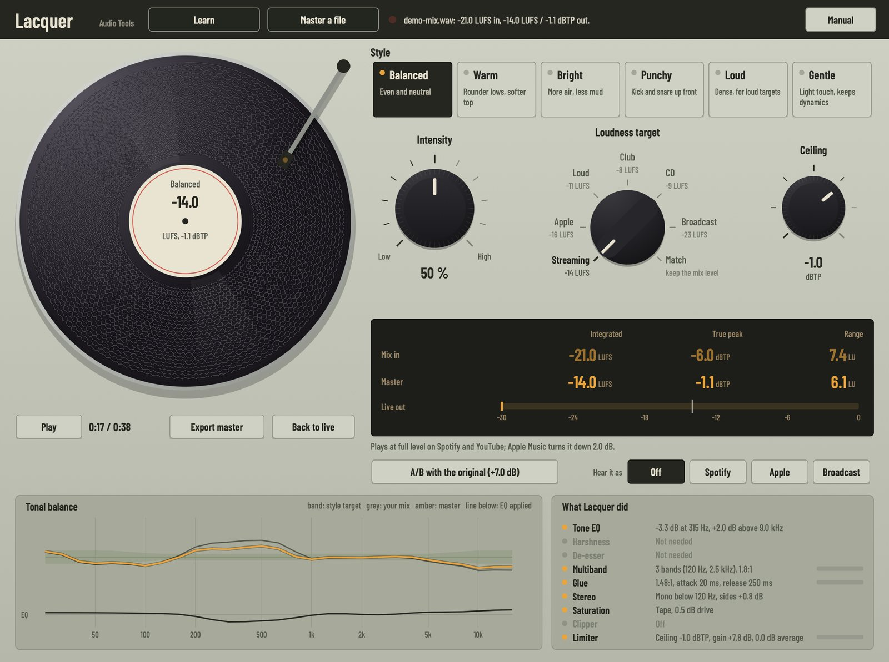
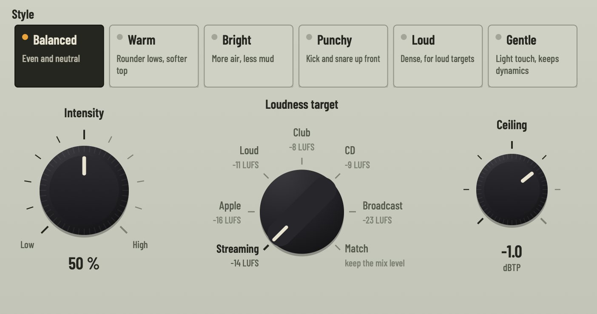
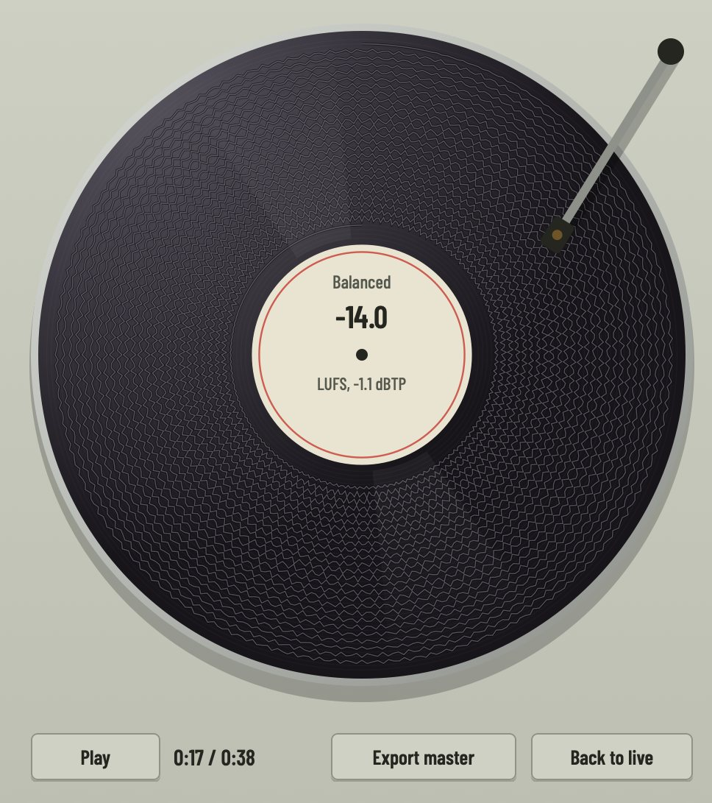
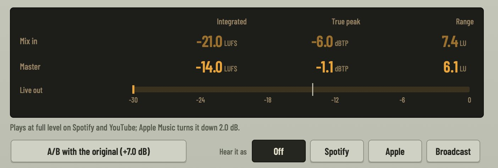
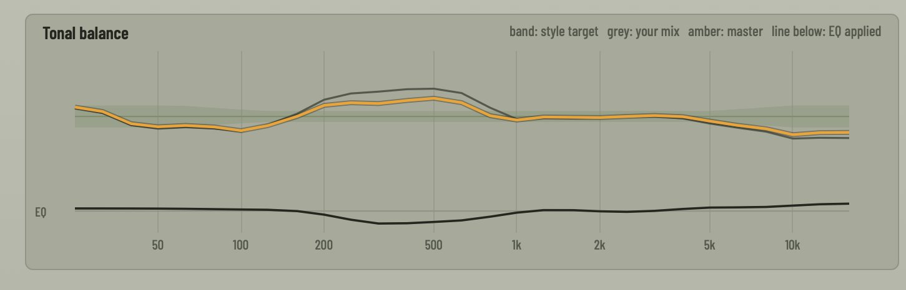
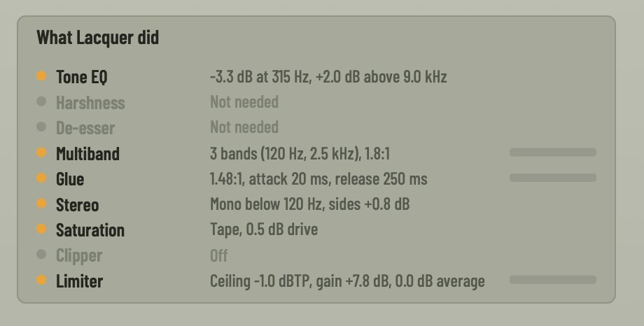
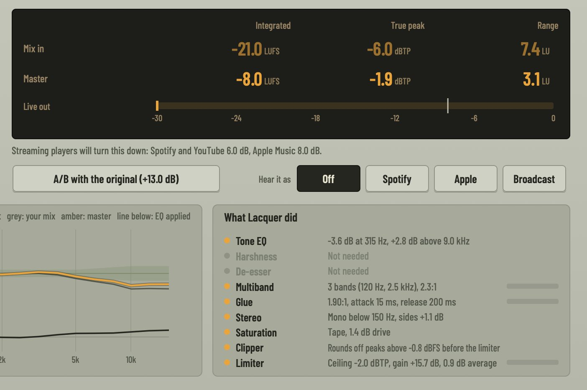

# Lacquer user manual

## What Lacquer is

Lacquer is an automatic mastering processor. You give it a finished mix and it returns a master: a balanced tone, controlled dynamics, mono-safe low end and a loudness that suits where the song is going (Spotify, Apple Music, a club, a CD). It works in two ways:

- **On the master bus of your DAW.** Press **Learn**, play the song, and Lacquer sets up its whole chain from what it heard. From then on it masters in real time.
- **With a file.** Open a mix (or drop it on the window), Lacquer analyses the whole song, renders the master, lets you compare it with the original at the same loudness and exports a WAV with a report.

The name comes from the lacquer disc: in the days of vinyl, mastering ended with cutting the music into a lacquer on a lathe. The disc on the left of the window is that lacquer, and its groove is your song.

## How it decides, in plain words

Lacquer does not use a neural network or a database of other people's songs. It measures your mix and applies rules, the same ones a mastering engineer runs in their head:

1. **It listens.** It measures loudness the way streaming services do (ITU-R BS.1770), the true peaks between samples, how dynamic the song is, the average spectrum of the loud parts, the stereo width and whether the low end is mono, harsh resonances and sibilance, clipped passages and a cut-off in the highs (a sign of an MP3 source).
2. **It compares the tone with a target.** Each style has its own target curve, built from published measurements of commercial music (smooth slopes, not a copy of anyone's product). Where your mix is already inside the normal range Lacquer barely touches it; where it is clearly off, it corrects the excess, with limits on how much and how narrow.
3. **It sets each module only as much as needed.** Compression and clipping depend on how much the loudness target asks for. A mix that is already dense and loud gets almost nothing but the safety limiter.
4. **It hits the loudness by measuring the result.** In file mode Lacquer renders, measures and corrects until the master reads the target within a few hundredths of a LU.

Everything is deterministic: the same mix with the same settings always gives exactly the same master.

## Installing

Download the package for your system from the website and unzip it.

On macOS:

1. Copy `Lacquer.vst3` to `~/Library/Audio/Plug-Ins/VST3/` and `Lacquer.component` (Audio Unit) to `~/Library/Audio/Plug-Ins/Components/`.
2. Rescan plugins in your DAW.
3. `Lacquer.app` is the standalone version and `lacquerrender` the command-line renderer.

The files are not notarized. If macOS refuses to open them, run `xattr -dr com.apple.quarantine` followed by the path of each file.

On Windows:

1. Copy `Lacquer.vst3` to `C:\Program Files\Common Files\VST3\`.
2. Rescan plugins in your DAW.
3. `Lacquer.exe` is the standalone version and `lacquerrender.exe` the command-line renderer.

## First master in one minute

With a file (the most accurate way):

1. Open the standalone app (or the plugin in any track).
2. Press **Master a file** and choose your mix, or drop the file on the window. WAV, AIFF, FLAC, Ogg and MP3 are accepted.
3. Wait a few seconds while the disc is cut. The status line says how loud the mix was and how loud the master is.
4. Press **Play**. Click anywhere on the disc to jump to that part of the song.
5. Try another **Style** or **Intensity**: Lacquer re-masters the song automatically.
6. Press **A/B with the original** to compare at the same loudness.
7. Press **Export master** to save a 24-bit WAV and its report.

In your DAW:

1. Put Lacquer on the master bus, last in the chain.
2. Press **Learn** and play the song from the start. The red lamp lights up and the disc starts cutting.
3. Let the whole song play for an exact loudness, or at least its loudest 30 seconds for a quick master. Press **Stop** when you have heard enough; Lacquer also stops by itself when the music stops.
4. A few seconds later the master is running. Export the song from your DAW as usual.

## The interface at a glance

- **Top bar**: **Learn** starts and stops listening, **Master a file** opens a file, the red lamp is lit while Lacquer is listening or rendering, the status line tells you what happened (and explains any control under the mouse), and **Manual** opens this manual.
- **Left**: the disc and, below it, the file transport (**Play**, the time, **Export master**, **Back to live**).
- **Right**: the four decisions that are yours (style, intensity, loudness target, ceiling), the readouts, the A/B button and the platform preview.
- **Bottom**: the tonal balance and the list of what each module did.

The window can be resized from its lower-right corner.

## Style

| Style | What it does |
|---|---|
| Balanced | Moves the tone toward an even, neutral balance and glues gently. The default. |
| Warm | A little more body in the low mids, a softer top end, light tape saturation and slower glue. |
| Bright | More air above 10 kHz, less mud around 300 Hz, slightly wider highs. |
| Punchy | Glue with a slower attack so kick and snare come through, a touch of valve saturation and a soft clipper on the peaks. |
| Loud | More compression and clipping: made for loud targets. |
| Gentle | Half the correction and no glue at low intensity, for mixes that are nearly there. |

A style is not a fixed preset of knob positions. It changes the target the analysis aims for, so the same style does different things to a dark mix and to a bright one.

## Intensity

**Intensity** decides how much Lacquer changes the tone and the dynamics. It does not change the loudness: that is the target's job, so a quiet open master and a loud dense one are both possible.

| Intensity | Tone correction | Compression | Saturation | Width |
|---|---|---|---|---|
| 0 % | none | none | none | untouched |
| 25 % | 40 % of the suggested, up to 2 dB | light | half | a quarter of the suggested |
| 50 % (default) | 60 %, up to 3 dB | moderate | the style's amount | half |
| 100 % | all of it, up to 4 dB | strong | the style's amount and more | all of it |

At 0 % Lacquer only sets the loudness and catches the peaks: with the target on **Match** and a high ceiling the output is identical to the input.

## Loudness target and ceiling

| Target | Loudness | Ceiling | When |
|---|---|---|---|
| Streaming | -14 LUFS | -1 dBTP | Spotify, YouTube, Tidal, Amazon. The default. |
| Apple | -16 LUFS | -1 dBTP | Apple Music and a more dynamic sound. |
| Loud | -11 LUFS | -2 dBTP | Louder than the platforms play: they will turn it down. |
| Club | -8 LUFS | -2 dBTP | DJ sets and club systems. |
| CD | -9 LUFS | -0.3 dBTP | CD or WAV delivery without lossy encoding. |
| Broadcast | -23 LUFS | -1 dBTP | Radio and TV (EBU R128). |
| Match | your mix's loudness | -1 dBTP | Only tone and glue, without changing the level. |

Streaming services play every song at roughly the same loudness: a master louder than -14 LUFS is turned down, so it gains nothing there and loses dynamics. The line under the readouts tells you how much each platform will turn your master down.

The **Ceiling** is the highest true peak allowed. Choosing a target sets its usual ceiling; you can change it afterwards (from -3 to -0.1 dBTP). Keep -1 dBTP or lower for anything that will be encoded to MP3 or AAC: encoding adds peaks.

> If a mix cannot reach a loud target without being wrecked, Lacquer stops at a sensible level and says so in the status line instead of crushing the song.

## Reading the disc

The song runs from the outer edge toward the label. The wider the groove's wiggle, the louder that moment: a quiet intro is a thin line, a chorus a wide band, and an over-compressed master a groove that is wide and even everywhere.

- While Lacquer is listening, the cutting head moves inward and the red tip glows.
- In file mode, the head shows the playback position and a click on the groove jumps there.
- The label shows the style, the master's loudness and its true peak.

## Readouts, A/B and Hear it as

- **Mix in** and **Master** show integrated loudness (LUFS), true peak (dBTP) and loudness range (LU) of what Lacquer analysed and of the result.
- **Live out** is the output's momentary loudness (the bright tick) and short-term loudness (the bar), with the target marked.
- **A/B with the original** plays your mix turned up or down to the master's loudness (the button shows by how much). Louder always sounds better at first, so this is the only fair comparison.
- **Hear it as** plays the master the way a platform would: **Spotify** turns it down to -14 LUFS if it is louder, **Apple** to -16, **Broadcast** to -23. A/B stays matched in every case.

## Tonal balance

The green band is the style's target with its tolerance (narrow in the mids, wider in the lows and the highs, where music varies most). The grey line is your mix and the amber line the master, both aligned to the target the way the automatic EQ compares them. The black line at the bottom is the EQ Lacquer applied (from -6 to +6 dB).

Do not expect the amber line to sit on the target: Lacquer only corrects what is clearly outside the band, and never more than the limits of the intensity.

## What Lacquer did

The chain runs in this order. Each line shows what the module is doing, or why it is off; the bars on the right show the live gain reduction.

- **Tone EQ**: a low shelf, six bells an octave apart and a high shelf, fitted to the correction curve. It changes the tone without changing the loudness. It never boosts above a cut-off it detects in the highs.
- **Harshness**: a dynamic band between 2 and 5 kHz on the most prominent resonance, which only cuts when that region sticks out. It stays off when the mix is dark there.
- **De-esser**: the same idea between 5 and 10 kHz, for sibilance and sharp cymbals.
- **Multiband**: three bands (low, mid, high) of gentle compression on the loudest moments. When it is not compressing, the signal passes untouched.
- **Glue**: a slow, low-ratio compressor on the whole mix that ties it together. It ignores the deep bass, so the kick does not make the mix pump.
- **Stereo**: makes the lows mono below about 120 Hz (essential for vinyl, clubs and phone speakers) and adjusts the width of the sides when the mix is clearly too narrow or too wide. It never widens a mix that already has phase problems.
- **Saturation**: tape (with pre-emphasis, softer top) or valve (more second harmonic), four times oversampled so it adds no aliasing.
- **Clipper**: rounds off the tallest transients before the limiter, also oversampled. It only appears when the target asks for more than the limiter alone can do cleanly.
- **Limiter**: a look-ahead true-peak limiter. It detects peaks with an eight-times interpolator, so the master does not go over the ceiling even after encoding to MP3 or AAC. Its release is fast for isolated peaks and slow for sustained reduction, which avoids pumping.

## Mastering a file

**Master a file** (or dropping a file on the window) switches Lacquer to file mode. While a file is open, the plugin's input is muted: what you hear is the file.

- The analysis covers the whole song, so the loudness is exact.
- Changing style, intensity, target or ceiling re-renders the song (a few seconds for a typical song).
- **Export master** writes a 24-bit WAV at the file's sample rate, and next to it a `.json` report: every measurement of the mix and the master, every setting of every module, and the notes. With that report the same master can be reproduced exactly.
- **Back to live** closes the file and returns to processing the plugin's input.

## Learn in the DAW

Learn records what comes into the plugin while you play the song, skipping silence, for up to six minutes. Playing the whole song gives the same exact loudness as file mode. Playing only the loudest 30 seconds is quicker; in that case the whole song will measure a little below the target if it has quiet parts, because Lacquer set the level from the loud part.

- Changing style, intensity, target or ceiling after learning re-analyses the stored audio, so the change is exact.
- The learned settings are saved with your project. The learned audio is not (it would make projects huge): after reopening a project you can still change the target and the ceiling, but a new style or intensity needs Learn again.
- If you change the mix after learning, press Learn again. Lacquer never follows the mix by itself: a master that changed while you played would be impossible to judge.

## The command-line renderer

`lacquerrender` runs the same engine on a WAV file, with no window. It is useful for batches and scripts.

`lacquerrender mix.wav master.wav --style warm --intensity 60 --target streaming --report master.json`

| Option | Values |
|---|---|
| --style | balanced, warm, bright, punchy, loud, gentle |
| --intensity | 0 to 100 (default 50) |
| --target | streaming, apple, loud, club, cd, r128, match |
| --lufs | any loudness, instead of a target |
| --ceiling | -6 to 0 dBTP |
| --bits | 16 (with dither), 24 (default) or 32 (float) |
| --report | path of the JSON report |

The output of the renderer and of Export master is identical for the same settings.

## Getting the best from it

- **Leave headroom in the mix.** Peaks around -6 dBFS and no limiter on the mix bus give Lacquer room to work. A mix that is already limited can only be made flatter.
- **Fix balance problems in the mix.** If the vocal is too quiet or the bass booms on one note, mastering cannot fix that without side effects.
- **Lacquer goes last.** Anything after it (a meter is fine) can push the peaks over the ceiling.
- **Compare at the same loudness.** Use A/B, and Hear it as Spotify to hear what listeners will hear.
- **Start at 50 % and move in steps of 10 to 20 %.** If you like the tone but want it more open, lower the intensity before changing the style.
- **Clipped mixes.** If the status line says the input has clipped passages, export the mix again with more headroom: mastering cannot undo clipping.

## Limits

- Automatic mastering is a good master for most mixes, not a replacement for an engineer on a difficult one. Lacquer cannot hear the genre, the artistic intention or a single badly balanced instrument.
- Learn on part of the song sets the level from that part; for exact delivery use the whole song or file mode.
- Very wide dynamic ranges (classical music, film scores) are respected, not flattened. For those, a quieter target such as Apple or Broadcast is usually better.

## Technical notes

- Loudness and true peak: ITU-R BS.1770-5, tested against the EBU Tech 3341 and 3342 test signals at 44.1, 48 and 96 kHz. Loudness range per EBU Tech 3342.
- Limiter: look-ahead 3 ms, eight-times peak detection, measured with an independent interpolator to stay within 0.02 dB of the ceiling.
- Saturation and clipper: four-times oversampling with half-band filters, aliasing below -90 dBFS.
- Latency: 275 samples at 48 kHz (5.7 ms), constant, reported to the host.
- CPU: under 5 % of one core at 48 kHz with every module active (measured on Apple M-series).
- The same file with the same settings gives the same master bit for bit, whatever the block size.
- Engine based on published research: Giannoulis, Massberg and Reiss on compressor design; Pestana and others on the spectrum of commercial music; Ma, Reiss and Black on automatic equalization; the BS.1770 filters as derived by libebur128.
- Text set in Barlow Condensed (SIL Open Font License).
