# Manual de Murmur

## Qué es Murmur

Murmur es un efecto granular en tiempo real de Audio Tools, para macOS y Windows, como VST3, como Audio Unit (macOS) y como aplicación independiente. Escucha lo que le mandes (una voz, una guitarra, un sinte, un loop de batería) y lo convierte en nubes, pads con shimmer, acordes congelados estirados durante minutos, tartamudeos rítmicos y glitches.

Todo lo que entra se graba en una memoria de hasta 16 segundos. Hasta 128 pedacitos de esa memoria, los **granos**, suenan al mismo tiempo, cada uno con su largo, su altura, su sentido, su fundido y su lugar en el estéreo. Después los granos pasan por dos filtros de tono, un delay y una reverb de placa, y se mezclan con tu señal seca. Podés congelar la memoria, devolverle los granos, recorrerla despacio para estirar el tiempo, ajustar la altura de los granos a acordes y escalas, atarlos al tempo de tu DAW, mover cosas con dos LFO y tocar los granos desde un teclado MIDI.

La ventana muestra todo esto como una bandada de pájaros sobre un horizonte: el horizonte es el audio grabado y cada pájaro es un grano. Una página Simple pone las perillas más importantes al lado de la bandada; una página Advanced muestra todos los parámetros. Trae 30 presets de fábrica en ocho categorías, y podés guardar los tuyos.

## El procesamiento granular en pocas palabras

Imaginate un grabador de cinta que nunca deja de grabar, con un lazo de cinta que guarda los últimos segundos, y decenas de cabezales de reproducción chiquitos tocando esa cinta a la vez. Cada cabezal toca un pedazo corto, de unos milisegundos a dos segundos, con un fundido de entrada y de salida para que empiece y termine suave. Ese pedazo es un grano.

Cuando los granos son cortos y muchos, ya no escuchás los pedazos: escuchás una nube, un borroneo del sonido original. Cuando son largos y pocos, escuchás ecos de frases que se superponen. Cuando cada grano suena un poco más agudo o más grave, la nube se vuelve un acorde o un shimmer. Cuando cada grano arranca en un tiempo del compás, la nube se vuelve un ritmo. Cuando la cinta deja de grabar (Freeze), los granos siguen tocando lo que había, así que un acorde puede durar para siempre. Y como la velocidad a la que los cabezales recorren la cinta no depende de la altura a la que tocan, podés estirar un sonido diez veces sin que se vuelva más grave.

Casi todos los controles responden una de tres preguntas sobre los granos: cuánto duran y cuántos son (Size, Density), de qué parte de la memoria leen (Position, Spray, Scan) y cómo suenan (altura, sentido, envolvente, paneo). El resto es lo que le pasa a la nube después: filtros, feedback, delay, reverb y el balance con el sonido seco.

## Instalación

Murmur viene como plugin VST3, como Audio Unit (sólo macOS) y como aplicación independiente. Funciona en macOS 11 o posterior (un solo binario universal para Apple silicon e Intel) y en Windows 10 u 11 de 64 bits.

En macOS:

1. Descomprimí el archivo.
2. Copiá `Murmur.vst3` a `~/Library/Audio/Plug-Ins/VST3`.
3. Copiá `Murmur.component` a `~/Library/Audio/Plug-Ins/Components`.
4. Reescaneá los plugins en tu DAW (Ableton Live: Settings, Plug-Ins, Rescan).

En Windows:

1. Descomprimí el archivo.
2. Copiá `Murmur.vst3` a `C:\Program Files\Common Files\VST3` (pide permisos de administrador).
3. Reescaneá los plugins en tu DAW.

`Murmur.app` (macOS) y `Murmur.exe` (Windows) son la versión independiente.

> Los binarios todavía no están firmados. Si macOS no los quiere abrir, corré `xattr -dr com.apple.quarantine` sobre los plugins instalados (el comando exacto está en el INSTALL.txt que viene en el paquete). Windows SmartScreen puede pedirte que confirmes la primera vez.

## Cómo cargarlo en un DAW

Murmur es un efecto de audio (un music effect en la lista de Audio Units) y va en cualquier cosa que lleve audio.

- En una pista de audio: Mix define el balance entre la pista seca y los granos.
- En una pista de retorno (aux, bus): mandale varias pistas y poné **Mix** en 100 %, así el retorno lleva sólo granos.
- En un grupo o en el master también funciona, pero una nube sobre una mezcla completa se llena enseguida.

Murmur acepta entrada mono o estéreo y da salida mono o estéreo. Una entrada mono se copia a los dos lados antes de hacer los granos, así que el resultado igual puede ser ancho. Murmur no agrega latencia: la señal seca pasa directo y los granos siempre leen audio que ya llegó. Si lo ponés en bypass, la señal seca pasa intacta. Le avisa al host que su cola dura 20 segundos, para que el feedback, la reverb y las nubes congeladas no se corten.

En Ableton Live, arrastrá Murmur a una pista de audio o a una pista de retorno (Create, Insert Return Track). En un retorno, poné Mix en 100 % y subí los Send de las pistas que quieras procesar.

### Cómo mandarle MIDI a Murmur

Los modos MIDI y el pedal de sustain necesitan notas. El audio sigue viniendo de la pista donde está Murmur; las notas vienen de una pista MIDI aparte. En Ableton Live:

1. Creá una pista MIDI al lado de la pista que tiene a Murmur.
2. En la sección I/O de la pista MIDI, poné **MIDI To** en la pista que tiene a Murmur.
3. En el selector de abajo, elegí `Murmur` (el dispositivo).
4. Armá la pista MIDI o poné su **Monitor** en `In` para tocar desde tu teclado, o escribí un clip en ella.
5. En Murmur, poné **MIDI Mode** (página Advanced, panel Effects and MIDI) en `Pitch` o `Gate`.

Cuando llegan notas, la esquina superior izquierda de la bandada muestra cuántas están apretadas. En otros DAW, buscá cómo le mandan MIDI a un plugin de efecto. Si un DAW no puede, funciona todo menos los modos MIDI y el pedal.

### La aplicación independiente

La versión independiente procesa la entrada de tu placa de audio. Usá el botón **Options** arriba de la ventana y después Audio/MIDI Settings para elegir la entrada, la salida y un teclado MIDI. En macOS te pide permiso para usar el micrófono, porque la entrada es lo que Murmur convierte en granos.

> Para evitar un acople entre micrófono y parlantes, la versión independiente arranca con la entrada muteada y muestra "Audio input is muted to avoid feedback loop". Ponete auriculares y destildá **Mute audio input** en Audio/MIDI Settings. Sin un host no hay transporte, así que todo lo que sigue al tempo va a 120 BPM.

## Primer sonido

1. Cargá Murmur en una pista con un sonido sostenido: una voz, una guitarra, un pad o un piano.
2. Hacé clic en el nombre del preset en la barra superior, abrí **Clouds** y elegí **First Murmur**.
3. Dale Play en tu DAW.

Aparecen pájaros sobre el horizonte y escuchás una nube suave de granos debajo de tu pista seca. Subí **Size** para que los granos se borroneen en una nube, **Spray** para desparramarlos en el tiempo, y llevá **Pitch** a +12 para subir la nube una octava. Después apretá **Freeze** y pará la música: la nube sigue cantando lo último que escuchó. Apretá Freeze de nuevo para dejar entrar audio nuevo.

> Murmur necesita audio para trabajar. Si la pista está en silencio, la bandada queda vacía y los granos no tienen nada que tocar.

## La interfaz de un vistazo

La ventana tiene una barra superior, el área de páginas y una barra de ayuda abajo. Se puede agrandar o achicar desde la esquina, de la mitad a una vez y media su tamaño normal, y conserva las proporciones.

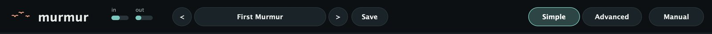

La barra superior, de izquierda a derecha:

- **murmur**: el logo.
- **in** y **out**: los medidores de entrada y salida. Se ponen color coral cuando el nivel llega a fondo de escala.
- **<** y **>**: el preset anterior y el siguiente, primero los de fábrica y después los tuyos.
- El nombre del preset: hacé clic para abrir el menú de presets, con un submenú por categoría y los tuyos en User.
- **Save**: guarda los ajustes actuales como preset de usuario.
- **Simple** y **Advanced**: cambian entre las dos páginas.
- **Manual**: abre este manual adentro del plugin.

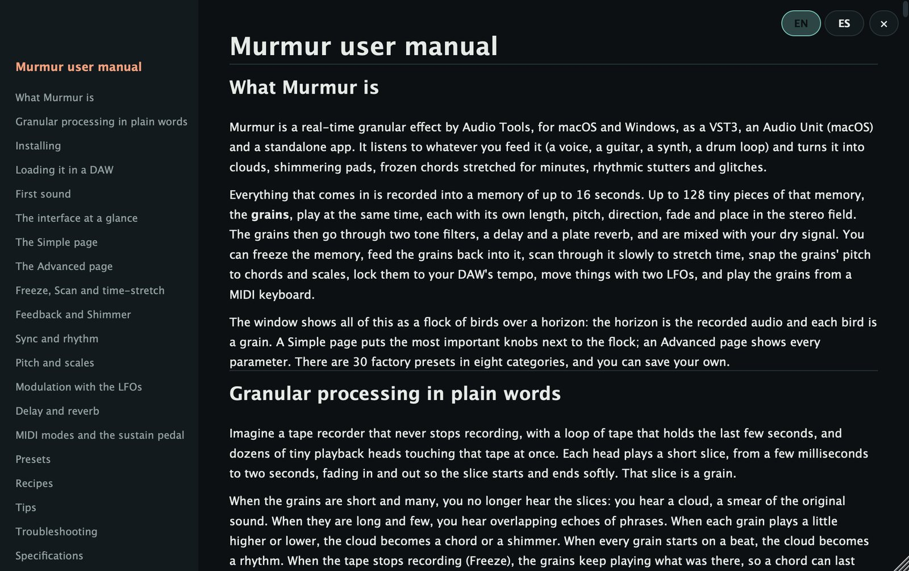

La barra de ayuda muestra el nombre del control que está bajo el mouse y una frase sobre lo que hace. Si no, muestra `Hover over a control to see what it does` y la carga de CPU: la parte de un núcleo del procesador que está usando Murmur.

Los controles funcionan igual en todos lados:

- Perillas redondas: arrastrá para arriba o para abajo. Con Shift el paso es fino, con doble clic vuelven al valor por defecto, y también responden a la rueda del mouse. El valor está escrito en el centro de la perilla.
- Cajas con un triangulito: hacé clic para abrir un menú de opciones.
- Cajas de dos estados (Freeze): hacé clic para cambiar.

Cada ajuste es también un parámetro del host que podés automatizar. En el host, los ajustes de los LFO llevan su número (`LFO 1 Rate`) y los de los efectos su nombre completo (`Delay Feedback`, `Reverb Damping`).

## La página Simple

La página Simple tiene la bandada a la izquierda, una fila de seis perillas chicas debajo y el panel "Shape the cloud" a la derecha, con seis perillas grandes y Freeze.

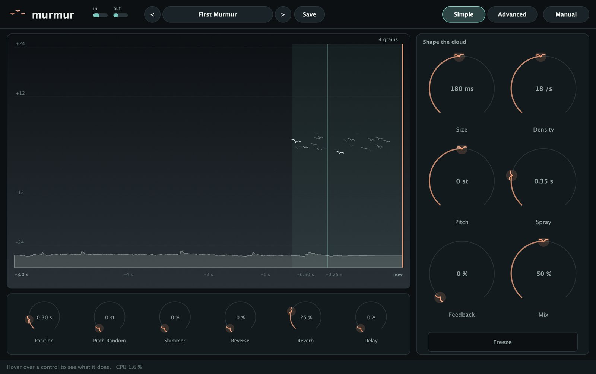

### Cómo leer la bandada

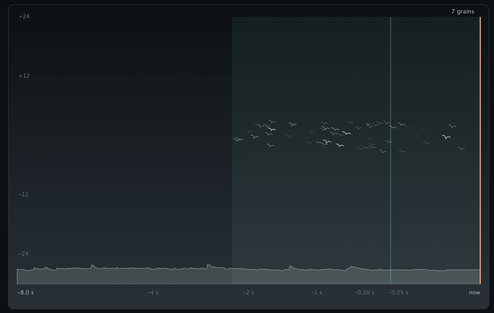

- **El horizonte** es la forma de onda del audio grabado: lo más nuevo a la derecha, en la línea marcada `now`, y lo más viejo a la izquierda, al largo del búfer (por ejemplo `-8.0 s`). El eje de tiempo les da más lugar a los últimos segundos; las marcas `-0.25 s`, `-0.50 s`, `-1 s`, `-2 s`, `-4 s` y `-8 s` muestran la escala.
- **La línea coral** de la derecha es donde se graba el audio nuevo. Cuando Murmur está congelado, la línea y la forma de onda se ponen verde agua y el rótulo dice `frozen`.
- **La franja clara** es donde nacen los granos nuevos: Position más y menos Spray. La línea fina de adentro es Position.
- **Cada pájaro es un grano.** Su lugar horizontal es el momento del búfer que está leyendo ahora. Su altura es su afinación: el centro es la altura original, y unas líneas tenues marcan +12 y +24 semitonos arriba y -12 y -24 abajo. Los pájaros quedan un poco más arriba o más abajo según su paneo.
- **El tamaño y el brillo de un pájaro** siguen a su envolvente: crece mientras el grano entra y se achica mientras se apaga. **Los pájaros verde agua** inclinados para el otro lado son granos en reversa.
- **Las estelas** muestran por dónde pasó cada grano. Mientras graba, un grano a la altura original se queda quieto, porque lee a la misma velocidad a la que llega el audio nuevo; los más agudos se corren a la derecha y los más graves y los de reversa a la izquierda. Congelado, los granos normales viajan a la derecha.
- **El contador** de arriba a la izquierda muestra cuántos granos están sonando y cuántas notas MIDI están apretadas.

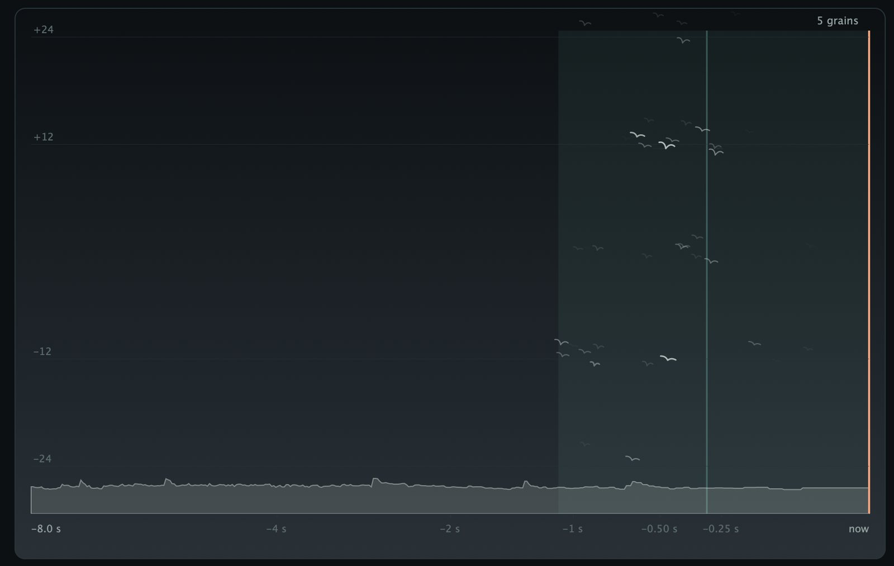

### Shape the cloud

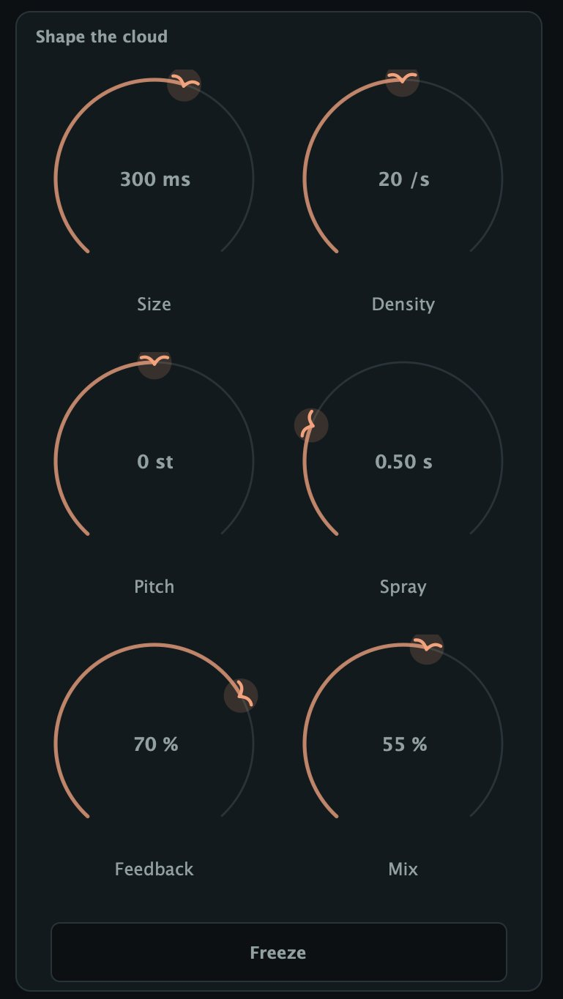

- **Size** (5 ms a 2 s): el largo de cada grano. Debajo de unos 30 ms los granos zumban; entre 100 y 300 ms la fuente todavía se reconoce; arriba de medio segundo se borronean en una nube lenta.
- **Density** (0,5 a 200 por segundo): cuántos granos nacen por segundo. Pocos dan ecos separados; decenas dan una textura continua.
- **Pitch** (-24 a +24 semitonos): transpone todos los granos.
- **Spray** (0 a 8 s): desparrama los granos alrededor de Position, desde un único momento enfocado hasta fragmentos de todo el pasado reciente.
- **Feedback** (0 a 97 %): devuelve los granos al búfer, así la nube crece sobre sí misma.
- **Mix** (0 a 100 %): el balance entre tu sonido seco (0) y los granos (100 %).

**Freeze**, debajo de las perillas, deja de grabar. Los granos siguen tocando lo que hay en el búfer, así que podés parar la música y quedarte con la nube. El pedal de sustain hace lo mismo.

### Las perillas chicas

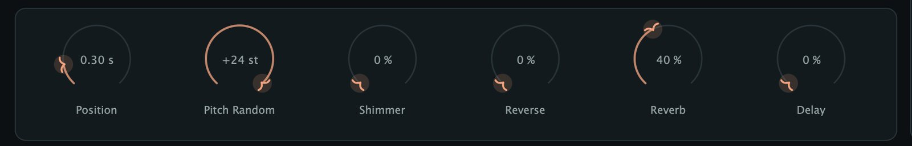

**Position** (cuánto atrás arrancan los granos), **Pitch Random** (una transposición al azar por grano), **Shimmer** (la probabilidad de un grano una octava arriba), **Reverse** (la probabilidad de un grano al revés), **Reverb** (Reverb Mix) y **Delay** (Delay Mix). Todas se explican en la página Advanced.

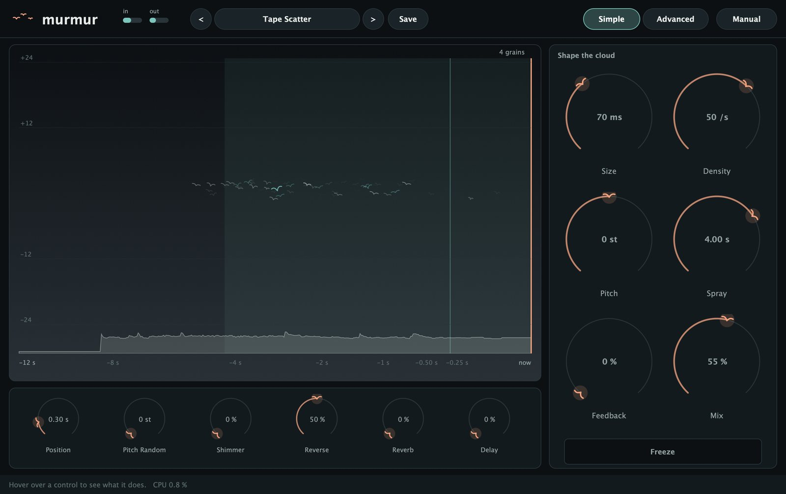

## La página Advanced

La página Advanced muestra todos los parámetros en ocho paneles: Grains, Time, Pitch y Envelope and stereo en la fila de arriba; Tone and level, LFO 1, LFO 2 y Effects and MIDI abajo. Las perillas de la página Simple son los mismos parámetros, así que lo que cambiás en una página se ve en la otra.

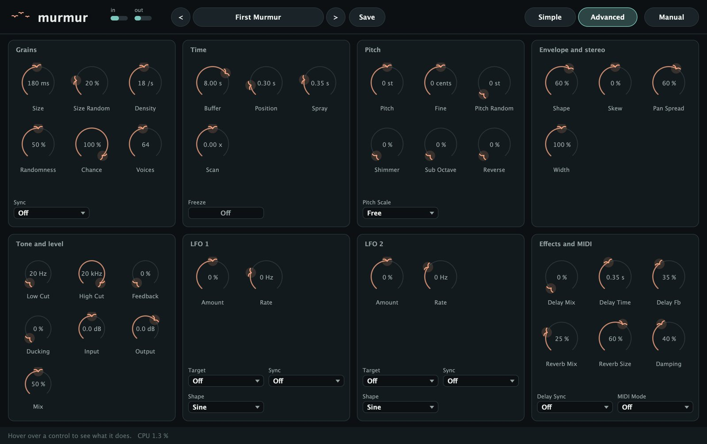

### Grains

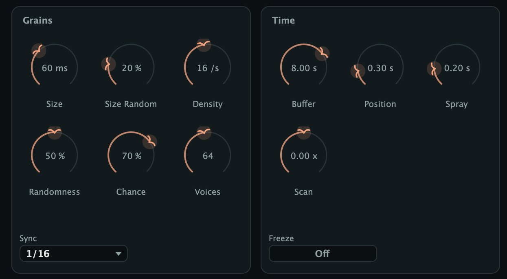

| Control | Rango | Por defecto |
|---|---|---|
| Size | 5 ms a 2 s | 120 ms |
| Size Random | 0 a 100 % | 20 % |
| Density | 0,5 a 200 /s | 16 /s |
| Randomness | 0 a 100 % | 50 % |
| Chance | 0 a 100 % | 100 % |
| Voices | 8 a 128 | 64 |
| Sync | Off, 1 bar a 1/8 D | Off |

**Size** es el largo de cada grano. Los granos cortos (5 a 40 ms) son clics y zumbidos, la materia prima del glitch. Los medianos (60 a 300 ms) conservan el carácter de la fuente. Los largos (de medio segundo a dos segundos) se superponen en mantos suaves.

**Size Random** le da a cada grano un largo al azar alrededor de Size, hasta una octava para cada lado: en 100 % cualquier cosa entre la mitad y el doble de Size. Un poco evita que la nube suene mecánica.

**Density** es cuántos granos nacen por segundo. Density por Size en segundos es cuántos se superponen: con 16 por segundo y 120 ms, unos dos; con 60 por segundo y 1 s, unos sesenta. Murmur baja el nivel de cada grano a medida que crece la superposición, así que una nube fina y una espesa suenan más o menos igual de fuerte.

**Randomness** define el espaciado. En 0 los granos llegan a intervalos parejos, como un pulso (a densidades altas el pulso se vuelve un zumbido con altura propia). En 100 % el espaciado es al azar, como lluvia. En el medio, Murmur mezcla las dos cosas.

**Sync** pone los granos en la grilla de tempo del host en lugar de usar Density: un grano al principio de cada paso. Las divisiones son `1 bar` (cuatro tiempos), `1/2`, `1/4`, `1/8`, `1/16`, `1/32`, los tresillos `1/4 T` y `1/8 T` y los puntillos `1/4 D` y `1/8 D`. Con Sync activo, Density y Randomness no se usan. **Chance**, que sólo funciona con Sync, es la probabilidad de que cada paso toque un grano.

**Voices** es la cantidad máxima de granos a la vez. Cuando se llega al límite, los granos nuevos se saltean hasta que termina alguno. Bajalo para ahorrar CPU o para aflojar una nube. Los presets no cambian Voices y se guardan sin él, pero queda guardado con tu proyecto.

### Time

| Control | Rango | Por defecto |
|---|---|---|
| Buffer | 0,5 a 16 s | 8 s |
| Position | 0 a 16 s | 0,30 s |
| Spray | 0 a 8 s | 0,20 s |
| Scan | -2 a +2 x | 0 |
| Freeze | Off, On | Off |

**Buffer** es cuánto audio reciente pueden alcanzar los granos y cuánto muestra el horizonte. Murmur siempre graba los últimos 16 segundos; Buffer elige cuánto usan los granos. Con Freeze activo, Buffer es el largo del lazo congelado, y lo podés cambiar congelado para mostrar más o menos de la memoria grabada.

**Position** es cuánto atrás arrancan los granos, en segundos detrás del audio más nuevo. En 0 la nube te sigue de cerca; con unos segundos repite lo que hiciste hace un momento, como un eco granular. No puede ir más atrás que Buffer ni que el audio grabado hasta ahora. Los granos transpuestos para arriba leen más rápido de lo que llega el audio, así que Murmur los hace arrancar lo bastante atrás como para que nunca alcancen a la grabación; por eso las nubes agudas se sienten un poco atrasadas.

**Spray** corre al azar el comienzo de cada grano, hasta esa cantidad de segundos antes o después de Position. En 0 todos los granos leen el mismo momento; entre 0,2 y 1 s la nube se vuelve un coro de momentos cercanos; con varios segundos se vuelve un collage.

**Scan** mueve el punto de lectura por su cuenta, en "veces tiempo real". Está pensado para Freeze: mirá Freeze, Scan y estiramiento del tiempo. **Freeze** es la misma llave que en la página Simple, que acá muestra `Off` u `On`.

### Pitch

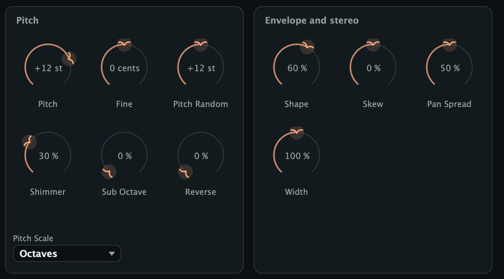

| Control | Rango | Por defecto |
|---|---|---|
| Pitch | -24 a +24 st | 0 st |
| Fine | -100 a +100 cents | 0 |
| Pitch Random | 0 a 24 st | 0 st |
| Shimmer | 0 a 100 % | 0 % |
| Sub Octave | 0 a 100 % | 0 % |
| Reverse | 0 a 100 % | 0 % |
| Pitch Scale | Free y 7 escalas | Free |

**Pitch** transpone todos los granos en semitonos sin cambiar la velocidad a la que recorren el búfer, así que una voz una octava arriba sigue cantando a su tempo. **Fine** afina en cents.

**Pitch Random** le da a cada grano una transposición al azar, para arriba o para abajo, de hasta esa cantidad de semitonos, ajustada a los intervalos que elijas en **Pitch Scale** (mirá Altura y escalas). Valores chicos en Free desafinan un poco los granos entre sí; valores grandes con una escala convierten la nube en un acorde.

**Shimmer** es la probabilidad de que un grano suene una octava arriba; con Feedback da el clásico shimmer que sube. **Sub Octave** es la probabilidad de que suene una octava abajo, para dar peso. Las dos se sortean por separado, así que un grano puede ganarse las dos y volver a la altura original. **Reverse** es la probabilidad de que un grano suene al revés: entre 30 y 50 % la nube se borronea, y en 100 % con un Skew positivo cada grano crece como una cinta pasada al revés.

La transposición total de un grano queda limitada a cuatro octavas para arriba o para abajo.

### Envelope and stereo

| Control | Rango | Por defecto |
|---|---|---|
| Shape | 0 a 100 % | 60 % |
| Skew | -100 a +100 % | 0 % |
| Pan Spread | 0 a 100 % | 50 % |
| Width | 0 a 200 % | 100 % |

Cada grano entra y se apaga con un fundido; ese fundido es su envolvente. **Shape** define qué tan suaves son: en 100 % una campana suave para nubes sin costuras, en 0 casi rectangular, con clics y ritmo, ideal para tartamudeos. Aun en 0, cada grano tiene al menos 2 ms de fundido en cada borde.

**Skew** corre el pico de la envolvente. Los valores negativos lo llevan al principio (ataque rápido y caída larga, como una cuerda pulsada); los positivos al final (una crecida lenta que se corta de golpe, como un sonido al revés). En los extremos el pico queda al 5 % o al 95 % del grano.

**Pan Spread** ubica cada grano en un punto al azar del estéreo, hasta esa distancia del centro. **Width** es el ancho estéreo de lo que lee cada grano: 0 mono, 100 % como se grabó, 200 % más ancho. Width le da forma a cada grano; Pan Spread lo ubica.

### Tone and level

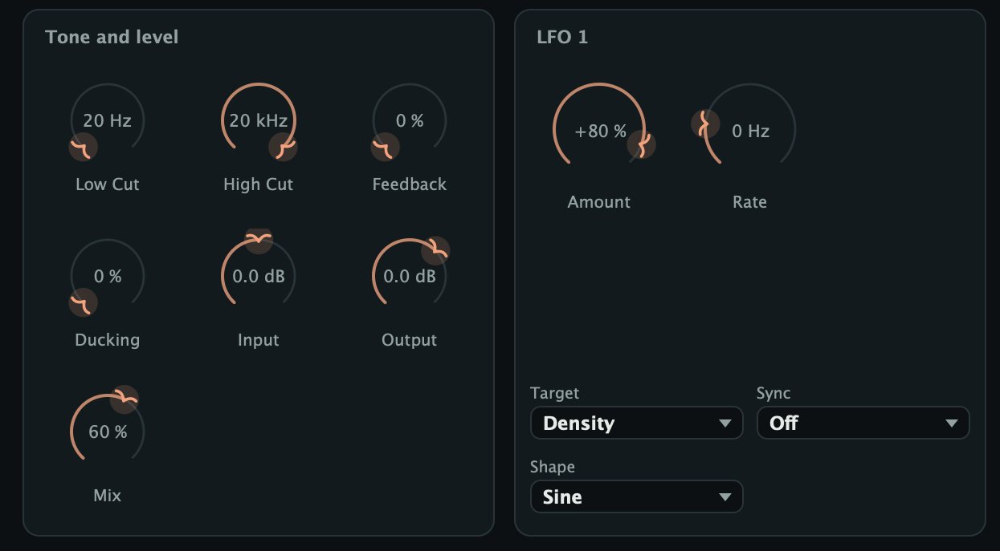

| Control | Rango | Por defecto |
|---|---|---|
| Low Cut | 20 Hz a 2 kHz | 20 Hz |
| High Cut | 500 Hz a 20 kHz | 20 kHz |
| Feedback | 0 a 97 % | 0 % |
| Ducking | 0 a 100 % | 0 % |
| Input | -24 a +24 dB | 0 dB |
| Output | -24 a +12 dB | 0 dB |
| Mix | 0 a 100 % | 50 % |

**Low Cut** y **High Cut** son filtros suaves (6 dB por octava) que actúan sólo sobre los granos. Low Cut entre 150 y 300 Hz evita que la nube embarre tus graves; High Cut entre 4 y 8 kHz la manda al fondo. Los granos se filtran antes de volver al búfer, así que estos filtros también definen cómo crece el Feedback.

**Feedback** devuelve los granos al búfer (mirá Feedback y Shimmer). No hace nada mientras Freeze está activo, porque no se graba nada.

**Ducking** baja los granos mientras la entrada suena fuerte, así la nube florece en los huecos entre frases. Reacciona rápido, se recupera en unos 0,3 s y baja del todo cuando la entrada pega unos -12 dBFS. Actúa sobre los granos, el delay y la reverb, nunca sobre la señal seca.

**Input** define el nivel que entra a Murmur: lo siguen tanto el búfer como la señal seca. **Output** define el nivel final de todo. **Mix** hace un fundido cruzado entre la entrada seca y los granos: en 50 % escuchás la mitad de cada uno.

### LFO 1 y LFO 2

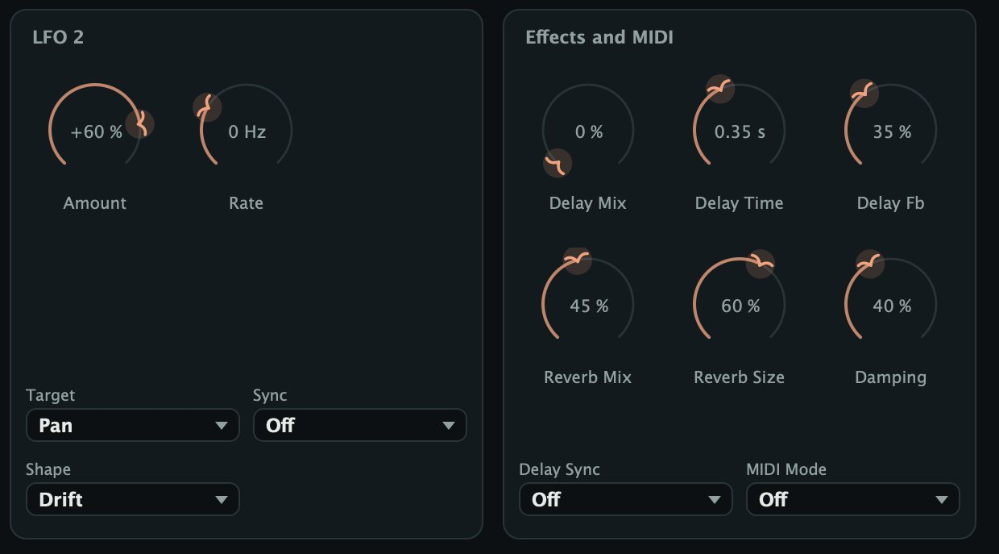

| Control | Rango | Por defecto |
|---|---|---|
| Target | Off y 9 destinos | Off |
| Amount | -100 a +100 % | 0 % |
| Rate | 0,01 a 20 Hz | 0,15 Hz, 0,40 Hz |
| Sync | Off, 1 bar a 1/8 D | Off |
| Shape | Sine, Triangle, Ramp, Drift, Step | Sine |

Los dos LFO son iguales (LFO 1 arranca en 0,15 Hz y LFO 2 en 0,40 Hz). **Target** elige qué mueve el LFO, **Amount** cuánto y en qué sentido, **Rate** a qué velocidad, **Sync** ata la velocidad al tempo del host y **Shape** elige la onda. Mirá Modulación con los LFO.

### Effects and MIDI

| Control | Rango | Por defecto |
|---|---|---|
| Delay Mix | 0 a 100 % | 0 % |
| Delay Time | 0,02 a 2 s | 0,35 s |
| Delay Fb | 0 a 95 % | 35 % |
| Delay Sync | Off, 1 bar a 1/8 D | Off |
| Reverb Mix | 0 a 100 % | 0 % |
| Reverb Size | 0 a 100 % | 60 % |
| Damping | 0 a 100 % | 40 % |
| MIDI Mode | Off, Pitch, Gate | Off |

El delay y la reverb se explican en Delay y reverb, y **MIDI Mode** en Modos MIDI y pedal de sustain.

## Freeze, Scan y estiramiento del tiempo

Con Freeze activo se deja de grabar y el búfer queda como una foto fija de los últimos Buffer segundos. Los granos siguen leyendo de ahí con todos sus ajustes, así que podés cambiar Size, Pitch, Spray y lo demás sobre un sonido que ya no existe en tu pista.

- Freeze se queda con lo que se grabó antes de apretarlo. Apretalo mientras el sonido todavía suena.
- Congelado, Position, Spray y Scan dan la vuelta: un búfer congelado se comporta como un lazo de exactamente Buffer segundos.
- Si el búfer tiene menos audio que Buffer, una parte del lazo está en silencio y los granos que caen ahí también. Bajá Buffer al largo del sonido que congelaste.
- Murmur arranca con el búfer vacío, y tu DAW puede vaciarlo cuando reinicia el audio o cambia la frecuencia de muestreo. Congelar un búfer vacío da silencio.
- Los presets de fábrica siempre cargan con Freeze apagado, así nunca congelás un búfer vacío sin querer. Un preset de usuario guardado con Freeze activo carga con Freeze activo.

### Scan y estiramiento

Con Freeze activo, Scan convierte a Murmur en un estirador de tiempo:

| Scan | Con Freeze |
|---|---|
| +1.00 x | recorre el sonido a su velocidad original |
| +0.50 x | a media velocidad: dura el doble |
| +0.10 x | dura diez veces más |
| 0 | se queda en un momento: una nota eterna |
| -0.05 x | dura veinte veces más, al revés |
| +2.00 x | al doble de velocidad |

La altura queda donde la pone Pitch; sólo cambia la velocidad del recorrido. Para el estiramiento más suave, usá granos largos (300 ms a 1 s), Shape cerca de 100 %, un Density de 20 a 40 por segundo y poco Spray (0,05 a 0,2 s). Granos más cortos y más Spray dan un estiramiento más granulado.

Si volvés Scan a 0, el punto de lectura se queda donde lo dejó Scan; Position lo sigue corriendo desde ahí. En la bandada, los granos se alejan de la franja clara a medida que Scan los mueve.

Sin Freeze, Scan hace que el punto de lectura barra desde Position hacia el audio más nuevo (positivo) o el más viejo (negativo), y vuelve atrás más o menos una vez por cada largo de Buffer. Puede hacer que una nube deambule, pero es sobre todo una herramienta para Freeze.

> Los presets de Stretch están pensados para Freeze pero cargan con Freeze apagado. Tocá tu sonido, apretá Freeze mientras suena y escuchá.

## Feedback y Shimmer

Feedback toma los granos (después de Low Cut y High Cut, antes del delay y la reverb) y los vuelve a grabar en el búfer junto con la entrada. Los granos nuevos leen entonces una mezcla de lo que tocaste y lo que ya hicieron los granos, así que el sonido se espesa y sigue cambiando después de que parás.

- De 0 a 30 % suma densidad y un halo suave.
- De 40 a 70 % la nube crece sobre sí misma y se sostiene muchos segundos.
- Arriba de 80 % se vuelve una textura que se sostiene sola y tarda mucho en apagarse.

La señal que vuelve pasa por un bloqueador de continua y un saturador suave, así que los picos se redondean en vez de explotar: las pruebas del motor corren Feedback en 97 % con Shimmer en 50 % durante 20 segundos y la salida queda acotada. Igual puede sonar fuerte, así que tené una mano en Output. Feedback multiplica lo que hagan los granos: con Pitch en +7 cada vuelta sube otra quinta, con Pitch Random en una escala el acorde se completa.

### El shimmer que sube

Cada grano que suena una octava arriba vuelve al búfer, donde algunos de sus granos suben otra octava: el sonido sube en una espiral lenta de octavas, como un coro que aparece de un acorde de guitarra. Arrancá con **Shimmer** entre 30 y 50 %, **Feedback** entre 50 y 75 %, **Size** de 250 a 400 ms, **Spray** cerca de 0,5 s, **High Cut** entre 6 y 10 kHz y bastante **Reverb Mix**. Un poco de **Sub Octave** da peso abajo, como en Cathedral Bloom. Si arriba se pone punzante, bajá High Cut antes que Feedback.

## Sync y ritmo

Con **Sync** en una división, los granos suenan en la grilla de tu DAW, uno al principio de cada paso, siguiendo la posición de la canción mientras el host reproduce. Con el host parado, Murmur mantiene un reloj libre al tempo del host, así que igual escuchás el ritmo mientras lo armás. Las pruebas del motor verifican que a 120 BPM en 1/8 Murmur toca 16 granos en 4 segundos.

Para que un ritmo suene a ritmo:

- Mantené **Size** más corto que el paso. A 120 BPM una semicorchea dura 125 ms, así que granos de 50 a 100 ms dejan huecos.
- Poné **Shape** bajo (0 a 20 %) y **Skew** negativo para ataques secos.
- Dejá **Spray** chico para un tartamudeo que repite el mismo momento, o más grande para un secuenciador granular que agarra un fragmento distinto en cada paso.
- Bajá **Chance** a 50 u 80 % para romper el patrón; cada paso decide por su cuenta.
- Sumá **Pitch Random** en Octaves para golpes que saltan, o **Reverse** para golpes al revés.

El delay y los LFO también pueden seguir el tempo: granos en 1/8 con un delay en 1/8 D dan el rebote con puntillo del preset Eighth Notes. En modo Gate con Sync activo, los granos suenan en los pasos sólo mientras hay una nota apretada.

## Altura y escalas

La altura de cada grano se arma con Pitch y Fine, después la nota MIDI (en los modos MIDI), después un intervalo al azar de Pitch Random y por último las octavas de Shimmer y Sub Octave.

**Pitch Scale** actúa sólo sobre la parte al azar. Murmur sortea un valor de hasta Pitch Random para cualquier lado y lo lleva al intervalo más cercano de la escala. La escala se arma sobre la altura del propio grano, no sobre una tonalidad fija: Major da la fundamental, la tercera mayor y la quinta de la nota que toque tu fuente. Pitch, Fine y las notas MIDI nunca se ajustan.

| Pitch Scale | Dónde cae la parte al azar |
|---|---|
| Free | cualquier valor |
| Semitones | semitonos enteros |
| Octaves | 0, 12 y 24 semitonos arriba o abajo |
| Fifths | octavas y la quinta arriba de cada una |
| Major | fundamental, tercera mayor, quinta |
| Minor | fundamental, tercera menor, quinta |
| Pentatonic | fundamental, 2.ª, 3.ª mayor, 5.ª, 6.ª |
| Whole tone | pasos de dos semitonos |

Pitch Random tiene que ser lo bastante ancho para llegar a los intervalos: en Octaves, cualquier valor por debajo de 6 semitonos vuelve a 0, así que usá al menos 12. Con 24 en Octaves, más o menos un cuarto de los granos queda en la altura original, la mitad cae a una octava y un cuarto a dos octavas: eso es Octave Shower.

Combinaciones para probar: Free con 0,1 a 0,5 st para un chorus (Starling Cloud); Fifths con 12 a 19 st para drones abiertos (Fifths Drone); Major o Minor con 12 st para un brillo de notas del acorde (Major Sparkle, Minor Mist); Pentatonic con 12 st para campanitas que nunca chocan (Pentatonic Wind); Semitones con 24 st y granos diminutos para un caos cromático (Bit Swarm).

## Modulación con los LFO

Cada LFO mueve un parámetro para arriba y para abajo alrededor de donde está su perilla. Las perillas no se mueven en pantalla; la modulación pasa adentro.

- **Sine**: un vaivén suave. **Triangle**: rectas con vueltas más marcadas. **Ramp**: baja de arriba a abajo y salta de nuevo arriba.
- **Drift**: se desliza suave hacia un valor al azar nuevo en cada ciclo, lo más natural para deambular despacio.
- **Step**: salta a un valor al azar nuevo en cada ciclo y lo mantiene.

**Rate** va de 0,01 Hz (un ciclo cada 100 segundos) a 20 Hz. Con **Sync** en una división, un ciclo dura esa división al tempo del host y Rate no se usa. Un Amount negativo invierte la onda.

| Target | Con Amount al máximo |
|---|---|
| Position | hasta medio Buffer para cada lado |
| Spray | de nada al doble del ajuste |
| Size | de un cuarto a cuatro veces |
| Density | de un cuarto a cuatro veces |
| Pitch | 12 semitonos arriba y abajo |
| Pan | abre y cierra Pan Spread |
| Tone | High Cut 3 octavas, Low Cut 1,5 octavas |
| Mix | 50 % para cada lado |
| Feedback | 50 % para cada lado |

Position, Spray, Size, Pitch y Pan se leen cuando nace cada grano y se mantienen toda su vida, así que la modulación se nota a lo largo de la corriente de granos. Density cambia cada cuánto nacen. Tone, Mix y Feedback se mueven de forma continua.

Ideas: Drift en Position con Rate lento para una nube que deambula por el búfer (Tape Scatter); Sine en Density a 0,1 Hz para una nube que respira (Breathing Cloud); Drift en Tone para un barrido bajo el agua (Underwater); Step en Pitch a 4 Hz para saltos al azar (Broken Radio); Triangle en Pan sincronizado a 1 bar para una nube que se abre con la música.

## Delay y reverb

Después de los filtros de tono, los granos pasan por un delay y después por una reverb de placa. Los dos procesan sólo los granos y están apagados, sin gastar nada, mientras su Mix está en 0. El Ducking actúa después, así que una nube que se agacha también agacha sus ecos y su reverb.

El delay es un eco ping-pong: la primera repetición sale por la izquierda y cada una de las siguientes cruza al otro lado, un poco más oscura cada vez.

- **Delay Mix**: cuánto eco se suma; los granos quedan a nivel completo.
- **Delay Time** (0,02 a 2 s): el tiempo entre repeticiones cuando Delay Sync está apagado. Si lo cambiás, se desliza suave, con una curva de altura como de cinta.
- **Delay Fb**: cerca de 30 % da unas pocas repeticiones, 70 % o más una cola larga.
- **Delay Sync**: el tiempo en notas del tempo del host; Delay Time deja de usarse. Los tiempos sincronizados llegan como mucho a 4 segundos.

La reverb es una placa densa y suave. **Reverb Mix** define cuánta se suma, **Reverb Size** el largo de la cola (arriba de 80 % dura muchos segundos) y **Damping** qué tan rápido se apagan los agudos.

> En un retorno con Mix en 100 %, Reverb Mix y Delay Mix te dan un ambiente completo en un solo plugin.

## Modos MIDI y pedal de sustain

Murmur escucha notas y el pedal de sustain (mirá Cómo mandarle MIDI a Murmur). **MIDI Mode** decide qué hacen las notas. En Off se ignoran, pero el pedal sigue funcionando.

### Pitch

Las notas que tocás definen la altura de los granos. El Do central (nota MIDI 60, que Ableton Live llama C3 y otros DAW C4) deja los granos en su altura original; cada semitono de distancia los transpone un semitono. Con varias notas apretadas, cada grano nuevo elige una al azar, así que un acorde en el teclado se vuelve un acorde de granos. Se usan hasta 16 notas apretadas.

- La velocity define el nivel de los granos que nacen de esa nota, desde más o menos un tercio del nivel completo hasta el completo.
- Pitch, Fine, Pitch Random, Shimmer y Sub Octave se siguen sumando arriba.
- Sin notas apretadas, los granos suenan a su altura normal: el modo Pitch transpone, no silencia.
- Los granos que ya suenan mantienen su altura; las notas nuevas aparecen a medida que nacen granos nuevos. Con más Density sigue más rápido lo que tocás.

La transposición es relativa a tu fuente. Si la fuente está en Do, las teclas suenan las notas que apretás. Si no, ajustá **Pitch** para que la fuente caiga en Do: para una fuente en La, -9 st (o +3 st una octava arriba).

### Gate

Los granos nacen sólo mientras hay una nota apretada. Soltás las teclas y no arrancan granos nuevos; los que suenan terminan y los efectos se apagan solos. Con Sync apagado, el primer grano sale en el momento en que apretás una tecla; con Sync activo, los granos suenan en los pasos mientras haya una tecla apretada. Gate también transpone como el modo Pitch, así que apretá el Do central si querés sólo la compuerta.

> En modo Gate sin notas, los granos no suenan. Si Murmur parece no hacer nada, revisá MIDI Mode primero.

### El pedal de sustain

El pedal de sustain (controlador 64) mantiene Freeze mientras está apretado, en cualquier modo MIDI: tocá un acorde, pisá el pedal mientras suena y tocá otra cosa encima de la nube congelada. El congelado del pedal es independiente del botón Freeze: el botón queda como estaba, pero la bandada dice `frozen` y el horizonte deja de moverse. Si cualquiera de los dos está activo, Murmur está congelado. Los mensajes All Notes Off y All Sound Off sueltan las notas; Reset All Controllers suelta el pedal; poner Murmur en bypass suelta las dos cosas.

## Presets

Hacé clic en el nombre del preset en la barra superior para abrir el menú, con un submenú por categoría, o recorré todos los presets con **<** y **>**. Cargar un preset cambia todos los parámetros menos Voices; el búfer no se vacía, así que los ajustes nuevos trabajan sobre el audio ya grabado.

Para guardar, hacé clic en **Save**, escribí un nombre y apretá Save. El preset va a la categoría User; si guardás con un nombre que ya existe, lo reemplaza. Los presets de usuario son archivos que podés copiar o compartir:

- macOS: `~/Library/Application Support/Audio Tools/Murmur/Presets`
- Windows: `%APPDATA%\Audio Tools\Murmur\Presets`

Tu proyecto guarda igual el estado completo de Murmur, con el nombre del preset, así que no hace falta un preset para conservar un sonido en un tema.

| Categoría | Presets | Qué darles |
|---|---|---|
| Clouds | First Murmur, Slow Fog, Starling Cloud, Dust Motes | cualquier cosa sostenida |
| Shimmer | Choir Rising, Glass Halo, Cathedral Bloom | guitarra, teclados, voz |
| Stretch | Stretch Ten Times, Reverse Glacier, Held Chord | un acorde, y después Freeze |
| Rhythm | Eighth Notes, Sixteenth Stutter, Triplet Rain, Gated Swells | batería, con el host andando |
| Pitch | Octave Shower, Major Sparkle, Minor Mist, Pentatonic Wind, Fifths Drone, Down Below | partes melódicas |
| Texture | Tape Scatter, Reverse Swell, Granular Wash, Underwater, Breathing Cloud | pads, ambientes |
| Glitch | Bit Swarm, Broken Radio, Skipping CD | beats, voces |
| MIDI | Play the Cloud, Gated Choir | una fuente más una pista MIDI |

Los presets de Stretch esperan que aprietes Freeze. Gated Choir no suena hasta que tocás notas.

## Recetas

### Nube de voz

1. Creá una pista de retorno con Murmur y mandale la voz.
2. Cargá **First Murmur** y poné **Mix** en 100 %.
3. Poné **Size** en 250 ms, **Density** en 20 /s, **Spray** en 0,6 s y **Pitch Random** en 0,2 st con Free.
4. Poné **Low Cut** en 250 Hz, **High Cut** en 8 kHz, **Reverb** en 30 % y **Ducking** en 50 %.
5. Subí el retorno hasta que el halo se sienta más de lo que se escucha.

### Pad con shimmer desde una guitarra

1. Cargá **Choir Rising** en una guitarra limpia y tocá acordes lentos. En unos segundos suben octavas por encima.
2. Para que suba más, llevá **Shimmer** hacia 60 %; para que florezca más tiempo, llevá **Feedback** hacia 80 %.
3. Si arriba se pone áspero, bajá **High Cut** a 6 kHz.
4. Dejá **Mix** entre 40 y 60 % para guitarra más pad, o en 100 % para el pad solo.

### Estirar un acorde con Freeze y Scan

1. Cargá **Stretch Ten Times** y poné **Buffer** un poco más largo que tu acorde, por ejemplo 4 s.
2. Tocá el acorde y, mientras suena, apretá **Freeze**. Se despliega diez veces más lento, a su altura original.
3. Poné **Scan** en 0,05 para veinte veces más lento, o en -0,1 para tocarlo al revés.
4. Poné Scan en 0 para quedarte en un momento, y mové **Position** para elegir cuál.

### Tartamudeo rítmico en la batería

1. Cargá **Sixteenth Stutter** en un loop de batería y arrancá el host.
2. Poné **Spray** en 0 y **Position** en 0,25 s para que cada golpe repita el mismo fragmento.
3. Usá **Chance** en 50 % para un patrón roto o en 100 % para un redoble; **Pitch Random** en 0 para un tartamudeo puro.
4. Automatizá **Mix** de 0 a 70 % al final de una frase para un fill.

### Acordes de granos con el modo MIDI Pitch

1. Poné Murmur en un sonido sostenido y ruteale una pista MIDI. Cargá **Play the Cloud**.
2. Si la fuente no está en Do, poné **Pitch** en su distancia a Do (para La, -9 st).
3. Apretá un acorde: cada grano elige una de las notas y la nube se vuelve el acorde.
4. Subí **Density** a 40 /s para seguir más rápido los cambios de acorde. Para una muestra congelada que puedas tocar, apretá Freeze o el pedal antes, en un buen momento.

### Ambiente con ducking en un retorno

1. Cargá **Cathedral Bloom** en un retorno, poné **Mix** en 100 % y mandale un piano o una voz.
2. Poné **Ducking** en 70 %: la nube se corre mientras tocás y florece en las pausas.
3. Poné **Low Cut** en 200 Hz, y bajá **Feedback** a 50 % si se queda demasiado.

### Glitch lo-fi

1. Cargá **Broken Radio** en un beat o una voz: una banda angosta y granos cortos al azar.
2. Subí el Amount del **LFO 1** para más caos, o poné su Shape en Drift para un vaivén más parejo.
3. Poné **Shape** en 0 % para clics más duros y **Voices** en unos 24 para aflojarlo.

### Lluvia de octavas

1. Cargá **Octave Shower** en una línea melódica.
2. Subí **Shimmer** a 30 % para favorecer las octavas de arriba, o **Sub Octave** para las de abajo.
3. Poné **Pan Spread** en 100 % y **Reverb** en 50 % para una nube ancha y estrellada; bajá **Pitch Random** a 12 st para una sola octava para cada lado.

### Drone congelado con el pedal de sustain

1. Cargá **Fifths Drone** y ruteale a Murmur una pista MIDI con tu teclado y tu pedal (MIDI Mode puede quedar en Off).
2. Tocá un acorde y pisá el pedal mientras suena: se congela en un drone de quintas y octavas.
3. Tocá encima; soltá el pedal para atrapar un acorde nuevo.

## Consejos

- Empezá con material sostenido y simple: una nota larga muestra clarito qué hace cada control.
- Si los pájaros no están donde esperás, mirá Position, Spray y Scan.
- Para pads, subí Shape y Size; para ritmos y glitches, bajalos.
- Size por Density es la superposición: subí cualquiera de los dos para una nube más espesa, bajá cualquiera si se vuelve un puré.
- Automatizá Freeze para atrapar momentos exactos, como el último acorde de una sección.
- Guardá variaciones sobre la marcha: los ajustes granulares se pierden fácil.

## Problemas y soluciones

### No hay granos, o no hay sonido

- **Mix** en 0 % deja sólo la señal seca.
- **MIDI Mode** en Gate toca granos sólo mientras hay una nota apretada.
- En la versión independiente la entrada arranca muteada: destildá Mute audio input en Options, Audio/MIDI Settings.
- Si la bandada no muestra forma de onda, no le llega audio a Murmur; mirá el medidor in y la entrada de la pista.

### Freeze da silencio o agujeros

El búfer estaba vacío cuando lo congelaste, o el sonido era más corto que Buffer. Bajá **Buffer** al largo del sonido, o apretá Freeze mientras todavía suena.

### El sonido sigue, o va creciendo

Freeze, el pedal, el Feedback o una reverb larga lo mantienen vivo. Apagá Freeze, soltá el pedal, bajá Feedback (y después High Cut y Output) o bajá Reverb Size. Si el botón Freeze está apagado pero la bandada dice `frozen`, el pedal está apretado; el bypass lo suelta.

### Clics

Los granos cortos con Shape bajo hacen clic a propósito. Para nubes suaves subí **Shape** a 50 % o más y **Size** a 60 ms o más, y acercá a 0 un **Skew** extremo.

### Mucha CPU

El costo crece con los granos que suenan a la vez, más o menos Density por Size, hasta Voices. La barra de ayuda muestra la carga. Bajá **Voices**, **Density** o **Size**. El delay y la reverb no gastan nada con Mix en 0. Como referencia, 128 granos de un segundo con delay y reverb a 48 kHz usan alrededor de 2,5 % de un núcleo en una Apple M4.

### Sync o MIDI no responden

Sync sigue la posición del host sólo mientras reproduce; con Chance por debajo de 100 % algunos pasos se saltean. Para MIDI, revisá MIDI Mode y el ruteo: la bandada muestra "notes held" cuando llegan notas. Si las notas suenan desafinadas en modo Pitch, la fuente no está en Do; ajustá Pitch.

## Especificaciones

| Ítem | Valor |
|---|---|
| Tipo | Efecto de audio granular en tiempo real con entrada MIDI |
| Formatos | VST3, Audio Unit music effect (macOS), aplicación independiente |
| Sistemas | macOS 11 o posterior (universal), Windows 10 u 11 (64 bits) |
| Entradas y salidas | Entrada mono o estéreo, salida mono o estéreo |
| Latencia | Ninguna |
| Búfer | Graba los últimos 16 s; los granos usan de 0,5 a 16 s |
| Granos | Hasta 128 a la vez (Voices de 8 a 128) |
| Largo de grano | 5 ms a 2 s, variación al azar de hasta una octava |
| Densidad | 0,5 a 200 granos por segundo, de parejo a al azar |
| Sincronía | 10 divisiones, de 1 bar a 1/32, tresillos y puntillos, probabilidad por paso |
| Altura | -24 a +24 st, afinación fina, azar de hasta 24 st, total dentro de 4 octavas |
| Escalas | Free, Semitones, Octaves, Fifths, Major, Minor, Pentatonic, Whole tone |
| Por grano | Probabilidad de shimmer, sub octava y reversa, forma e inclinación de envolvente, paneo, ancho |
| Tono | Low cut de 20 Hz a 2 kHz, high cut de 500 Hz a 20 kHz, 6 dB por octava |
| Feedback | Hasta 97 %, con bloqueador de continua y saturador suave |
| Modulación | 2 LFO, 5 formas, 9 destinos, 0,01 a 20 Hz o sincronizados |
| Efectos | Delay ping-pong de hasta 2 s (4 s sincronizado), reverb de placa, ducking |
| MIDI | Modos Pitch y Gate, 16 notas, velocity, el pedal de sustain mantiene Freeze |
| Presets | 30 en ocho categorías, más los tuyos |
| Cola informada | 20 s |

Verificado sobre el motor:

| Prueba | Resultado |
|---|---|
| 128 granos de 1 s, delay y reverb, 48 kHz | Alrededor de 2,5 % de un núcleo en una Apple M4 |
| Pitch +12 sobre un tono de 220 Hz | A menos de 15 Hz de 440 Hz |
| Freeze con la entrada en silencio | El búfer congelado sigue sonando |
| Sync 1/8 a 120 BPM durante 4 s | 16 granos, uno por corchea |
| Feedback 97 % con Shimmer 50 % durante 20 s | La salida queda acotada |
| Modo Gate sin notas | Silencio |
| 44,1, 96 y 192 kHz, bloques de 1 a 4096 muestras | Salida finita y con nivel en todos los casos |
| 60 combinaciones al azar de todos los parámetros | Siempre finito, sin explosiones de nivel |
