# Manual de Orrery

## Qué es Orrery

Orrery es un instrumento MIDI generativo para ambient, dark ambient, drone y música tranquila. No hace sonido por sí sola: escribe notas y movimientos de controladores y se los manda a otros instrumentos, sean sintes virtuales en tu DAW o sintes físicos por un cable MIDI. Una sola Orrery puede tocar un sinte o un rack entero.

Adentro, ocho **carriles** giran alrededor de una armonía lenta compartida. Cada carril tiene un rol (drone, pad, melodía, arpegio, nube, bajo o pulso) y su propio canal MIDI, así que el carril 1 puede tocar un drone grave en un sinte mientras el carril 3 toca una melodía en otro. Todos los carriles escuchan el mismo acorde, que cambia despacio, y por eso las partes siempre están de acuerdo.

Un carril también puede grabar lo que toca y repetirlo como un lazo de su propio largo, mutando un poco en cada vuelta. Con lazos de largos distintos, las partes entran y salen de fase durante horas: la técnica que Brian Eno describió para Music for Airports. Encima de eso hay sesiones con duración y fades lentos, un ritmo de respiración que marca los acordes y las frases, y un modo suave que mantiene todo bajo y tranquilo.

Cada elección al azar sale de un número de **variación**: el mismo número con los mismos ajustes toca siempre las mismas notas. Un pequeño **sonido de prueba** incorporado te deja probar todo sin rutear nada.

> Orrery es una herramienta musical para relajarse y concentrarse. No es un dispositivo médico ni promete efectos terapéuticos.

## Instalación

Orrery viene como plugin VST3, como Audio Unit (sólo macOS) y como aplicación independiente. Funciona en macOS 11 o posterior (un solo binario universal para Apple silicon e Intel) y en Windows 10 u 11 de 64 bits.

En macOS:

1. Descomprimí el archivo.
2. Copiá `Orrery.vst3` a `~/Library/Audio/Plug-Ins/VST3`.
3. Copiá `Orrery.component` a `~/Library/Audio/Plug-Ins/Components`.
4. Reescaneá los plugins en tu DAW. En Ableton Live usá el VST3 (más abajo te contamos por qué).

En Windows:

1. Descomprimí el archivo.
2. Copiá `Orrery.vst3` a `C:\Program Files\Common Files\VST3`.
3. Reescaneá los plugins en tu DAW.
4. `Orrery.exe` es la versión independiente: funciona sola y toca tus puertos MIDI.

> Los builds todavía no están firmados. macOS puede negarse a abrirlos hasta que corras `xattr -dr com.apple.quarantine` sobre los plugins instalados, y SmartScreen de Windows puede pedir confirmación la primera vez. Cada paquete trae un INSTALL.txt con los pasos exactos.

## Cargarla en un DAW

Orrery se carga como instrumento en su propia pista MIDI. Su MIDI sale de esa pista; tus sintes van en otras pistas y toman su entrada MIDI de ella. Cada carril llega siempre al DAW por su propio canal MIDI: el carril 1 por el canal 1, el carril 2 por el canal 2, y así, salvo que cambies los canales.

Si tu DAW puede rutear la salida MIDI de un plugin a otras pistas, poné la entrada MIDI de cada pista de sinte en la pista de Orrery, y en el canal del carril si tu DAW deja filtrar por canal. Si no puede, usá las salidas MIDI directas con un puerto virtual (ver Ruteo, puertos y sincronía).

Orrery ignora el MIDI que entra y no lo deja pasar. Cuando el plugin está en bypass, manda note-off a todo lo que esté sonando y después queda en silencio.

En Ableton Live:

1. Arrastrá el VST3 de Orrery a una pista MIDI vacía. Live no saca el MIDI que producen los plugins Audio Unit, así que la versión AU no puede tocar otras pistas ahí.
2. Poné tu sinte en otra pista MIDI.
3. En la sección de entrada y salida de la pista del sinte, elegí en **MIDI From** la pista de Orrery, y en el selector de abajo elegí `Audio Tools Orrery`.
4. Poné el **Monitor** de la pista del sinte en `In`, o armá la pista.
5. Hacé clic en **Preview sound**, en la barra superior de Orrery al lado de Play, hasta que diga `Preview sound: Off`. Así escuchás sólo tu sinte.
6. Apretá Play en Orrery.

En REAPER también usá el VST3: REAPER tampoco saca el MIDI que producen los plugins Audio Unit. Mandá la pista de Orrery a la de cada sinte (un envío con MIDI), o armá la pista del sinte con el MIDI de la pista de Orrery como entrada.

Live junta todos los canales MIDI cuando rutea MIDI de una pista a otra, así que ese sinte recibe todos los carriles encendidos. Para un sinte que toca todo, perfecto. Para mandar carriles distintos a sintes distintos en Live, agregá más Orrery: la primera es la Main y cada Orrery que agregues después se vuelve un satélite que toca un carril de la Main. Los pasos están en Una Orrery, muchos sintes, al principio de Ruteo, puertos y sincronía. Un puerto virtual, o una Orrery por pista con Link, también sirven.

## Primer sonido

1. Abrí Orrery (la aplicación independiente, o el plugin en una pista MIDI).
2. En la página Simple, hacé clic en un clima a la izquierda, por ejemplo **Ambient**.
3. Apretá **Play** en la barra superior.

El sonido de prueba arranca enseguida y el orrery del centro se despierta: una órbita por carril, un planeta que la recorre y una chispa por cada nota. Si no escuchás nada, mirá Problemas y soluciones.

Lo que escuchás es el **sonido de prueba** de Orrery, un sinte chico incorporado para probarla sin rutear nada. No es tu sinte. Mientras suena, el botón al lado de Play dice `Preview sound: On` y la línea de arriba del orrery dice "You're hearing Orrery's preview sound". Cuando toquen tus sintes, hacé clic en el botón hasta que diga `Preview sound: Off`: el MIDI que manda Orrery es el mismo de las dos maneras.

> Muchos presets entran con un fade de 20 segundos o más, y los de dormir con más de un minuto. Los primeros segundos son bajos a propósito.

## La interfaz de un vistazo

La ventana tiene una barra superior, el área de páginas y un pie. Se puede agrandar o achicar desde la esquina, de la mitad a una vez y media su tamaño normal, y mantiene las proporciones.

La barra superior, de izquierda a derecha:

- **orrery**: el logo. Un clic vuelve a la página Simple. Debajo, la línea de estado muestra `playing` y el tiempo de sesión (y la duración de la sesión cuando la hay), `stopped`, o `session finished` cuando terminó una sesión.
- **Play** / **Stop**: arranca y frena Orrery.
- **Preview sound: On** / **Off**: prende y apaga el sonido de prueba incorporado. Está al lado de Play para que siempre se vea si lo que suena es Orrery o tu sinte. Es el mismo ajuste que Preview sound en la página Outputs.
- **<** y **>**: el preset anterior y el siguiente. El nombre del preset, entre las dos flechas, abre el menú de presets agrupados por clima, con los tuyos bajo User.
- **Save**: guarda los ajustes actuales como preset de usuario.
- **Simple** y **Advanced**: pasan de la página Simple a las tres páginas avanzadas. En las avanzadas, unas pestañas debajo de la barra eligen **Lanes**, **Harmony & session** u **Outputs**.
- **Capture MIDI**: guarda los últimos minutos tocados como archivo MIDI.
- **All notes off**: corta todas las notas que suenan en los 16 canales, en el DAW y en los puertos directos.
- **Manual**, a la derecha del pie, abre este manual dentro del plugin, en inglés o en castellano. Esc o la cruz lo cierran.

En un satélite (ver Main y satélites) la barra superior deja sólo el logo, Preview sound y All notes off: lo demás lo decide la Main.

El pie muestra una línea de ayuda corta de lo que tengas bajo el mouse, mensajes como el nombre de un archivo capturado, y el archivo capturado mismo, listo para arrastrar al DAW.

Los controles funcionan igual en todos lados:

- Perillas redondas: arrastrá hacia arriba o hacia abajo. Con Shift el paso es fino, el doble clic vuelve al valor por defecto, y también sirve la rueda del mouse.
- Cajas con un triangulito: un clic abre un menú de opciones.
- Cajas con un número: arrastrá hacia arriba o hacia abajo, o usá la rueda. El doble clic vuelve al valor por defecto.
- Cajas de dos estados (Off y On, Stopped y Playing): un clic cambia el estado.

Cada ajuste es también un parámetro del host, así que lo podés automatizar en tu DAW. Los ajustes de carril aparecen en el host como `Lane 1 Density`, `Lane 2 Role`, etcétera.

## La página Simple

La página Simple es todo lo que la mayoría necesita: los climas, el orrery, una llave por carril, cinco perillas que dan forma a todo a la vez, la tonalidad y la sesión.

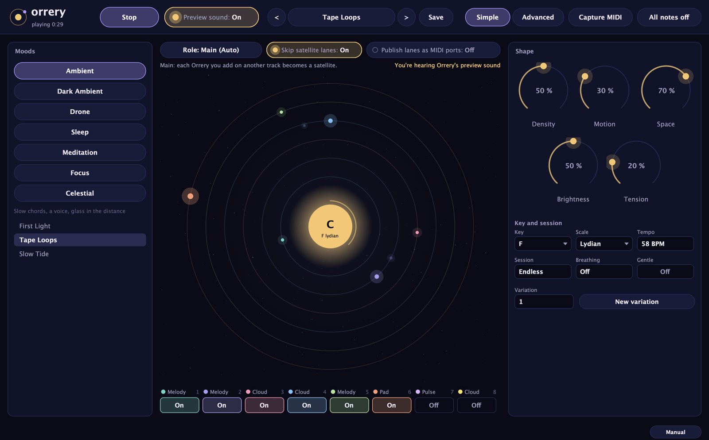

### Climas

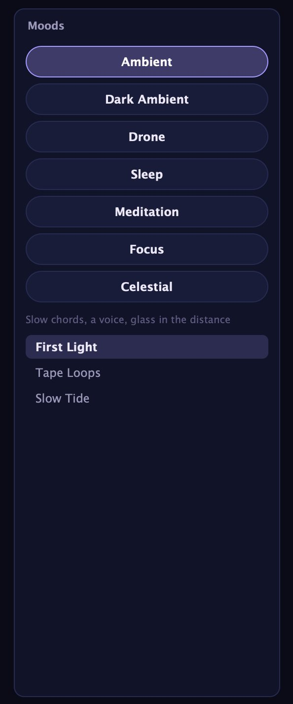

El panel **Moods** muestra los siete climas: Ambient, Dark Ambient, Drone, Sleep, Meditation, Focus y Celestial. Un clic en un clima carga su primer preset y muestra una descripción de una línea debajo de los botones, como "Low, minor, unresolved" en Dark Ambient. Más abajo, la lista muestra los tres presets del clima; hacé clic en uno para cargarlo. Si Orrery está tocando, sigue tocando con el preset nuevo.

### El orrery

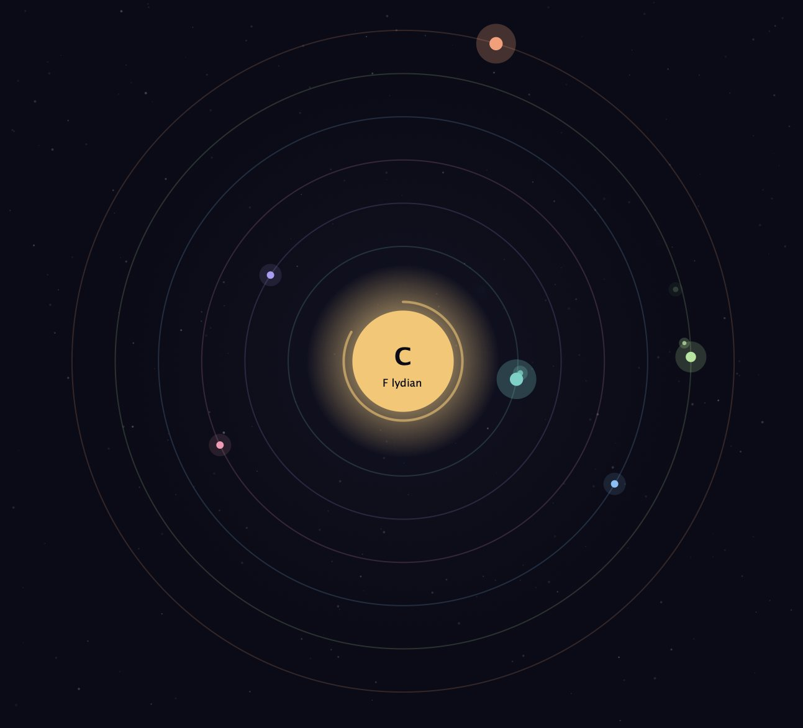

El dibujo del centro muestra lo que suena. El sol del medio muestra el acorde actual (por ejemplo `Dm9`) y, debajo, la tonalidad y la escala. Un arco alrededor del sol se va llenando a medida que avanza el acorde y vuelve a empezar en cada cambio. Con Orrery frenada, el sol dice `rest`.

Cada carril encendido tiene su órbita, del color del carril. Su planeta da una vuelta cada **Loop length** pulsos de ese carril, así que carriles con largos de lazo distintos casi nunca se alinean, igual que sus lazos. El planeta crece mientras el carril toca notas, y cada nota deja sobre la órbita una chispa que se apaga despacio: más grande cuanto más fuerte es la nota. Con la respiración encendida, un halo suave alrededor del sol se abre y se cierra con cada respiración.

Pasá el mouse por una órbita para ver su carril, su rol y su canal. Un clic en una órbita abre la página Lanes con ese carril resaltado.

### Rol, satélites y puertos

La fila de arriba del orrery tiene:

- **Role**: `Auto`, `Independent`, `Main` o `Satellite`. El botón muestra el rol en uso, por ejemplo `Role: Main (Auto)`. Ver Main y satélites.
- **Skip satellite lanes** (sólo en una Main): encendido, los carriles que tocan tus satélites no salen además por la pista de la Main, así ningún sinte los recibe dos veces. Viene encendido.
- **Publish lanes as MIDI ports** (macOS y Linux): un puerto MIDI virtual por carril, con el nombre del carril, que cada pista de sinte de tu DAW puede elegir como entrada. Viene apagado. Ver Ruteo, puertos y sincronía.

La línea de abajo dice quién toca qué. En una Main lista los satélites y el carril de cada uno, y las llaves de esos carriles llevan un anillo dorado. Mientras suena el sonido de prueba, a la derecha de la línea dice "You're hearing Orrery's preview sound".

### Llaves de los carriles

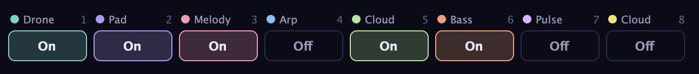

Debajo del orrery hay una llave para cada uno de los ocho carriles, del color del carril, con su rol y su canal MIDI encima. Un clic enciende o apaga el carril. Un carril que se apaga suelta sus notas en el acto.

### Shape

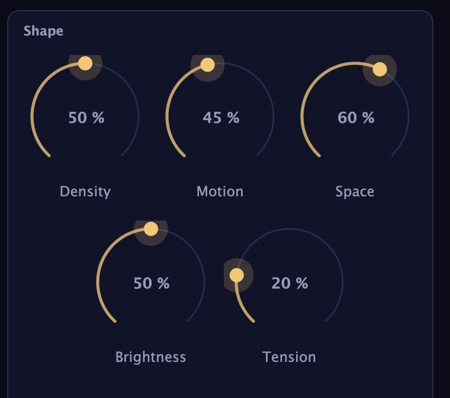

El panel **Shape** tiene cinco perillas que actúan sobre todos los carriles a la vez. Son las mismas que las cinco primeras de la página Harmony & session.

| Perilla | Rango | Qué hace |
|---|---|---|
| Density | 0 a 100 % | Cuántas notas: multiplica la densidad de cada carril por 0,5 a 2 |
| Motion | 0 a 100 % | Qué tan rápido cambian acordes y lazos |
| Space | 0 a 100 % | Notas más largas, más aire, ecos más largos |
| Brightness | 0 a 100 % | Registro y velocity |
| Tension | 0 a 100 % | De consonante a acordes suspendidos, clusters y tritonos |

En 50 %, **Density** deja cada carril como está. **Motion** además hace que las notas de los lazos muten más seguido, les da más saltos a las melodías y acelera las curvas de controlador Drift; en 100 % los acordes duran la mitad de Chord length, en 0 % el doble. **Space** estira el largo de las notas y el tiempo de los ecos de 0,5 a 2 veces y alarga los silencios entre frases. **Brightness** sube o baja todos los carriles hasta siete semitonos y hace las notas más suaves o más fuertes.

**Tension** suma color: arriba de 25 % los acordes pueden volverse sus2 o sus4, arriba de 55 % se les puede sumar un cluster de segunda menor, arriba de 75 % un tritono. Debajo de 50 % la caminata lenta evita los acordes disminuidos. Arriba de 55 % el nombre del acorde en el sol lleva un asterisco.

### Tonalidad y sesión

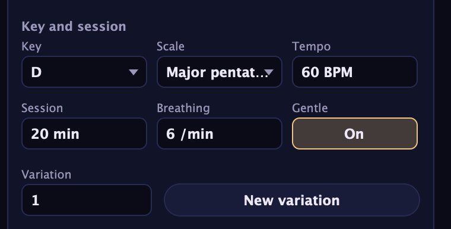

- **Key**: la tónica, de C a B.
- **Scale**: una de 16 escalas (la lista está en la página Harmony & session).
- **Tempo**: 20 a 140 BPM. Vale cuando el reloj está en Free o cuando el host está frenado.
- **Session**: cuánto toca Orrery, con fades, antes de frenar. `Endless` no frena nunca.
- **Breathing**: un ritmo de respiración en respiraciones por minuto, u Off.
- **Gentle**: pone tope a las notas fuertes, las agudas y los saltos.

Debajo, **Variation** es el número del que salen todas las elecciones al azar, y **New variation** elige un número nuevo al azar entre 1 y 9999. Ver Lazos y variaciones.

## Cómo hace música Orrery

Todo arranca de la armonía compartida. Orrery arma los acordes apilando terceras sobre los grados de la escala, así que cada acorde pertenece a la tonalidad. Un acorde dura **Chord length** pulsos (ajustado por Motion) y después se elige el siguiente, casi siempre a una cuarta, una quinta o una tercera. Cada nota de cada carril sale del acorde actual o de la escala, salvo que Tension sume clusters y tritonos a propósito.

Cada carril toca esa armonía de la manera que marca su **rol**. Cada rol tiene su registro propio: el bajo más abajo, después el drone, el pad y el pulso en el medio, la melodía, el arpegio, y la nube más arriba. Octave, Range y Brightness lo mueven desde ahí.

### Drone

Sostiene la raíz del acorde en el grave hasta el acorde siguiente. Con la densidad del carril arriba de 35 % suma la quinta, y arriba de 70 % la octava. Vuelve a atacar en cada cambio de acorde y, en acordes largos, cada Loop length pulsos (como mínimo cada 8). A los drones dales un sinte de ataque lento y release largo.

### Pad

Toca el acorde con la cantidad de notas que marca **Voices** (más con densidad alta, menos con densidad baja) y lleva cada voz a la nota más cercana del acorde siguiente, así los pads se deslizan de un acorde al otro en vez de saltar. Las notas arrancan un poco separadas, como un rasgueo lento; Length abre esa separación. Los pads sostienen hasta que cambia el acorde.

### Melody

Toca frases de tres a nueve notas, caminando la escala casi siempre por grado conjunto con algún salto, y después descansa. Más densidad da frases más largas, notas más rápidas y silencios más cortos; Space alarga los silencios; Motion hace más probables los saltos. Las notas largas caen en notas del acorde cuando Follow está en Chord. Con la respiración encendida, cada frase empieza al exhalar.

### Arp

Un arpegio que avanza al **Rate** del carril por las notas que permite Follow dentro del rango del carril, en el orden que marca **Arp pattern**. Qué pasos suenan lo decide el ritmo euclidiano, o el azar cuando Euclid pulses está en 0. El primer paso de cada patrón lleva un acento leve.

### Cloud

Notas sueltas desparramadas en momentos y alturas al azar, como gotas de cristal. Con densidad baja llega una nota cada 16 pulsos más o menos, con densidad máxima casi una por pulso. En las nubes los ecos lucen: dos o tres ecos con un Echo time largo convierten unas pocas notas en un campo que brilla.

### Bass

Toca la raíz del acorde en el grave en cada cambio de acorde y la sostiene. Con la densidad del carril arriba de 50 %, los acordes largos se parten en dos notas, y la segunda a veces es la quinta.

### Pulse

Una sola nota repetida, la raíz o la quinta más cercana al medio de su rango, tocada con el mismo motor rítmico que el arpegio (Rate, Euclid steps, pulses y rotate). Grave y lento es un latido; más agudo y rápido, un tic suave para música de concentración.

## La página Lanes

La página Lanes tiene una columna por carril y una fila por ajuste: 29 ajustes para cada uno de los 8 carriles. El encabezado de cada columna muestra el número de carril en su color. Un clic en una órbita de la página Simple abre esta página con ese carril resaltado.

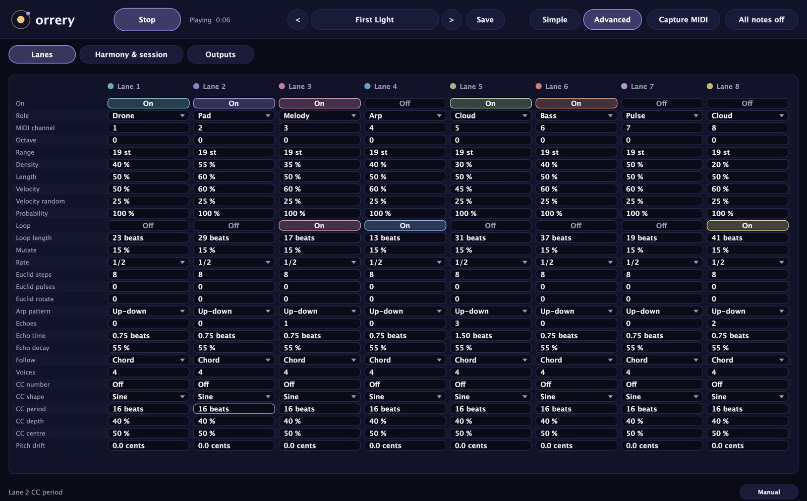

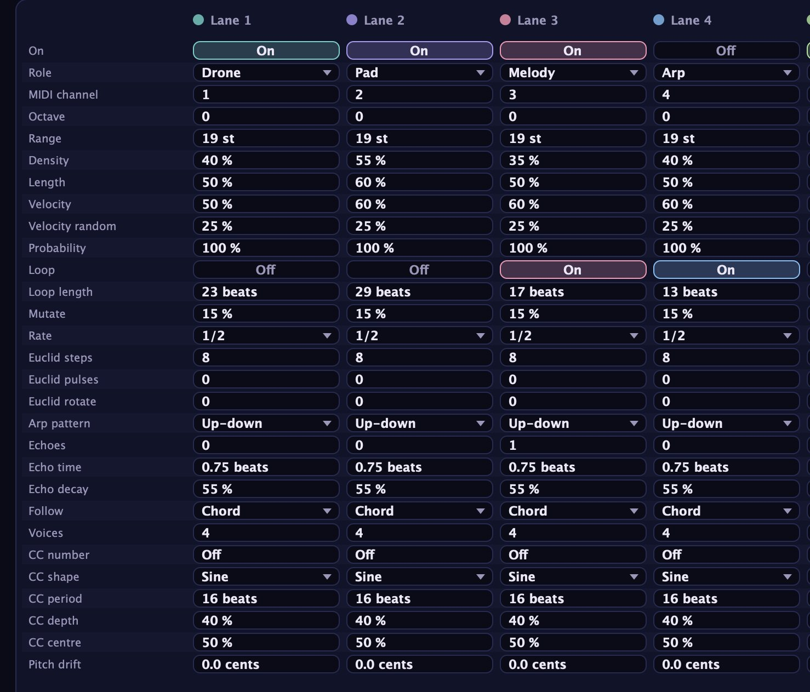

Algunos ajustes valen sólo para algunos roles: Rate y las filas Euclid para Arp y Pulse, Arp pattern para Arp, Voices para Pad. **Follow** elige las notas de Melody, Arp y Cloud, y de cualquier carril mientras reproduce un lazo; Drone, Bass y Pulse usan siempre la raíz (y la quinta), y Pad usa siempre el acorde.

### Rol, canal y registro

| Ajuste | Rango | Por defecto |
|---|---|---|
| On | Off, On | carriles 1, 2, 3, 5 y 6 encendidos |
| Role | Drone, Pad, Melody, Arp, Cloud, Bass, Pulse | según el carril |
| MIDI channel | 1 a 16 | el número del carril |
| Octave | -3 a +3 | 0 |
| Range | 4 a 48 semitonos | 19 |

**MIDI channel** decide qué sinte escucha el carril. Dos carriles en un mismo canal comparten sus notas y sus controladores: la misma nota tocada por los dos se corta, y la deriva o la curva de controlador de uno mueve también al otro.

**Octave** mueve el registro propio del carril por octavas. **Range** es cuánto se pueden abrir las notas alrededor, en semitonos: angosto para una voz concentrada, ancho para arpegios y nubes que cubren varias octavas.

### Notas

| Ajuste | Rango | Por defecto |
|---|---|---|
| Density | 0 a 100 % | según el carril |
| Length | 0 a 100 % | 50 % |
| Velocity | 0 a 100 % | 60 % |
| Velocity random | 0 a 100 % | 25 % |
| Probability | 0 a 100 % | 100 % |

**Density** es cuánto toca el carril, de la manera que marca su rol; la perilla global Density la multiplica. **Length** es el largo de las notas, también escalado por Space. **Velocity** marca qué tan fuerte toca el carril y **Velocity random** cuánto varía cada nota alrededor de eso. **Probability** es la chance de que suene cada nota: en 70 % quedan afuera unas tres notas de cada diez, y el patrón respira sin cambiar su ritmo.

### Lazo

| Ajuste | Rango | Por defecto |
|---|---|---|
| Loop | Off, On | encendido en los carriles 3, 4 y 8 |
| Loop length | 2 a 128 pulsos | un primo distinto por carril, de 13 a 41 |
| Mutate | 0 a 100 % | 15 % |

Con **Loop** encendido, el carril graba sus primeros **Loop length** pulsos y los repite. **Mutate** es la chance de que una nota del lazo cambie en cada vuelta: pasa a una nota cercana, baja a la mitad de su velocity o se corre un poco en el tiempo, y el cambio queda. Ver Lazos y variaciones.

### Ritmo

| Ajuste | Rango | Por defecto |
|---|---|---|
| Rate | 2, 1, 1/2, 1/4, 1/8 pulsos | 1/2 |
| Euclid steps | 1 a 32 | 8 |
| Euclid pulses | 0 a 32 | 0 |
| Euclid rotate | 0 a 31 | 0 |
| Arp pattern | Up, Down, Up-down, Random | Up-down |

Estas filas actúan en carriles Arp y Pulse. **Rate** es el largo de cada paso en pulsos: 2 pulsos, 1 pulso, medio, un cuarto o un octavo de pulso.

**Euclid steps** es el largo del ciclo rítmico y **Euclid pulses** cuántos de esos pasos suenan, repartidos lo más parejo posible: 3 sobre 8 da el conocido patrón de tres contra ocho, 5 sobre 8 uno que se hamaca. **Euclid rotate** corre el comienzo del patrón. Con pulses en 0 no hay patrón fijo: cada paso suena por azar, más seguido cuanto más densidad.

**Arp pattern** es el orden del arpegio: subiendo, bajando, subiendo y bajando, o al azar.

### Ecos

| Ajuste | Rango | Por defecto |
|---|---|---|
| Echoes | 0 a 8 | 1 en el carril 3, 3 en el 5, 2 en el 8 |
| Echo time | 0,125 a 4 pulsos | 0,75 pulsos |
| Echo decay | 0 a 95 % | 55 % |

Los ecos son repeticiones MIDI: cada nota se vuelve a tocar **Echoes** veces, cada **Echo time** pulsos (estirado por Space), cada repetición más suave según **Echo decay**. Como son notas de verdad, tu sinte las toca con su propio sonido. Las repeticiones que serían muy suaves se descartan.

### Armonía por carril

| Ajuste | Rango | Por defecto |
|---|---|---|
| Follow | Chord, Scale, Root | Chord |
| Voices | 1 a 8 | 4 |

**Follow** elige qué notas puede usar un carril: sólo las del acorde actual, cualquier nota de la escala, o apenas la raíz y la quinta. Chord es lo más tranquilo, Scale deja pasar notas de paso, Root sirve para un arpegio tipo tanpura. **Voices** es la cantidad de notas de cada acorde del pad.

### Curva de controlador y deriva

| Ajuste | Rango | Por defecto |
|---|---|---|
| CC number | Off, CC 0 a CC 119 | Off |
| CC shape | Sine, Drift, Breath, Swell | Sine |
| CC period | 1 a 128 pulsos | 16 pulsos |
| CC depth | 0 a 100 % | 40 % |
| CC centre | 0 a 100 % | 50 % |
| Pitch drift | 0 a 50 cents | 0 |

Cada carril puede dibujar una curva lenta en un controlador MIDI de su canal. Elegí el controlador con **CC number**: el 74 suele ser el corte del filtro, el 1 la rueda de modulación, el 11 la expresión, el 2 el soplo. Los controladores 120 a 127 son mensajes de modo de canal y no se ofrecen.

**CC shape** elige la curva:

- **Sine**: una onda suave que se repite cada **CC period** pulsos.
- **Drift**: un vagar lento al azar, más rápido con más Motion.
- **Breath**: sigue el ritmo de respiración (sube al inhalar y baja al exhalar). Con Breathing apagado queda en el centro.
- **Swell**: crece mientras el carril toca notas y baja en los silencios.

**CC centre** es el valor del medio y **CC depth** cuánto se mueve la curva hacia cada lado. La curva se actualiza hasta 30 veces por segundo, y sólo cuando cambia su valor.

**Pitch drift** hace que la afinación del carril vague despacio por pitch bend, hasta los cents que marques, como el oscilador de un sinte analógico viejo. Poné **Synth bend range**, en la página Outputs, en el rango de pitch bend de tu sinte; si no, la deriva va a ser más grande o más chica de lo pensado.

## Lazos y variaciones

### Lazos

Con Loop length en 17, un carril genera 17 pulsos de música y después vuelve a tocar esas notas cada 17 pulsos. Cada nota repetida se ajusta al acorde actual, así que cuando la armonía se mueve el lazo se mueve con ella, sin perder su forma.

Los lazos de largos distintos son el corazón de la técnica de Eno. Dos lazos de 17 y 23 pulsos recién vuelven a arrancar juntos a los 391 pulsos; sumale un tercero de 29 y el patrón completo tarda más de once mil pulsos en repetirse. Los números primos (11, 13, 17, 19, 23, 29, 31, 37, 41) mantienen a los carriles desfasados el mayor tiempo.

Mutate evita que un lazo se vuelva mecánico. En 5 % casi no cambia en toda una pieza larga; en 30 % se renueva cada pocas vueltas. Si encendés Loop mientras Orrery toca, el carril empieza a grabar en ese momento. Si un carril no toca nada durante su primer ciclo, simplemente vuelve a grabar.

### Variaciones

El número de **Variation** (1 a 9999) es la semilla de todas las elecciones al azar: acordes, notas, ritmos, mutaciones, la deriva de los controladores y el tiempo humanizado. Cada vez que Orrery arranca, arranca desde ese número, así que la misma variación con los mismos ajustes toca siempre las mismas notas, en macOS y en Windows, con cualquier tamaño de buffer y frecuencia de muestreo. Con Clock en Host, arrancar el transporte del DAW es uno de esos arranques: desde la misma posición de la canción salen las mismas notas al reproducir y en un render offline, toque lo que haya tocado Orrery antes con el transporte frenado. Si cambiás ajustes mientras toca, la música cambia desde ahí.

Cuando una variación te suena bien, anotá el número o guardá un preset; para algo nuevo con el mismo carácter, apretá **New variation**.

## La página Harmony & session

Esta página tiene todos los ajustes globales: las cinco perillas de Shape más el color de acorde, la armonía y el tiempo, y la sesión.

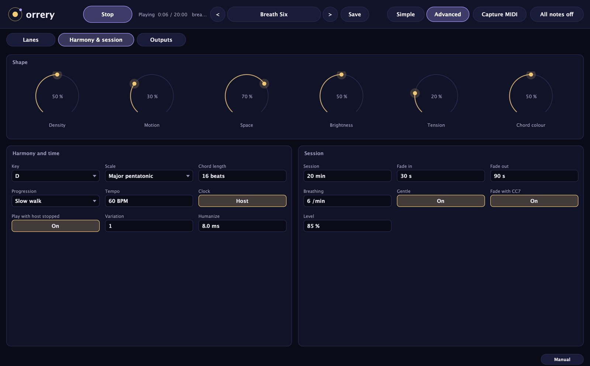

### Shape

Las cinco primeras perillas son Density, Motion, Space, Brightness y Tension, las mismas de la página Simple. La sexta es **Chord colour** (0 a 100 %, por defecto 50 %): tríadas simples en 0 %, séptimas arriba de 30 %, novenas arriba de 55 % y oncenas arriba de 85 %. En las escalas de cinco notas, como las pentatónicas, los acordes se arman con la propia escala en cuartas y quintas, y Chord colour suma más notas de la escala arriba de 40 % y de 75 %.

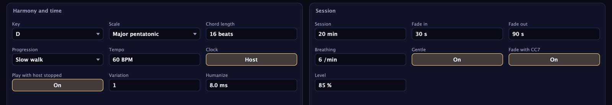

### Armonía y tiempo

| Ajuste | Rango | Por defecto |
|---|---|---|
| Key | C a B | D |
| Scale | 16 escalas | Dorian |
| Chord length | 2 a 64 pulsos | 16 |
| Progression | Slow walk, Drone, Two chords | Slow walk |
| Tempo | 20 a 140 BPM | 60 |
| Clock | Free, Host | Host |
| Play with host stopped | Off, On | On |
| Variation | 1 a 9999 | 1 |
| Humanize | 0 a 30 ms | 8 ms |

Las 16 escalas son Major (Ionian), Natural minor, Dorian, Phrygian, Lydian, Mixolydian, Locrian, Harmonic minor, Phrygian dominant, Double harmonic, Major pentatonic, Minor pentatonic, Hirajoshi, In-sen, Whole tone y Lydian augmented: mayor, menor natural, dórico, frigio, lidio, mixolidio, locrio, menor armónica, frigio dominante, doble armónica, pentatónica mayor y menor, hirajoshi, in-sen, tonos enteros y lidio aumentado.

**Chord length** es cuántos pulsos dura cada acorde con Motion en 50 %. Con la respiración encendida se redondea a un número entero de respiraciones.

**Progression** elige cómo se mueve la armonía:

- **Slow walk**: los acordes se mueven por cuartas, quintas y terceras, a veces por grado, y cada tanto vuelven a la tónica.
- **Drone**: el centro casi no se mueve. La mayoría de los cambios mantiene el mismo acorde; cada tanto va al cuarto o al quinto grado y vuelve.
- **Two chords**: alterna entre la tónica y el acorde del sexto grado (el cuarto grado en las escalas de cinco notas).

**Clock**: en `Host`, Orrery sigue el tempo y la posición del DAW mientras corre el transporte, y su propio Tempo no cuenta. En `Free` usa siempre su propio Tempo. Con Clock en `Host`, arrancar el transporte del DAW es lo mismo que apretar Play, y frenarlo lo mismo que Stop; el botón Play lo muestra. Cada arranque empieza una sesión nueva en esa posición de la canción (en la próxima semicorchea si la posición cae entre dos); un pre-roll o una cuenta previa antes del compás 1 espera al compás 1. **Play with host stopped** decide qué hace Play con el transporte del DAW frenado: On toca al tempo propio de Orrery hasta que arranque el transporte (entonces Orrery vuelve a empezar desde la posición de la canción), Off espera al transporte. Cuando el transporte del DAW salta (movés la posición de reproducción o da la vuelta un loop), Orrery suelta sus notas y sigue desde la posición nueva.

**Humanize** adelanta o atrasa un poco cada nota, al azar, hasta más o menos los milisegundos que marques.

### Sesión

| Ajuste | Rango | Por defecto |
|---|---|---|
| Session | Endless, 1 a 120 min | Endless |
| Fade in | 0 a 120 s | 20 s |
| Fade out | 0 a 300 s | 60 s |
| Breathing | Off, 1 a 12 por minuto | Off |
| Gentle | Off, On | Off |
| Fade with CC7 | Off, On | On |
| Level | 0 a 100 % | 85 % |

Se explican en la sección siguiente. **Level** marca la velocity general de todos los carriles; es un ajuste global que los presets no cambian.

## Sesiones, fades, respiración y modo suave

### Sesiones y fades

**Session** marca cuánto toca Orrery. Cuando se cumple el tiempo, Orrery frena, suelta todas las notas y la línea de estado dice `Session finished`. Con `Endless` toca hasta que la frenes.

**Fade in** sube la música durante los primeros segundos; **Fade out** la baja durante los últimos segundos antes de que termine la sesión (así que Fade out sólo funciona si Session tiene duración). Los fades actúan sobre la velocity: las notas se vuelven más suaves, hasta un tercio de su velocity normal al principio o al final de todo. Con **Fade with CC7** encendido, Orrery además mueve el volumen de canal (MIDI CC7) de cada carril entre 0 y 100, así también se apagan las notas sostenidas y la sesión termina en silencio. Cuando Orrery frena, devuelve el CC7 a 100 y centra el pitch bend en los canales que movió.

El reloj de la sesión cuenta sólo mientras Orrery toca: Stop lo pausa y Play lo retoma. Con Clock en Host, arrancar el transporte del DAW empieza una sesión nueva desde cero; hace fade in sólo cuando el transporte arranca en el comienzo de la canción, así que parar y seguir desde el medio (tocando en vivo) vuelve a nivel pleno. Cargar un preset arranca una sesión nueva desde cero, con su fade in. Cuando una sesión terminó, apretá Stop y después Play para empezar otra.

> Si tu sinte usa el CC7 para otra cosa, o lo ignora, apagá Fade with CC7. Los fades quedan entonces sólo en la velocity.

### Respiración

**Breathing** marca un ritmo lento en respiraciones por minuto (1 a 12; 6 es un ritmo común de respiración lenta). Cada respiración tiene una parte que sube (el primer 40 %, la inhalación) y una que baja (el resto, la exhalación). Con la respiración encendida:

- Los cambios de acorde caen en un número entero de respiraciones.
- Las frases melódicas empiezan al exhalar.
- Pads y drones crecen un poco en velocity con cada respiración.
- Las nubes tocan más notas en lo alto de la respiración.
- Una curva de controlador con forma Breath la sigue.
- El halo alrededor del sol del orrery se abre y se cierra con ella.

El ritmo de respiración es un tiempo musical: una subida y bajada lenta y pareja que podés seguir si querés.

### Modo suave

**Gentle** mantiene todo suave y bajo para escuchar tranquilo y para dormir. Pone tope a la velocity en 92 (de 127), mantiene las notas en el grave y el medio (no más arriba de un E6, la nota MIDI 88), limita la densidad de cada carril a 70 % y Tension a 30 %, y hace raros los saltos melódicos. Lo usan los presets de Sleep, de Meditation y la mayoría de los de Focus.

## La página Outputs

La página Outputs decide adónde van los carriles además del DAW, y tiene las opciones de reloj, vínculo, sonido de prueba y afinación.

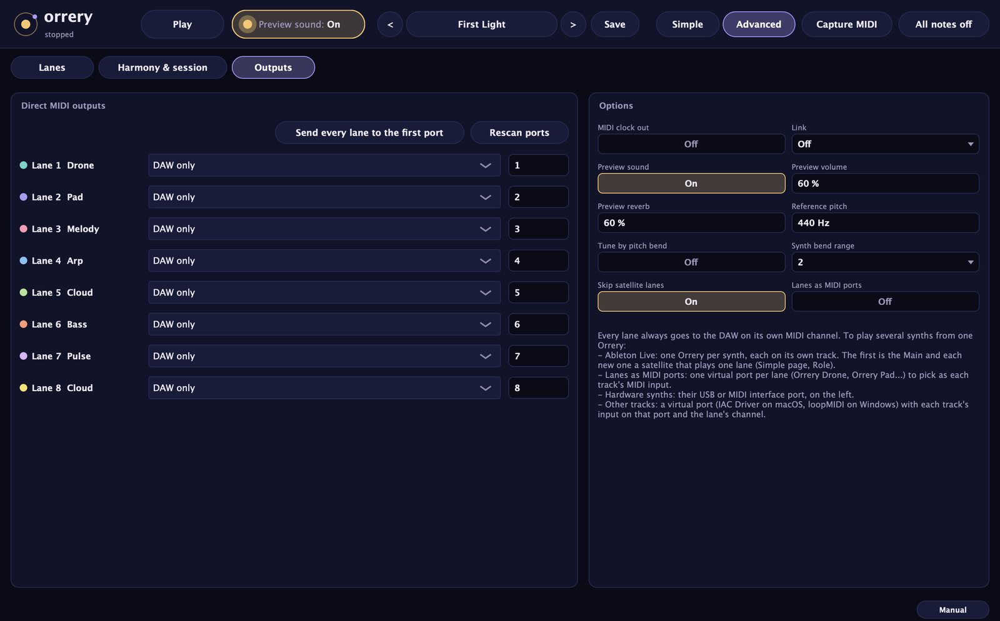

### Salidas MIDI directas

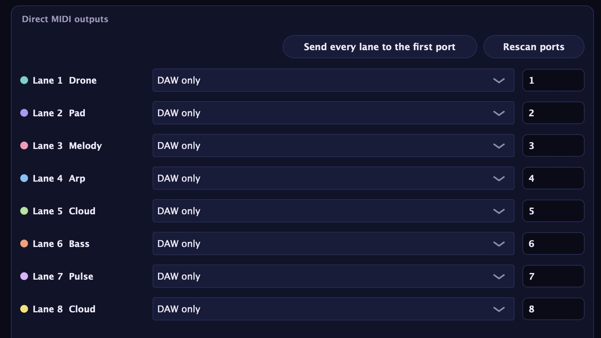

Cada carril llega siempre al DAW por su propio canal. Además, cada carril puede salir directo a un puerto MIDI:

- Sintes físicos: su puerto USB o el puerto de tu interfaz MIDI.
- Otras pistas de tu DAW: un puerto virtual (IAC Driver en macOS, loopMIDI en Windows), con la entrada de cada pista en ese puerto y en el canal del carril.

Cada fila muestra el carril, su rol, un menú de puertos y el **Channel** del carril. `DAW only` quiere decir sin puerto directo. La caja Channel de acá es el mismo ajuste que MIDI channel en la página Lanes.

- **Send every lane to the first port**: copia el puerto del carril 1 a todos los demás. Elegí primero un puerto para el carril 1.
- **Rescan ports**: vuelve a leer la lista de puertos MIDI. Orrery también se da cuenta sola, en pocos segundos, cuando aparece o desaparece un puerto.

Cuando un carril deja un puerto, o se cierra Orrery, el puerto recibe All Notes Off en el canal del carril. Los puertos se guardan con el proyecto del DAW, no con los presets.

### Opciones

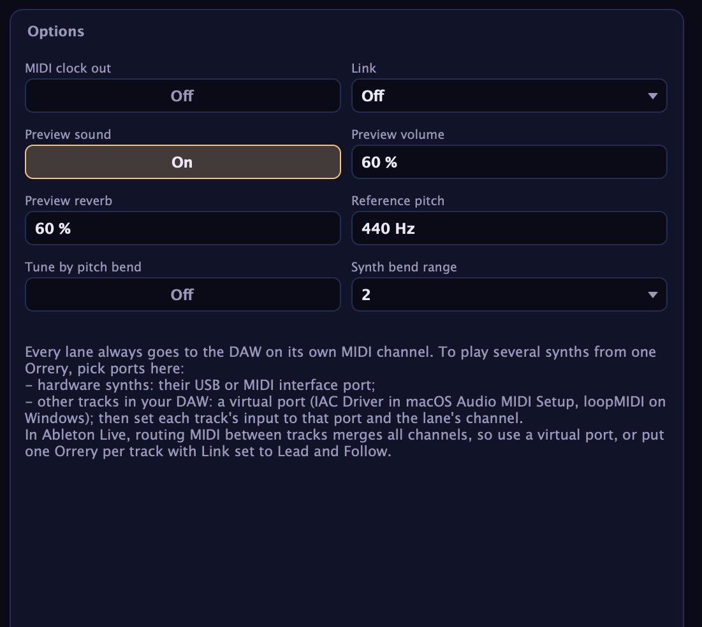

| Ajuste | Rango | Por defecto |
|---|---|---|
| MIDI clock out | Off, On | Off |
| Link | Off, Lead, Follow | Off |
| Preview sound | Off, On | On (Off en un satélite nuevo) |
| Preview volume | 0 a 100 % | 60 % |
| Preview reverb | 0 a 100 % | 60 % |
| Reference pitch | 415 a 466 Hz | 440 Hz |
| Tune by pitch bend | Off, On | Off |
| Synth bend range | 2, 3, 12, 24, 48 semitonos | 2 |
| Skip satellite lanes | Off, On | On |
| Lanes as MIDI ports | Off, On (macOS y Linux) | Off |

**MIDI clock out** manda reloj MIDI (24 pulsos por negra) más Start y Stop a todos los puertos directos en uso, así las cajas de ritmos, secuenciadores, arpegiadores y delays sincronizados de tus equipos siguen a Orrery. El reloj va al tempo del host mientras el host toca y el reloj está en Host, y al Tempo propio de Orrery en los demás casos. No se manda al DAW, y sólo sale cuando por lo menos un carril tiene puerto directo.

**Link** conecta varias Orrery cargadas en el mismo DAW. Funciona en las Orrery Independent; una Main también puede ser Lead, y los satélites lo ignoran. La que está en `Lead` comparte su tonalidad, su escala y sus acordes; las que están en `Follow` tocan sus propios carriles sobre los acordes de la líder, sin tener en cuenta su propia Key, Scale ni sus ajustes de acordes. Usá una sola líder. Una Orrery en Follow sin líder en la sesión toca su propia armonía. Este vínculo es propio de Orrery: funciona entre instancias dentro de la misma aplicación host, y no intercambia tempo con otras aplicaciones.

**Preview sound** es el sinte incorporado, que también prende y apaga el botón al lado de Play: un sonido por rol (un drone oscuro, un pad tibio, una voz de triángulo, una campana FM para los arpegios, una gota de cristal para las nubes, un bajo redondo, un latido suave para los pulsos), cada carril paneado en su lugar, con un delay y una reverb larga. **Preview volume** y **Preview reverb** marcan su nivel y su reverb. Apagalo cuando toquen tus sintes: el MIDI es el mismo de las dos maneras.

**Reference pitch** reafina los carriles lejos de A4 = 440 Hz, por pitch bend, para sintes que no se pueden reafinar solos. Funciona sólo con **Tune by pitch bend** encendido. Poné **Synth bend range** en el rango de pitch bend de tu sinte (los semitonos que mueve un bend completo): Pitch drift también lo usa. Si no coincide, la afinación va a quedar mal.

**Skip satellite lanes** y **Lanes as MIDI ports** son los mismos ajustes que en la página Simple (ver Main y satélites, y Ruteo, puertos y sincronía). En Windows el panel explica que en lugar de Lanes as MIDI ports hace falta un puerto de loopMIDI.

> El pitch bend actúa sobre un canal MIDI entero, así que la afinación y la deriva necesitan cada carril en su propio canal.

## Captura

**Capture MIDI** guarda lo que Orrery acaba de tocar como archivo MIDI. Hacé clic y elegí `Last minute`, `Last 2 minutes`, `Last 5 minutes` o `Last 10 minutes`. El archivo se guarda en una carpeta `Orrery` dentro de tu carpeta de Música, con la fecha y la hora en el nombre, y el pie muestra dónde. Después aparece en el pie un recuadro que dice "Drag ... into your DAW": arrastralo a una pista para usar el pasaje como MIDI común.

El archivo tiene una pista por canal MIDI (o sea, una por carril cuando cada carril tiene su canal) y el tempo al que tocaba Orrery. Tiene las notas con su velocity y su tiempo, fades incluidos. No tiene los ecos, las curvas de controlador, el pitch bend ni los fades de CC7. Orrery guarda las últimas 8192 notas, así que un preset muy cargado puede dar menos de diez minutos. Si todavía no sonó nada, el pie dice "Nothing to capture yet: press Play first".

## Presets y climas

Orrery trae 21 presets de fábrica, tres por clima. Los presets cambian los ajustes musicales: armonía, sesión y todos los carriles. No cambian Play, Clock, Play with host stopped, Level, los ajustes del sonido de prueba, los de afinación, MIDI clock out, Link, el rol, los carriles del satélite, Skip satellite lanes, Lanes as MIDI ports ni los puertos directos, así que cambiar de preset nunca rompe tu ruteo. Los carriles que un preset no usa quedan apagados.

Una Orrery nueva arranca con el primer preset, First Light (lo que los hosts muestran como su primer programa): drone, pad, melodía en lazo, nube con ecos y bajo, en D dórico.

Ableton Live no muestra los presets de fábrica de los plugins (ignora las listas de programas de VST3); usá el menú de presets de Orrery, o el navegador: los presets de fábrica aparecen en el navegador de Live en Plug-Ins → Audio Tools Orrery (desplegá el plugin), instalados por el launcher o copiando la carpeta Presets del zip.

| Preset | Clima | Tonalidad y escala | Qué suena |
|---|---|---|---|
| First Light | Ambient | D dórico | Drone, pad, melodía en lazo, nube con ecos, bajo |
| Tape Loops | Ambient | F lidio | Cinco lazos de 17, 21, 23, 29 y 31 pulsos sobre un pad |
| Slow Tide | Ambient | A pentatónica menor | Pad, arpegio euclidiano en lazo, nube, bajo |
| Undertow | Dark Ambient | C frigio | Drone a la deriva, pad con filtro que vaga, nube, bajo |
| Catacomb | Dark Ambient | D menor armónica | Dos acordes, drone, pad, pulso grave, melodía en lazo |
| Black Lake | Dark Ambient | E frigio dominante | Drone a la deriva, pad en la rueda de modulación, nube con ecos largos |
| Om Field | Drone | C pentatónica mayor | Dos drones y una nube rala |
| Tanpura | Drone | D mayor | Drone, un lazo de arpegio de raíz y quinta, pad suave |
| Monolith | Drone | B locrio | Dos drones graves con deriva de afinación y filtro que vaga |
| Night Garden | Sleep | G pentatónica mayor | Pad, nube, bajo; sesión de 45 min |
| Deep Sleep | Sleep | F mayor | Drone y pad; sesión de 60 min |
| Lullaby Stars | Sleep | C lidio | Melodía en lazo, arpegio ralo, pad; sesión de 30 min |
| Breath Six | Meditation | D pentatónica mayor | Drone, pad con curva de respiración, nube; 6 respiraciones por minuto |
| Slow Breath | Meditation | A dórico | Pad con curva de respiración, melodía, bajo; 4 respiraciones por minuto |
| Singing Bowls | Meditation | D pentatónica mayor | Dos nubes con ecos largos sobre un drone |
| Deep Work | Focus | E menor natural | Pad, pulso parejo, bajo |
| Study Rain | Focus | Bb mayor | Dos nubes de notas cortas sobre un pad |
| Flow State | Focus | G mixolidio | Arpegio euclidiano en lazo, bajo, pad |
| Orbiting | Celestial | E lidio | Arpegio con ecos, nube, pad agudo, bajo |
| Aurora | Celestial | Ab lidio aumentado | Pad de cinco voces con onda de filtro, nube, melodía en lazo |
| Starfield | Celestial | C tonos enteros | Dos nubes agudas, arpegio al azar en lazo, drone |

Todos los presets de Sleep y Meditation usan modo suave, sesiones y fades largos. Deep Work y Study Rain también usan modo suave.

Para guardar uno propio, apretá **Save**, escribí un nombre y confirmá. Los presets de usuario aparecen bajo User en el menú de presets, y las flechas los recorren después de los de fábrica. Son archivos en `~/Library/Application Support/Audio Tools/Orrery/Presets` en macOS y en `Audio Tools\Orrery\Presets` dentro de tu carpeta AppData\Roaming en Windows. Guardar con un nombre que ya existe reemplaza ese preset. Para borrar uno, borrá su archivo; desaparece la próxima vez que se abra Orrery.

### En REAPER

REAPER muestra cada preset de fábrica dos veces en el menú de presets: una de la lista propia del plugin y otra como archivo (los .vstpreset que instalan el launcher o la carpeta Presets del zip para Ableton Live, en ~/Library/Audio/Presets/Audio Tools/ en macOS, Documentos\VST3 Presets\Audio Tools\ en Windows y ~/.vst3/presets/Audio Tools/ en Linux). Los dos cargan lo mismo. Si no usás Live, podés borrar ahí la carpeta "Audio Tools Orrery" y cada preset aparece una sola vez.

## Main y satélites

En Ableton Live una pista de sinte que toma su MIDI de otra pista recibe todos sus canales MIDI, así que una sola pista de Orrery mandaría todos los carriles a todos los sintes. Main y satélites lo resuelven dentro de Orrery: una Orrery, la **Main**, tiene la música; cada otra Orrery del set es un **satélite** que toca exactamente un carril de la Main (o unos pocos) en su propia pista. Cada sinte toma entonces su MIDI de un satélite.

| Rol | Qué hace |
|---|---|
| Auto | El de toda Orrery nueva. La primera Orrery de la aplicación host se vuelve Main; cada Orrery agregada después se vuelve un satélite que toma el próximo carril de la Main que esté encendido y que no toque otro satélite. |
| Independent | Orrery como era hasta 1.0.4: toca todos sus carriles, y Link (Off, Lead, Follow) funciona como antes. |
| Main | Toca como Independent, publica todo lo que hace para sus satélites y puede ser líder de Link. |
| Satellite | Toca sólo los carriles de la Main que le tocaron. Sus propios ajustes no se usan. |

Lo que eligió Auto se guarda con el proyecto: al abrir el set otra vez la Main sigue siendo la Main y cada satélite toca el mismo carril, en el orden que el host las cargue. Los proyectos guardados con Orrery 1.0.4 o anterior no tienen rol: abren como Independent, con el Link que tenían, y suenan como antes. Los presets nunca cambian el rol, los carriles del satélite, Skip satellite lanes ni los puertos MIDI.

Una copia de una Orrery no hereda su rol: cuando duplicás una pista en Live (o copiás la pista o el efecto en REAPER), la copia se vuelve un satélite en el próximo carril libre, como una Orrery nueva, aunque la original fuera la Main. La copia de una Orrery Independent sigue siendo Independent.

### La página del satélite

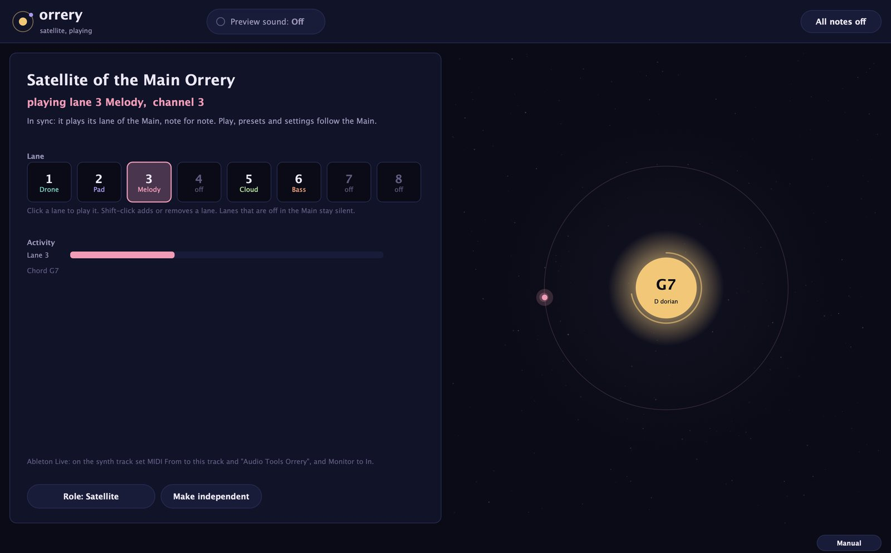

Un satélite muestra una sola página en lugar del editor completo:

- **Satellite of** y el nombre de la pista de la Main (cuando el host les dice a los plugins el nombre de su pista), y qué carril toca, con el rol y el canal MIDI del carril. Ableton Live les dice a los plugins el nombre de una pista sólo cuando la renombrás: hasta entonces el satélite dice `Satellite of the Main Orrery` y la Main nombra a sus satélites por carril (`1 Drone, 2 Pad`). Renombrá las pistas para ver sus nombres.
- El estado: en sincronía con la Main, sincronizando, o esperando una Main.
- **Lane**: los ocho carriles de la Main con sus roles. Un clic en uno lo toca en lugar del actual; Shift-clic (o Cmd-clic) agrega o quita un carril, así un satélite puede tocar varios. Un carril apagado en la Main muestra `off` y queda en silencio.
- **Activity**: cuánto toca cada uno de sus carriles, y el acorde actual de la Main. El orrery de la derecha muestra sólo sus carriles.
- **Role**: el mismo menú que en la página Simple.
- **Make independent**: convierte el satélite en una Orrery Independent con los ajustes actuales de la Main y sólo sus carriles encendidos, para editar todo desde ahí.
- **Make this the Main** aparece en su lugar cuando no hay ninguna Main tocando en el set.

Un satélite sigue a la Main en todo: Play y Stop, el transporte, climas y presets, cada ajuste, el número de variación y el reloj de la sesión. Su Preview sound arranca apagado, porque lo que tiene que sonar es su sinte; se puede prender con el botón de la barra superior. All notes off en un satélite resetea sólo los canales de sus carriles.

### Skip satellite lanes

Una Main sigue mandando su MIDI a su propia pista. Con **Skip satellite lanes** encendido (viene así), los carriles que tocan los satélites quedan afuera, así un sinte alimentado desde la pista de la Main no los toca por segunda vez. El sonido de prueba de la Main también los deja afuera. Un satélite que deja de procesarse por más de un segundo y medio (borrado, desactivado) le devuelve su carril a la Main.

### Cómo se mantienen juntas

Un satélite no recibe notas de la Main. Corre su propia copia del generador de Orrery con todo el estado musical de la Main, y como el generador es determinista produce las mismas notas, velocidades, controladores y pitch bend, en la misma muestra, que la Main para ese carril. Para eso:

- Cada Orrery lee el transporte del host (si toca, la posición, el tempo) por su cuenta: en un ciclo de proceso todas las pistas ven el mismo.
- La Main aplica los cambios de ajustes, Play, Stop, los presets nuevos y All notes off un buffer de audio después de leerlos, y los publica para ese buffer. Cuando un satélite procesa un buffer, la Main ya terminó el anterior, sea cual sea la pista que el host procesa primero y en el núcleo que sea, así que el satélite siempre sabe qué vale.
- Cuando un satélite se suma, copia el estado de la Main en un borde de buffer y averigua, una sola vez, qué buffer suyo es qué buffer de la Main. Usa la posición del transporte del host cuando el transporte corre; si no, la hora que el host le da a cada ciclo de proceso (system time de VST3, host time de Audio Unit), o el reloj de la computadora. Desde ahí las dos cuentan buffers y muestras a la par.
- En cada buffer la Main publica una huella de todo lo que generó, y cada satélite compara la suya. Si alguna vez difieren, o la Main deja de procesarse, el satélite suelta sus notas, vuelve a copiar el estado de la Main y ataca las notas de sus carriles que estén sonando en ese momento.

Se midió con una Main y varios satélites, con buffers de 64 a 1024 muestras, en órdenes de proceso al azar y con cada Orrery en su propio hilo: cada satélite tocó exactamente los mensajes de la Main para su carril.

A tener en cuenta:

- Usá una sola Main por set. Con dos, los satélites siguen a la que se volvió Main primero, y la otra lo avisa.
- Los satélites y su Main tienen que estar en la misma aplicación host. No se conectan entre aplicaciones ni entre computadoras.
- Un satélite toca sólo mientras su Main se procesa. Poner la Main en bypass o desactivarla calla a sus satélites, que sueltan sus notas y siguen cuando la Main vuelve.
- Los cambios de ajustes en una Main se aplican un buffer más tarde que en una Orrery Independent (unos 10 ms con 512 muestras).
- En REAPER con el proceso anticipado de efectos (anticipative FX, lo normal), las pistas no se procesan a la par: una puede ir varios buffers adelante de otra, sobre todo en un render offline. Con el transporte en marcha, un satélite se ubica por la posición de la canción, no por el orden en que se procesan las pistas: copia el estado de la Main y se pone al día hasta su propia posición, y cuando va adelante de la Main supone que los ajustes de la Main siguen igual y lo comprueba cuando la Main llega. Un ajuste cambiado justo en ese momento lo hace resincronizar. Nunca manda notas de largo cero.
- Con el transporte del host frenado, en un host que no les da a los plugins la hora de cada ciclo, y si el host procesa siempre la pista de un satélite más de medio buffer después que la de la Main, un satélite puede quedar a un buffer de la Main. Arrancar el transporte, o usar Clock en Host con el transporte en marcha, lo deja exacto.

## Ruteo, puertos y sincronía

### Una Orrery, muchos sintes en Ableton Live

Live junta los canales MIDI entre pistas y no saca el MIDI de los plugins Audio Unit, así que usá el VST3. La forma más rápida de darle a cada sinte su propio carril es Main y satélites:

1. Poné Orrery en una pista MIDI vacía y elegí un clima. Esta primera Orrery es la **Main**.
2. Por cada sinte, agregá otra pista MIDI y poné Orrery en ella. Cada Orrery nueva se vuelve un **satélite** y toma el próximo carril de la Main: el carril 1 (Drone), después el 2 (Pad), y así. Su página dice `Satellite of ...` y qué carril toca; ahí podés hacer clic en otro carril para cambiarlo.
3. Poné cada sinte en su propia pista MIDI. En la sección de entrada y salida de la pista del sinte elegí en **MIDI From** la pista del satélite, en el selector de abajo `Audio Tools Orrery`, y poné **Monitor** en `In`.
4. En la Main, hacé clic en **Preview sound** en la barra superior hasta que diga `Preview sound: Off` cuando toquen tus sintes. Los satélites arrancan con el sonido de prueba apagado.
5. Apretá Play en la Main, o arrancá el transporte de Live (con Clock en Host). Los satélites la siguen.

La pista de la Main sigue llevando los carriles que no toca ningún satélite, así que un sinte alimentado desde la pista de la Main (como en el paso 3) toca el resto. Skip satellite lanes evita que duplique los carriles de los satélites.

### Los carriles como puertos MIDI (macOS y Linux)

En lugar de satélites, una Orrery puede publicar cada carril como un puerto MIDI propio:

1. En la página Simple, encendé **Publish lanes as MIDI ports**. Orrery crea un puerto MIDI virtual por carril, con el nombre de su rol: `Orrery Drone`, `Orrery Pad`, `Orrery Melody`... Si dos carriles tienen el mismo rol se agrega el número de carril (`Orrery Cloud 5`, `Orrery Cloud 8`); una segunda Orrery que también publica usa `Orrery 2 Drone`, etcétera.
2. Una sola vez: en Settings de Live, pestaña Link, Tempo & MIDI, encendé **Track** en la entrada de cada puerto `Orrery` que vayas a usar.
3. En cada pista de sinte, elegí en **MIDI From** un puerto, por ejemplo `Orrery Pad`, con `All Channels`, y poné **Monitor** en `In`.

Los nombres se fijan al encender la opción: después de cambiar los roles de los carriles, apagala y encendela para renombrar los puertos. Los puertos desaparecen al sacar esa Orrery o cerrar el set, y cada uno recibe All Notes Off antes de cerrarse. Windows no tiene puertos MIDI virtuales propios, así que la opción no aparece ahí: usá loopMIDI con las salidas directas, como se explica abajo.

### Ableton Live, otras maneras

Estas configuraciones de versiones anteriores siguen funcionando.

Una Orrery, un sinte: seguí los pasos de Cargarla en un DAW. Todos los carriles encendidos llegan a ese sinte, así que apagá los que no quieras.

Una Orrery, varios sintes, por un puerto virtual:

1. Creá un puerto virtual. En macOS, abrí Configuración de Audio MIDI, mostrá el Estudio MIDI, abrí IAC Driver y tildá "El dispositivo está conectado". En Windows, instalá loopMIDI y creá un puerto.
2. En los ajustes de Live, en la pestaña Link, Tempo & MIDI, encendé **Track** como entrada para ese puerto.
3. En la página Outputs de Orrery, elegí el puerto para cada carril (o elegilo para el carril 1 y hacé clic en **Send every lane to the first port**), y revisá el canal de cada carril.
4. En cada pista de sinte, elegí en MIDI From el puerto virtual y el canal del carril que tiene que tocar, y poné el Monitor en `In`.
5. Apagá Preview sound.

El filtro de canal propio de Live en un puerto de entrada mantiene separados los carriles, así que cada sinte escucha sólo el suyo.

Una Orrery por sinte, con Link:

1. Poné una Orrery en su propia pista MIDI por cada sinte, y en cada pista de sinte elegí en MIDI From su pista de Orrery.
2. En la página Outputs de la primera Orrery poné **Link** en `Lead`. En las demás, en `Follow`.
3. En cada Orrery, encendé sólo los carriles que tiene que tocar ese sinte.
4. Apretá Play en cada Orrery (o arrancá el transporte, con Clock en Host).

Las seguidoras tocan sobre los acordes de la líder, así todo el conjunto queda en una misma armonía, y cada sinte escucha sólo su Orrery.

### Sintes físicos

1. Conectá los sintes por USB o a través de una interfaz MIDI.
2. En la página Outputs, elegí el puerto de cada sinte para el carril que lo tiene que tocar, y poné cada sinte a recibir en el canal de ese carril (o poné el Channel del carril en el canal del sinte).
3. Encendé **MIDI clock out** si una caja de ritmos, un arpegiador o un delay de tus equipos tiene que seguir el tempo de Orrery.
4. Si usás Pitch drift o la afinación por pitch bend, poné **Synth bend range** en el rango de bend del sinte.
5. Apagá Preview sound.

Varios carriles pueden ir al mismo puerto por canales distintos, ideal para un sinte multitímbrico o para una cadena de sintes en un mismo cable MIDI. El tráfico es liviano: entre todos los presets de fábrica, Orrery manda como mucho 37 mensajes por segundo en un canal, cuando un cable MIDI de 5 pines lleva unos mil.

### La aplicación independiente

La aplicación independiente toca los puertos directos, con reloj MIDI si lo querés, y el sonido de prueba por tu placa de audio (el botón Options de la ventana abre los ajustes de audio). Sin host no hay transporte, así que Orrery usa siempre su propio Tempo; dejá **Play with host stopped** encendido, o se va a quedar esperando un transporte que nunca llega.

## Recetas

### Un pad para un sinte

1. Cargá Orrery en una pista MIDI y un sinte de pads en otra; ruteá la entrada MIDI del sinte desde Orrery.
2. En la página Simple, apagá todas las llaves menos la del carril 2 (Pad).
3. En la página Lanes, poné Voices del carril 2 en 4 o 5 y Length en 70 %.
4. En la página Harmony & session, poné Chord length en 24 y Chord colour en 60 % para tener novenas.
5. Apagá Preview sound y apretá Play.

Para darle movimiento, poné CC number del carril 2 en 74, CC shape en Sine y CC period en 32 pulsos: el filtro se abre y se cierra despacio.

### Un rack entero de sintes físicos

1. Cargá First Light (Ambient). Usa los carriles 1, 2, 3, 5 y 6 en los canales 1, 2, 3, 5 y 6.
2. En la página Outputs, dale a cada carril el puerto de su sinte: el drone y el bajo a un sinte cada uno, el pad a uno polifónico, la melodía y la nube a un tercero.
3. Poné cada sinte a recibir en el canal de su carril.
4. Encendé MIDI clock out para que los delays sincronizados acompañen.
5. Poné Synth bend range igual que tus sintes y dale al drone de 10 a 15 cents de Pitch drift.
6. Apagá Preview sound y apretá Play.

### Lazos de cinta a lo Eno

1. Cargá Tape Loops (Ambient), o arrancá desde First Light.
2. Poné cuatro o cinco carriles en Melody o Cloud con densidad baja (10 a 20 %) y Loop encendido.
3. Dales largos de lazo primos y bien separados: 17, 23, 29, 31.
4. Dejá Mutate bajo (alrededor de 5 %) para que cada lazo conserve su identidad.
5. Poné Progression en Drone, Chord colour cerca de 30 % y Space cerca de 70 %.
6. Dale a cada carril su propio sonido y mirá los planetas: se separan y casi nunca se encuentran.

### Una sesión para dormir

1. Cargá Deep Sleep o Night Garden (Sleep).
2. Poné Session en la duración que quieras, por ejemplo 45 minutos.
3. Poné Fade in en 60 segundos o más y Fade out en 300 segundos.
4. Fijate que Gentle esté encendido, y dejá Fade with CC7 encendido para que el final sea silencio de verdad.
5. Bajá Level si los sintes todavía están muy presentes.
6. Apretá Play. Cuando se cumple el tiempo, Orrery se apaga sola con un fade y frena.

### Dos Orrery vinculadas

1. En Live, poné la Orrery A en una pista que alimenta un sinte de pads, y la Orrery B en otra pista que alimenta un sonido de campana o de piano.
2. En la página Outputs de A poné Link en Lead; en la de B, en Follow.
3. En A dejá los carriles de drone, pad y bajo; en B, sólo una melodía y una nube.
4. Poné Clock en Host en las dos y arrancá el transporte.

La melodía y la nube de B quedan dentro de los acordes de A, aunque cada sinte tenga su propia pista y su propio canal.

### Un filtro que respira

1. Cargá Breath Six (Meditation), o poné Breathing en 6 en cualquier preset.
2. En un carril de pad, poné CC number en 74 (o el que use tu sinte para el filtro), CC shape en Breath, CC depth en 80 % y CC centre en 50 %.
3. Apretá Play. El filtro se abre cuando sube cada respiración y se cierra cuando baja, los acordes cambian en respiraciones enteras y las melodías empiezan cuando la respiración baja.

### Un fondo de dark ambient

1. Cargá Undertow (Dark Ambient).
2. Bajá Brightness a 15 % y subí Tension a 70 % para tener clusters y tritonos.
3. Poné Octave del drone en -2 y su Pitch drift en 20 cents.
4. Poné Echoes de la nube en 5, Echo time en 2,5 pulsos y Echo decay en 70 %.
5. Subí Space a 85 % para notas largas y silencios largos.

### Guardar un pasaje

1. Cuando Orrery toque algo que te guste, hacé clic en Capture MIDI y elegí cuánto para atrás.
2. Arrastrá el archivo desde el pie a una pista MIDI de tu DAW.
3. Cada canal MIDI llega en su propia pista, listo para editar, cambiar de sonido o arreglar.

Anotá también el número de Variation: con los mismos ajustes, Orrery va a volver a tocar lo mismo desde el principio.

## Problemas y soluciones

**No suena nada.** Orrery hace MIDI, no audio. Ruteala a un instrumento (ver Cargarla en un DAW) o hacé clic en **Preview sound** en la barra superior hasta que diga `Preview sound: On`, con Preview volume arriba en la página Outputs.

**Escucho un sonido, pero no es mi sinte.** Es el sonido de prueba de Orrery: el botón al lado de Play dice `Preview sound: On` y la línea de arriba del orrery dice "You're hearing Orrery's preview sound". Hacé clic en el botón para apagarlo.

**No pasa nada cuando aprieto Play en el DAW.** Orrery tiene su propio botón Play: apretalo en la barra superior. El botón dice Stop cuando Orrery está tocando.

**Orrery queda en silencio con el DAW frenado.** Con Clock en Host, Orrery espera al transporte si Play with host stopped está en Off. Arrancá el transporte, o encendé Play with host stopped.

**Al principio suena muy bajo.** Es el fade in (20 segundos por defecto, más en los presets de dormir). Poné Fade in en 0 si querés nivel pleno de entrada.

**La línea de estado dice Session finished.** Se cumplió el tiempo de la sesión. Apretá Stop y después Play para empezar otra, o poné Session en Endless.

**El ajuste Tempo no hace nada.** Con Clock en Host y el DAW tocando, Orrery sigue el tempo del DAW. Poné Clock en Free para usar el Tempo de Orrery.

**En Ableton Live cada sinte toca todos los carriles.** Live junta los canales entre pistas. Alimentá cada sinte desde un satélite (ver Una Orrery, muchos sintes en Ableton Live), usá Lanes as MIDI ports o un puerto virtual, o una Orrery por pista con Link.

**Una Orrery nueva muestra "Satellite" y la quería aparte.** Con el rol en Auto, toda Orrery después de la primera se vuelve satélite. Elegí `Independent` en su botón Role, o hacé clic en Make independent para quedarte con los ajustes de la Main.

**Un satélite dice "Waiting for a Main Orrery".** No hay una Main en esta aplicación host, o no se está procesando (borrada, desactivada o en bypass). Agregá una, poné el Role de una Orrery en Main, o hacé clic en Make this the Main.

**Un satélite no toca nada.** Su carril está apagado en la Main, o la Main está frenada. Encendé el carril en la Main, elegí otro carril en la página del satélite, o apretá Play en la Main.

**Un carril suena dos veces.** Un sinte lo recibe de un satélite y de la pista de la Main. Encendé Skip satellite lanes en la Main.

**Los puertos de Orrery no aparecen en Live.** Primero encendé Publish lanes as MIDI ports; después, en Settings de Live, Link, Tempo & MIDI, encendé Track en las entradas `Orrery`. En Windows no hay puertos virtuales: usá loopMIDI.

**En Ableton Live (o REAPER) no llega MIDI a las otras pistas.** Estás usando el Audio Unit. Cargá el VST3.

**Orrery arranca cuando aprieto Play en el DAW.** Con Clock en Host, arrancar el transporte es Play y frenarlo es Stop. Poné Clock en Free si Orrery tiene que ignorar el transporte.

**Una pista duplicada toca dos veces el mismo carril.** Eso pasaba con Orrery 1.0.5. Desde 1.0.6 una copia se vuelve un satélite en el próximo carril libre; si un set guardado con 1.0.5 tiene dos satélites en un carril, hacé clic en otro carril en uno de ellos.

**Un puerto no aparece en la lista.** Hacé clic en Rescan ports. En macOS, fijate que IAC Driver tenga tildado "El dispositivo está conectado"; en Windows, que loopMIDI esté abierto.

**Un sinte queda desafinado.** Pitch drift o Tune by pitch bend están encendidos y Synth bend range no coincide con el sinte. Ponelo en el rango de bend del sinte, o apagá la deriva y la afinación.

**El volumen de mi sinte queda bajo.** Fade with CC7 mueve el volumen de canal. Orrery lo devuelve a 100 cuando frena; si tu sinte usa el CC7 de otra manera, apagá Fade with CC7.

**Quedan notas colgadas.** Hacé clic en All notes off. Manda note-off y resetea los 16 canales, en el DAW y en los puertos directos.

**Cambio un ajuste de carril y no pasa nada.** Algunos ajustes valen sólo para algunos roles: Rate y las filas Euclid para Arp y Pulse, Arp pattern para Arp, Voices para Pad, Follow para Melody, Arp y Cloud. Revisá el rol del carril.

**Una Orrery en Follow no sigue a nadie.** Tiene que haber una Orrery en Lead en la misma aplicación host, y tiene que estar tocando. Follow funciona sólo en las Orrery Independent.

## Especificaciones

| Ítem | Valor |
|---|---|
| Formatos | VST3, Audio Unit (macOS), aplicación independiente |
| Sistemas | macOS 11 o posterior (universal), Windows 10 u 11 (64 bits) |
| Carriles | 8, cada uno con su canal MIDI y su rol |
| Roles | Drone, pad, melodía, arpegio, nube, bajo, pulso |
| Armonía | 16 escalas y modos, de tríadas a oncenas, tensión, tres progresiones |
| Tempo | 20 a 140 BPM, o el del host |
| Lazos | 2 a 128 pulsos por carril, con mutación |
| Ritmo | Patrones euclidianos, probabilidad, valores de 2 pulsos a 1/8, humanizado hasta 30 ms |
| Expresión | Hasta 8 ecos MIDI, una curva de CC por carril, deriva de afinación hasta 50 cents |
| Sesión | Hasta 120 min, fade in hasta 120 s, fade out hasta 300 s, respiración de 1 a 12 por minuto, modo suave |
| Salidas | MIDI al DAW por canal, un puerto MIDI directo por carril, reloj MIDI, vínculo Lead y Follow, Main y satélites, un puerto MIDI virtual por carril (macOS, Linux), sonido de prueba |
| Afinación | Referencia de 415 a 466 Hz por pitch bend |
| Captura | Los últimos 1, 2, 5 o 10 minutos a un archivo MIDI |
| Presets | 21 en siete climas, más los tuyos |
| Salida de audio | Estéreo o mono (sólo el sonido de prueba) |

Medido sobre el motor:

| Prueba | Resultado |
|---|---|
| Diez minutos de siete carriles con Tension en 0 | Ninguna nota fuera de la escala, ninguna nota colgada al parar |
| Tráfico MIDI, los 21 presets, 5 minutos cada uno | Como mucho 37 mensajes por segundo en un canal |
| Lazo de 17 pulsos | 84 de 84 notas se repiten 17 s después |
| Modo suave | Velocity como mucho 92, nota más aguda 86 |
| Seguidora del vínculo | 56 notas, ninguna fuera del acorde de la líder |
| Misma variación | Mismas notas en macOS y Windows, con buffers de 64 a 1024 muestras y a 44,1, 48 y 96 kHz; con Clock en Host, las mismas notas desde que arranca el transporte tras cualquier espera con el transporte frenado, con pre-roll, offline o en tiempo real |
| Satélites | Exactamente los mensajes de la Main para su carril, con buffers de 64 a 1024 muestras, en cualquier orden de proceso, en hilos separados y con pistas hasta 16 buffers adelante o atrás (anticipative FX de REAPER); sin notas de largo cero |
| Carriles como puertos MIDI | Cada nota de cada carril llega a su puerto; dos Orrery reciben nombres distintos (macOS, Linux) |

CPU, en porcentaje de un núcleo a 48 kHz:

| Ajuste | Apple M4 | AMD Ryzen 9 5900XT |
|---|---|---|
| Generador solo, 8 carriles cargados | 0,003 % | 0,009 % |
| Con el sonido de prueba, Orbiting | 1,6 % | 3,8 % |
