# Pallor user manual

## What Pallor is

Pallor is a drum machine for the cold, dark side of electronic music: dark wave, coldwave, post-punk, minimal wave, EBM, synthpop, goth rock, industrial, new beat, italo and hi-NRG, witch house, 90s darkwave and trip-hop, and dark ambient. It is an original design, not a copy of any machine.

It has sixteen voices. Each one can be played by two engines: an analog engine that models the circuits of the drum machines of 1978 to 1984 (bridged-T resonators, VCO drums, six-square metal, noise snares and claps, the hexagonal electronic drums), and a digital engine that plays samples through the chain of the sampling drum machines of the 80s, with its 8-bit companding converter and its pitch set by the clock. Eight digital kits are built in, all synthesised by Pallor itself, and every voice can load a sample of your own.

Around the voices are the studio effects of the period (gated, nonlinear and reverse rooms, plates, springs, tape echo, bucket-brigade chorus, flangers, phasers, lo-fi samplers, tape and bus compression) and a step sequencer with what current drum programmers ask for: probability, ratchets, flams, conditions, polymeter, swing per pattern, fills and a song chain. It comes with 65 presets in 13 genres and a library of 156 patterns.

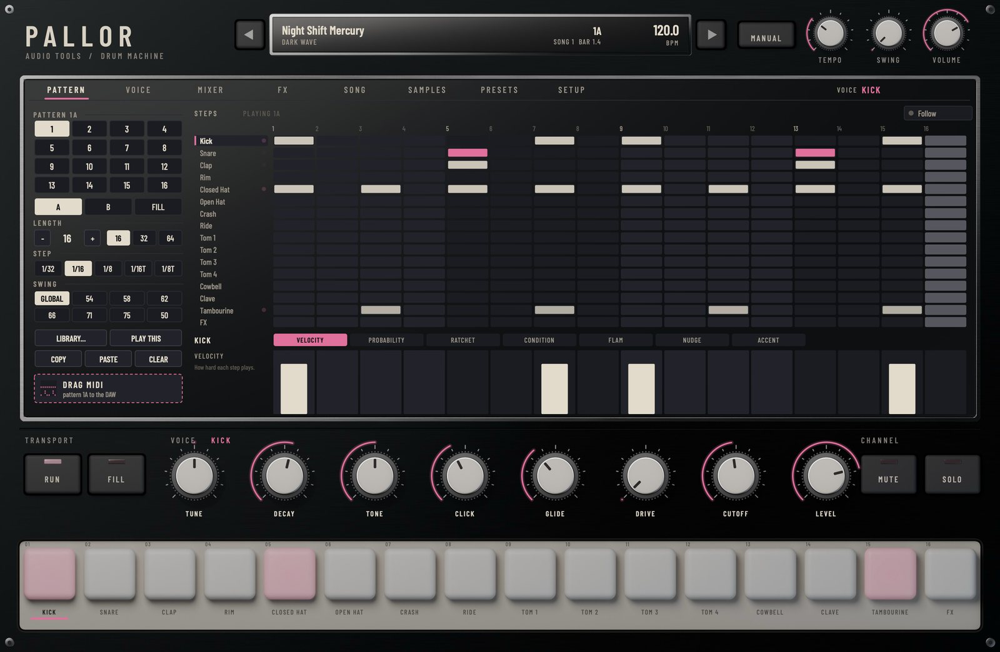

## Installing

Download the package for your system from the website and unzip it. The Audio Tools launcher can also download and install it for you.

On macOS:

1. Copy `Pallor.vst3` to `~/Library/Audio/Plug-Ins/VST3/` and `Pallor.component` (Audio Unit) to `~/Library/Audio/Plug-Ins/Components/`.
2. Rescan plugins in your DAW. Pallor appears as **Audio Tools Pallor**, among the instruments.
3. `Pallor.app` is the standalone version and `pallorrender` the command-line renderer.

The files are not notarized. If macOS refuses to open them, run `xattr -dr com.apple.quarantine` followed by the path of each file.

On Windows:

1. Copy `Pallor.vst3` to `C:\Program Files\Common Files\VST3\`.
2. Rescan plugins in your DAW.

On Linux:

1. Copy `Pallor.vst3` to `~/.vst3/` and `Pallor.lv2` to `~/.lv2/`.
2. Rescan plugins in your DAW. The standalone needs JACK or ALSA.

## First sound

1. Put Pallor on an instrument (MIDI) track.
2. Press play in your DAW. Pallor follows the host's transport and tempo, and the first preset, Night Shift Mercury, starts playing its song.
3. Click the pads to hear each voice: a click near the top of a pad plays harder than near the bottom.
4. Step through the presets with the arrows on each side of the display, or click the display to browse them by genre.

Without a DAW, open the standalone and press **Run**: Pallor plays on its own clock at the **Tempo** of the header.

## The panel

Pallor looks like a piece of hardware seen from above, and works like one.

- **The header.** The display shows the preset (with an asterisk when you changed something), its genre, the tempo and, while playing, the pattern and the bar. The arrows step through presets. **Manual** opens this manual. The three knobs are **Tempo** (the internal clock, used when Pallor is not following the host), **Swing** (the global swing, 50 to 75 %) and **Volume** (the master output).
- **The screen.** Eight pages, chosen with the tabs on top: PATTERN, VOICE, MIXER, FX, SONG, SAMPLES, PRESETS and SETUP. The name of the selected voice is always shown on the right of the tabs.
- **The voice row.** Eight knobs for the voice you selected: Tune, Decay, Tone, the two character controls of its model (their names change with the model), Drive, Cutoff and Level. On the left, **Run** and **Fill**; on the right, **Mute** and **Solo** for the selected voice.
- **The pads.** One per voice. A pad lights when its voice plays, from the sequencer, from MIDI or from your click. Click a pad to play and select that voice; Alt-click selects it without playing; right-click it to load or clear a sample, mute or solo it. You can drop an audio file on a pad to load it into that voice.

Every knob turns by dragging up and down (or sideways); Shift drags finely, a double-click returns it to its default, and the mouse wheel moves it in steps. Every control has a tooltip.

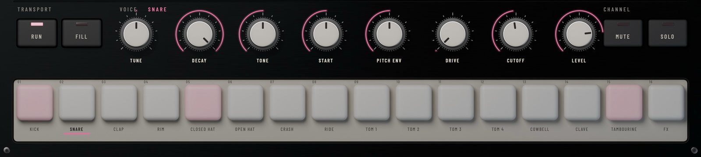

## Voices and engines

The sixteen voices are Kick, Snare, Clap, Rim, Closed Hat, Open Hat, Crash, Ride, Tom 1 to Tom 4, Cowbell, Clave, Tambourine and FX. Each voice has the same set of controls and chooses its engine on the VOICE page: **Analog** or **Digital**.

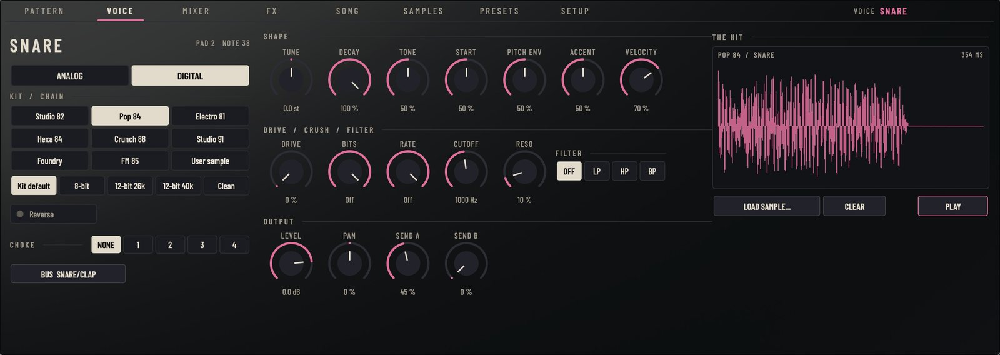

### The analog engine

The analog engine synthesises each hit from a model of a circuit. Every voice offers the models of its family:

| Voice | Models |
|---|---|
| Kick | Bridged-T, VCO Punch, Compact, Hexagonal, Dark |
| Snare | Bridged-T, VCO Punch, Hexagonal, Noise Box, Crack |
| Clap | Analog, Big, Tight |
| Rim | Bridged-T, Woody, Click |
| Closed Hat, Open Hat | Six-Square, Noise Box, Twin Tank, FM |
| Crash | Six-Square, Noise Wash, FM |
| Ride | Six-Square, Bell, FM |
| Toms | Bridged-T, Hexagonal, VCO Punch, Conga |
| Cowbell | Two-Square, Clank, Bell |
| Clave | Bridged-T, Woodblock, Blip |
| Tambourine | Maracas, Tambourine, Shaker |
| FX | Zap, Sweep, Metal, Drop, Static |

**Bridged-T** is the resonant drum of the late 70s machines: a resonator struck by a short pulse, with the click of the pulse and a pitch that starts a little high and settles. **VCO Punch** is the drum of 1983 and 1984: an oscillator with a fast pitch envelope. **Six-Square** is the metal of hats and cymbals made from six square waves at unrelated frequencies through band-pass filters. **Hexagonal** is the electronic drum pad of the early 80s with its steep downward bend, the "pew". **Twin Tank** is a cheaper metal: noise and three squares in two resonant tanks. **Dark** and **Crack** are voices of our time: a long-sweep kick and a hard, short snare.

Each model has two character controls whose names appear under the knobs and on the VOICE page: for a bridged-T kick they are Click and Glide, for a six-square hat Color and Spread, for an FM metal Index and Ratio. Every model is calibrated so that a new kit is balanced with all levels at 0 dB.

### The digital engine and the 80s chain

The digital engine plays a sample through the chain of the sampling drum machines of 1980 to 1990. Choose a **Kit** and a **Chain**:

| Kit | What it is |
|---|---|
| Studio 82 | Acoustic kit, dry and tight, 8-bit companded at 28 kHz |
| Pop 84 | Punchy acoustic kit with gated rooms on snare, claps and toms, 8-bit at 25 kHz |
| Electro 81 | Pallor's own analog voices sampled into a 12-bit 26 kHz sampler |
| Hexa 84 | The hexagonal electronic kit sampled at 8 bits: bends, noise and clicks |
| Crunch 88 | Big, hot acoustic hits through a 12-bit 26 kHz sampler |
| Studio 91 | Roomier acoustic kit, 12-bit at 40 kHz |
| Foundry | Industrial: struck sheets, pipes, barrels and chains, 8-bit at 32 kHz |
| FM 85 | Two-operator FM drums: thin, glassy, cold |
| User sample | Your own sample for this voice |

No sample of any machine is used: every kit is synthesised by Pallor when it starts.

The chains:

- **8-bit**: the companding converter of the early sampling machines (255 levels, about 72 dB of range, more noise on loud sounds than on soft ones). **Tune** changes the playback clock, as on those machines: pitching down brings the converter's images into the audible band, the rough brightness of the period. Kicks and toms go through a 10 kHz output filter that opens on each hit; the rest through 16 kHz.
- **12-bit 26k**: 12 bits at a fixed 26.04 kHz, pitch by skipping and repeating samples, no output filter: the gritty sampler of the late 80s.
- **12-bit 40k**: 12 bits at 40 kHz, cleaner and wider.
- **Clean**: the sample as it is.
- **Kit default**: whatever chain the kit was made for.

On the digital engine the two character controls are **Start** (where playback starts, to cut the attack) and **Pitch env** (a pitch drop at the start of the hit). **Reverse** plays the sample backwards.

### Shaping a voice

The same controls work on both engines:

- **Tune**: ±24 semitones.
- **Decay**: how long the hit rings.
- **Tone**: dark to bright.
- **Accent**: how much louder and harder an accented step plays on this voice (the global amount is in SETUP).
- **Velocity**: how much the velocity of a step or a MIDI note changes the level (0 % plays every hit the same).
- **Drive**: saturation.
- **Bits** and **Rate**: a bit crusher and sample-rate reducer per voice (16 bits and 48 kHz are off).
- **Filter**: Off, LP, HP or BP, with **Cutoff** and **Reso**.
- **Level** (−60 to +6 dB), **Pan**, **Send A** (to Space) and **Send B** (to Echo).
- **Choke**: voices in the same group cut each other. The closed and open hats are in group 1, so a closed hat stops a ringing open hat, as on a real kit.
- **Bus**: the output this voice uses when Outputs is Per voice (see Multiple outputs).

The hit drawn on the right of the VOICE page is the real thing: it is computed with the current settings, so you can see the decay and the click change as you turn the knobs. Click it to play the voice.

## Loading samples

Any voice can play a sample of your own: WAV, AIFF or FLAC, mono or stereo, at any rate. There are four ways:

- Drop the file on a pad: it goes into that voice.
- Drop it on the hit view of the VOICE page, or anywhere on the screen: it goes into the selected voice.
- Use **Load sample...** on the VOICE page, or right-click a pad.
- Browse your folders on the SAMPLES page: one click loads the file into the selected voice and plays it, so you can audition a folder quickly by clicking down the list. You can also drag a file from the list onto a pad.

Loading a sample switches the voice to the digital engine with the User sample kit. It then goes through the chain you choose, so a modern sample can be turned into an 8-bit hit.

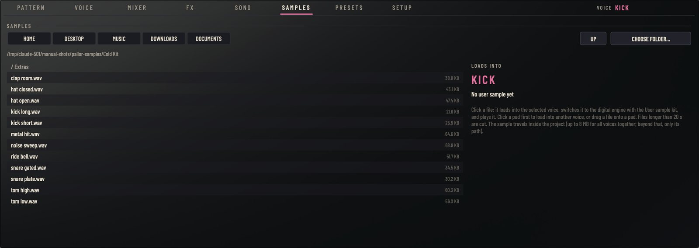

Samples longer than 20 seconds are cut. They are saved inside your project, compressed without loss, up to 8 MB for all voices together; beyond that only the path of the file is saved, and the file must still be there when you reopen the project.

## The sequencer

Pallor has 16 patterns. Each pattern has two variations, **A** and **B**, and a **Fill**. A pattern holds 16 tracks, one per voice, of up to 64 steps.

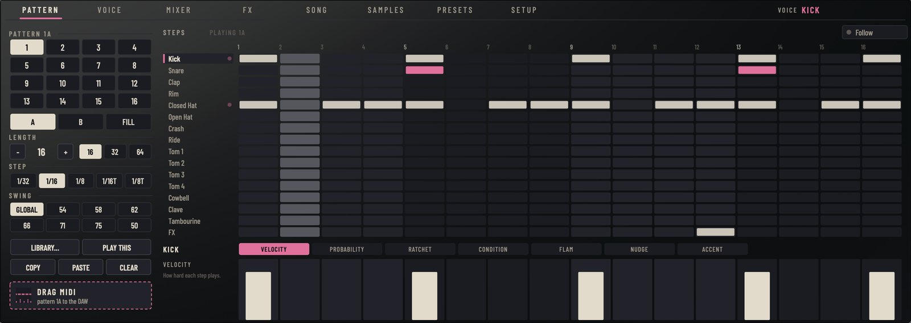

### Choosing what you edit

On the left of the PATTERN page, click a number to edit that pattern and **A**, **B** or **FILL** to edit that variation. The pattern that is playing has a small light in its number. **Follow** makes the grid jump to whatever is playing, which is useful while a song runs. **PLAY THIS** makes the pattern you are editing the one that plays.

### Writing steps

- Click a step to turn it on or off; drag across a row to paint several.
- **Shift**-click toggles an accent (the step turns rose).
- **Alt**-click adds repeats (ratchets) up to 4; **Cmd**-click (Ctrl on Windows and Linux) lowers the probability in steps of 25 %.
- Right-click a step for everything: accent, velocity, probability, ratchet, condition, flam and nudge.
- Click a name on the left to select that voice; right-click it to set the track's own length, shift the track left or right, copy, paste or clear it.

A step shows what it does: brighter means louder, a partly filled step has a probability, small bars at the bottom are ratchets, a dot in the corner is a flam, a short label is a condition, and a thin line is a nudge.

### The lanes

Below the grid, the lanes edit one value of every step of the selected voice. Choose the lane with its tab and draw across the steps:

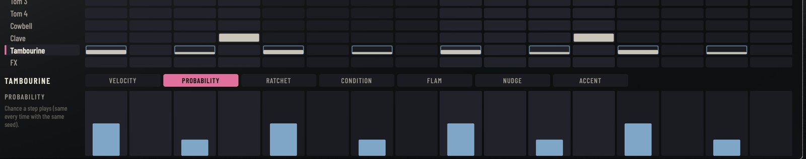

- **Velocity**: how hard each step plays.
- **Probability**: the chance that a step plays, in steps of 5 %. The chance is decided by the position of the step and the **Chance seed** (SETUP): the same seed plays the same variations every time you render, and a different bar plays a different choice.
- **Ratchet**: 1 to 8 repeats inside the step.
- **Condition**: click a step to cycle through Always, Fill (only on fill passes), Not fill, 1:2 (the first of every two passes), 2:2, 1:4, 4:4, First (only the first pass after the pattern starts) and Not first. Right-click for a menu.
- **Flam**: a softer grace note before the beat, 0 to 40 ms.
- **Nudge**: plays the step early or late, up to half a step.
- **Accent**: click or drag to set and clear accents.

Double-click a step in a lane to reset its value.

### Length, step and polymeter

**LENGTH** sets how many steps the pattern lasts, 1 to 64 (the 16, 32 and 64 buttons are shortcuts). **STEP** sets the length of a step: 1/32, 1/16, 1/8, or the triplets 1/16T and 1/8T.

A track can have its own length (right-click its name): a 12-step hat over a 16-step pattern shifts against the bar every time round, and the pattern keeps playing for its own length. This is polymeter, the way to make a four-bar loop out of one bar.

### Swing

Swing delays the second note of every pair of 16ths (or 8ths, set in SETUP) to a percentage of the pair: 50 % is straight, 66.7 % is a triplet shuffle, 75 % a dotted rhythm. The **Swing** knob of the header sets it for every pattern; **SWING** on the PATTERN page gives a pattern its own value, or **GLOBAL** to follow the knob. Swing works on 1/32, 1/16 and 1/8 steps; triplet steps never swing.

### The library

**LIBRARY...** loads one of 52 pattern sets (A, B and Fill, by genre, with their tempo shown) into the pattern you are editing. Its swing comes with it. **COPY** and **PASTE** move a whole pattern; **CLEAR** empties it.

### Play modes and fills

On the SONG page, **Play mode** chooses what plays:

- **A** or **B**: that variation of the current pattern, in a loop.
- **A > B**: A and B alternating.
- **SONG**: the song chain.

The current pattern is chosen in the row of numbers below (or with PLAY THIS). A change lands at the end of the pass that is playing, so it always stays on the bar.

A fill pass plays the pattern's Fill instead of A or B. Press **Fill** on the panel to play fills until you press it again (its light stays on), or set **Auto fill** to play the Fill every 2, 4, 8 or 16 passes. Steps with the Fill and Not fill conditions also react to fill passes, so the A pattern can have its own small changes on those bars. If a pattern's Fill is empty, the A or B pattern plays with its fill conditions instead.

### The song chain

The song is a chain of up to 64 entries. Each entry plays a pattern's A or B a number of times, and can end with its fill.

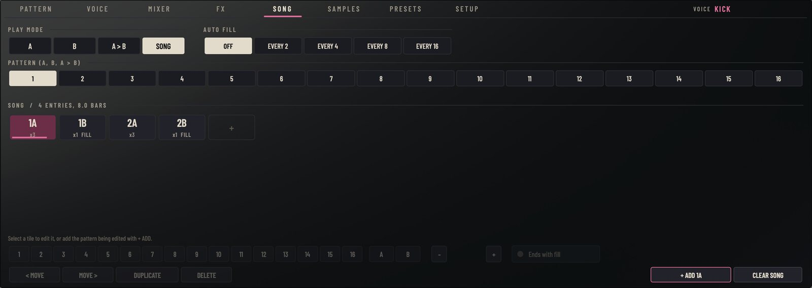

- **+ ADD** (or the + tile) appends the pattern you are editing.
- Click a tile to select it, then set its pattern, variation, **repeats** (with - and +) and **Ends with fill** in the row below.
- Drag a tile to move it, or use **MOVE**. **DUPLICATE** and **DELETE** work on the selected tile; **CLEAR SONG** empties the chain.

While the song plays, the current tile is lit and a line shows how far it has gone. The song loops at the end. When the host jumps to another position, Pallor plays what belongs to that position, as if it had played the whole song from the start.

### Following the host

With **Follow host transport and tempo** on (SETUP, on by default), Pallor plays when the host plays, at the host's tempo, locked to its bars. When the host is stopped, or with Follow off, **Run** starts the internal clock at **Tempo**.

## Effects

Each voice sends to two effects, and everything goes through the master. The FX page has all three.

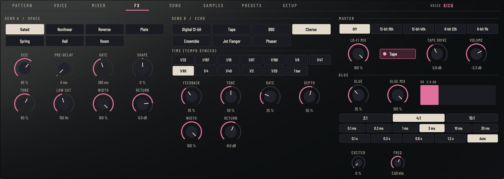

### Send A: Space

- **Gated**: the gated room of the 80s: a dense room, squashed and cut by a gate that opens with what you send it. **Gate** sets how long it stays open.
- **Nonlinear**: a flat burst of reflections that stops dead after the Gate time, the other famous 80s snare sound.
- **Reverse**: the same burst rising instead of falling.
- **Plate**, **Spring**, **Hall** and **Room**: the classic spaces; hall and room run with the bandwidth and the 12-bit return of the digital reverbs of the period.

**Size**, **Pre-delay**, **Shape** (for nonlinear and reverse: the envelope of the burst, falling, flat or rising), **Tone**, **Low cut**, **Width** and **Return** complete it.

### Send B: Echo

- **Digital 12-bit**: the clean, slightly grainy digital delay of the mid 80s.
- **Tape**: tape echo with three heads, wow and flutter, and the tape's saturation in the loop.
- **BBD**: a bucket-brigade delay, darker as the time gets longer.
- **Chorus**, **Ensemble**, **Jet Flanger** and **Phaser**: modulation effects. They return only the effected signal, so it is the mix with the dry sound that makes the chorus, the comb or the notches.

**Time** is always in step with the tempo, from 1/32 to a bar. **Feedback**, **Tone**, **Rate**, **Depth**, **Width** and **Return** complete it.

### Master

- **Lo-fi**: the whole kit through a sampler: 12-bit at 26 or 40 kHz, or 8-bit at 22 or 11 kHz, with its **Lo-fi mix**.
- **Tape**: the master through tape, with **Tape drive**. It adds 54 samples of latency, which Pallor reports to the host.
- **Glue**: a bus compressor with **Ratio**, **Attack** and **Release** in the steps of the console compressors (Auto release adapts to the material), **Glue mix** for parallel compression, and a gain reduction meter.
- **Exciter** and its **Freq**: added brightness above the chosen frequency.
- **Volume**: the output level (the same as the header knob).

## The mixer

The MIXER page has a strip for each voice: **M** (mute) and **S** (solo), Pan, Send A, Send B, a level fader with its meter, and the output bus. On the right, the returns of Space and Echo and the master volume. Click a strip to select its voice. Several voices can be soloed at once.

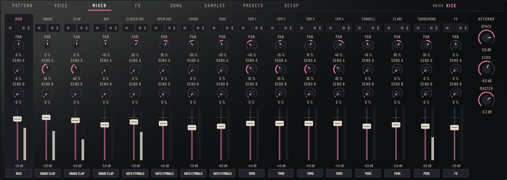

## MIDI

### Playing Pallor from MIDI

Notes from the DAW or a controller play the voices, on any channel. The note map is chosen in SETUP:

| Voice | GM note | Chromatic |
|---|---|---|
| Kick | 36 (also 35) | 36 |
| Snare | 38 (also 40) | 37 |
| Clap | 39 | 38 |
| Rim | 37 | 39 |
| Closed Hat | 42 (also 44) | 40 |
| Open Hat | 46 | 41 |
| Crash | 49 (also 55, 57) | 42 |
| Ride | 51 (also 53, 59) | 43 |
| Tom 1 | 41 (also 43) | 44 |
| Tom 2 | 45 | 45 |
| Tom 3 | 48 (also 47) | 46 |
| Tom 4 | 50 | 47 |
| Cowbell | 56 | 48 |
| Clave | 75 (also 76, 77) | 49 |
| Tambourine | 54 (also 69, 70, 82) | 50 |
| FX | 52 | 51 |

GM is the map of most drum controllers and of the drum racks of DAWs. Chromatic puts the sixteen voices on the sixteen notes from 36 (C1 in most DAWs) to 51, one per pad of a 4 × 4 controller. A note at or above **Accent at** (120 by default) plays as an accent.

### MIDI out

With **Send the sequencer as MIDI** on, Pallor sends every step it plays as a note, with the same note map, on the chosen **Channel** (10 by default). Accented steps are sent at velocity 127. **Gate** sets how long each note lasts, 2 to 1000 ms (30 ms by default); a note always ends before the same note plays again. When the transport stops or jumps, every note that is still on is ended. Use it to play another drum machine or a sampler with Pallor's sequencer, or to record the pattern as MIDI.

The notes leave Pallor as late as its audio (its latency, 78 samples at 48 kHz with Tape on), which the host compensates for the audio only, so a synth or a MIDI recording fed from Pallor lines up with Pallor's own sound.

In Ableton Live and in REAPER, use the VST3 version for MIDI out: neither takes the MIDI that Audio Unit plugins produce.

### Drag MIDI

**DRAG MIDI** on the PATTERN page holds the pattern you are editing as a MIDI file. Drag it onto a MIDI track of your DAW to get the pattern as notes, with its swing, ratchets and flams, in the chosen note map. Click it instead to save the `.mid` file.

## Multiple outputs

Pallor has a main stereo output and six more: Kick, Snare/Clap, Hats/Cymbals, Toms, Perc and FX. With **Outputs** set to **Per voice** (SETUP), every voice goes to its bus (change it on the VOICE page or in the MIXER). The sends and the master effects stay on the main output. A bus that the host did not enable goes to the main output, so nothing is ever lost.

In Ableton Live:

1. Put Pallor on a MIDI track and set **Outputs** to **Per voice** in SETUP.
2. Create an audio track for each bus you want, for example one for the kick and one for the snare and clap.
3. In each audio track, set **Audio From** to the Pallor track, and in the second menu choose the output (Kick, Snare-Clap, Hats-Cymbals, Toms, Perc or FX).
4. Set the **Monitor** of those audio tracks to **In**.
5. Every voice whose bus you did not route keeps playing on the Pallor track.

In Logic Pro, insert Pallor as a multi-output instrument and add the aux channels with the + button of its channel strip. In Reaper, open the plugin's I/O button and route the extra outputs to new tracks.

All the outputs stay aligned with the main one, including the latency of the master tape.

## Presets

The 65 presets cover 13 genres, five each: a kit, its effects, its patterns and often a song. The PRESETS page lists them by genre with a short description and the tempo.

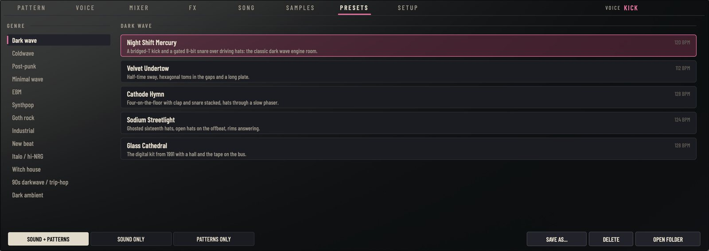

Choose what a click loads: **SOUND + PATTERNS** (everything), **SOUND ONLY** (the kit, mixer and effects, keeping your patterns) or **PATTERNS ONLY** (patterns and song, keeping your sound). The second is the quickest way to hear your own pattern through every kit.

**SAVE AS...** keeps everything as a preset of your own, in the User genre: kit, effects, patterns, song, and the paths of your samples. **DELETE** removes the selected user preset and **OPEN FOLDER** shows where they are kept.

Every preset is levelled to about −18 LUFS, so you can compare them without the louder one winning, or lower where its peaks would reach the output ceiling: every preset peaks below −1 dBFS.

### In Ableton Live

Live does not show plugins' factory presets (it ignores VST3 program lists). The PRESETS page works as everywhere, and the factory presets also appear in Live's browser under Plug-Ins → Audio Tools Pallor (expand the plugin), installed by the launcher or by copying the Presets folder from the zip.

Pallor has 463 parameters and Live keeps at most 128 of a device for automation and its panel, and fills the panel by itself only when a plugin has 64 or fewer. Click **Configure** on Pallor's device in Live and move the controls you want to automate or map: they are added in that order. A good set for a live performance: **Pattern**, **Fill**, **Swing**, **Volume**, **Space Return**, **Echo Return**, **Tape Drive** and **Glue Mix**, plus **Level**, **Tune**, **Decay** and **Cutoff** of the three or four voices you play with (Kick, Snare, Closed Hat...). Everything else stays in Pallor's own panel and is saved with the set.

### In REAPER

REAPER lists every factory preset twice in the preset menu: once from the plugin's own list and once as a preset file (the .vstpreset files that the launcher or the Presets folder of the zip install for Ableton Live, in ~/Library/Audio/Presets/Audio Tools/ on macOS, Documents\VST3 Presets\Audio Tools\ on Windows and ~/.vst3/presets/Audio Tools/ on Linux). Both load the same settings. If you don't use Live, you can delete the "Audio Tools Pallor" folder there and each preset appears once.

## Setup

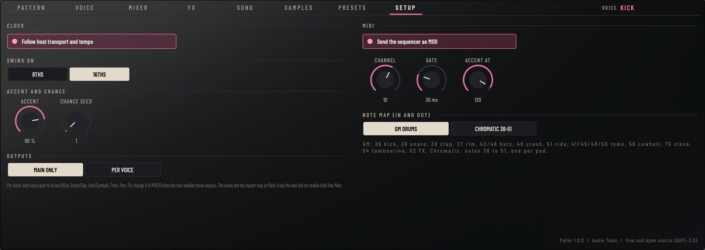

- **Follow host transport and tempo**: on by default.
- **Swing on**: 8ths or 16ths.
- **Accent**: how much every accent adds, for all voices; **Chance seed**: the seed of the probability (1 to 999).
- **Outputs**: Main only, or Per voice.
- **Send the sequencer as MIDI**, **Channel**, **Gate** and **Accent at**: see MIDI.
- **Note map**: GM drums or Chromatic 36-51, for MIDI in and out.

## Genre tips

- **Dark wave**: a bridged-T kick, an 8-bit snare into the gated room, steady eighth-note hats through the chorus of send B. Night Shift Mercury is the place to start.
- **Coldwave**: the Hexa 84 kit or the Hexagonal models, sparse patterns, the nonlinear room; keep the tempo between 120 and 140.
- **Post-punk**: toms carry the beat. Give the four toms short decays, pan them across, and let the snare sit on the backbeat in a small room.
- **Minimal wave**: the Compact kick and the Noise Box hats, a preset-rhythm feel, 12-bit 26k on the master lo-fi.
- **EBM**: the VCO Punch kick, a clap on the backbeat, sixteenth hats, the Glue at 4:1 with a fast attack, and a clanking cowbell.
- **Synthpop**: Studio 82 or Pop 84, claps and tambourine, the plate.
- **Goth rock**: fast tempos (140 to 160), a gallop on the kick, toms in the fills, the hall.
- **Industrial**: the Foundry kit, Drive and Bits on the metals, the jet flanger, the tape driven hard.
- **New beat**: slow (100 to 115), heavy, the 12-bit 26k chain, the gated clap.
- **Italo and hi-NRG**: four on the floor, open hats on the off-beat, the Hexagonal toms going "pew" in the fills.
- **Witch house**: around 70 BPM, hats in ratchets, sub drops on the FX voice, the reverse room, 8-bit 11k on the master.
- **90s darkwave and trip-hop**: a swung break at 70 to 95 BPM on 12-bit, ghost notes with low velocity and probability.
- **Dark ambient**: probability everywhere, long decays, the ride and the metal FX into a long hall and tape echo.

## Tips and troubleshooting

- **Nothing plays when I press play in the DAW.** Check that Follow host is on (SETUP) and that the play mode is not SONG with an empty chain (Pallor then plays A).
- **The hats sound thin when the open hat is cut.** The closed and open hats are in choke group 1; set the open hat's Choke to NONE to let them ring together.
- **A pattern change does not happen at once.** It lands at the end of the pass that is playing, to stay on the bar.
- **No MIDI comes out in Ableton Live or REAPER.** Use the VST3 version, and in the receiving track set MIDI From to the Pallor track (in REAPER, a send with MIDI).
- **Live's device panel for Pallor is empty.** Click Configure and touch the controls you want there (see Presets, In Ableton Live).
- **My sample is missing when I reopen the project.** Only 8 MB of samples travel inside the project; the rest are saved by their path. Keep the files where they were, or save the project with fewer or shorter samples.
- **The probability always plays the same thing.** That is by design: a render is repeatable. Change the Chance seed for other choices.

## Specifications

| | |
|---|---|
| Formats | VST3 (macOS, Windows, Linux), Audio Unit (macOS), LV2 (Linux), standalone, pallorrender |
| Voices | 16, each with an analog engine (44 circuit models) and a digital engine (8 kits and a user sample) |
| Sequencer | 16 patterns × A, B and Fill, up to 64 steps, per-track length, song chain of up to 64 entries |
| Per step | Velocity, accent, probability, ratchet 1 to 8, flam, nudge ±50 %, nine conditions |
| Effects | Space (7 types), Echo (7 types), master lo-fi, tape, glue compressor, exciter |
| Outputs | Main stereo and six stereo buses |
| MIDI | In: GM or chromatic note map. Out: the sequencer, with adjustable gate |
| Latency | 24 samples; 78 with the master tape |
| Presets | 65 in 13 genres; a library of 52 pattern sets (156 patterns) |
| License | GNU Affero General Public License v3 |
