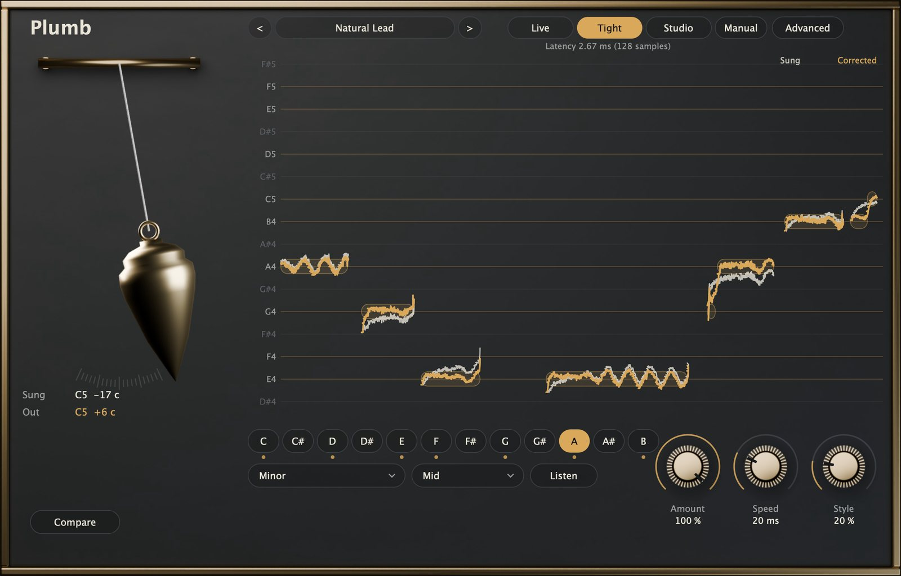
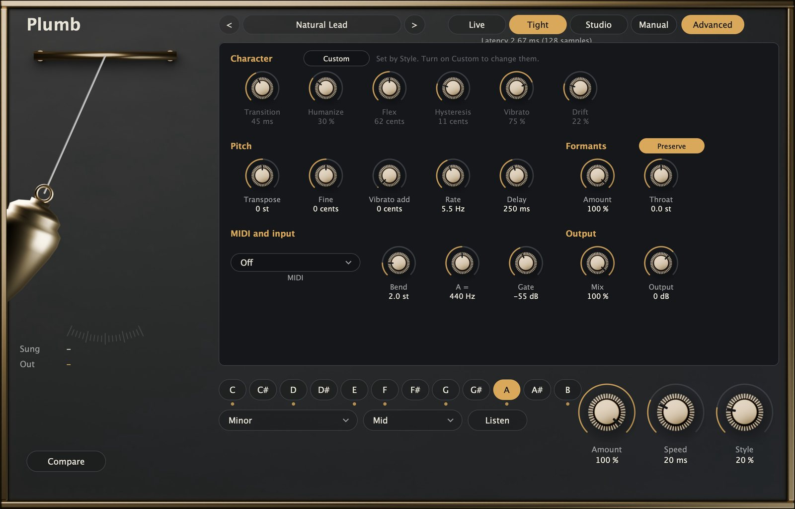
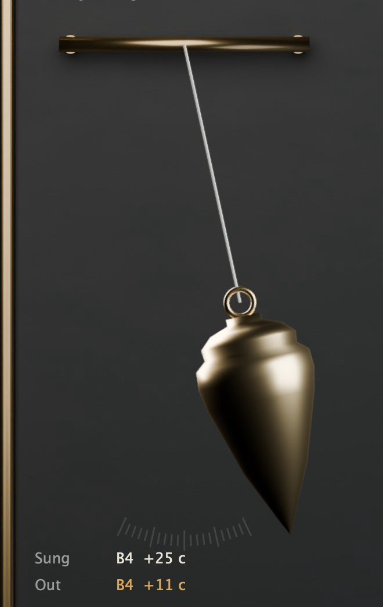
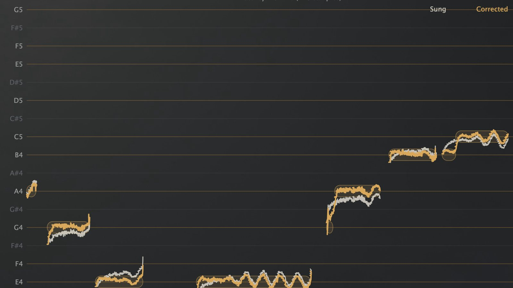
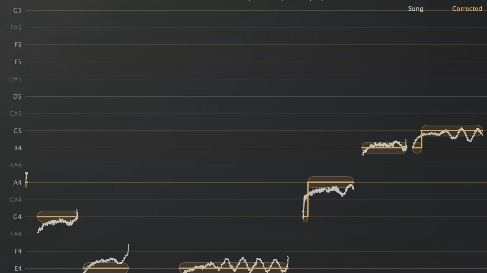
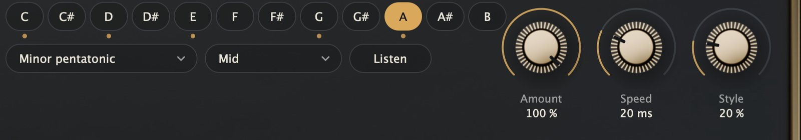

# Manual de Plumb

## Qué es Plumb

Plumb corrige la afinación de una voz, o de cualquier instrumento que toque una nota por vez, mientras se canta. Encuentra la nota a la que apunta quien canta y lleva la voz hasta ella, desde un empujoncito que conserva cada entrada desde abajo y cada vibrato hasta el efecto duro, escalonado, en el que cada nota cae exactamente en su altura.

Está hecho pensando primero en la latencia. En su modo más rápido Plumb agrega 32 muestras, 0,67 ms a 48 kHz: menos que el retardo de los conversores de la mayoría de las interfaces de audio, así que quien canta puede escuchar la voz corregida en los auriculares o en los in-ears sin sentirla atrasada. El modo por defecto agrega 2,7 ms, y el de mezcla 21 ms.

Los controles de todos los días son pocos: una tonalidad, una escala, un rango de voz y tres perillas. Todo lo demás está en una sola página Advanced, y cada control se explica solo en un globo de ayuda cuando lo señalás.

La ventana es una pizarra con marco de bronce. A la izquierda cuelga una plomada: oscila con el error de afinación de lo que se canta y queda quieta cuando la nota está justa. Sobre la pizarra, la vista de notas en vivo dibuja la altura cantada en tiza y la corregida en bronce, sobre los renglones de las notas de la escala.



## Instalación

Bajá el paquete para tu sistema desde el sitio y descomprimilo. El launcher de Audio Tools también puede bajarlo e instalarlo por vos.

En macOS:

1. Copiá `Plumb.vst3` a `~/Library/Audio/Plug-Ins/VST3/` y `Plumb.component` (Audio Unit) a `~/Library/Audio/Plug-Ins/Components/`.
2. Volvé a escanear los plugins en tu DAW. Plumb aparece como **Audio Tools Plumb**.
3. `Plumb.app` es la versión independiente y `plumbrender` el renderizador de línea de comandos.

Los archivos no están notarizados. Si macOS no los deja abrir, corré `xattr -dr com.apple.quarantine` seguido de la ruta de cada archivo.

En Windows:

1. Copiá `Plumb.vst3` a `C:\Program Files\Common Files\VST3\`.
2. Volvé a escanear los plugins en tu DAW.
3. `Plumb.exe` es la versión independiente y `plumbrender.exe` el renderizador de línea de comandos.

## Primeros sonidos en un minuto

1. Poné Plumb en una pista de voz. Es un efecto mono: en una pista estéreo corrige la suma y la devuelve por los dos lados.
2. Hacé clic en la tonalidad de la canción en la fila de botones de notas y elegí la escala (Major o Minor para la mayoría de las canciones). Si no sabés la tonalidad, apretá **Listen**, cantá o pasá la canción entre 15 y 30 segundos, y apretá **Apply** cuando Plumb proponga una.
3. Elegí **Voice**: Low para bajo y barítono, Mid para tenor y contralto, High para soprano, Instrument para cualquier otra cosa.
4. El preset por defecto, **Natural Lead**, ya corrige. Cantá y mirá cómo la línea de bronce se asienta sobre los renglones.
5. Girá **Style** a la derecha para una corrección más firme; hasta el fondo para el efecto de afinación dura. O elegí **Hard Tune** en los presets.
6. Encendé **Compare** para escuchar la voz sin corrección, con el mismo nivel y la misma latencia; apagalo para volver a escuchar Plumb.

## La interfaz de un vistazo

- **Barra de arriba.** Los presets (flechas y menú), los tres modos de latencia (Live, Tight, Studio) con la latencia que agregan, **Manual** (este manual) y **Advanced**.
- **La plomada.** A la izquierda. Debajo, la nota cantada y la de salida, cada una con su distancia en cents a la nota más cercana.
- **La vista de notas.** Los últimos segundos de canto, corriéndose hacia la izquierda.
- **Tonalidad y escala.** Los doce botones de notas, la lista de escalas, la de rangos de voz, **Listen** y **Apply**.
- **Tres perillas.** Amount, Speed y Style.
- **Compare**, abajo a la izquierda.

## Modos de latencia

Plumb escucha la voz a través de una ventana corta de anticipación, y esa ventana es el único retardo que agrega. Los tres modos cambian ese retardo por cuánto sabe Plumb antes de mover la voz.

| Modo | Latencia agregada a 48 kHz | Para qué |
|---|---|---|
| **Live** | 32 muestras, 0,67 ms | Monitoreo: escenario, auriculares, in-ears |
| **Tight** | 128 muestras, 2,7 ms | Grabación y casi toda la mezcla. El de por defecto |
| **Studio** | 1024 muestras, 21 ms | Mezcla, cuando el retardo no importa |

La latencia es la misma cantidad de milisegundos en cualquier frecuencia de muestreo (64, 256 y 2048 muestras a 96 kHz). Plumb se la informa al host, así que un DAW con compensación de retardo mantiene la pista en tiempo.

Lo que cambia entre modos es cómo se corta y se vuelve a unir la voz. Plumb mueve la altura repitiendo o salteando ciclos sueltos de la voz, y lo hace en el punto más silencioso de cada ciclo. Con más anticipación puede elegir un punto mejor, así que Tight y Studio son más suaves que Live en voces graves y en pasajes rápidos. Los tres usan el mismo detector y las mismas reglas.

Hay dos demoras que no son latencia de audio y conviene conocer:

- **Arranques de nota.** Plumb necesita uno o dos períodos de una nota nueva para saber su altura: entre 10 y 23 ms según la nota (menos en las agudas). En Live y Tight el primer instante de cada nota pasa tal como se cantó; en la práctica es la entrada desde abajo, que se espera escuchar. En Studio la ventana ya lo cubre, así que también se corrigen los arranques.
- **Empalmes.** Cada vez que se repite o se saltea un ciclo, la voz se corre un poco más tarde o más temprano, hasta un período (unos milisegundos). Plumb mantiene ese corrimiento dentro de un período y vuelve a la latencia informada cuando la voz para.

## Tonalidad, escala y voz

Los doce botones de notas eligen la **tonalidad**: el encendido es la tónica, y un punto marca cada nota de la escala.

La lista de **escalas** tiene Chromatic (cada semitono es un objetivo), Major, Minor, Harmonic minor, Melodic minor, los modos (Dorian, Phrygian, Lydian, Mixolydian, Locrian), Major y Minor pentatonic, Blues, y **Custom**.

Con **Custom**, cada botón de nota tiene tres estados; hacé clic para pasar de uno a otro:

- **Snap**: la nota es un objetivo.
- **Skip**: la nota no es un objetivo; una voz cerca de ella va a una vecina.
- **Bypass**: ninguna corrección cerca de esta nota. Sirve para una blue note o una nota de paso que querés dejar como se cantó.

**Listen** junta entre 15 y 30 segundos de lo que se canta y propone una tonalidad y una escala (mayor o menor). Nunca cambia nada por su cuenta: la propuesta aparece al lado del botón y **Apply** la aplica. Sólo usa notas sostenidas más de una décima de segundo, así que lo hablado y los pasajes rápidos no la confunden.

**Voice** fija el rango que escucha el detector. Cuanto más angosto, más rápido y más seguro es el detector, así que elegí el que corresponda:

| Voice | Rango |
|---|---|
| Low | 65 a 520 Hz |
| Mid | 80 a 880 Hz |
| High | 175 a 1400 Hz |
| Instrument | 40 a 2000 Hz |

## Amount, Speed y Style

- **Amount** es cuánto de la distancia a la nota objetivo se corrige. 100 % cae en la nota; 50 % hace la mitad del camino.
- **Speed** es qué tan rápido la corrección llega al objetivo, en milisegundos. 0 es instantáneo, el efecto de afinación dura; 20 ms es rápido pero natural; 100 ms o más deja pasar el movimiento propio de quien canta.
- **Style** va de **Natural** a **Hard**. Fija de una vez todo el carácter de la corrección: cómo se enlazan las notas, cuánto vibrato y cuánta deriva se conservan, qué tan ancha es la ventana de notas que se corrigen, y cuánto tiene que alejarse una nota para que cambie el objetivo. Natural conserva vibrato, entradas desde abajo y bends, y sólo mueve el centro de cada nota; Hard pone cada nota exactamente sobre su renglón.

Con Style al 100 % Plumb pasa a afinación dura: la salida es la nota objetivo misma, sin vibrato y con saltos instantáneos cuando Speed está en 0.

## La página Advanced



### Character

Son los valores que fija Style. Encendé **Custom** para ajustarlos a mano; Style deja de cambiarlos.

- **Transition** (0 a 200 ms): cómo pasa la corrección de una nota objetivo a la siguiente. Corta es un escalón; larga es un deslizamiento.
- **Humanize** (0 a 100 %): las notas largas se corrigen más despacio que los arranques, así una nota sostenida conserva su vida mientras el arranque queda afinado.
- **Flex** (cents): sólo se corrigen las notas que están a menos de esta distancia del objetivo. Un bend o un glissando más ancho pasa como se cantó. En Hard se abre a todo.
- **Hysteresis** (0 a 50 cents): cuánto tiene que pasar la voz el punto medio entre dos notas para que cambie el objetivo. Evita que una nota cantada entre dos objetivos salte de uno a otro. En 0, con Style al 100 %, el objetivo sigue cada movimiento de la voz, vibrato incluido: el efecto buscado del preset **Warble**.
- **Vibrato** (0 a 100 %): cuánto del vibrato de quien canta se conserva.
- **Drift** (0 a 100 %): cuánto de la deriva lenta dentro de una nota se conserva.

### Pitch

- **Transpose** (±24 semitonos) y **Fine** (±100 cents) mueven el objetivo. Con los formantes preservados, una octava abajo es una segunda voz más grave, no una voz ralentizada.
- **Vibrato add**, **Rate** y **Delay** suman un vibrato sintético parejo a cada nota sostenida, que arranca después del retardo y entra de a poco. Útil encima de la afinación dura.

### Formants

Los formantes son las resonancias de la boca y la garganta que hacen que una voz suene como ella misma y que las vocales se reconozcan. Cuando un cambiador de altura los mueve junto con la altura, una voz suena a ardilla hacia arriba y a gigante hacia abajo.

- **Preserve** (encendido por defecto) deja los formantes donde están mientras se mueve la altura.
- **Amount**: 100 % los deja en su lugar; valores menores los dejan seguir a la altura una parte del camino.
- **Throat** los mueve a propósito: hacia abajo, un tracto vocal más largo (más oscuro, más grande); hacia arriba, uno más corto (más brillante, más joven), sin cambiar la altura. Cuesta entre dos y tres veces la CPU de la corrección sola.

Con Preserve apagado, Plumb corre la forma de onda misma: lo más barato y lo más transparente para correcciones chicas, y el efecto ardilla para las grandes.

### MIDI and input

- **MIDI** fija qué hacen las notas MIDI que le mandás a Plumb:
  - **Off**: el MIDI se ignora.
  - **Scale from held notes**: las notas que apretás pasan a ser los únicos objetivos, y quedan cuando las soltás, hasta que tocás el acorde siguiente. Tocá los acordes de la canción y la voz los sigue.
  - **Note lock**: la última nota que apretás es el objetivo, se cante lo que se cante. El pitch bend la mueve hasta **Bend** semitonos.
  - **Auto**: las notas apretadas son los objetivos mientras están apretadas; si no, se usa la escala.
- **A =** fija la afinación de referencia, de 415 a 466 Hz.
- **Gate** (dB): por debajo de este nivel el detector ignora la entrada, así no se corrigen respiraciones ni el ruido de la sala.

### Output

- **Mix** mezcla la voz corregida con la seca. La seca se retrasa para quedar alineada, así que una mezcla por debajo del 100 % engorda sin fase.
- **Output** fija el nivel.

## Cómo leer la plomada y la vista de notas



La plomada se va hacia el lado del error: a la derecha cuando la voz está alta, a la izquierda cuando está baja, más lejos cuanto mayor es el error. Cada marca chica de la escala grabada debajo es de 5 cents, y la escala termina a 50 cents de cada lado. Los números de abajo son lo útil para ajustar una toma: **Sung** es lo que entra y **Out** lo que sale, cada uno como la nota más cercana y su distancia a ella en cents. Con ajustes naturales Out se mueve con el vibrato y en promedio queda cerca de cero; con Hard marca cero.



En la vista de notas, cada renglón es una nota: brillante para las notas de la escala, tenue para las otras. La línea de tiza es la altura cantada y la de bronce la corregida; los bloques suaves son las notas objetivo que eligió Plumb. Donde la tiza y el bronce se separan, Plumb está trabajando.





## Presets

Los presets fijan el carácter de la corrección. Nunca cambian la tonalidad, la escala, la referencia de afinación ni el gate: eso es de la canción y queda como lo dejaste.

| Grupo | Presets |
|---|---|
| Natural | Natural Lead, Gentle Polish, Pop Lead, Ballad, Backing Vocals, Choir Section |
| Hard | Hard Tune, Hard Tune Live, Soft Robot, Stepped Glide, Warble |
| Live | Stage Natural, Stage Firm, Tracking |
| Voice | Low Voice, High Voice, Rap Pitch Lock, Instrument |
| Character | Throat Down, Throat Up, Octave Down, Octave Up, Chipmunk, Added Vibrato, MIDI Note Lock |

## El renderizador de línea de comandos

`plumbrender` pasa un archivo WAV por Plumb con un preset y escribe el resultado:

```
plumbrender in.wav out.wav --preset "Natural Lead" --set key=4 --set scale=1
plumbrender in.wav out.wav --preset "Hard Tune" --set key=9 --set scale=2 --at 6 style=50
```

- `--set id=valor` fija un parámetro (los id son los de la página Advanced: `amount`, `speed`, `style`, `key` de 0 a 11 desde Do, `scale` de 0 a 13 en el orden de la lista, `voice`, `mode`, `transpose`, `throat`, etcétera).
- `--at segundos id=valor` cambia un parámetro en ese momento.
- `--tail segundos` renderiza más allá del final del archivo (6 s por defecto).

Imprime la CPU usada, como porcentaje de un núcleo.

## Cómo sacarle el mejor resultado

- **Fijá la tonalidad.** Chromatic sirve para todo, pero una voz cantada entre dos notas tiene entonces dos candidatas a un semitono; con la escala correcta tiene una, y la corrección puede ser más suave.
- **Dale una sola voz.** Plumb sigue una nota por vez. Ponelo antes de la reverb y el delay, y antes de todo lo que agregue una segunda altura (duplicado, chorus, armonías).
- **Elegí el rango de voz más angosto que sirva.** Hace al detector más rápido en los arranques e inmune a los errores de octava.
- **Empezá natural y andá a más firme.** La mayoría de las voces suena mejor con el centro de la nota corregido y el movimiento conservado: Natural Lead o Pop Lead, y después Style hacia arriba hasta que desaparezcan los momentos desafinados.
- **Para monitoreo, Live.** Para grabar, Tight. Pasá a Studio en la mezcla si querés que también se corrijan los arranques.
- **Ajustá el gate** un poco por encima del ruido de la sala, así las respiraciones quedan tranquilas.

## Límites

- Plumb es monofónico: acordes, coros en una sola pista e instrumentos que tocan dos notas a la vez no se corrigen bien.
- Los susurros y los sonidos sin voz no tienen altura y pasan sin cambios; un canto muy aireado o gutural puede corregirse con menos firmeza.
- En Live y Tight, los primeros 10 a 23 ms de cada nota nueva pasan como se cantaron.
- Los corrimientos grandes (varios semitonos) con Preserve encendido son limpios en vocales sostenidas y menos en grupos rápidos de consonantes.
- Plumb corrige la altura, no el tiempo.

## Notas técnicas

- **Detección.** Un detector de función diferencia (familia YIN) trabaja sobre una copia diezmada de la voz, cada 8 muestras a 12 kHz (24 kHz para los rangos High e Instrument), y se refina a la frecuencia completa sobre dos períodos. Hay guardas que atrapan los errores de octava en los arranques, y una compuerta sobre la energía y la estabilidad de la ventana deja afuera respiraciones y ruido. Medido sobre vocales sintéticas de 82 a 880 Hz: error mediano por debajo de 1,3 cents, sin errores de octava, enganche entre 11 y 23 ms.
- **Corrección.** La altura se separa en un centro de nota (unos 0,6 Hz), una deriva lenta y el vibrato; el objetivo se elige sobre el centro, con histéresis. Style y los controles de Character pesan cuánto se conserva de cada parte.
- **Corrimiento.** La voz se corre repitiendo o salteando ciclos sueltos de la excitación (el residuo de un modelo de predicción lineal), unidos en el punto más silencioso de cada ciclo con un fundido corto. Los formantes salen de un modelo de predicción lineal de orden 48 sobre la señal con preénfasis, aplicado con filtros en celosía normalizados para que cambiarlos en cada bloque siga siendo estable; Throat mueve las resonancias del modelo escalando sus ángulos.
- **Latencia medida.** 32, 128 y 1024 muestras a 44,1 y 48 kHz (64, 256 y 2048 a 96 kHz), igual a la informada en los nueve casos. Con Amount en 0 la salida es igual a la entrada retrasada, con un error por debajo de −120 dB.
- **CPU.** Alrededor del 3 % de un núcleo a 48 kHz en Apple M4 en cualquier modo, y alrededor del 8 % con Throat. Las cifras medidas en las dos plataformas están en el sitio.
- La salida es la misma con cualquier tamaño de bloque, bit a bit, e idéntica en cada corrida.
