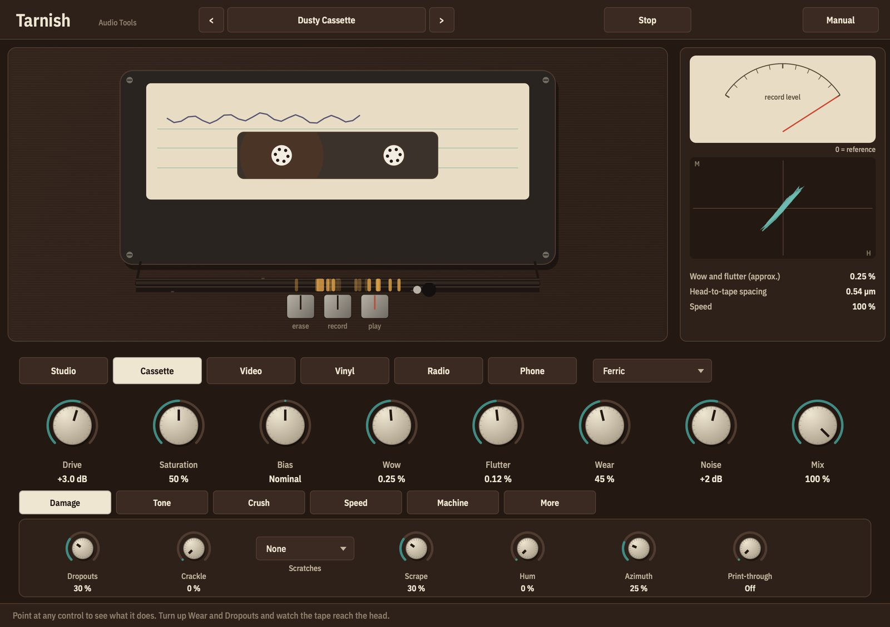
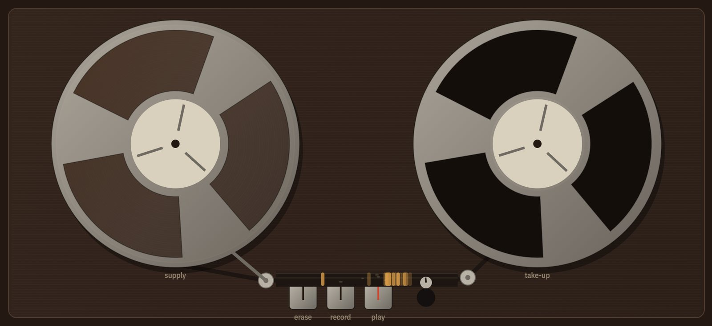
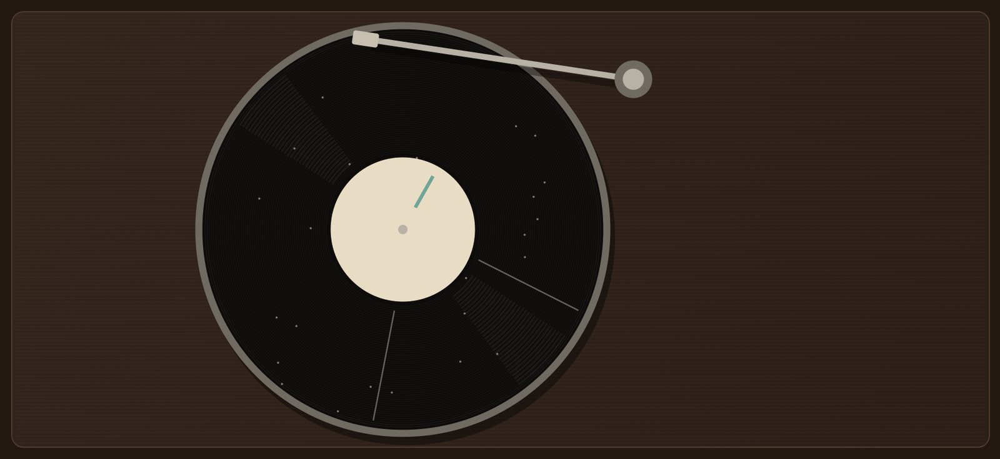
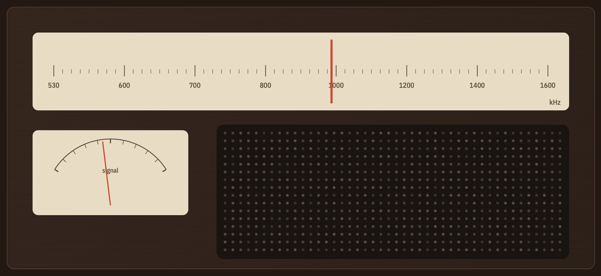
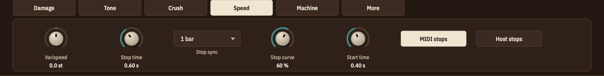
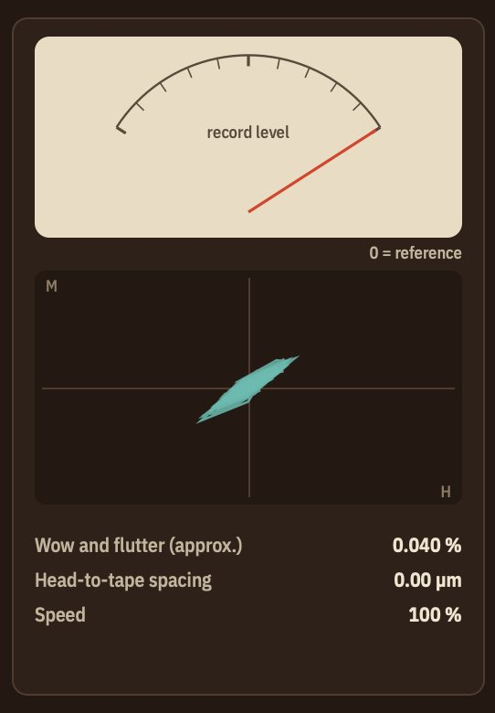

# Manual de Tarnish

## Qué es Tarnish

Tarnish pasa tu sonido por una máquina vieja: un grabador de cinta de estudio, una casetera, una videocasetera, un tocadiscos, una radio AM o una línea de teléfono. Hace lo que esas máquinas le hacían a la música, para bien y para mal: la saturación tibia de la cinta magnética, el vaivén lento y rápido del transporte, el soplido, las caídas cuando la cinta se despega de la cabeza, el crujido y las rayas de un disco, el desvanecimiento y la estática de una emisora lejana, la voz angosta y áspera de un teléfono. También trae los efectos que se hacen con ellas: tape stop, media velocidad, reducción de bits y de frecuencia de muestreo.

Las máquinas están modeladas, no sampleadas. La saturación de la cinta es un modelo de histéresis magnética (Jiles-Atherton) con la ecualización de grabación y reproducción de las normas reales; las caídas son la cabeza que se separa de la cinta, así que se van primero los agudos; el vaivén está hecho de las líneas que produce un transporte de verdad (carretes, rodillo de presión, cabrestante, motor). Todo lo aleatorio sigue la posición de la canción, así que un bounce suena exactamente como lo que escuchaste al reproducir.

La ventana muestra la máquina desde arriba. Los carretes giran a la velocidad de la cinta y sus bobinas crecen y se achican a medida que la cinta pasa de uno a otro; la cinta corre por las cabezas con su desgaste; y cada caída es una marca en la cinta que llega a la cabeza de reproducción en el momento en que la escuchás.



## Instalación

Bajá el paquete para tu sistema desde el sitio y descomprimilo.

En macOS:

1. Copiá `Tarnish.vst3` a `~/Library/Audio/Plug-Ins/VST3/` y `Tarnish.component` (Audio Unit) a `~/Library/Audio/Plug-Ins/Components/`.
2. Volvé a escanear los plugins en tu DAW.
3. `Tarnish.app` es la versión independiente y `tarnishrender` el renderizador de línea de comandos.

Los archivos no están notarizados. Si macOS no los deja abrir, corré `xattr -dr com.apple.quarantine` seguido de la ruta de cada archivo.

En Windows:

1. Copiá `Tarnish.vst3` a `C:\Program Files\Common Files\VST3\`.
2. Volvé a escanear los plugins en tu DAW.
3. `Tarnish.exe` es la versión independiente y `tarnishrender.exe` el renderizador de línea de comandos.

## Primeros sonidos en un minuto

1. Poné Tarnish en una pista, un bus o el master.
2. Abrí el menú de presets y elegí **Warm Studio Tape**. Es la cinta como pegamento: un poco de saturación, graves suaves, casi nada de vaivén.
3. Elegí **Dusty Cassette**. Mirá la cinta: las marcas ámbar son caídas que van camino a la cabeza de reproducción.
4. Elegí **Worn Vinyl**, después **Old Radio**, después **Telephone**.
5. Apretá **Stop** en la barra de arriba. La máquina frena hasta pararse; volvé a apretarlo y arranca. Cualquier nota MIDI que le mandes a Tarnish hace lo mismo.

Cada control se explica solo en la línea de ayuda de abajo de la ventana cuando lo señalás.

## La interfaz de un vistazo

- **Barra superior.** Presets, **Stop** y **Manual**.
- **La máquina.** Por dónde pasa el sonido, dibujado desde arriba. A la derecha, la ventana de servicio: el nivel de grabación, el lazo magnético y las lecturas.
- **Máquinas.** Studio, Cassette, Video, Vinyl, Radio y Phone, con la lista de al lado para la velocidad, el tipo de cinta, las revoluciones, la banda o la línea.
- **Ocho perillas.** Drive, Saturation, Bias, Wow, Flutter, Wear, Noise y Mix.
- **Pestañas.** Damage, Tone, Crush, Speed, Machine y More.

## Las máquinas



- **Studio.** Un grabador de carretes a 30, 15, 7,5 o 3,75 pulgadas por segundo. Cuanto más rápido, más limpio y brillante, y más arriba el golpe de cabeza (el refuerzo de graves que tiene todo grabador de cinta). **EQ** elige la curva IEC o NAB; NAB levanta los graves al reproducir y los baja al grabar, así que el zumbido y el rumble cambian con ella.
- **Cassette.** La cinta **Ferric** es tibia y con soplido; **Chrome** y **Metal**, más brillantes y limpias. **Half speed** es un dictáfono o un contestador. Los agudos de la casete saturan primero: si grabás fuerte se cierra el brillo, y ese es el sonido de casete.
- **Video.** La pista de audio lineal de una videocasetera hogareña: **SP** llega a unos 9 kHz, **EP** (larga duración) a unos 4,5 kHz. Angosta, con soplido, con el vaivén de un servo buscando la velocidad.
- **Vinyl.** Un tocadiscos a **33**, **45** o **78** rpm. La música se corta con la curva RIAA y se reproduce a través de ella, así que los clics y el ruido suenan como en un disco. Hacia la etiqueta los surcos pierden agudos y distorsionan más; el vaivén de un disco descentrado también crece hacia el centro. Un 78 es mono, angosto y tiene el rugido de la goma laca.



- **Radio.** Un receptor de AM: el compresor pesado de la emisora, la modulación de amplitud (con sobremodulación), un desvanecimiento que se lleva los graves y los agudos por separado, un detector que no sigue las caídas rápidas, estática, el silbido de una emisora vecina, el filtro angosto del receptor y un parlante chico. **Narrow** es un aparato viejo, **Wide** un sintonizador de alta fidelidad.



- **Phone.** **Landline**: de 300 a 3400 Hz, la cápsula del tubo, muestreado a 8 kHz con la ley mu de 8 bits de la red telefónica. **Mobile**: menos bits y tramas que se pierden en ráfagas.

## Drive, Saturation y Bias

- **Drive** es qué tan fuerte llega la señal a la cinta, de -24 a +24 dB. Con 0 dB, un pico de -18 dBFS queda en el nivel de referencia de la cinta. Con **Auto gain** prendido (lo normal, en More), Tarnish baja su salida lo mismo, así escuchás la saturación y no el volumen.
- **Saturation** mueve el techo de la cinta: abajo es una cinta con mucho margen; arriba satura antes y más suave.
- **Bias** es la calibración de la máquina. En el centro la cinta es lineal en nivel bajo. El **sub-bias** (a la izquierda) abre el lazo magnético: las notas suaves se ensucian con una distorsión granulada, como de cruce, y el brillo se vuelve más áspero. El **sobre-bias** (a la derecha) es más limpio, un poco más opaco y más comprimido.

El lazo magnético de la ventana de servicio dibuja lo que está haciendo la cinta. Una línea fina es cinta limpia; al subir Drive se dobla hacia las esquinas; con sub-bias se abre en un lazo.

## Wow, Flutter y Wear

- **Wow** es la variación lenta de velocidad, **Flutter** la rápida. Las dos están en porcentaje ponderado, como se miden las máquinas (una aproximación a IEC 386): 0,03 % es una máquina de estudio, 0,1 % una buena casetera, 0,3 % un portátil, 1 % algo roto. Están hechos de las líneas que produce un transporte de verdad: en cinta, los dos carretes (cuya velocidad cambia a medida que la bobina pasa de uno a otro), el rodillo de presión, el cabrestante y el motor, más una deriva lenta al azar; en vinilo, la vuelta de un disco descentrado y su alabeo.
- **Wear** es una cinta usada: la cinta se separa de la cabeza (se apagan los agudos), se desprende óxido, aparecen tramos dañados donde las caídas se amontonan. En vinilo es un disco más sucio.

La lectura de la ventana de servicio se mide de la velocidad del transporte, no se copia de la perilla.

## Noise y Mix

- **Noise** es el ruido propio de la máquina: soplido de cinta, superficie del disco, ruido de línea. En 50 % está donde suele estar esa máquina (unos -68 dB bajo la referencia en una de estudio a 15 ips, -52 dB en una casete ferric); 0 es apagado, 100 % son 20 dB más. El soplido pasa por la cadena de reproducción, así que su color cambia con la máquina y la velocidad.
- **Mix** mezcla la máquina con el sonido seco. El seco se atrasa para quedar exactamente en tiempo, pero el wow y el flutter mueven la copia de la cinta unos milisegundos alrededor, así que una mezcla en el medio hace fase como un flanger, igual que dos máquinas reales. Para saturación en paralelo limpia, bajá Wow y Flutter; para el flanging, dejalos arriba.

## Damage

- **Dropouts.** Un polvo o un grumo de óxido separa la cinta de la cabeza un instante. La pérdida sigue la ley de separación de la grabación magnética: se van primero y más los agudos, los graves sobreviven, así que una caída suena opaca y hueca, no muda. Las cintas tienen tramos dañados donde las caídas vienen juntas.
- **Crackle.** En vinilo: crujido, clics y pops, tres tipos con sus propias tasas. En la radio: estática.
- **Scratches.** Hasta tres rayas en el disco. Cada una está en un lugar fijo del disco y suena una vez por vuelta, exacta.
- **Scrape.** Ruido de modulación: la pelusa que agrega la cinta alrededor de una nota sostenida.
- **Hum.** Zumbido de la red: 60 Hz, 50 Hz en radio y teléfono, la frecuencia de campo en video.
- **Azimuth.** La cabeza de reproducción está inclinada. Caen los agudos y el canal derecho se atrasa unos microsegundos, así que la imagen estéreo se corre y la suma en mono queda opaca y con fase.
- **Print-through.** En un carrete, cada capa de cinta magnetiza a la siguiente. Se escucha un eco suave de la capa de una vuelta más allá; su tiempo sigue el tamaño del carrete.

## Tone

- **Low cut** y **High cut** dan forma al sonido después de la máquina.
- **Noise reduction.** Un compansor genérico, como los de las caseteras: **Mild**, unos 10 dB en los agudos; **Strong**, unos 20. Sube los agudos suaves antes de grabar y los baja al reproducir.
- **Mistrack.** El decodificador escucha otro nivel que el codificador, como cuando una cinta se reproduce en otra casetera. Los agudos respiran y bombean.

## Crush

- **Bits**, de 24 (apagado) a 1, continuo.
- **Sample rate**, de la frecuencia del host (apagado) hasta 500 Hz.
- **Mode.** **Clean** filtra antes y después y suaviza los escalones, como un sampler con buenos filtros. **Raw** deja todo el aliasing.
- **Jitter** hace temblar el reloj de muestreo. **Dither** convierte la distorsión de cuantización en soplido.

## Speed



- **Varispeed** hace andar la máquina más lenta o más rápida, hasta una octava para cada lado.
- **Stop time**, **Stop sync** y **Stop curve**: cuánto tarda la cinta en pararse, en segundos o como figura del tempo del host, y cómo: un frenado en seco (fricción) o un deslizamiento largo (inercia). La afinación y el nivel caen con la velocidad, como con una cabeza de reproducción de verdad.
- **Start time**: cuánto tarda en volver a velocidad. Cuando llega, Tarnish vuelve con un fundido a la señal en vivo, así el tiempo se alinea de nuevo.
- **MIDI stops**: mientras haya una nota MIDI sostenida, la cinta está parada. **Host stops**: la cinta frena cuando el host deja de reproducir (en los hosts que siguen procesando con el transporte detenido).

El botón **Stop** de la barra de arriba hace lo mismo, y se puede automatizar.

## Machine

Los ajustes de la máquina elegida:

- **Studio, Cassette y Video**: caídas, scrape, azimut y copia (lo mismo que en Damage).
- **Vinyl**: **Groove position**, del borde a la etiqueta, y **Follow song**, que lleva la púa hacia adentro a medida que avanza la canción, como en un lado de un disco.
- **Radio**: **Station** (cuánto comprime la emisora), **Fading**, **Tuning** (fuera de centro agrega un silbido y un sonido torcido), **Whistle** y **Detector** (un detector lento no sigue las caídas rápidas).
- **Phone**: **Frame loss** y **Codec**.

## More

- **Output**, después de la máquina.
- **Auto gain** deshace el cambio de nivel de Drive y de Bias (con poco bias la cinta suena más fuerte).
- **Stereo wobble**: cada canal se mueve por su cuenta. Las máquinas reales mueven los dos canales juntos; esto no es físico, pero es ancho.
- **Lock to timeline**: las caídas, el crujido, la estática y la deriva lenta siguen la posición de la canción. Prendido, un bounce es idéntico a la reproducción, y el compás 17 suena igual si empezás en el 1 o en el 16. Apagado, cada pasada es distinta, como una cinta gastada de verdad.
- **Quality**: **Eco** gasta la mitad de CPU en el modelo magnético, con un lazo menos exacto con mucho drive.

## Cómo leer la ventana de servicio



- **Record level**: el nivel que entra a la cinta, contra su referencia. Arriba de 0 la cinta satura; la ranura de la cabeza de reproducción pasa de verde a rojo.
- **El lazo**: magnetización (M) contra el campo de la cabeza (H), en vivo.
- **Wow and flutter**: medido del transporte, ponderado.
- **Head-to-tape spacing**: qué tan lejos está la cinta de la cabeza en este momento, en micrómetros (desgaste más caídas). Un micrómetro cuesta unos 1,4 dB a 10 kHz en cinta de estudio a 15 ips y 11 dB en una casete: por eso las casetes gastadas pierden el brillo y la cinta de estudio no.
- **Groove position** en vinilo, **Station** en la radio, y la **Speed** de la máquina (baja durante un stop).

## Presets

Treinta y tres presets en seis grupos:

- **Studio tape.** Warm Studio Tape, 30 ips Master, 7.5 ips Demo Reel, Hot Drum Bus, Bounced Four Times, Under-Biased Grit.
- **Cassette.** Dusty Cassette, Chrome Mixtape, Pocket Player Jog, Fourth-Generation Dub, Answering Machine, Chewed Tape, Hot Ferric Saturation, Forgotten in the Car, Lo-Fi Beat Tape.
- **Video tape.** Broken VHS, Rental Copy EP Mode, Tracking Error.
- **Vinyl.** Worn Vinyl, Clean Pressing, Thrift Store 45, Shellac 78, Warped LP, Inner Groove Blues.
- **Radio and phone.** Old Radio, Distant Station, Telephone, Mobile Call Breakup, Intercom.
- **Lo-fi and effects.** Tape Stop Drop, Half-Speed Dream, 12-bit Sampler, Toy Sampler.

Los presets están nivelados cerca del nivel de lo que entra: una mezcla con picos de -3 dBFS sale por debajo de 0 dBFS con cualquiera de ellos. Las máquinas igual mueven los picos de una mezcla uno o dos dB (el golpe de cabeza, las curvas de grabación y reproducción), así que un master a -14 LUFS puede llegar a 0 dBFS: bajá **Output** o poné un limitador después de Tarnish.

En Ableton Live, que no muestra la lista de programas propia de un plugin, los presets de fábrica aparecen en el navegador de Live en **Plug-Ins**, **Audio Tools Tarnish** (desplegá el plugin). Los instala el launcher; con el zip, copiá las carpetas de su carpeta **Presets** a `~/Library/Audio/Presets/Audio Tools/` (macOS).

## El renderizador de línea de comandos

`tarnishrender` pasa un archivo por el efecto completo:

```
tarnishrender in.wav out.wav --preset "Dusty Cassette"
tarnishrender in.wav out.wav --preset "Tape Stop Drop" --bpm 96 --at 8 stop=1 --at 10 stop=0
tarnishrender in.wav out.wav --set machine=3 --set crackle=50 --set scratches=2
```

- `--preset` carga un preset por nombre. Sin él, el primero (Warm Studio Tape), como una instancia nueva en un DAW.
- `--tail` agrega segundos de silencio al final (6 por defecto).
- `--bpm` es el tempo para un stop sincronizado (120 por defecto).
- `--set id=valor` fija un parámetro antes de empezar; `--at segundos id=valor` lo cambia en ese momento.
- `--float` escribe en coma flotante de 32 bits, así se conservan los picos por encima de 0 dBFS (24 bits por defecto).

## Cómo sacarle el jugo

- **En un bus o en el master**, que sea sutil: Warm Studio Tape o 30 ips Master, Drive unos pocos dB, Wow y Flutter bajos.
- **Subí Drive con Auto gain prendido** y escuchá cómo cambia el carácter sin que cambie el volumen.
- **El sonido de casete sale del nivel**: grabá fuerte una casete ferric y se cierran los agudos.
- **Dropouts y Wear juntos** hacen una cinta que suena usada; Wear solo la vuelve más opaca.
- **Lock to timeline** mantiene el daño repetible mientras mezclás; apagalo para una interpretación distinta cada vez.

## Límites

- La lectura de wow y flutter usa una aproximación a la ponderación de IEC 386, no la curva de la norma.
- Varispeed es un desplazador de afinación con dos cabezas que se cruzan: en notas largas sostenidas se puede escuchar un leve temblor al ritmo de su ventana.
- La radio está modelada sobre la envolvente de la señal de AM, no sobre una portadora.
- Host stops sólo funciona en los hosts que siguen procesando audio con el transporte detenido.

## Notas técnicas

- **Cinta magnética.** Histéresis de Jiles-Atherton en unidades normalizadas, resuelta con Runge-Kutta de cuarto orden sobre el camino del campo de la cabeza, con sobremuestreo ×4 (segundo orden en Eco). El énfasis de grabación va antes y el de reproducción después, como inversas exactas; las pérdidas de reproducción, el golpe de cabeza y el soplido van en el medio.
- **Pérdidas.** El corte de reproducción de cada máquina más la pérdida por separación de la grabación magnética (54,6·d/λ dB) para el desgaste y las caídas, y la pérdida de azimut con su retardo entre canales.
- **Transporte.** Wow y flutter como modulación de retardo a partir de las líneas del transporte; las frecuencias de los carretes siguen el radio de la bobina a medida que pasa la cinta; una deriva lenta al azar. El nivel ponderado lo fija la perilla, y se mide.
- **Determinismo.** Todo se calcula por muestra, y los eventos al azar salen de un hash de la posición: la salida es idéntica con cualquier tamaño de bloque, e idéntica a la reproducción con la línea de tiempo atada.
- **Latencia.** Constante: 25 ms de transporte más 54 muestras de sobremuestreo y una muestra, informada al host.
- **CPU.** Con la máquina de estudio por defecto (modelo magnético a ×4), 5,3 % de un núcleo en un Apple M4 y 5,5 % en un AMD Ryzen 9 5900XT; Dusty Cassette 5,6 / 6,1 %; vinilo, radio y teléfono alrededor de 0,5 / 1,1 %. Eco gasta la mitad en el modelo magnético.
- **Aliasing.** Por debajo de -78 dBFS hasta 9 kHz con el drive a +12 dB. Un tono de 15 kHz a escala plena con +12 dB en cinta de 30 ips (el caso extremo) tiene aliasing a unos -46 dBFS.
- **Probado** con una batería automática de 13 pruebas (sin NaN, latencia exacta, determinismo con cualquier bloque y cualquier punto de inicio, wow y flutter medidos, lazo de histéresis, aliasing, respuesta en frecuencia, niveles de ruido, tasas de eventos, tiempo del tape stop, independencia de la frecuencia de muestreo, CPU), pluginval y auval.
