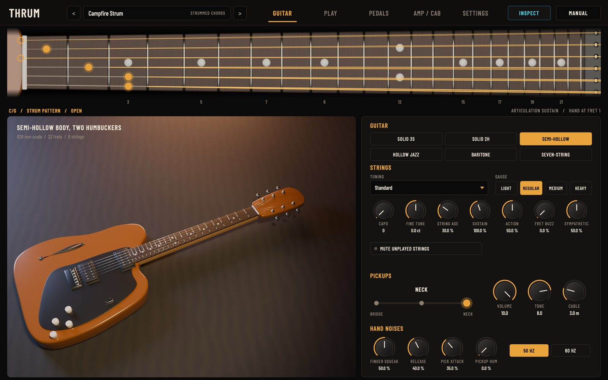
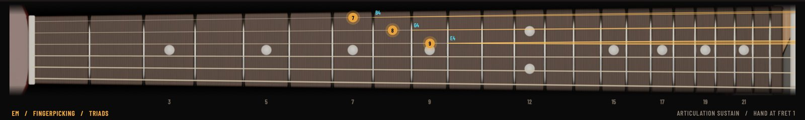
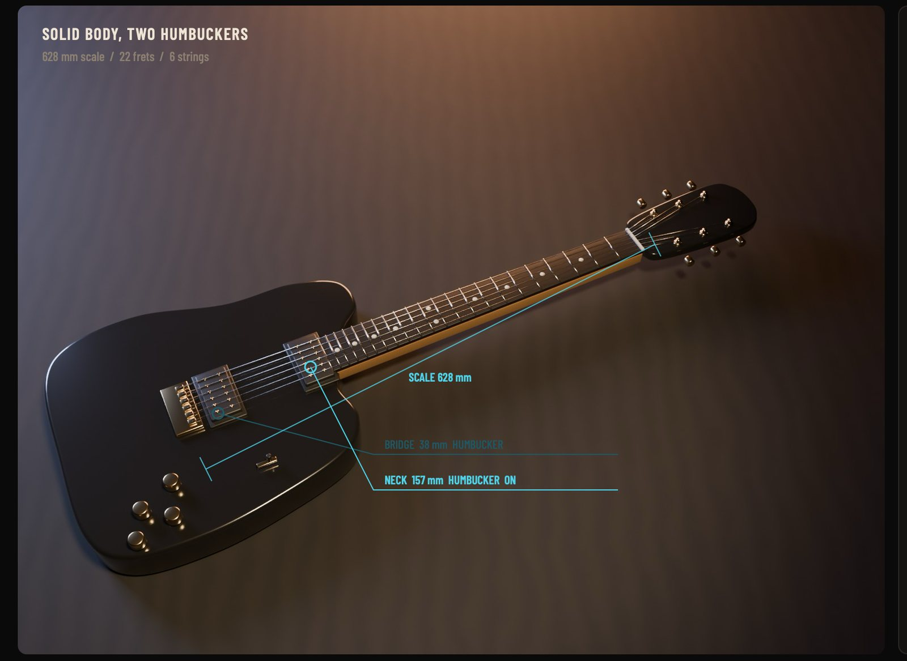
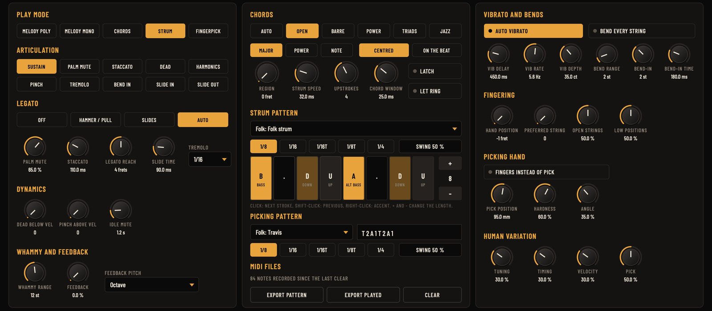
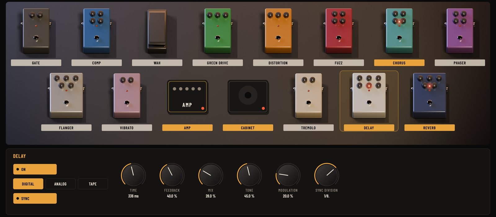
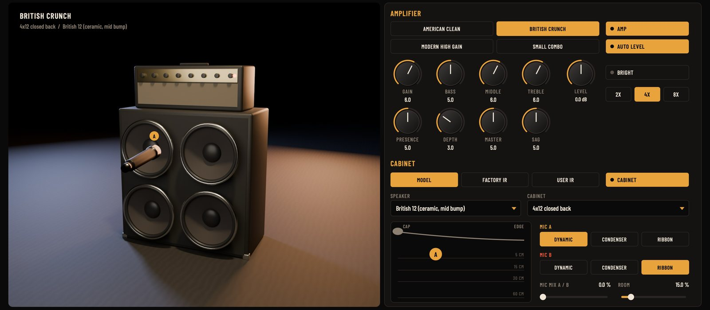
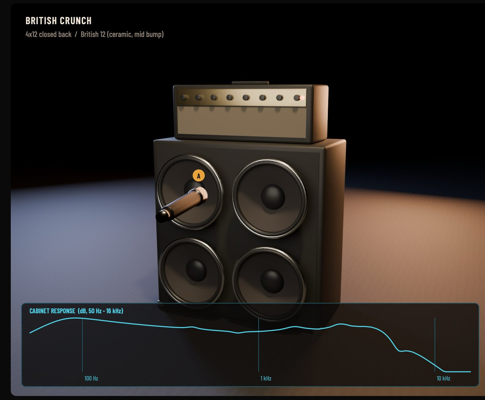
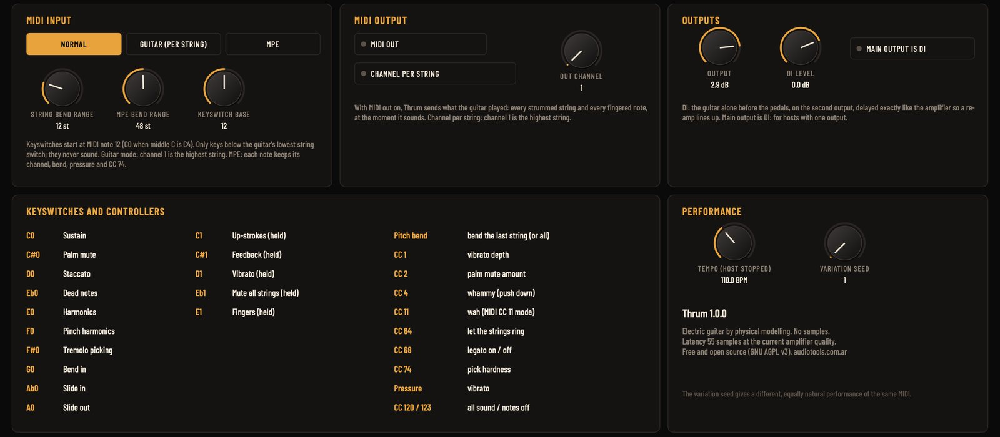

# Thrum user manual

## What Thrum is

Thrum is an electric guitar for your keyboard and your DAW, built by physical modelling: no samples. Every string is a vibrating string simulated as it plays, with its gauge, its tension and its stiffness; the pickups listen to it at their real distance from the bridge, through the volume and tone pots and the cable; and a guitarist inside the plugin decides on which string and fret each note is played, strums the chords string by string, picks with the fingers and plays the articulations. After the guitar comes a pedal board you can reorder, four amplifiers and a cabinet with movable microphones.

Because nothing is recorded, the same note never sounds twice the same: the pick lands a little differently every time, the strum spreads differently, the tuning moves a few cents with the force of the pick. And everything stays editable: change the guitar, the strings or the tuning and every note follows.

Thrum has six guitars, all described generically: a solid body with three single coils, a solid body with two humbuckers, a semi-hollow, a hollow jazz body, a baritone and a seven-string. It plays melodies (with hammer-ons, pull-offs, slides, bends and vibrato), chords voiced like a guitarist would play them, strum patterns synced to your song and fingerpicking patterns.

## Installing

Download the package for your system from the website and unzip it. The Audio Tools launcher can also download and install it for you.

On macOS:

1. Copy `Thrum.vst3` to `~/Library/Audio/Plug-Ins/VST3/` and `Thrum.component` (Audio Unit) to `~/Library/Audio/Plug-Ins/Components/`.
2. Rescan plugins in your DAW. Thrum appears as **Audio Tools Thrum**, an instrument.
3. `Thrum.app` is the standalone version and `thrumrender` the command-line renderer.

The files are not notarized. If macOS refuses to open them, run `xattr -dr com.apple.quarantine` followed by the path of each file.

On Windows:

1. Copy `Thrum.vst3` to `C:\Program Files\Common Files\VST3\`.
2. Rescan plugins in your DAW.
3. `Thrum.exe` is the standalone version and `thrumrender.exe` the command-line renderer.

On Linux:

1. Copy `Thrum.vst3` to `~/.vst3/` and `Thrum.lv2` to `~/.lv2/`.
2. Rescan plugins in your DAW. `Thrum` is the standalone version (ALSA or JACK).

## First sounds in one minute

1. Put Thrum on an instrument track and play a few single notes: the default preset is a clean guitar in melody mode.
2. Hold a chord with three or four keys. In melody mode the notes are placed together on different strings and picked low to high, like a quick strum.
3. Open the preset menu and pick **Campfire Strum** (in Strummed Chords). Start your DAW's playback and hold a chord: Thrum strums it in time with your song. Change chords and it follows.
4. Pick **Blues Lead Bends** and play a melody with one finger: notes that overlap become hammer-ons and pull-offs, and long notes get a vibrato after a moment.
5. Pick **Modern Chug** and play low notes: palm-muted high gain. Turn the pitch bend wheel for a bend.

> Thrum reacts to how you play: velocity is the force of the pick, overlapping notes are legato, and the keys below the guitar's lowest note are keyswitches that change the articulation.

## The interface at a glance

The top bar has the preset menu with the previous and next buttons, the page buttons, **Inspect** and **Manual**, which opens this manual inside the plugin.

Below it, across the whole window, is the fretboard of the chosen guitar. It shows live what the guitarist inside Thrum is doing: a dot on every string and fret that sounds, the string vibrating while it rings, open strings marked at the nut and the capo when there is one. It is the quickest way to see why a note sounds the way it does: the same E can be an open string, the fifth fret of the B string or the ninth of the G string, and each one has its own colour. Under the fretboard, Thrum shows the chord it recognised, the play mode, the articulation and where the hand is.

**Inspect** turns on the technical view, drawn in cyan over every page: the name of each sounding note on the fretboard, where each pickup listens on the guitar (measured from the bridge) and which ones the selector turns on, the signal path and the delay's echoes on the Pedals page, and the frequency response of the cabinet and microphones on the Amp / Cab page. Turn it off for the plain view.

The pages:

- **Guitar**: the instrument, its strings, its tuning, the pickups and the hand noises.
- **Play**: how the guitarist plays: the play mode, the articulations, legato, vibrato and bends, chords, strum and picking patterns, fingering and human variation.
- **Pedals**: the pedal board. Click a pedal's footswitch to turn it on, drag a pedal to move it in the chain.
- **Amp / Cab**: the amplifier and the cabinet, with the microphones you can move in front of the speaker.
- **Settings**: MIDI input and output, keyswitches, the output levels and the DI output.

## The guitar

### Guitar types

**Guitar** chooses the instrument. Each type changes the scale length and the number of frets, the string set and its tension, the body (how long the notes sustain, how bright it is, how the body and the bridge resonate) and the pickups (where they sit and what kind they are).

| Guitar | Scale | Frets | Pickups | Sound |
|---|---|---|---|---|
| Solid body, three single coils | 648 mm | 22 | three single coils, five-way selector | bright, glassy, quacky in positions 2 and 4 |
| Solid body, two humbuckers | 628 mm | 22 | two humbuckers, three-way selector | thick, warm, long sustain |
| Semi-hollow body, two humbuckers | 628 mm | 22 | two humbuckers | rounder, airy, a little acoustic resonance |
| Hollow jazz body | 628 mm | 20 | two humbuckers | dark, woody, short sustain, heavy strings |
| Baritone | 686 mm | 24 | a humbucker and a single coil | tuned a fourth lower, deep and tight |
| Seven-string | 648 mm | 24 | two humbuckers | standard tuning plus a low B |

### Strings and tuning

- **Tuning**: Standard, Drop (lowest string down a tone), Half step down, Open G, Open D, Open E, DADGAD, Drop a tone lower, and Custom. In Custom, **String 1 tuning** to **String 7 tuning** move each string up or down by semitones from standard (string 1 is the highest).
- **String gauge**: Light, Regular, Medium or Heavy. Heavier strings have more tension, a stronger fundamental and a longer sustain; light strings bend more easily and sound brighter.
- **Capo** (0 to 12): a capo on that fret. The fingering counts frets from the capo, as a guitarist would.
- **Fine tune** (±50 cents): the whole guitar.
- **String age** (0 to 100 %): new strings are bright and ring long; old strings lose their highs early.
- **Body sustain** (25 to 200 %): how long the notes last.
- **Action** (0 to 100 %): the height of the strings. Higher action rings cleaner; low action buzzes sooner when you add **Fret buzz**.
- **Fret buzz** (0 to 100 %): the string touching the frets when it vibrates wide, strongest on hard picking.
- **Sympathetic strings** (0 to 100 %): the strings that are not played still vibrate a little with the others through the bridge, as on a real guitar.
- **Mute unplayed strings**: when on, the fretting hand damps every string that is not being played, so nothing rings by sympathy. Useful for very dry rhythm parts.

### Pickups and controls

- **Pickup selector**: on the guitar with three single coils, five positions: Bridge, Bridge + middle, Middle, Middle + neck, Neck. The other guitars have two pickups and three positions: Bridge, Both, Neck. Click a position on the switch. The bridge pickup is bright and thin, the neck pickup round and full; the in-between positions of the single-coil guitar have the hollow, "quacky" sound of two coils at different places on the string.
- **Volume** and **Tone** (0 to 10): the guitar's own pots. Lowering the volume also takes some highs away (the pot against the cable), and with a driven amp it cleans the sound up, like on a real guitar. The tone control is the classic capacitor: it darkens and, near zero, adds a resonant "woman tone".
- **Cable length** (1 to 10 m): a longer cable has more capacitance and softens the highs.
- **Mains hum** (50 or 60 Hz) and **Pickup hum** (0 to 100 %): the hum and hiss of the pickups. Single coils hum more than humbuckers. Leave it at zero for clean recordings, raise it a little for realism under a high-gain amp.

### Hand noises

Each noise has its own level (0 to 100 %):

- **Finger squeak**: the fingers sliding on the wound strings when the hand moves along the neck, louder the faster it moves.
- **Release noise**: the small sound when a finger lets go of a string.
- **Pick attack noise**: the scrape of the pick on the string at the attack.

## Playing

### Play modes

**Play mode** sets how the keys you press become guitar playing.

- **Melody (poly)**: every key is a note. Notes that start together are placed together on different strings (a chord picked quickly from low to high); a single line is fingered with legato where the notes overlap.
- **Melody (mono)**: one note at a time, like a lead player. A new note replaces the previous one; overlapping notes become hammer-ons, pull-offs or slides.
- **Chords**: the keys you hold are recognised as a chord (22 chord types, with slash basses) and Thrum plays it as a guitarist would voice it, strummed once each time you change it.
- **Strum pattern**: the held chord is strummed with the selected pattern, in time with your song.
- **Fingerpicking**: the held chord is picked string by string with the selected picking pattern.

### Articulations

**Articulation** chooses how notes are played. It can also be changed with keyswitches (see MIDI), with velocity, and some of them with controllers.

- **Sustain**: normal notes.
- **Palm mute**: the side of the picking hand rests on the strings near the bridge. **Palm mute amount** sets how much (light chug to fully choked). CC 2 also sets it live.
- **Staccato**: short notes; **Staccato length** sets how short (40 to 300 ms).
- **Dead notes**: the fretting hand only touches the strings: a percussive click with no pitch. **Dead notes below velocity** turns every soft note into a dead note, so you can play ghost notes with the velocity.
- **Harmonics**: natural harmonics where the note exists as one on an open string (frets 12, 7, 5, 4 and 3), artificial harmonics elsewhere.
- **Pinch harmonics**: the squeal of the thumb touching the string right after the pick. **Pinch above velocity** turns every hard note into a pinch harmonic.
- **Tremolo picking**: the note is picked repeatedly at **Tremolo picking** (1/8, 1/16, 1/16T, 1/8T or 1/4 of the tempo) while you hold the key.
- **Bend in**: the note starts bent from below (**Bend-in amount**, 1 to 4 semitones, over **Bend-in time**).
- **Slide in**: the note slides in from a few frets lower.
- **Slide out**: when you release the key the finger slides down the neck.

### Legato, slides and vibrato

- **Legato**: Off, Hammer-on / pull-off, Slides, or Auto (hammer-ons and pull-offs for small intervals, slides for larger ones). It applies to overlapping notes in the melody modes, on the same string, within **Legato reach** frets (1 to 7). CC 68 turns legato on and off live.
- **Slide time** (20 to 400 ms): how long slides take.
- **Auto vibrato**: long single notes get a hand vibrato after **Vibrato delay**, at **Vibrato rate** (3 to 8 Hz) and **Vibrato depth** (in cents). The vibrato pushes the string and lets it come back, as a guitarist does, so it only goes up. The mod wheel (CC 1), channel pressure and polyphonic aftertouch add vibrato too.

### Bends, whammy and feedback

- **Pitch bend range** (1 to 12 semitones): the pitch bend wheel bends the last string played, or every string with **Pitch bend bends every string** on.
- **Whammy range** (1 to 24 semitones): CC 4 pushes the tremolo arm down. Each string drops by a different amount, as on a floating bridge, and when you release the arm the bridge flutters for a moment.
- **Feedback** (0 to 100 %) and **Feedback pitch**: a held note slowly turns into amplifier feedback: it sustains forever and, after a while, jumps to the Fundamental, Octave, Octave + fifth or Two octaves. Holding the feedback keyswitch does the same on any note.

### Chords, strum and fingerpicking

- **Voicing**: Auto, Open, Barre, Power, Triads or Jazz. Auto picks what a guitarist would most likely play in the chosen region: open chords near the nut, barre chords higher up.
- **Chord region** (fret 0 to 12): where on the neck the chords are played.
- **Single key plays**: what a single held key means in the chord modes: a Major chord, a Power chord or The note alone.
- **Chord window** (0 to 80 ms): keys that arrive within this time are taken as one chord. Raise it if you play chords loosely.
- **Latch chord**: the chord keeps playing after you release the keys, until you play the next one.
- **Let open strings ring**: open strings keep ringing when the chord changes, instead of being damped.
- **Strum pattern**: the strum pattern, from a library of 32 (rock, pop, funk, reggae, ballad, post-punk and more). You can edit the selected pattern on the Play page.
- **Strum speed** (5 to 120 ms): how long a strum takes from the first to the last string, at medium force. Harder strums are faster.
- **Upstroke strings** (2 to 7): how many of the high strings an upstroke usually hits.
- **Strum timing**: **Centred on the beat** (the default) starts the strum a little before the beat so that its middle strings land on it, which is how guitarists keep time; **Starts on the beat** puts the first string on the beat.
- **Picking pattern**: the fingerpicking pattern, from a library of 11 (Travis, alternating bass, rolls, p-i-m-a, ballad arpeggios and more).
- **Tempo (host stopped)**: when your DAW is not playing, the patterns follow this tempo and start with the first key you press.

With the DAW playing, the patterns follow its song position, and when it loops, every pass strums the same as the first one: the end of the loop flows into its start without losing or repeating a stroke.

> With Centred on the beat, a chord that changes exactly on the beat in your MIDI clip is caught a few milliseconds late: the strings of the old chord that had not been picked yet are skipped and the new chord is strummed at once. For the tightest changes, start the new chord's notes a 64th note early, as a guitarist moves the hand before the beat, or choose Starts on the beat.

### The strum pattern language

Each step of a strum pattern is one stroke:

| Step | Stroke |
|---|---|
| D / U | down / up, the whole chord |
| d / u | down / up, only the high strings |
| M / m | down / up with the palm muted |
| X / x | dead strum down / up: the left hand only touches the strings ("chk") |
| B | the bass note alone |
| A | the alternate bass note |
| S | down, then the chord is cut half a step later |
| . or - | nothing |

A vertical bar (the pipe character) stops every string. Each step can also have an accent (normal, accent or strong), the pattern has a length (up to 32 steps in the editor), a division (1/8, 1/16, 1/16T, 1/8T or 1/4) and a swing for 1/8 and 1/16.

On the Play page, the strum pattern is a row of steps: click a step for the next stroke, shift-click for the previous one, right-click to change its accent; **+** and **-** change the length. The division buttons sit above it, and **Swing** changes when you drag it (double-click: straight). The picking pattern is the text field next to its menu: type the groups and press Return.

Picking patterns use groups separated by spaces, one group per step: `T` the bass string, `A` the alternate bass, `1` the highest string of the chord, `2` the next one down, `3`, `4`; several in one group sound together (`T1` is a pinch of bass and melody); `.` is a rest and `>` in front of a group accents it.

### Fingering

Every note goes to a real string and fret. Thrum chooses by cost, like a player: it keeps the hand in one place when it can, avoids jumping between strings, prefers low positions and open strings to the degree you ask.

- **Hand position** (fret −1 to 19): −1 lets Thrum move the hand freely; any other value keeps it around that fret.
- **Preferred string** (0 to 7): 0 is automatic; 1 to 7 plays every note it can on that string (string 1 is the highest). Great for a melody on the low string, or a whole riff on one string.
- **Open strings** and **Low positions** (0 to 100 %): how much Thrum likes them.

### Picking hand

- **Fingers instead of pick**: softer, rounder attacks with no pick scrape.
- **Pick position** (20 to 160 mm from the bridge): close to the bridge is thin and bright, over the neck round and soft.
- **Pick hardness** (0 to 100 %): a soft pick rounds the attack, a hard one makes it sharper. CC 74 changes it live.
- **Pick angle** (0 to 100 %): an angled pick scrapes more and excites the string in a different plane, which changes the decay.

### Human variation

No two notes are identical. The variation is calculated, not random: the same MIDI renders the same audio every time, and a different **Variation seed** (on the Settings page) gives a different, equally natural performance.

- **Human tuning**: a few cents of difference from note to note, as fingers press the string with different force.
- **Human timing**: small delays and a less regular strum.
- **Human velocity**: small changes of force.
- **Human pick**: the pick lands at a slightly different place, angle and hardness each time. This is what replaces the round robin of sampled guitars.
- **Idle hand mute** (0.3 to 6 s): when you stop playing, after this time the hand rests on the strings and silences whatever was still ringing.

## Pedals

The board has thirteen pedals; the amplifier and the cabinet are part of the same chain. Click a pedal's footswitch (or double-click the pedal) to turn it on; click the pedal to show its controls below the board; drag it to another place on the board to change its position in the chain. The board reads like a page: the top row from left to right, then the bottom row. The usual order is gate, compressor, wah and drives before the amplifier; modulation, delay and reverb after the cabinet, where they are in stereo.

- **Noise gate**: **Threshold** and **Release**. Silences the hum and hiss between phrases, essential with high gain.
- **Compressor**: **Sustain**, **Attack**, **Level** and **Blend** (parallel compression). Evens out picking and adds sustain.
- **Wah**: **Mode** Manual (the **Position** knob), Auto (follows how hard you play: **Sensitivity**, **Speed**) or MIDI CC 11 (an expression pedal or a controller lane). **Range** and **Resonance** shape the sweep.
- **Green overdrive**: a mid-boosted, smooth overdrive: **Drive**, **Tone**, **Level**. Classic in front of an amp that is already breaking up.
- **Distortion**: hard clipping: **Amount**, **Filter**, **Level**.
- **Fuzz**: two-transistor fuzz with a **Silicon** or **Germanium** transistor: **Amount**, **Bias** (lower bias sputters and gates), **Tone**, **Level**. It cleans up when you lower the guitar's volume.
- **Chorus**: **Rate**, **Depth**, **Mix**, **Tone**.
- **Phaser**: **Rate**, **Depth**, **Feedback**, **Mix**.
- **Flanger**: **Rate**, **Depth**, **Feedback**, **Mix**, **Manual**.
- **Tremolo**: **Shape** Sine, Optical or Harmonic; **Rate**, **Depth**; **Sync** to the tempo.
- **Vibrato**: pitch vibrato, **Rate** and **Depth**.
- **Delay**: **Type** Digital, Analog (darker repeats) or Tape (wow, flutter and saturation in the loop); **Time** or, with **Sync**, a division from 1/32 to 1/2 with dotted and triplet values; **Feedback**, **Mix**, **Tone**, **Modulation**.
- **Reverb**: **Type** Spring, Room or Hall; **Decay**, **Tone**, **Mix**, **Pre-delay**, **Size / drip** (on the spring, how much it drips); **Freeze** holds the reverb forever, for ambient pads.

## Amp and cabinet

### The amplifier

**Amp** chooses one of four:

- **American clean**: big, clean headroom with a scooped tone stack; breaks up only at high gain with a hard strum.
- **British crunch**: three gain stages, the classic crunch to rock sound.
- **Modern high gain**: five gain stages with a tight low end, for metal and modern rock.
- **Small combo**: a small class-A combo with no master volume: the power stage saturates and sags.

The controls:

- **Gain**: how hard the preamp is driven.
- **Auto level** (on by default): Gain changes the character but not much the volume, so you can sweep it without jumping out of the mix. Turn it off for the classic amplifier behaviour: then Gain also raises the volume, a lot on the clean and combo amps. Both modes sound equally loud at Gain 5.
- **Bass**, **Middle**, **Treble**: the tone stack, the real interacting circuit of these amps (turning one changes the others a little).
- **Presence** and **Depth**: high and low resonance of the power stage.
- **Master**: the power stage drive.
- **Sag** (0 to 10): the power supply drooping under load: more compression and bloom on hard chords.
- **Bright**: a bright switch, strongest at low gain.
- **Amp level** (±24 dB): the level after the amplifier.
- **Amp quality** 2x, 4x or 8x (oversampling): higher is cleaner on high gain and uses more CPU. It also sets the latency (47, 55 or 57 samples).

### The cabinet

**Cabinet source** chooses where the cabinet's sound comes from:

- **Model**: our own model of the speaker and microphones. **Speaker** (Vintage 12, British 12, American 12, Modern 12, Small 10) and **Cabinet** (1x12 open back, 2x12 open back, 4x12 closed back, 1x10 small combo) set the box. Two microphones, **Mic A** and **Mic B** (Dynamic, Condenser or Ribbon), each with a **position** across the speaker (0 % at the centre of the cone, bright; 100 % at the edge, dark) and a **distance** (1 to 60 cm; close is bassier from the proximity effect). Drag the microphones on the pad below the speaker: left and right is the position across the cone, up and down the distance; the picture of the cabinet shows where they are. **Mic mix A/B** blends them, with the real time difference between them, and **Room reflection** adds the floor.
- **Factory IR**: eight impulse responses made by the same model, ready to use.

- **User IR**: load your own impulse response (WAV, AIFF or FLAC, mono or stereo, up to 3 seconds). It is resampled to your project's rate and saved with the project. Long responses work too: a room, a spring or a whole studio chain.

## Presets

Sixty-nine presets in nine categories:

- **Clean**: Glass Arpeggio, Warm Jazz Box, Funk Scratch, Sparkle Pop Strum, Clean Picked Lead, Fingerstyle Semi, Chicken Pickin', Bossa Night.
- **Crunch & Blues**: Small Combo Breakup, Blues Lead Bends, Texas Shuffle, Crunch Rhythm, Edge of Breakup, Open G Slide, Delta Fingerpick, Green Drive Lead.
- **Rock & High Gain**: Classic Stack Eighths, Arena Lead, Seventies Riff, Modern Chug, Baritone Doom, Metal Lead, Thrash Palm Mute, Seven String Grid, Stoner Fuzz, Pinch Squeal.
- **Post-punk & Dark wave**: Cold Chorus Arpeggio, Night Drive Strum, Post-Punk Downstrokes, Gothic Lead, Ice Cathedral, Wire Stabs, Baritone Shadows, Coldwave Tremolo.
- **Surf, Shoegaze & Ambient**: Surf Spring Drip, Surf Rhythm, Twang and Spring, Shoegaze Wall, Haze Melody, Ambient Freeze, Swell Pad, Feedback Drone, Endless Sustain.
- **Strummed Chords**: Campfire Strum, Pop Punk Eighths, Reggae Skank, Funk Ghost Notes, Boom Chuck, Waltz Strum, Six-Eight Ballad, Anthem Strum, Half Time Pop.
- **Leads**: Legato Runs, Bend Into Note, Slide Lead, Trill Lead, Tremolo Picking Lead, Harmonics Bells, Whammy Dives, Fusion Lead.
- **Effects**: Auto Wah Funk, Wah Lead (CC 11), Seventies Phaser, Jet Flanger Chords, Tape Echo Twang, Harmonic Tremolo Chords.
- **Direct**: DI Single Coils, DI Humbuckers, DI Baritone: the guitar alone, without amplifier, for your own amp plugins.

A preset sets the guitar, the playing and the whole chain. The MIDI settings, the tempo for when the host is stopped, the DI output and the amp quality belong to your session and are kept when you change presets.

Ableton Live does not show plugins' factory presets (it ignores VST3 program lists). Thrum's own preset menu works everywhere, and the factory presets also appear in Live's browser under Plug-Ins → Audio Tools Thrum (expand the plugin), installed by the launcher or by copying the Presets folder from the zip. Thrum has 182 parameters and Live keeps at most 128 of a device for automation: click **Configure** on Thrum's device and move the controls you want there. In a host's parameter list the amp's and the cabinet's switches are **Amp On** and **Cabinet On** (**Amp** and **Cabinet** are the model and the box).

## MIDI

### Keyswitches

Keys below the guitar's lowest open string are keyswitches; they start at **Keyswitch base note** (MIDI note 12 by default, which is C0 in DAWs where middle C is C4, or C-1 where it is C3). They never sound.

| Key | Articulation (stays until the next one) | | Key | While held |
|---|---|---|---|---|
| base + 0 | Sustain | | base + 12 | Up-strokes |
| base + 1 | Palm mute | | base + 13 | Feedback |
| base + 2 | Staccato | | base + 14 | Vibrato |
| base + 3 | Dead notes | | base + 15 | Mute all strings |
| base + 4 | Harmonics | | base + 16 | Fingers |
| base + 5 | Pinch harmonics | | | |
| base + 6 | Tremolo picking | | | |
| base + 7 | Bend in | | | |
| base + 8 | Slide in | | | |
| base + 9 | Slide out | | | |

### Controllers

| Controller | Does |
|---|---|
| Pitch bend | bends the last string played (or all, an option), within Pitch bend range |
| CC 1 (mod wheel) | vibrato depth |
| CC 2 | palm mute amount (0 = off) |
| CC 4 | whammy: pushes the arm down |
| CC 11 | wah position, with the wah in MIDI CC 11 mode |
| CC 64 (sustain) | let the strings ring |
| CC 68 | legato on and off |
| CC 74 | pick hardness |
| Channel pressure, poly aftertouch | vibrato |
| CC 120, CC 123 | all sound off, all notes off |

Velocity is the force of the pick, and with **Dead notes below velocity** and **Pinch above velocity** it can choose dead notes and pinch harmonics too.

### MIDI input modes

**MIDI input** on the Settings page:

- **Normal**: any channel, one instrument.
- **Guitar (channel per string)**: for MIDI guitars and guitar controllers that send each string on its own channel. Channel 1 is the highest string, channel 6 (or 7) the lowest; each channel's pitch bend bends only its string, within **Per-string bend range**.
- **MPE**: for MPE controllers. Every note keeps its own channel, and that channel's pitch bend (within **MPE bend range**, 48 semitones by default), pressure (vibrato) and CC 74 (pick hardness) act only on the string that plays it. Set your controller's bend range to match.

### MIDI output

With **MIDI out** on, Thrum sends what the guitar actually played: every strummed string, every fingered note, legato and slides, at the moment it sounds. Record it on another track to edit a strum note by note, or send it to another instrument to double the guitar. **MIDI out channel** sets the channel, or **MIDI out channel per string** sends each string on its own channel (channel 1 the highest), ready for a guitar-style instrument.

> Dead strums and the muted strings inside a strum are played but are not sent as notes: they have no pitch.

The notes leave Thrum as late as its audio (its latency, 55 samples at 4x quality), which the host compensates for the audio only, so a doubling instrument or a recording lines up with the guitar.

In Ableton Live and in REAPER use the VST3 for MIDI out: neither takes the MIDI that Audio Unit plugins produce. In Live set the receiving track's MIDI From to the Thrum track; in REAPER use a send with MIDI.

On the Play page, **Export pattern** saves the current strum or picking pattern as a `.mid` file, played over the chord you are holding (or C major), and **Export played** saves everything Thrum played since you last pressed **Clear**.

## Outputs

Thrum has two stereo outputs: the main output, with the whole chain, and **DI**, the guitar alone before the pedals, delayed by exactly the amplifier's latency so both line up. Record both and you can re-amp the DI later with another amplifier, Thrum's own or any other. In hosts that only take one output, **Main output is DI** sends the DI on the main output. **Output** and **DI level** set their levels.

## Getting realism out of it

- Play like a guitarist, not like a pianist. Guitar chords are voiced in a few shapes; let Thrum voice them (the chord modes) instead of playing piano voicings in melody mode.
- Overlap notes for legato and leave gaps for picked notes. A slide or a hammer-on happens only where the notes overlap.
- Use velocity. Soft picking is darker and quieter, hard picking brighter and a little sharp for a moment, like real strings.
- Keep the human variation on. Thirty percent is a careful player; seventy a loose one. Zero sounds mechanical, which is useful only for tests.
- Vary the articulation in a riff: a palm-muted chug with an open accent, a dead note between two chords, a slide into the last note. Keyswitches on a separate MIDI lane make it easy.
- Bend up into notes with the pitch wheel and add vibrato at the end of long notes, not at the start.
- Change chords a little before the beat, as a guitarist's hand does, especially with Strum timing on Centred.
- Use the right guitar for the style: single coils for funk and clean pop, humbuckers for rock, the hollow body for jazz, the baritone for dark wave.
- Don't overdo the noises: a little finger squeak on slides and position changes sells the part; too much sounds like a mistake.
- Pan two takes left and right with different **Variation seed** values for a double-tracked rhythm guitar.

## The command-line renderer

`thrumrender` renders a preset to a WAV file with the whole plugin, without a DAW:

- `thrumrender out.wav --preset "Campfire Strum" --chords "C G Am F" --bpm 96` strums a progression.
- `thrumrender out.wav --preset "Blues Lead Bends" --midi solo.mid` plays a MIDI file; `--di di.wav` also writes the DI.
- `thrumrender --list` lists the presets; `--bench` measures the CPU of every preset; `--export-irs folder` writes the factory impulse responses; `--export-pattern f.mid` writes a pattern.

## Specifications

- Formats: VST3, Audio Unit (macOS), LV2 (Linux), standalone; instrument with MIDI input and output.
- Systems: macOS 11 or later (Apple Silicon and Intel), Windows 10 or 11 (x64), Linux x86_64 (glibc 2.35 or later).
- Latency: 47, 55 or 57 samples (amplifier quality 2x, 4x, 8x), the same with the amplifier off.
- CPU, one core at 48 kHz: 3.3 % on average over the presets on an Apple M4, 6.2 % on an AMD Ryzen 9 5900XT; the guitar alone 1.4 % and 2.7 %.
- Strings: digital waveguides with two polarisations, stiffness fitted per fret, tension modulation, bridge coupling and a neck dead spot. Pickups with their position, aperture and passive circuit. Amplifiers with tube stages, the real tone stack, power stage and sag, oversampled. Cabinet by our own speaker and microphone model or by impulse responses up to 3 s (partitioned convolution, no added latency).
- No samples: every sound is calculated while you play.
