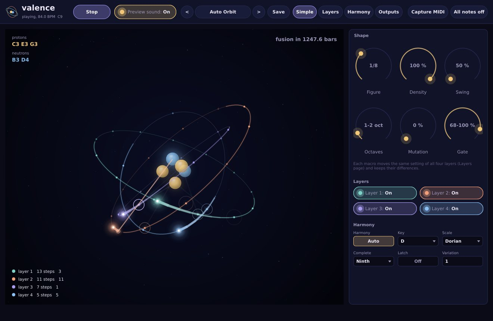
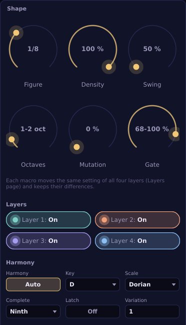
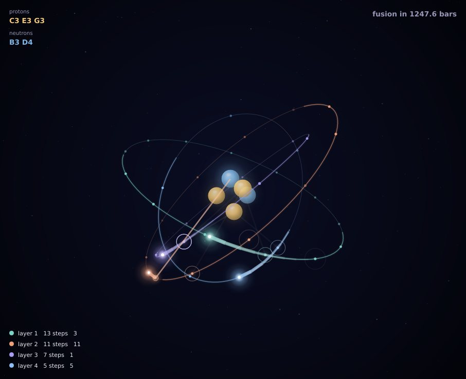
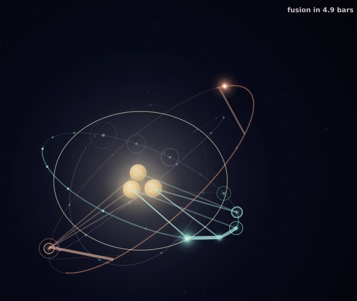
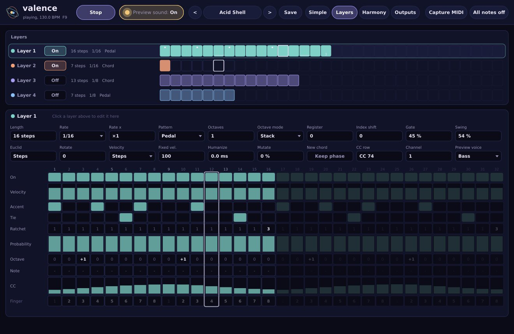
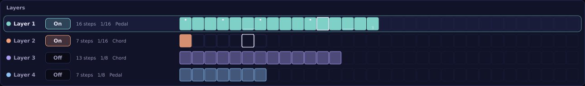
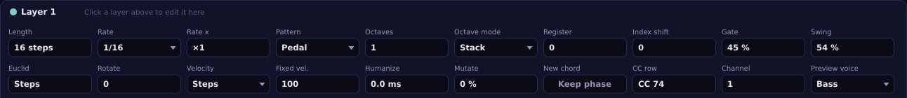
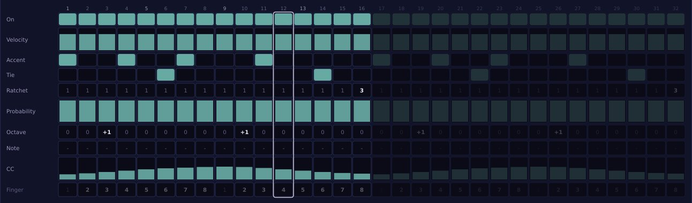
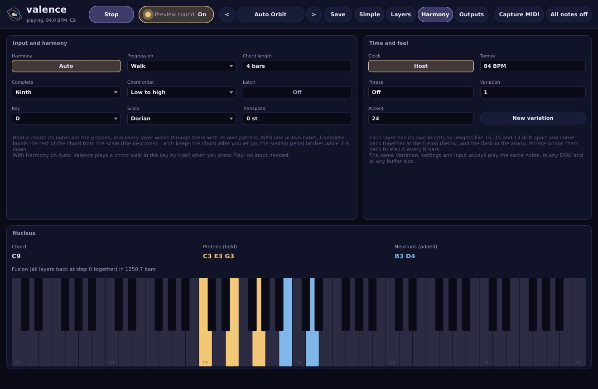
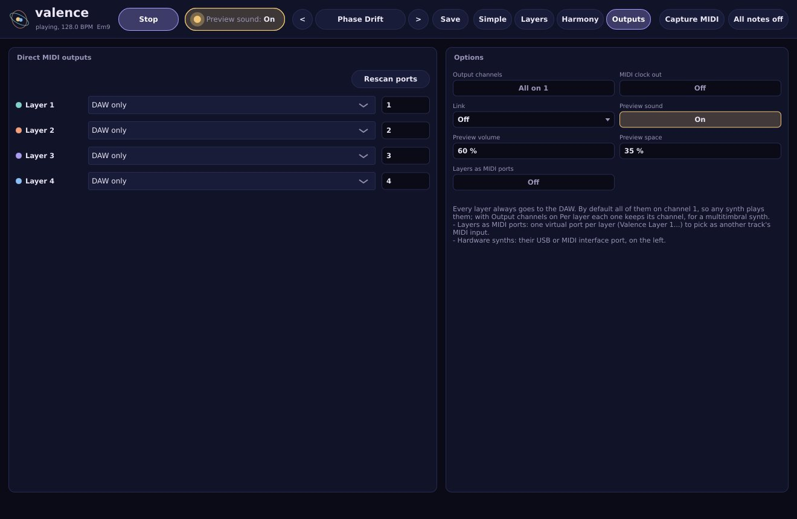

# Valence user manual

## What Valence is

Valence is a MIDI arpeggiator with four layers. It does not make sound by itself: it takes the chord you hold, plays it as arpeggios and sends the notes to other instruments, either software synths in your DAW or hardware synths on a MIDI cable.

The four **layers** all walk through the same chord, but each one has its own length in steps, its own step figure, pattern, octave range, gate, swing and MIDI channel. With lengths of 16, 15 and 13 steps the layers drift apart, step by step, and only come back together after minutes: 3120 sixteenth notes, 195 bars. That moment, when every layer is back on its first step at once, is the **fusion**, and Valence tells you how many bars away it is.

Every step of every layer has its own rows: on or off, velocity, accent, tie, ratchet, probability, octave, a fixed note, a controller value. A layer can also mutate a little at every cycle, so a pattern changes slowly over a long track.

The interface is an atom. The notes you hold are the **protons** of the nucleus, the notes Valence adds to complete the chord are the **neutrons**, each layer is an **orbit** with its steps marked on it, an **electron** runs round each orbit as the layer plays, and every note is a **photon** fired from the electron to the note it played.

Every random choice comes from a **variation** number, so the same chord, settings and variation play the same notes every time, in any DAW and at any buffer size. A small built-in **preview sound** lets you try it all without routing anything, and **Auto harmony** plays a chord walk by itself when you have no keyboard at hand.

## Installing

Valence comes as a VST3 plugin, an Audio Unit instrument and an Audio Unit MIDI FX (macOS only), an LV2 plugin (Linux only) and a standalone application. It runs on macOS 11 or later (one universal binary for Apple silicon and Intel), on 64-bit Windows 10 or 11 and on 64-bit Linux.

On macOS:

1. Unzip the download.
2. Copy `Valence.vst3` to `~/Library/Audio/Plug-Ins/VST3`.
3. Copy `Valence.component` and `Valence MIDI FX.component` to `~/Library/Audio/Plug-Ins/Components`.
4. Rescan plugins in your DAW. In Ableton Live and REAPER, use the VST3 (see below); in Logic, use the MIDI FX.

On Windows:

1. Unzip the download.
2. Copy `Valence.vst3` to `C:\Program Files\Common Files\VST3`.
3. Rescan plugins in your DAW.
4. `Valence.exe` is the standalone version: it runs on its own and plays your MIDI ports.

On Linux, copy `Valence.vst3` to `~/.vst3/` and the LV2 bundle to `~/.lv2/`, then rescan in your host.

> The builds are not code-signed yet. macOS may refuse to open them until you run `xattr -dr com.apple.quarantine` on the installed plugins, and Windows SmartScreen may ask you to confirm the first time. Each package includes an INSTALL.txt with the exact steps.

## Loading it in a DAW

Valence loads as an instrument on its own MIDI track. The chord you play goes into that track (from your keyboard or a MIDI clip), and the arpeggios come out of it; your synths sit on other tracks and take their MIDI input from the Valence track.

By default every layer goes out on MIDI channel 1, so any synth plays all of them. With **Output channels** set to `Per layer` (on the Outputs page) each layer keeps its own channel, 1 to 4 unless you change them, for a multitimbral synth or for routings that filter by channel.

Valence keeps the notes you play to itself: they become the chord, they are not passed on. Other controller messages, pitch bend and aftertouch pass through unchanged. The sustain pedal (CC 64) latches the chord while it is down, and All Notes Off or All Sound Off (CC 123, CC 120) from your DAW stops the arpeggio. When the plugin is bypassed it releases every note that is sounding and forgets the keys that were held; a latched chord stays.

Every setting is also a host parameter that you can automate. The first 64 are the global settings and the main settings of each layer (`Layer 1 Rate`, `Layer 2 Length`...), which is what Ableton Live shows in its device panel; the finer settings of each layer come after them. The step rows are not parameters: they are saved with the project and with presets.

### In Ableton Live

1. Drag the Valence VST3 onto an empty MIDI track. Live does not pass on the MIDI that Audio Unit plugins produce, so the AU version cannot play other tracks there.
2. Arm the Valence track (or set its **Monitor** to `In`) so your keyboard reaches it, or put a MIDI clip with chords on it.
3. Put your synth on another MIDI track.
4. In the synth track's I/O section, set **MIDI From** to the Valence track, and in the chooser below it pick `Audio Tools Valence`.
5. Set the synth track's **Monitor** to `In`.
6. Click **Preview sound** in Valence's top bar, next to Play, so it reads `Preview sound: Off`. You then hear only your synth.
7. Hold a chord.

Live merges all MIDI channels when it routes MIDI from one track to another, so that synth receives every layer that is on. That is right for one synth playing everything. To send each layer to a different synth there are two ways:

- **One multitimbral synth.** On Valence's Outputs page set **Output channels** to `Per layer`. Layer 1 then plays on channel 1, layer 2 on channel 2, and so on (each layer's **Channel** sets which). Load a synth that plays a different sound on each channel and route it as above.
- **Layers as MIDI ports** (macOS). On the Outputs page turn **Layers as MIDI ports** on. Valence creates one virtual MIDI port per layer, named `Valence Layer 1` to `Valence Layer 4` (a second Valence that also publishes uses `Valence 2 Layer 1` and so on). Once only, in Live's Settings, on the Link, Tempo & MIDI tab, turn on **Track** for the input of each `Valence Layer` port. Then, on each synth track, set **MIDI From** to one port, for example `Valence Layer 2`, with `All Channels`, and set **Monitor** to `In`. Each synth hears only its layer.

On Windows there are no virtual MIDI ports of its own: create a port with loopMIDI, choose it for the layers on Valence's Outputs page, set Output channels to `Per layer`, and on each synth track pick that port in MIDI From with the channel of its layer.

Live ignores the factory presets of VST3 plugins in its own preset list; use Valence's preset menu, or the browser: the factory presets appear in Live's browser under Plug-Ins, Audio Tools Valence (expand the plugin), installed by the launcher or by copying the Presets folder from the zip.

### In REAPER

Use the VST3: REAPER does not pass on the MIDI that Audio Unit plugins produce either.

1. Put Valence on a track and record-arm it with your keyboard as its input, with monitoring on (or put a MIDI item with chords on that track).
2. Put your synth on another track.
3. Send the Valence track to the synth track, with MIDI. With **Output channels** on `Per layer`, set the MIDI channel of each send to the layer that synth should play, so several synths each take their own layer from one Valence.

REAPER lists every factory preset twice in the preset menu: once from the plugin's own list and once as a preset file (the .vstpreset files that the launcher or the Presets folder of the zip install for Ableton Live, in ~/Library/Audio/Presets/Audio Tools/ on macOS, Documents\VST3 Presets\Audio Tools\ on Windows and ~/.vst3/presets/Audio Tools/ on Linux). Both load the same settings. If you don't use Live, you can delete the "Audio Tools Valence" folder there and each preset appears once.

REAPER's list of parameters for automation shows Valence's own parameters first and then about two thousand entries named `MIDI CC`: they are how a VST3 receives controllers such as the sustain pedal, and you can ignore them.

### In Logic

In Logic use **Audio Tools Valence MIDI FX**, the Audio Unit MIDI FX version:

1. Create a software instrument track with your synth.
2. In the channel strip's **MIDI FX** slot, above the instrument, choose Audio Units, Audio Tools, Audio Tools Valence MIDI FX.
3. Play a chord on that track, or put a region with chords on it.

The MIDI FX plays the instrument of its own channel strip, and all four layers go to that instrument. To hear the layers on different sounds, set **Output channels** to `Per layer` and use a multitimbral instrument that plays a different sound on each MIDI channel. The MIDI FX has no preview sound: what you hear is always your instrument.

Things not checked yet in Logic: whether Logic gives a MIDI FX its song position, so that Clock on Host locks the layers to Logic's bars; Valence takes Logic's tempo when Logic reports it, and otherwise the last tempo it saw or its own Tempo. Sending each layer to a separate instrument track (through the instrument version's direct outputs or its virtual ports) has not been tried in Logic either.

## First sound

1. Open Valence (the standalone, or the plugin on a MIDI track).
2. Hold a chord of three or four notes on your keyboard.

The preview sound plays right away and the atom in the middle of the Simple page comes alive: your notes appear as protons in the nucleus, an electron runs round each orbit and every note fires a photon. Let go and the arpeggio stops; turn **Latch** on to keep it playing after you let go.

With no keyboard at hand, set **Harmony** to `Auto` (on the Simple page, under the layer switches) and press **Play** in the top bar: Valence then plays a chord walk in the key by itself.

What you hear is Valence's **preview sound**, a small built-in synth that is there so you can try Valence without routing anything: a pluck, a filtered bass, a chord stab and a sub, one per layer. It is not your synth. While it plays, the button next to Play reads `Preview sound: On`. When your own synths play, click the button so it reads `Preview sound: Off`: the MIDI Valence sends is the same either way.

## The interface at a glance

The window has a top bar, a page area and a footer. It opens at 85 % of its full size and can be resized from the corner, from half to one and a half times its full size, keeping its proportions. It reopens on the last page you used.

The top bar, from left to right:

- **valence**: the logo. Under it, the status line shows `playing`, the tempo and the current chord, or `waiting for a chord`.
- **Play** / **Stop**: starts and stops Auto harmony. With Harmony on `Played` Valence plays whenever you hold a chord, whatever this button says.
- **Preview sound: On** / **Off**: switches the built-in preview sound. It sits next to Play so you can always see whether the sound you hear is Valence's own or your synth's. It is the same setting as Preview sound on the Outputs page.
- **<** and **>**: the previous and next preset. The preset name between them opens the preset menu, grouped by style, with your own presets under User. An asterisk after the name means you changed something since the preset was loaded.
- **Save**: saves the current settings, step rows included, as a user preset.
- **Simple**, **Layers**, **Harmony** and **Outputs**: the four pages.
- **Capture MIDI**: saves the last minutes played as a MIDI file.
- **All notes off**: stops every sounding note and sends All Notes Off on all 16 channels, in the DAW and on the direct ports.

The footer shows a short help line for whatever is under the mouse, messages such as the name of a captured file, and the captured file itself, ready to drag into your DAW.

The controls work the same everywhere:

- Round knobs (the macros): drag up or down. Hold Shift for fine steps, double-click to return to the default, or use the mouse wheel.
- Boxes with a small triangle: click to open a menu of choices.
- Boxes with a number: drag up or down, or use the mouse wheel. Double-click returns to the default.
- Boxes with two states (Off and On, Played and Auto): click to switch.

## The Simple page

The Simple page holds the atom, six macros that move all four layers at once, a switch for each layer and the main harmony settings. It is enough to play Valence without opening the other pages.

### Macros

The **Shape** panel holds six macros. Each one moves the same setting of every layer and keeps their differences: if layer 1 has a gate of 30 % and layer 2 of 50 %, raising Gate by 20 points gives 50 % and 70 %. When the layers differ, the knob shows the range (`68-100 %`); otherwise it shows the one value. It reads the layers that are on (all four if none is). Going back to where you started returns every layer exactly to its value, and a double-click sets every layer back to its default.

The macros are not host parameters of their own: each one writes the layers' own parameters, so your DAW records exactly what moved and presets do not change.

| Macro | Moves | Range |
|---|---|---|
| Figure | each layer's Rate | one division at a time: 1/4, 1/8, 1/16, 1/32 |
| Density | each layer's Euclid pulses | from one step to every step of the layer |
| Swing | each layer's Swing | 50 to 75 % |
| Octaves | each layer's Octaves | 1 to 4 |
| Mutation | each layer's Mutate | 0 to 100 % |
| Gate | each layer's Gate | 5 to 100 % of the step |

- **Figure** keeps each layer's feel: a triplet layer stays triplet (1/8T becomes 1/16T), a dotted one stays dotted. The knob shows the figure of the first layer that is on.
- **Density** is the share of each layer's steps that play. Moving it spreads that many pulses evenly over the layer (a Euclidean rhythm, see Step rows). A layer whose steps you drew by hand keeps them until its count of steps actually changes.
- **Mutation** is how much each layer changes at every cycle (see Mutation).

### Layer switches

Under the macros there is a switch for each of the four layers, in the layer's colour. Click one to turn the layer on or off. A layer turned off releases its notes at once and its orbit dims in the atom; turned on again while Valence plays, it comes in on the step its position gives, in time with the others.

### Harmony

The six boxes under the switches are the main settings of the Harmony page:

- **Harmony**: `Played` (the notes you hold) or `Auto` (a chord walk plays by itself when you press Play).
- **Key** and **Scale**: used by Complete, Auto harmony and the fixed notes of the Note row.
- **Complete**: with one or two notes held, builds the chord of the scale on the lowest one.
- **Latch**: keeps the chord after you let go (the sustain pedal also latches).
- **Variation**: the number that seeds every random choice. The same number plays the same notes everywhere.

## The atom

The atom is not decoration: every part of it shows something Valence is doing.

| Particle | What it shows |
|---|---|
| Protons | Warm spheres in the nucleus: the notes of the chord, one per note. They are the notes you hold (or keep with Latch or the pedal), Auto harmony's chord, or the chord of a Link leader. |
| Neutrons | Cold blue spheres in the nucleus: the notes Valence adds with Complete. With Complete off there are none. |
| Orbits | One per layer, in the layer's colour, each with its own tilt, slowly turning. The size of the orbit is the layer's register: higher layers have wider orbits. A layer that is off has a dim orbit. |
| Step marks | Dots on the orbit, one per step of the layer. Filled dots play, hollow dots are rests; fainter dots have a lower probability, bigger dots are accented, and a line to the next dot is a tie. A Euclidean rhythm shows as dots spread evenly round the orbit. |
| Electron | The bright point with a comet tail: the layer's position. It moves from one step mark to the next as the layer plays, so swing shows as a change of speed. |
| Photon | Every note that plays: a thin ray from the electron to the proton or neutron it played, and a ring that opens on the orbit, larger for louder notes. Accented notes are brighter; a ratchet fires a burst of photons. |
| Fusion | When every layer is back on its first step at the same time, the whole atom flashes and a ring opens round the nucleus. |

On a new chord the nucleus rearranges itself with a little spring. Hover over a proton or a neutron to see its note name.

Round the edges:

- Top left: the **protons** and **neutrons**, as note names (`C3 E3 G3`, `B3 D4`).
- Top right: **fusion in** and the number of bars until the next fusion, `no fusion ahead` when the layers cannot realign (see Polymeter and the fusion), or `fusion in -` when Valence is not playing.
- Bottom left: each layer with its length and the step it is on, or `off`.

## How Valence plays

### The chord: protons and neutrons

Valence arpeggiates the notes of one chord, the **nucleus**. Where the chord comes from depends on **Harmony**:

- `Played`: the notes you hold. Pressing a new hand replaces the chord; adding a note while you hold the others adds it. **Transpose** moves the whole chord by up to two octaves up or down.
- `Auto`: a chord walk in the key and scale, the same walk Orrery uses, playing a triad that changes every **Chord length** bars. It starts when you press Play (or when the DAW transport starts, with Clock on Host). **Progression** chooses how it moves: `Walk` steps through the chords of the scale, `Two chords` alternates between two of them, `Drone` stays on the tonic.
- With **Link** set to `Follow`, the chord of the Valence set to `Lead` (see Link).

**Latch** keeps the chord after you let go: a new hand replaces it, adding notes adds them, and turning Latch off releases it. The sustain pedal latches too, for as long as it is down.

**Complete** adds notes to the chord. These added notes are the **neutrons**; the notes you hold are the **protons**:

| Complete | With one or two notes held | With Auto harmony |
|---|---|---|
| Off | nothing added | nothing added |
| Triad | the triad of the scale on the lowest note | nothing added (Auto already plays a triad) |
| Seventh | the seventh chord of the scale on the lowest note | the seventh added |
| Ninth | the chord with the seventh and the ninth | the seventh and ninth added |
| Octaves | every note one octave higher | every note one octave higher |

Triad, Seventh and Ninth act only with one or two notes held: with three or more, your chord is played as it is. The lowest note is moved to the nearest note of the scale first. So with C minor as the key and scale, holding a single D with Complete on Seventh plays D, F, Ab and C.

**Chord order** is the order in which the patterns walk the chord: `As played` (the order you pressed the keys), `Low to high` (the default), `High to low`, or `Random` (a fixed shuffle that depends on the Variation).

### Patterns

Each layer chooses one note of the chord per step (or all of them, with Chord) according to its **Pattern**. With a chord of four notes numbered 1 (the first in Chord order) to 4:

| Pattern | Order of notes |
|---|---|
| Up | 1 2 3 4, 1 2 3 4... |
| Down | 4 3 2 1... |
| Up-down | 1 2 3 4 3 2, 1 2 3 4 3 2... (the ends are not repeated) |
| Up-down (repeat ends) | 1 2 3 4 4 3 2 1... |
| Converge | from the outside in: 1 4 2 3... |
| Diverge | from the middle out: 3 2 4 1... |
| As played | the order you pressed the keys (the added neutrons after them), whatever the Chord order |
| Random | any note of the chord at each step |
| Random walk | one note up or down from the last one, at random |
| Chord | every note of the chord together, on every step |
| Pedal | the first note alternating with each of the others: 1 2 1 3 1 4... |
| Finger order | the note the Finger row names for each step |

The random patterns are reproducible: the same Variation gives the same choices.

The pattern is a sequence of notes, the steps are a sequence of time. They are separate: a pattern of six notes (Up-down over four notes) on a layer of 16 steps falls differently on each pass, which is another source of drift.

### Octaves, register and index shift

**Octaves** (1 to 4) is how many octaves the pattern spans. **Octave mode** chooses how it climbs them: `Stack` plays the whole pattern in the first octave, then in the next one, and so on; `Alternate` changes octave note by note; `Random` picks the octave of each note at random. **Register** (-3 to +3) moves the whole layer by octaves: a bass layer at -2, a high pluck at +1. **Index shift** (0 to 15) starts the pattern on another note of the chord, so two layers with the same pattern do not play in unison.

### Time: rate, length and swing

**Rate** is the length of one step: 1/4, 1/8, 1/16 or 1/32, straight, triplet (T) or dotted (D). **Rate x** multiplies it by 1 to 16, for very slow layers: 1/16 ×3 is a step of three sixteenths. **Length** (1 to 32 steps) is how many steps make one cycle of the layer.

**Swing** (50 to 75 %) delays every other step: at 50 % the steps are straight, at 66 % they have a triplet feel, at 75 % every other step is delayed by half a step.

**Humanize** (0 to 30 ms) delays each step slightly, by a reproducible random amount, never earlier than the grid. Since a step reads the chord at its own moment on the grid, a chord played right on the beat is never missed.

### Gate, velocity and accent

**Gate** is the length of each note as a part of its step, from 5 to 100 %. **Velocity** chooses where the note's velocity comes from: `Fixed` (the **Fixed vel.** value, 100 by default), `Played` (the velocity of the key you held) or `Steps` (the Velocity row). An accented step adds the **Accent** amount from the Harmony page (24 by default) on top.

### Several layers on one channel

With every layer on channel 1 (the default) two layers can play the same note at the same time. Valence never sends a note twice without releasing it in between: if both strike at the same moment the two notes become one, which lasts as long as the longer one; if the note was already sounding, it is released and struck again. The same rule applies to ratchets and ties.

## Polymeter and the fusion

Every layer counts its own steps. A layer of 16 steps at 1/16 completes its cycle every bar; a layer of 15 completes it a sixteenth earlier, so each bar it starts one step further ahead. The two start together again only after 16 × 15 = 240 sixteenths, 15 bars. With a third layer of 13 steps, all three start together after 3120 sixteenths, 195 bars: more than six minutes at 124 BPM.

That common restart is the **fusion**. Valence works it out exactly, from each layer's length and step figure, as soon as it starts playing, and counts down to it: **fusion in** at the top right of the atom, and on the Harmony page, in bars of four beats. When it arrives the atom flashes. The fusion is the lowest common multiple of the layers' cycles, so prime lengths (5, 7, 11, 13, 17, 19, 23, 29, 31) keep the layers apart the longest, and lengths that share a factor (16 and 12, for example) meet sooner.

Three settings bring the layers back together earlier:

- **New chord** (per layer, Layers page): with `Restart`, the default, the layer goes back to its first step every time the chord changes. With `Keep phase` it carries on where it was. For free polymeter over chord changes, set every layer to `Keep phase`; to start every chord on a fresh downbeat, leave it on `Restart`.
- **Phrase** (Harmony page): every 1 to 16 bars all layers go back to step 1 together. `Off` is free polymeter: they realign only at the fusion.
- Starting the DAW transport: with Clock on Host each layer takes the step its song position gives (see Clock and tempo), so the same bar always plays the same steps.

If some layers restart on a new chord and others keep their phase, they may never line up again: the counter then reads `no fusion ahead`.

## The Layers page

The Layers page shows the four layers at the top and every setting and step row of the selected layer below.

### The layer strips

Each layer has a row with its **On** switch, a summary (length, rate, pattern, and `E` with the pulses when the Euclid generator is on) and a strip of its steps, where the white frame is the step playing now. Steps beyond the layer's length are empty frames. Click a layer's row to select it and edit it below.

You can edit steps right on the strip:

- Click: switch a step on or off.
- Shift-click: accent it (a dot at the top).
- Alt-click: cycle its ratchet, 1 to 4 (the number at the bottom).
- Cmd-click (Ctrl-click on Windows and Linux): tie it to the next step (a line at the bottom).

A step's opacity shows its probability. When the Euclid generator is on, it decides which steps play, and the strip shows those.

### Layer settings

| Setting | Range | Default |
|---|---|---|
| Length | 1 to 32 steps | 16, 15, 13 and 7 for layers 1 to 4 |
| Rate | 1/4 to 1/32, straight, triplet or dotted | 1/16 for layers 1 and 2, 1/8 for layers 3 and 4 |
| Rate x | ×1 to ×16 | ×1 |
| Pattern | 12 patterns | Up, Up-down, Chord, Pedal |
| Octaves | 1 to 4 | 1 |
| Octave mode | Stack, Alternate, Random | Stack |
| Register | -3 to +3 octaves | 0, -1, 0, -2 |
| Index shift | 0 to 15 | 0 |
| Gate | 5 to 100 % | 50 % |
| Swing | 50 to 75 % | 50 % |
| Euclid | Steps, 1 to 32 pulses | Steps |
| Rotate | 0 to 31 | 0 |
| Velocity | Fixed, Played, Steps | Fixed |
| Fixed vel. | 1 to 127 | 100 |
| Humanize | 0 to 30 ms | 0 ms |
| Mutate | 0 to 100 % | 0 % |
| New chord | Keep phase, Restart | Restart |
| CC row | Off, CC 0 to CC 119 | Off |
| Channel | 1 to 16 | the layer number |
| Preview voice | Pluck, Bass, Stab, Sub | Pluck, Bass, Stab, Sub |

Layers 1 and 2 are on by default, 3 and 4 off. **Channel** is used when Output channels is `Per layer` (Outputs page). **Preview voice** only changes the built-in preview sound, not the MIDI. The other settings are explained in How Valence plays, Step rows and Mutation.

### Step rows

Under the settings, every row of the selected layer is drawn out as a strip of 32 steps; the step numbers run along the top and the steps beyond the layer's length are dimmed. A row that does nothing with the current settings is drawn faint, and its help line says why.

| Row | Values | What it does |
|---|---|---|
| On | on, off | whether the step plays |
| Velocity | 1 to 127 | the step's velocity, when the layer's Velocity is `Steps` |
| Accent | on, off | adds the Accent amount (Harmony page) to the velocity |
| Tie | on, off | holds the note into the next step |
| Ratchet | 1 to 4 | notes inside the step |
| Probability | 0 to 100 % | the chance that the step plays |
| Octave | -2 to +2 | octave of this step, on top of the layer's Register |
| Note | -, or a note of the scale | a fixed note instead of the pattern's |
| CC | nothing, 0 to 127 | value sent with the layer's CC row number |
| Finger | 1 to 16 | which note of the chord the step plays, with the Finger order pattern |

Editing:

- On, Accent, Tie: click a step, or drag across several to paint them.
- Velocity, Probability, CC: click at the height you want, or drag to draw a curve.
- Ratchet, Octave, Note, Finger: drag up or down on a step, or use the mouse wheel.
- Double-click a step to return it to its default.
- Right-click a row for its menu: **Reset the row**, **Fill with step N's value**, **Rotate left**, **Rotate right** (within the layer's length).

What each row does:

- **Tie** holds the note until the next step starts. If the next step plays the same note, it simply goes on sounding, so a tie over several steps makes one long note. If it plays another note, the new note starts before the old one ends: a legato that synths with a glide or a slide mode play as a slide.
- **Ratchet** splits the step into 2, 3 or 4 equal notes, each with the layer's gate: a quick roll at the end of a phrase.
- **Probability** is drawn once per step from the Variation, so a step at 50 % plays on some passes and not others, the same way every time you play the same thing.
- **Note** replaces the pattern's note with a fixed note of the scale, counted from the key (shown as a note name, with an apostrophe per octave up). Use it for a pedal tone or a riff that ignores the chord. Fixed notes do not move the pattern on.
- **CC** sends a controller value at the start of the step, with the number chosen in the layer's **CC row** setting (for example 74, often the filter cutoff), on the layer's channel. A value is sent only when it changes. At the bottom of the bar nothing is sent. In the preview sound, CC 74 opens the filter of that layer's voice.
- **Finger** names, for each step, which note of the chord to play (1 is the first in Chord order, with Low to high the lowest). It is used only with the `Finger order` pattern: a melody that follows the chord's shape.

### The Euclid generator

With **Euclid** at `Steps` the On row decides which steps play. With a number of pulses, Valence spreads that many pulses as evenly as possible over the layer's length and ignores the On row: 3 pulses over 8 steps give the familiar three-against-eight, 5 over 16 or 7 over 16 a rolling pattern. **Rotate** turns the pattern, moving its first pulse without changing how many there are. The other rows (velocity, accent, ratchet and the rest) still apply to whichever steps play. The Density macro works through this generator.

### Mutation

With **Mutate** above 0 %, a layer changes a little at the start of every cycle from its second one on: a step's probability goes up or down, its octave moves, a step is switched on or off (or made less likely, when the Euclid generator decides the steps), its velocity moves, or a ratchet of 2 appears or goes. The higher the value, the more often and the more changes. The changes add up from cycle to cycle while Valence plays; each new start (a new hand with the transport stopped, the transport starting, a new preset) begins again from the rows as you drew them, and so does editing a row.

Each layer mutates with its own random stream, seeded by the Variation: turning mutation on for one layer does not change the notes of the others, and the same Variation mutates the same way every time.

## The Harmony page

### Input and harmony

| Setting | Range | Default |
|---|---|---|
| Harmony | Played, Auto | Played |
| Progression | Walk, Two chords, Drone | Walk |
| Chord length | 1 to 16 bars | 2 bars |
| Complete | Off, Triad, Seventh, Ninth, Octaves | Off |
| Chord order | As played, Low to high, High to low, Random | Low to high |
| Latch | Off, On | Off |
| Key | C to B | A |
| Scale | 16 scales | Natural minor |
| Transpose | -24 to +24 semitones | 0 |

Progression and Chord length apply to Auto harmony only. The 16 scales are Major (Ionian), Natural minor, Dorian, Phrygian, Lydian, Mixolydian, Locrian, Harmonic minor, Phrygian dominant, Double harmonic, Major pentatonic, Minor pentatonic, Hirajoshi, In-sen, Whole tone and Lydian augmented. Key and Scale do not change the notes you hold: they matter for Complete, Auto harmony and the Note row.

### Time and feel

| Setting | Range | Default |
|---|---|---|
| Clock | Free, Host | Host |
| Tempo | 40 to 240 BPM | 122 |
| Phrase | Off, 1 to 16 bars | Off |
| Variation | 1 to 9999 | 1 |
| Accent | 0 to 60 | 24 |

**New variation** picks another Variation number at random: other random choices with the same settings.

### The nucleus

The Nucleus panel shows the current chord by name, the protons and the neutrons, the fusion line (`Fusion (all layers back at step 0 together) in N bars`), and a keyboard from C1 to C7 with the protons in warm colour and the neutrons in cold.

### Clock and tempo

With Clock on `Host` and the DAW transport running, Valence follows the DAW's tempo and song position, and its own Tempo is ignored. Each layer then takes the step that its song position gives (or that the position since the last Phrase start gives), so the same bar of the song always plays the same steps, in playback, in a loop and in an offline render. Starting the transport is the same as pressing Play, and stopping it is the same as Stop. When the transport jumps (you move the play position, or a loop wraps), Valence releases its notes and picks up from the new position, so every pass of a loop plays the same.

With the transport stopped, or with Clock on `Free`, a new hand starts the layers from their first step at the moment you play it, and they stop when you let go. With `Free` Valence always uses its own Tempo; with `Host` and the transport stopped it uses the DAW's tempo.

A chord that arrives after a step has started is heard from the next step. MIDI clips in the DAW land on the grid, so they are never late; when you play by hand, a chord played a hair late joins on the next step.

### Determinism

Every random choice (the Random and Random walk patterns, probability, mutation, humanize, the Random chord order and Auto harmony) comes from the Variation number. The same Variation, settings and input play the same notes, at the same moments, in any DAW, at any buffer size and sample rate, and in an offline render.

## The Outputs page

### Direct MIDI outputs

Every layer always goes to the DAW. In addition, each layer can go straight to a MIDI port:

- Hardware synths: their USB port or the port of your MIDI interface.
- Other tracks or programs: a virtual port (IAC Driver on macOS, loopMIDI on Windows).

Each row shows the layer, a port menu and the layer's **Channel** (the same setting as on the Layers page). `DAW only` means no direct port. **Rescan ports** reads the list of MIDI ports again; Valence also notices by itself, within a few seconds, when a port appears. If a chosen port is missing when you open a project, the menu says `Not connected` with the port's name, and it connects again once the port is back (Rescan ports). The ports are saved with your DAW project, not with presets.

### Options

| Setting | Range | Default |
|---|---|---|
| Output channels | All on 1, Per layer | All on 1 |
| MIDI clock out | Off, On | Off |
| Link | Off, Lead, Follow | Off |
| Preview sound | Off, On | On |
| Preview volume | 0 to 100 % | 60 % |
| Preview space | 0 to 100 % | 35 % |
| Layers as MIDI ports | Off, On (macOS and Linux) | Off |

**Output channels**: `All on 1` sends every layer on MIDI channel 1, which works with any synth. `Per layer` sends each layer on its own Channel, for a multitimbral synth or a routing that separates channels. It applies to the DAW, the direct ports and the virtual ports alike.

**MIDI clock out** sends MIDI clock (24 pulses per beat) plus Start and Stop to the direct ports, so drum machines, sequencers and tempo-synced delays on your hardware follow Valence.

**Link** connects several Valence instances in the same host application. The one set to `Lead` shares its chord; the ones set to `Follow` play their own layers over the leader's chord, ignoring their own input. Use one Lead. It is Valence's own link: it works between instances inside the same host application, not between applications or computers.

**Preview sound** is the built-in synth, also switched by the button next to Play. Each layer has its own voice (chosen with Preview voice on the Layers page) and its own place in the stereo field, with a short delay and reverb whose amount is **Preview space**. **Preview volume** sets its level. Turn it off when your synths play: the MIDI is the same either way. The Logic MIDI FX version has no preview sound.

**Layers as MIDI ports** (macOS and Linux) publishes each layer as a virtual MIDI port, `Valence Layer 1` to `Valence Layer 4`, that other tracks and programs can pick as their input; a second Valence that also publishes uses `Valence 2 Layer 1` and so on. The ports disappear when you turn the option off, remove that Valence or close the project, and each one receives All Notes Off before it closes. Windows has no virtual MIDI ports of its own, so the option is not shown there: create a port with loopMIDI and choose it in Direct MIDI outputs.

## Capture

**Capture MIDI** saves what Valence has just played as a MIDI file. Click it and choose `Last minute`, `Last 2 minutes` or `Last 5 minutes`. The file is saved in a `Valence` folder inside your Music folder, named with the date and time, and the footer shows where. A box at the right of the footer then reads "Drag ... into your DAW": drag it onto a track to use the passage as ordinary MIDI.

The file has one track per layer, named `Layer 1` to `Layer 4`, with each layer's notes on its output channel, their velocities and timing, and the tempo Valence was playing at. It does not hold the CC row. Valence keeps the last 8192 notes, so a very busy preset may give less than five minutes. If nothing has been played yet, the footer says "Nothing to capture yet: hold a chord first".

## Presets

Valence comes with 43 factory presets in seven groups. Presets change the musical settings: every layer with its step rows, the harmony, the tempo and the variation. They do not change Play, Clock, Output channels, the preview sound settings, MIDI clock out, Link, Layers as MIDI ports or the direct ports, so switching presets never breaks your routing. Loading a preset while Valence plays starts the music again from the chord you are holding.

A new Valence starts with the first preset, Phase Drift (what hosts show as its first program). The tempo of a preset matters only with Clock on Free or with the DAW stopped.

| Preset | Group | Key and scale | Tempo | Layers (length × rate, pattern) |
|---|---|---|---|---|
| Phase Drift | Minimal Techno | A natural minor | 128 | 16 × 1/16 up-down, 15 × 1/16 as played, 12 × 1/16 random |
| Prime Lattice | Minimal Techno | D Phrygian | 127 | 13 × 1/16 up, 11 × 1/16 down, 7 × 1/16 pedal |
| Concrete Pulse | Minimal Techno | F natural minor | 129 | 16 × 1/16 random, 16 × 1/16 up, 8 × 1/8 pedal |
| Hollow Loop | Minimal Techno | C Dorian | 126 | 16 × 1/16 pedal, 14 × 1/16 up-down |
| Tilt Shift | Minimal Techno | G natural minor | 128 | 16 × 1/16 up, 16 × 1/16 up, 9 × 1/8 random walk |
| Static Bloom | Minimal Techno | Eb natural minor | 130 | 16 × 1/16 up-down (repeat ends), 15 × 1/16 random |
| Bubble | Minimal House | G natural minor | 122 | 16 × 1/16 pedal, 12 × 1/8T up |
| Jack Groove | Minimal House | E natural minor | 124 | 16 × 1/16 pedal, 8 × 1/8 up-down |
| Late Shuffle | Minimal House | A natural minor | 120 | 16 × 1/16 up, 12 × 1/8 pedal |
| Velvet Keys | Minimal House | Bb major | 123 | 8 × 1/8 chord, 13 × 1/16 diverge |
| Warm Floor | Minimal House | E natural minor | 122 | 16 × 1/16 pedal, 16 × 1/16 up-down, 6 × 1/8T random |
| Sunday Loop | Minimal House | G Mixolydian | 121 | 12 × 1/16 up, 16 × 1/16 pedal |
| Liquid Rolls | Drum and Bass | C major | 174 | 7 × 1/16 up-down, 11 × 1/8T random |
| Reese Engine | Drum and Bass | F natural minor | 172 | 16 × 1/16 pedal, 5 × 1/16 chord |
| Halftime | Drum and Bass | D natural minor | 172 | 23 × 1/8 random walk, 29 × 1/8 up |
| Neuro Steps | Drum and Bass | D Phrygian dominant | 174 | 16 × 1/32 random, 9 × 1/16 chord |
| Roller | Drum and Bass | A natural minor | 175 | 16 × 1/16 pedal, 6 × 1/16 up |
| Atmos Drift | Drum and Bass | Bb Dorian | 170 | 13 × 1/8T up-down, 11 × 1/16 random, 4 × 1/4 chord |
| Rubber Line | Acid | A natural minor | 130 | 16 × 1/16 random walk |
| Acid Shell | Acid | A natural minor | 130 | 16 × 1/16 pedal, 7 × 1/16 chord |
| Squelch Walk | Acid | E Phrygian | 132 | 16 × 1/16 random, 7 × 1/16 chord |
| Acid Ratchet | Acid | G natural minor | 130 | 16 × 1/16 up-down |
| Tension Wire | Acid | C Phrygian dominant | 134 | 15 × 1/16 converge, 16 × 1/16 pedal |
| Resonant Steps | Acid | D Dorian | 128 | 16 × 1/16 finger order |
| Night Glide | Acid | F natural minor | 128 | 12 × 1/16 up, 4 × 1/4 pedal |
| Dub Chord | Dub | C natural minor | 124 | 16 × 1/8 chord, 4 × 1/4 finger order |
| Echo Chamber | Dub | G Dorian | 120 | 11 × 1/8D chord, 16 × 1/16 up |
| Deep Stab | Dub | C natural minor | 122 | 8 × 1/8 chord, 8 × 1/8 pedal |
| Fog Lights | Dub | F natural minor | 118 | 12 × 1/8T chord, 8 × 1/4 pedal |
| Sub Pressure | Dub | A Phrygian | 126 | 4 × 1/4 pedal, 6 × 1/8 chord |
| Steam Room | Dub | Eb Dorian | 121 | 10 × 1/8 chord, 7 × 1/16 random |
| Auto Orbit | Ambient | D Dorian | 84 | Auto harmony; 13 × 1/8 up-down, 11 × 1/8T random, 7 × 1/4 chord, 5 × 1/4 pedal |
| Glass Cycles | Ambient | E Lydian | 76 | 17 × 1/8 converge, 19 × 1/8 diverge |
| Slow Bells | Ambient | C major pentatonic | 70 | 7 × 1/4 random, 11 × 1/4T random walk |
| Cloud Chamber | Ambient | A minor pentatonic | 90 | 29 × 1/16 random, 23 × 1/8 random walk |
| Long Tide | Ambient | F major | 66 | 31 × 1/8 up-down (repeat ends), 3 × 1/4 chord |
| Polar Night | Ambient | B Phrygian | 72 | Auto harmony; 19 × 1/8T up-down, 13 × 1/4 random, 8 × 1/4 pedal |
| Simple Up | Classics | C major | 120 | 16 × 1/16 up |
| Simple Down | Classics | C major | 120 | 16 × 1/16 down |
| Up and Down | Classics | C major | 120 | 16 × 1/16 up-down |
| Two Octaves Up | Classics | C major | 120 | 16 × 1/16 up over two octaves |
| Random Notes | Classics | C major | 120 | 16 × 1/16 random |
| Chord Stabs | Classics | C major | 120 | 8 × 1/8 chord |

Auto Orbit and Polar Night play by themselves with Auto harmony: press Play. All the others wait for your chord; the key and scale of a preset matter for Complete and fixed notes, so with Complete off you can play them in any key.

To save your own, press **Save**, type a name and confirm. User presets appear under User in the preset menu, and the arrows step through them after the factory ones. They are files in `~/Library/Application Support/Audio Tools/Valence/Presets` on macOS, in `Audio Tools\Valence\Presets` inside your AppData\Roaming folder on Windows, and in `~/.config/Audio Tools/Valence/Presets` on Linux. Saving with an existing name replaces that preset. To remove one, delete its file; it disappears the next time Valence opens.

## Routing to synths

### Each layer to its own synth

The layers can reach different synths in four ways; the first two are described step by step in In Ableton Live:

- **Output channels on Per layer and a multitimbral synth**: one track, one synth, a different sound on each channel.
- **Layers as MIDI ports** (macOS and Linux): each synth track takes one `Valence Layer` port as its input.
- **Output channels on Per layer and a DAW that filters by channel**: in REAPER, a send per synth with the layer's channel; in other DAWs, the synth track's MIDI input set to the Valence track and to the layer's channel.
- **Direct outputs to a virtual port**: give every layer the same virtual port on the Outputs page, set Output channels to `Per layer`, and on each synth track pick that port as input with the layer's channel.

### Hardware synths

1. Connect the synths by USB or through a MIDI interface.
2. On the Outputs page, pick each synth's port for the layer that should play it. For several layers on one multitimbral synth or on a chain of synths on one cable, give them the same port, set Output channels to `Per layer` and set each synth to receive on its layer's channel.
3. Turn on **MIDI clock out** if a drum machine, sequencer or delay on your hardware should follow Valence's tempo.
4. Turn Preview sound off.

Traffic stays well within a MIDI cable: even one layer at 1/32 with a ratchet of 4 at 180 BPM and a CC on every step sends about 216 messages per second, and a 5-pin cable carries about a thousand.

### The standalone application

The standalone plays the direct ports, with MIDI clock out if you want it, and the preview sound through your audio device. The standalone window's Options button opens the audio and MIDI settings, where you choose your keyboard as MIDI input. With no host there is no transport, so Valence uses its own Tempo.

## Recipes

### Minimal techno: three layers that drift

1. Load Phase Drift, or start from Simple Up.
2. Turn on three layers at 1/16 with lengths 16, 15 and 12 (or 16, 15 and 13 for a much longer drift).
3. Give them different patterns: Up-down, As played, Random.
4. Set Swing to 50 to 54 % with the macro and Gate to about 30 %.
5. On the Layers page, set New chord to `Keep phase` on every layer.
6. Hold a minor chord, or a single note with Complete on Seventh.

Watch the fusion counter: with 16, 15 and 12 the layers meet every 15 bars.

### A filter that never lands on the same note

1. Start from any two-layer preset with Output channels on `All on 1` (the default).
2. Turn on a third layer and give it a length the others do not share, for example 12 or 11.
3. On that layer, switch off every step in the On row, set CC row to 74 and draw a slow curve in the CC row between about 40 and 90.

That layer plays no notes, only the filter curve, on the same channel as the others: the filter moves with its own cycle, so it never falls the same way on the same note.

### Minimal house: swing and ghost notes

1. Load Jack Groove or Bubble.
2. Raise Swing to 56 to 60 %.
3. On the bass layer (Pattern Pedal), set Velocity to `Steps`, and draw low velocities (30 to 45) with Probability around 40 % on four or five weak steps: ghost notes.
4. Add a layer at 1/8T with Up and Index shift 1 for a marimba line.

### Drum and bass: short cycles and rolls

1. Load Liquid Rolls or Roller (172 to 175 BPM).
2. Keep a short layer of 7 at 1/16 and another of 11 at 1/8T, both nearly straight (Swing 50 to 54 %).
3. Put a ratchet of 2 to 4 on the last step of a layer for a roll at the end of each cycle.
4. For halftime, load Halftime: two slow layers of 23 and 29 eighths that take 667 steps to meet.

### Acid: accents and slides

1. Load Acid Shell or Rubber Line.
2. On a layer of 16 steps with Pattern `Pedal` or `Random walk`, accent three or four steps.
3. Tie two or three steps to the next: with a synth that glides on overlapping notes, they slide.
4. Put a ratchet of 3 on step 16.
5. Set CC row to 74 and open the filter a little more on the accented steps.

### Dub: chord stabs

1. Load Dub Chord or Deep Stab.
2. Use Pattern `Chord` at 1/8 with Gate 15 to 30 %, so each stab is short.
3. Lower Probability to around 60 % on most steps and set Mutate low (10 to 20 %): the stabs shift slowly from bar to bar.
4. Put a delay of a dotted eighth on the synth: the delay gives the stabs their body.

### Keeping a passage

1. When Valence plays something you like, click Capture MIDI and choose how far back to go.
2. Drag the file from the footer onto a MIDI track in your DAW.
3. Each layer arrives on its own track, ready to edit or to play on other sounds.

Write down the Variation number too: with the same settings and the same chords, Valence plays the same thing again.

## Troubleshooting

**No sound at all.** Valence makes MIDI, not audio. Either route it to an instrument (see Loading it in a DAW) or click **Preview sound** in the top bar so it reads `Preview sound: On`, with Preview volume up on the Outputs page. Then hold a chord.

**I press Play and nothing happens.** With Harmony on `Played`, Valence plays when you hold a chord; Play starts Auto harmony only. Hold a chord, or set Harmony to `Auto`.

**It stops when I let go.** Turn **Latch** on, or hold the sustain pedal.

**I hear a sound, but it is not my synth.** That is Valence's preview sound: the button next to Play reads `Preview sound: On`. Click it to turn it off.

**In Ableton Live every synth plays every layer.** Live merges channels between tracks. Use Output channels on `Per layer` with a multitimbral synth, or Layers as MIDI ports, or a virtual port (see In Ableton Live).

**In Ableton Live (or REAPER) no MIDI reaches the other tracks.** You are using the Audio Unit. Load the VST3 instead.

**I cannot find Valence in Logic's MIDI FX slot.** Choose `Audio Tools Valence MIDI FX`, under Audio Units, Audio Tools. The instrument version, `Audio Tools Valence`, goes in the instrument slot instead; to play another instrument from Valence, use the MIDI FX.

**The layers jump back to step 1 with every chord.** That is New chord on `Restart` (the default). Set it to `Keep phase` on each layer for free polymeter.

**The fusion counter says no fusion ahead.** Some layers restarted with a new chord and others kept their phase, so they can no longer line up. Set New chord the same on every layer, or set a Phrase.

**Clicking steps in the On row changes nothing.** The layer's Euclid generator is on and decides the steps. Set Euclid to `Steps`.

**The Velocity row has no effect.** The layer's Velocity is not `Steps`. The row is drawn faint while it does nothing.

**The CC row sends nothing.** Choose a controller number in the layer's CC row setting, and draw values above the bottom of the bar.

**The Finger row has no effect.** It only works with the `Finger order` pattern.

**Complete adds nothing.** Triad, Seventh and Ninth act only when one or two notes are held. With three or more, use Octaves, or play fewer notes.

**Two layers seem to cut each other's notes.** With every layer on channel 1, the same note from two layers is merged or restruck, never doubled. Set Output channels to `Per layer` to keep them apart.

**A chord I play lands one step late.** A chord that arrives after a step has started plays from the next step. Play slightly ahead of the beat, or quantize the clip.

**The Tempo setting does nothing.** With Clock on Host and the DAW playing, Valence follows the DAW's tempo. Set Clock to Free to use Valence's own Tempo.

**Valence starts when I press Play in the DAW.** With Clock on Host, starting the transport is Play and stopping it is Stop. Set Clock to Free if Valence should ignore the transport.

**The Valence ports do not appear in Live.** Turn on Layers as MIDI ports first, then open Live's Settings, Link, Tempo & MIDI, and turn on Track for the `Valence Layer` inputs. On Windows there are no virtual ports: use loopMIDI.

**A port is not in the list.** Click Rescan ports. On macOS, check that the IAC Driver has "Device is online" ticked; on Windows, that loopMIDI is running.

**There is an asterisk after the preset name.** You changed a setting or a step since the preset was loaded. Save it as a user preset to keep it.

**Notes hang.** Click All notes off. It releases everything and sends All Notes Off on all 16 channels, in the DAW and on the direct ports.

## Specifications

| Item | Value |
|---|---|
| Formats | VST3, Audio Unit and Audio Unit MIDI FX (macOS), LV2 (Linux), standalone |
| Systems | macOS 11 or later (universal), Windows 10 or 11 (64-bit), Linux (64-bit) |
| Layers | 4, each with its own length, figure, pattern, octaves, gate, swing and MIDI channel |
| Steps | 1 to 32 per layer, with on, velocity, accent, tie, ratchet 1-4, probability, octave, fixed note, CC and finger rows |
| Figures | 1/4 to 1/32, straight, triplet and dotted, times 1 to 16 |
| Patterns | 12: up, down, up-down with and without repeated ends, converge, diverge, as played, random, random walk, chord, pedal, finger order |
| Harmony | the chord you hold, completed to a triad, seventh or ninth of 16 scales, or a chord walk of its own |
| Rhythm | Euclidean generator, swing 50 to 75 %, humanize up to 30 ms, phrase reset every 1 to 16 bars |
| Tempo | 40 to 240 BPM, or the host's |
| Outputs | DAW MIDI on one channel or one per layer, a direct MIDI port per layer, MIDI clock, Lead and Follow link, a virtual MIDI port per layer (macOS, Linux), preview sound |
| Capture | Last 1, 2 or 5 minutes to a MIDI file, one track per layer |
| Presets | 43 in seven groups, plus your own |
| Audio output | Stereo (preview sound only; none in the MIDI FX) |

Measured on the engine:

| Check | Result |
|---|---|
| Same input, same variation | Identical messages to the sample with buffers from 64 to 1024 samples; the same messages in order at 44.1 and 96 kHz; 169,529 of 169,529 over 20 minutes in 15 host combinations |
| Grid | 16,518 notes on the exact sample of their step at three tempos, with swing, triplets and dotted figures |
| Polymeter | Layers of 16, 15 and 13 steps realign at step 3120, predicted from the start |
| Complete | 79,192 notes in 5 scales over 50 minutes: none outside the scale |
| Hanging notes | None after release, latch off, transport stop, bypass, preset change, layer off, channel change, All notes off, CC 123 or the pedal |
| MIDI traffic | One layer at 1/32, ratchet 4, 180 BPM, CC on every step: 216 messages per second on its channel |

CPU, as a percentage of one core:

| Setting | Apple M4 | AMD Ryzen 9 5900XT |
|---|---|---|
| Engine alone, four busy layers | 0.0037 % | 0.0083 % |
